<div align="center">
<h1>Patina</h1>

<p><b>A visual node graph editor and engine. Each node is Rust code.</b></p>

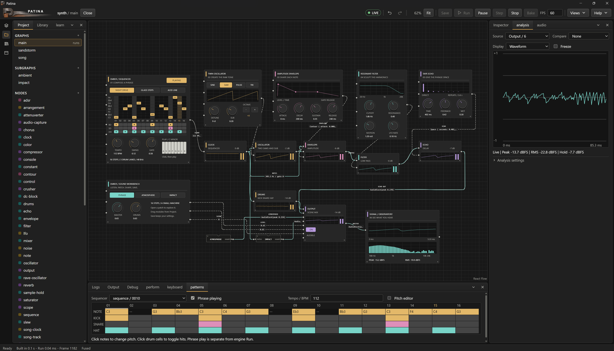

</div>

> **Patina 0.1 is the first release.** The editor, the engine and the command line work on
> Windows. The Linux and macOS builds are basic. [STATUS.md](STATUS.md) tells what works and the
> known limits. The [specification](docs/spec/README.md) is the full design. The
> [changelog](CHANGELOG.md) lists the changes of each release.

- [What Patina is](#what-patina-is)
- [Workbenches](#workbenches)
- [Nodes](#nodes)
- [Connections](#connections)
- [Views](#views)
- [Layers](#layers)
- [Clock domains](#clock-domains)
- [GPU](#gpu)
- [Install](#install)
- [Packages](#packages)
- [Run a project from the command line](#run-a-project-from-the-command-line)
- [How it is built](#how-it-is-built)
- [Status and roadmap](#status-and-roadmap)
- [Documentation](#documentation)
- [Contributing](#contributing)
- [License](#license)

## What Patina is

You make a graph of nodes, and the graph runs.

- Each node is Rust source code. You edit it in the editor.
- Patina compiles the whole graph to native machine code, optimized as one build.
- Patina finds the nodes that can run at the same time, and runs them in parallel. You give no
  hints.
- A change to one node recompiles only that node. The target is a few seconds. The rest of the
  graph stays optimized.
- A node can have its own interactive GUI. Views add custom panels to the editor, for example a
  timeline or a 3D viewport. With both, a project can become a tool with its own editors.

Patina does not limit what a graph does. Some examples:

- Sound effect editors
- Image and shader editors
- Automation pipelines
- Simulation
- Scientific data processing

Patina is the Rust successor to [PyFlowGraph](https://github.com/bhowiebkr/PyFlowGraph).

## Workbenches

Patina comes with eight workbenches. A workbench is a complete project that shows what a graph
can do. Open one from the start screen of the editor, click **Run** and change it. The
[workbench guide](docs/workbenches/README.md) explains the editor and each workbench, with many
images.

<table>
<tr>
<td width="50%" valign="top"><a href="docs/workbenches/hello.md">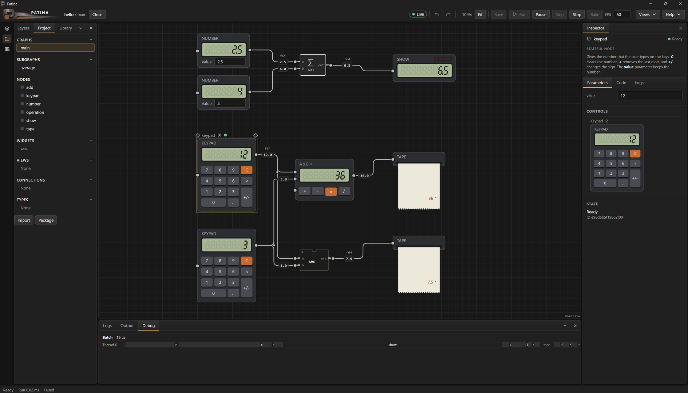</a><br><b><a href="docs/workbenches/hello.md">hello</a></b>: The smallest project: numbers, a keypad, a calculator and a subgraph. Start here.</td>
<td width="50%" valign="top"><a href="docs/workbenches/computer.md">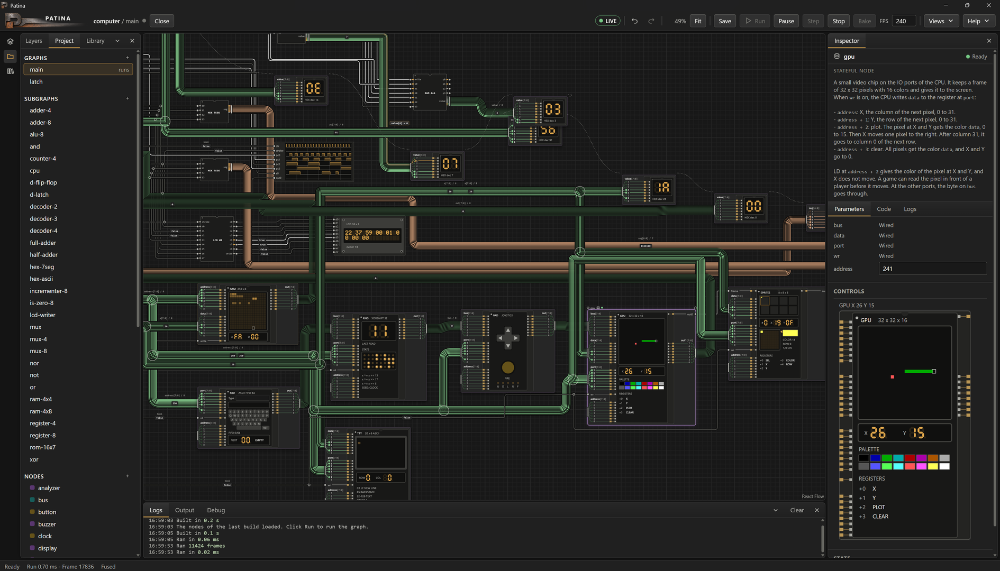</a><br><b><a href="docs/workbenches/computer.md">computer</a></b>: An 8-bit computer of NAND gates, with RAM, a video chip, a keyboard and displays.</td>
</tr>
<tr>
<td width="50%" valign="top"><a href="docs/workbenches/gpu.md">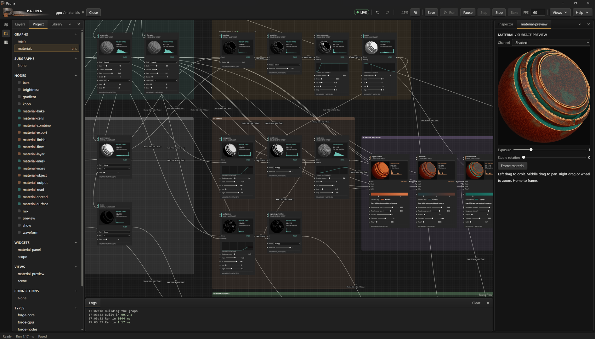</a><br><b><a href="docs/workbenches/gpu.md">gpu</a></b>: Smart materials on the GPU: noise, masks, layers and a material preview.</td>
<td width="50%" valign="top"><a href="docs/workbenches/synth.md"></a><br><b><a href="docs/workbenches/synth.md">synth</a></b>: Ember, a modular synthesizer: a sequencer, a synth voice, effects and analysis.</td>
</tr>
<tr>
<td width="50%" valign="top"><a href="docs/workbenches/model.md">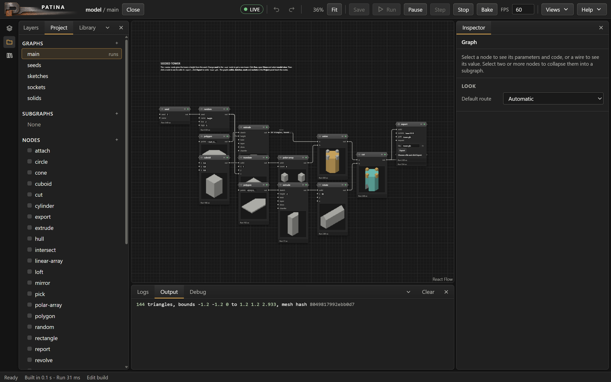</a><br><b><a href="docs/workbenches/model.md">model</a></b>: Procedural 3D models with solids, sketches, booleans and export.</td>
<td width="50%" valign="top"><a href="docs/workbenches/city.md">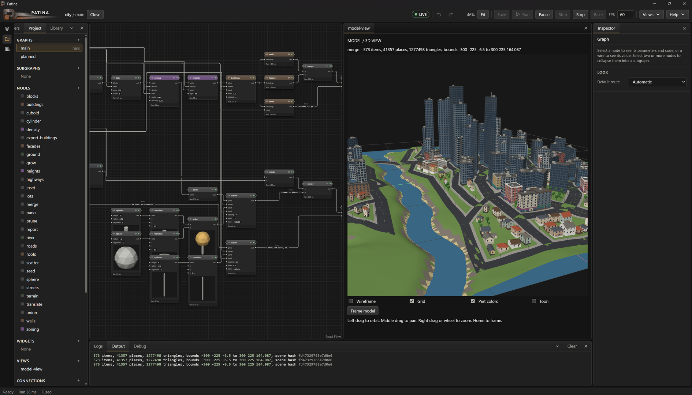</a><br><b><a href="docs/workbenches/city.md">city</a></b>: Seeded cities: terrain, a river, streets, lots and buildings in a 3D view.</td>
</tr>
<tr>
<td width="50%" valign="top"><a href="docs/workbenches/gun.md">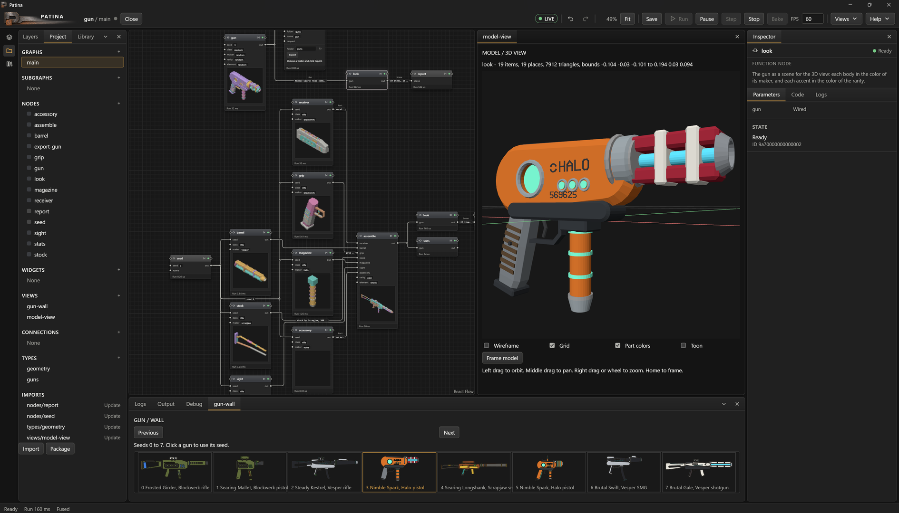</a><br><b><a href="docs/workbenches/gun.md">gun</a></b>: Seeded guns for a game, from the parts of four makers.</td>
<td width="50%" valign="top"><a href="docs/workbenches/laser-level.md">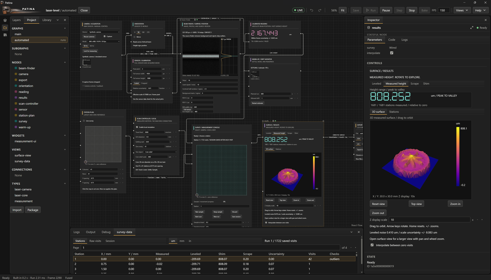</a><br><b><a href="docs/workbenches/laser-level.md">laser-level</a></b>: Surface measurement with a camera and a laser level, with a simulated scan.</td>
</tr>
</table>

## Nodes

A node is a Rust function with the `#[node]` attribute. Patina reads the signature and makes the
pins.
[Write a custom node](docs/custom-nodes.md) tells a person or an AI agent how to write the logic
and the look of a node.

```rust
#[node]
pub fn exposure(
    image: &Image,
    #[param(default = 0.0, min = -4.0, max = 4.0)] amount: f32,
) -> Image { ... }
```

- Each argument is an input pin. The return type is the output pin.
- An input pin with no wire is a parameter. The **Parameters** panel shows a slider, a check box
  or a text field for it. A parameter change needs no compile.
- A node can use any crate from crates.io.
- A node can return a `Result`. An error shows on the node, and the nodes after it do not run.
  They show **Skipped**. A panic also shows on the node, with the place in the code. It does
  not stop the engine.
- After a run, each node that ran shows its run time at the bottom, for example **Run 0.42 ms**.
- A node can write log lines with the `log` crate. Add the crate with **Add crate**, then call
  `log::info!`, `log::warn!` or `log::error!`. The **Logs** panel shows the lines of each run.
  Debug and trace lines do not show. A line from a thread that the node starts shows in the
  **Output** panel.
- `#[node(color = "#175c59")]` gives the node a colored header. The **Project** panel shows the
  color next to the node. A node with no color has a gray header.

A node that keeps data between runs is a struct:

```rust
#[node]
pub struct Counter { count: u64 }

impl Counter {
    pub fn init() -> Self { Self { count: 0 } }
    pub fn process(&mut self, step: u64) -> u64 {
        self.count += step;
        self.count
    }
}
```

A `ui` function in the node code draws the GUI of the node: buttons, sliders, curves, plots,
images, and a canvas for custom controls. The GUI shows small in the node and large in the
inspector. A node can also open its GUI in the whole graph area, for example a large curve
editor.

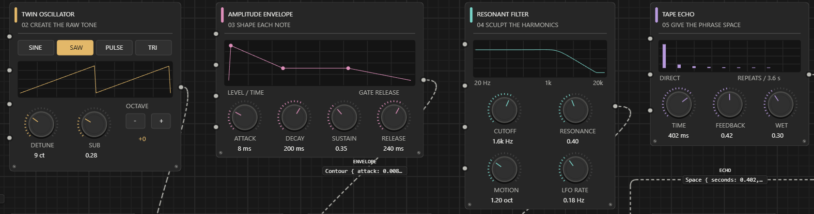

Nodes can also be generic or async. Patina does not define data types. Crates define them, and
two pins connect only when they have the same type.

Each node has its own folder, with its code, its GUI and its tests. Views, custom widgets and
data types have their own folders too. Another project can import a folder and reuse it. The
import is a copy. **Update** in the **Project** panel shows the changes in the original folder
and copies them when you confirm. To delete a folder, a subgraph or a top graph, right-click it
in the **Project** panel and click **Delete**. The folder goes to the Recycle Bin. When you
delete the open graph or the graph that runs, `main` or the graph that runs opens in its place.
The `main` graph cannot go.

A project can have more than one top graph, for example an empty canvas next to a finished
build. To make one, click **New graph** in the **Graphs** group of the **Project** panel and type
a name. The new graph uses the same nodes and subgraphs. Only one top graph runs: the last top
graph that you opened. The hint **runs** shows it. To run another top graph from the command
line, add `--graph <name>` to `patina-cli run` or `patina-cli package`.

To reuse nodes and subgraphs:

- Select nodes and push Ctrl+C, or use **Copy** in the right-click menu. Push Ctrl+V in the same
  editor, in a second editor or in another project. The paste brings the wires between the
  nodes and the subgraphs that they use. It imports the node folders that the project does not
  have from the source project.
- Add a Patina project in **Settings** > **Libraries**. The **Add node** palette then shows its
  nodes and subgraphs.
- To add a library from a Git repository, type its HTTPS URL in **Git URL** and a tag in
  **Tag**, then push **Add from Git**. An empty tag selects the newest tag. Patina downloads
  that tag into its data folder and pins its commit.
- Push **Browse libraries** to show the shared libraries of the index. Push **Add** to download
  the pinned tag of a library.
- Push **Check for updates** to compare the pinned tags with the repositories. Push
  **Update to** to download a newer tag. **Remove** deletes a downloaded copy, but not a local
  project.

```
image-pipeline/
  graphs/          the main graph and the subgraphs, with their connections
  nodes/
    curve-editor/  one node: its code, its GUI and its tests
  views/           custom panels
  widgets/         custom widgets for node GUIs and views
  connections/     connection kinds: how the wires of each type look
  types/           data types
```

Node code runs with your user rights. A project from another person opens read-only until you
trust it.

## Graph view

The graph view moves at once, with no animation.

- Turn the mouse wheel to zoom at the mouse pointer. A touchpad pinch also zooms.
- Drag with the middle mouse button to pan. You can also hold Space and drag.
- Drag on an empty area to select the nodes and the wires in a box.
- Press F to fit the selection. With no selection, F fits the full graph.

## Connections

A wire shows the value that it carries while the graph runs, as a node shows its state.

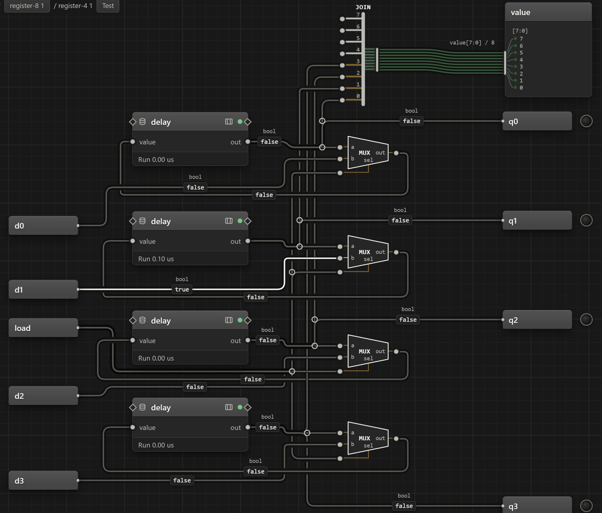

- A bus carries one value with many signals, for example the 8 bits of a byte. The wire shows
  each signal as a lane, and a lane lights when its bit is 1. A badge shows the value as text.
- The project defines how the wires of each data type look, with a connection kind. For
  example, a bus kind sets the lanes of a byte. A type with no connection kind shows one wire
  and its type name.
- Hold the pointer on a pin name to see its Rust type. The **Inspector** shows the type of the
  selected wire.
- By default, a wire goes around the nodes with straight lines and right angles. The wires of
  one output share a trunk. A wire can also be curved, orthogonal or a polyline with your bends.
  The look of a wire never changes what it connects.
- Double-click a wire to add a bend. With the keyboard, move the focus to a wire with Tab and
  push + or Insert. A default wire goes through each bend. Select the wire to
  set its look in the **Look** section of the **Inspector**: **Route**, **Corners** and **Reset
  route**.
- A selected orthogonal wire shows a bar on each middle segment. Drag a bar to move its segment
  sideways. The segments next to it stretch, so the wire stays connected. The arrow keys move a
  focused bar by 10 px, or by 1 px with Shift.
- A yellow "!" on a wire shows that the wire has no clear path around the nodes, for example
  because a bend is in a node body. Move the node or the bend. The graph still runs.
- Press Shift+L to arrange the selected nodes in columns, with the signal from left to right.
  With fewer than two nodes selected, Shift+L arranges the full graph.
- One output can feed many inputs. Splitting or joining a value takes a node. The wires of one
  output share a trunk, and a dot shows where they part. Where two wires of different outputs
  cross, the narrower wire has a small gap, so a crossing does not look like a join.
- During a wire drag, the sockets that fit the type get an amber ring, and the other sockets
  dim. The build does the full type check.
- To connect a wire to another socket, drag its end from next to the socket to the new socket.
  The wire keeps its name and its look. Undo puts it back.
- An order wire carries no data. It makes one node run before another node, for example for
  two writes to one file. Drag from the hollow diamond at the right of a node header to the
  diamond at the left of the other node header. The order wire shows as a dotted line. Select it
  and push Delete to remove it.

To add a connection kind:

1. In the **Project** panel, click the **+** of the **Connections** group, type a name and
   push Enter. The **Inspector** shows the start code of the kind.
2. In `src/lib.rs`, change the `#[connection]` function. It takes a reference to the value and
   gives its lanes:

   ```rust
   #[patina_sdk::connection]
   pub fn byte(value: &u8) -> patina_sdk::Lanes {
       patina_sdk::Lanes::bits(8, *value as u64).label("data")
   }
   ```

3. Run the graph. Each wire of that type shows its lanes and the label `data[7:0] / 8`.

To add your own type, click the **+** of the **Types** group. Then select a node or a
connection folder, click **Add crate** in its **Code** tab and type the name of the type folder.

## Views

A view is a custom panel in the editor. A project can add its own views, for example a timeline,
a 3D viewport for procedural generation, a scientific plot, or a spectrum display for a sound
tool.

- A view uses the same GUI API as node GUIs, and it can draw with the GPU.
- A view is not part of the graph, but it can read and change the graph: parameters, outputs,
  nodes and wires. It can also read and set the selected nodes.
- While the graph runs, a view can fire a `trigger` node with a text: `graph.fire(id, text)`.
  For a node in a subgraph use, the ID is `<use ID>/<node ID>`.
- Open a view from the **Views** menu. It docks like the other panels, and it can float in its
  own window. Each click opens a new instance with its own state, up to four.
- To make a view, click **+** in the **Views** group of the **Project** panel. Write the view in
  the **Code** tab. A save builds the view again.
- A view can show a viewport with `ui.viewport` and draw into it with `wgpu`, through
  `patina_gpu::ViewportSurface`. The `scene` view of `workbenches/gpu` is an example. On Linux and
  macOS, a viewport does not show yet.

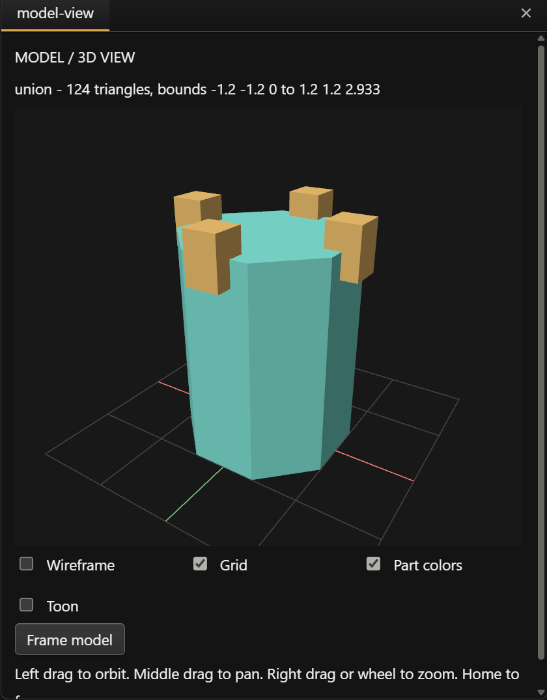

## Layers

Patina compiles a graph in two layers, so that the graph runs fast and your changes build fast.

- **The base** is the whole graph, compiled and optimized as one build. Small nodes are inlined
  into each other.
- **The slot** holds the node that you edit. Patina compiles that node alone and swaps it in
  while the graph runs. The target is a few seconds for each change.

When you open the code of a node, Patina makes a slot for it in the background. Each change to
the code then compiles only that node. If the code does not compile, the graph keeps running
with the last build that did.

When you open another node, stop editing for a while, or click **Bake**, Patina fuses the node
back into the optimized base.

Patina never runs the graph as separately compiled nodes. Only the node that you edit runs on
its own.

## Clock domains

Each node runs in a clock domain. The domain decides when the node runs.

| Domain | When it runs | Example uses |
|---|---|---|
| Batch | One time, when you click **Run** or an input changes | Data processing, export |
| Frame | Each display or simulation tick, at the frame rate of the project (60 FPS by default, **FPS** in the toolbar) | Interactive tools, previews |
| Audio | Each block of samples from the audio device | Sound effects, synthesis |
| Event | On a schedule, a webhook, a file change or a GUI event | Automation pipelines |

One graph can use more than one domain. A slow domain never stops a fast one.

A small icon in the node header shows the domain of the node. A wire between two domains has a
dashed line. A second icon, before the node name, shows the node kind: function, stateful,
generic, async, trigger or subgraph. Put the pointer on an icon to see its name.

## GPU

GPU support comes from crates and from `patina-sdk`, not from the engine.

- CUDA through `cudarc` and NVRTC, on NVIDIA.
- WESL shaders through `wgpu`, on NVIDIA, AMD, Intel and Apple. WESL is WGSL with imports,
  conditions and shader packages.
- GPU data stays on the GPU between GPU nodes.
- A shader change needs no Rust compile.

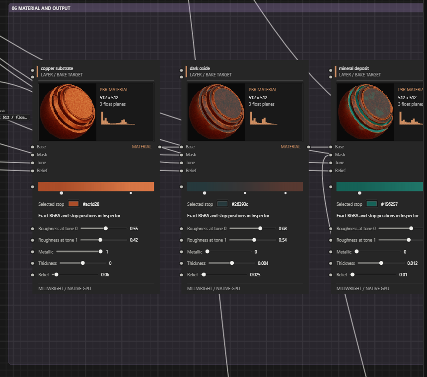

A node uses the GPU with the `patina-gpu` crate. Add `patina-gpu = { workspace = true }` to
the `Cargo.toml` of the node, and set Rust 1.97.1 or later in `patina.toml`. The workbenches use Rust 1.100.0. Keep the shaders
in the `assets/` folder of the node, and find them with `asset!("file.wesl")`. The
`workbenches/gpu` project draws a gradient with a WESL shader, shows a small copy in the GUI of
a preview node and writes its mean brightness.

A shader can import the shared functions of the `patina_gpu` package, for example
`import patina_gpu::image::luma;`. The `image` module has `luma` and `inside`. A node can also
link WESL text, for example a string from another node, with `link_source`. Run the example:

```
cargo +1.100.0 run -p patina-cli -- run workbenches/gpu
```

A node uses CUDA with the `patina-cuda` crate. `cuda()` gives the shared context, and
`Cuda::kernel` compiles CUDA C++ at run time. It needs the NVIDIA driver and the NVRTC library
of the CUDA Toolkit 12.

## Logic circuits

A graph can be a digital circuit. The `workbenches/computer` project has one node for the gate,
`nand`. The other gates, the adders and a 4-bit counter are subgraphs of NAND gates. Each frame
is one clock step. A `delay` node keeps a bit for one step, as a flip-flop does. A loop of gates
with no state needs no delay: each gate of the loop runs one time in each frame, and a wire back
gives the value of the frame before. So two NOR gates make a latch, as in a logic simulator. To build the circuits of Digital Logic Sim 2, see [Build the computers of Digital Logic Sim 2](docs/dls2-parity.md). Run the example and the latch:

```
cargo run -p patina-cli -- run workbenches/computer --frames 16
```

```
cargo run -p patina-cli -- run workbenches/computer --graph latch --frames 16
```

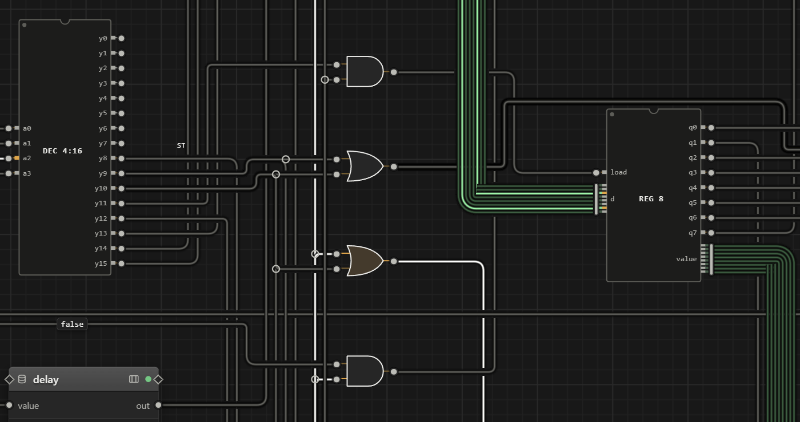

In the editor, a 1-bit wire is lit when it is true. Run the project and double-click a use of a
subgraph, for example the `cpu` node, or click its **Open subgraph** button. The subgraph opens
with the live values of that use. The path bar shows each use from the main graph, for example
**main / cpu / alu-8**. Click a name to go back to that graph.
To see the inside of a use with no change of graph, click **Show inner nodes** in its header. The
use becomes a frame with its inner nodes and their live values. Click **Hide inner nodes** to
close it. To edit the inner nodes, open the subgraph.
To test a subgraph alone, open it and click **Test** in the path bar. Click the switch at the left
of an input to toggle it. The lamp at the right of an output shows its value. Click **End test**
to return. The **Graphs** group of the **Project** panel lists the subgraphs. Click one to open
it, or drag it into the graph to add a use.
In an open subgraph, click an empty part of the graph to see the **Subgraph interface** in the
**Inspector**. It lists the public pins in the order of each use. Use it to rename, move, add
and remove pins. The **Public node preview** shows the use.
A `switch` node shows a check box in its **on** row. Click it to set the bit. Three `display`
nodes show the count, and the OUT register of the CPU as two hex digits on 7 segments.
Each display gets one copper bus with the lanes a to g. Put the pointer on a lane or on a
contact of a bus socket to see the name and the state of that lane.

Each frame writes ten lines: the count, the count plus 3, an accumulator that adds 5 at each
step, a memory, the three registers of the CPU and the segments of the three displays. A
`register-4` subgraph keeps 4 bits, and takes new bits when its **load** input is on. The
`ram-4x4` subgraph keeps 4 words of 4 bits. It writes the accumulator to the address of the
count, so it shows the accumulator of 4 steps before.

The `cpu` subgraph is an 8-bit computer of 794 NAND gates. At each tick of its **clk** input, it
runs one instruction from the `program` node, which keeps 256 instructions. Lines 5 to 7 of a
frame show its program counter, its register A and its OUT register. The CPU also has the index
register X, the carry flag C and the zero flag Z. The instructions have a 4-bit opcode and an
8-bit value k:

- **LDI k** (0): A takes k.
- **ADDI k** (1): A takes A + k. C takes the carry.
- **SUBI k** (2): A takes A - k. C is on when there is no borrow, so when A was k or more.
- **ANDI k** (3): A takes A and k, bit by bit.
- **LD k** (4): A takes the byte at address k.
- **ADD k**, **SUB k** and **AND k** (5 to 7): as ADDI, SUBI and ANDI, with the byte at address k.
- **ST k** (8): the byte at address k takes A.
- **STX k** (9): the byte at address k + X takes A.
- **LDX k** (10): A takes the byte at address k + X.
- **TAX** (11): X takes A.
- **OUT** (12): OUT takes A.
- **JMP k** (13): the program counter takes k.
- **JC k** (14): the program counter takes k when C is on.
- **JZ k** (15): the program counter takes k when Z is on.

Z takes "A is 0" each time that A takes a new value. Addresses 0 to 239 (0x00 to 0xEF) are the
RAM, and addresses 240 to 255 (0xF0 to 0xFF) are the IO ports. The `ram` node is the RAM chip,
with 256 bytes. It is a Rust node, and the CPU stays NAND gates. The node shows the byte at the
last address. Expand it to see all bytes in hexadecimal. A mark shows the last address, and the
last byte that the CPU wrote is lit.

Inside the `cpu`, a `decoder-4` subgraph gives one line for each opcode. Bits 0 and 1 of the
opcode select the function of the `alu-8` subgraph: b, a + b, a - b or a and b. Bit 2 selects the
byte at the address in place of k. An `adder-8` subgraph adds X to k for STX and LDX. The
`incrementer-8` subgraph gives the next program counter, and `is-zero-8` gives Z.

The `program` node is the program memory, with an assembler. Its **file** parameter is an
assembly file of the project, for example `programs/fibonacci.asm`. The **File** dropdown of the
node lists the `.asm` files of the project. Select a file to run its program. To start a new
program, click **New** in the **Inspector**. The node writes `programs/new1.asm` and selects it.
Undo puts back the last file. To change the program:

1. Select the node. For more room, click the expand button of the node.
2. Edit the code in the **Program** field.
3. Click outside the field, or press Ctrl+Enter.

The node assembles the code and writes the file. You can also edit the file in another editor.
The node reads the changed file in half a second. The expanded node fills the graph area and shows
the line numbers. A band marks the line that runs, and each line with an error is red. Hold the
pointer on a red line number to see the error. **Back** or Esc returns to the graph, and the graph
keeps running. When the code has an error, the node shows the line of the error, and the CPU runs
the last good program. The **Memory** list shows 16 of the 256 words, around the program
counter. The word at the program counter is lit. Bits 0 to 7 of a word are k, and bits 8 to 11
are the opcode.

A line of code has an optional label `name:`, an optional instruction and an optional comment
after `;`. A line `NAME = number` gives a name to a number, for example `KEY = 0xF0`. A value k
is a number from -128 to 255, a label or a name. For example, write `12`, `0xC`, `0b1100` or
`-1`. A negative number gives its byte in two's complement, so -1 gives 255. Names are not
case-sensitive.

The example program writes the Fibonacci numbers 1, 1, 2, 3, 5 to 233 to OUT. It keeps the last
two numbers in the RAM. At the carry of the next sum, it starts again.
Select `programs/count.asm` for a program that counts up. The `rom-16x7` subgraph is a
program memory of `switch` nodes, one for each bit.

The `clock` node gives the ticks of the CPU. It gives one tick each **every** frames. The
example project runs at 240 frames each second, so the CPU runs 60 instructions each second. To
change the speed, set **FPS** in the toolbar (1 to 100000), or set **every** in the **Inspector**.
To stop the clock, click **Pause** on the node. This sets **halt**. Then click **Step** to give one
tick, and the band of the `program` node goes to the next line. Click **Run** to start the clock
again. The LED of the node is lit for the first half of each period.

The **address** output of the CPU is the address of the instruction, and its **a** output is A.
Its **write** output is on during an ST or an STX to the RAM, and its **mem** input is the byte
of the RAM. Its **wr** and **rd** outputs are on during a write or a read of an IO port. Its
**io** input is the byte that a read of an IO port gives. The main graph has seven devices on the
ports:

- `keyboard` (port 0xF0): type a text into the **Type** field and press Enter. The characters and
  an Enter key (13) go into a buffer. LD 0xF0 reads the first key, or 0 when the buffer is empty.
- `terminal` (port 0xF0): ST 0xF0 writes the ASCII character A, on 6 lines of 20 characters.
  Enter (13) starts a new line, and backspace (8) removes the last character.
- `gpu` (ports 0xF1 to 0xF4): a video chip with a frame of 32 x 32 pixels in 16 colors. ST 0xF1
  sets X, ST 0xF2 sets Y, and ST 0xF3 plots the color A at X and Y. Then X moves to the next
  pixel. ST 0xF4 fills the frame with the color A. LD 0xF3 reads the color of the pixel at X and
  Y, and X does not move.
- `sprites` (ports 0xF9 to 0xFD): 8 sprites of 8 x 8 pixels over the frame of the `gpu`. ST 0xF9
  selects sprite A. ST 0xFA sets its X, and ST 0xFB sets its Y. ST 0xFC sets its color, and color
  0 hides it. ST 0xFD writes the next row of its pattern, and bit 7 is the left pixel. A new
  sprite is one dot, so two writes move it. Sprite 0 is on top of the other sprites.
- `screen`: shows the frame of the `sprites` node.
- `random` (port 0xF5): LD 0xF5 reads a random byte, and each LD gives a new byte. At the other
  ports, the byte on its **bus** input goes through to the **io** input of the CPU.
- `joystick` (ports 0xF6 to 0xF8): click the pad, then hold the arrow keys or W, A, S and D, and
  Space for fire. LD 0xF6 reads the x axis: 1 for right, 255 for left, else 0. LD 0xF7 reads the
  y axis: 1 for down, 255 for up. LD 0xF8 reads the bits of the buttons: 1 up, 2 down, 4 left,
  8 right and 16 fire.

Select `programs/echo.asm` in **File** to show each key on the terminal. Select
`programs/stripes.asm` to paint the screen. Select `programs/noise.asm` or
`programs/confetti.asm` to paint random pixels. Select `programs/dice.asm` to show a random
number on OUT at each key. Select `programs/paint.asm` to paint with the joystick. Select
`programs/snake.asm` to play Snake, and set **every** of the `clock` to 1. The programs
give names to the ports, for example `KEY = 0xF0`. The **address** parameter of a device sets its
first port. The `cpu` has one **io** input, so the devices are a chain: `keyboard` to `random` to
`joystick` to `gpu` to the CPU.

The `monitor` view draws the screen on the real GPU, with a dark gap between the pixels. Open it
from the **Views** menu. Click the screen of the view, then push the arrow keys and Space to play.
The keys go to the `joystick`, as the keys of its pad do.

In the editor, the `readout` nodes show a byte as 8 lamps and as a number. The `join` node
puts 8 bits into a byte. The `byte` connection kind draws each byte wire as a ribbon of 8
lanes, with the label `bus[7:0] / 8`. Each readout gets one byte wire from an output of its
subgraph, for example **value**, or **pc**, **a** and **out** of the `cpu`.

The data path of the `cpu` also uses byte wires. The `register-8`, `ram-4x8`, `adder-8`,
`mux-8`, `alu-8`, `incrementer-8` and `is-zero-8` subgraphs have byte inputs and outputs. Inside
them, a `split` node gives the 8 bits of a byte, and a `join` node makes the byte output. The
`program` node gives the opcode and k as two bytes.

The `lcd` node shows 2 lines of 16 characters. The **strobe** output of the `cpu` is on in the tick of an OUT
instruction. The `lcd-writer` subgraph then writes the two hex digits of OUT and a space to the
LCD, one character at each step. Its `hex-ascii` subgraph gives the ASCII code of a hex digit,
`0` to `9` or `A` to `F`.

The `analyzer` node is a logic analyzer. It draws the last 96 frames of its 8 inputs as
waveforms, the newest at the right. Its **names** text labels the channels, separated by commas.
In the example, it shows the clock, the strobe, the PC bits, A0 and OUT0.

## Install

Patina comes in two editions, on GitHub Releases. Release 0.1 has only the portable edition.

- **Portable:** a zip file, for Windows and Linux. Patina runs from its folder and keeps
  everything in it. It needs no admin rights and makes no changes to the system.
- **Installed:** the installer of your system. An `.msi` file on Windows, a `.dmg` file on
  macOS, and a `.deb` package or an AppImage on Linux. The installers come in a later release.

Windows is the main platform. The Linux and macOS builds are basic, and contributors who use
those systems improve them.

To start the portable edition:

1. Download the zip of your system from
   [GitHub Releases](https://github.com/bhowiebkr/Patina/releases).
2. Unzip the file.
3. Start `patina`.

The program has no code signature yet. Thus Windows SmartScreen can show **Windows protected
your PC** the first time. Click **More info**, then **Run anyway**.

The `workbenches` folder of the portable edition has the example workbenches, for example
`computer` and `synth`.

The installers are not available yet. These steps are for a later release. To install on
Windows:

1. Run the `.msi` file.
2. Select **Just me** or **All users**. **Just me** needs no admin rights.

To install on macOS:

1. Open the `.dmg` file.
2. Drag Patina to **Applications**.
3. Start Patina. The first time, macOS blocks it, because the build is not notarized.
4. Open **System Settings > Privacy & Security**, and click **Open Anyway**.

In both editions, open **Settings** and click **Install toolchain** the first time. Patina
downloads Rust and Zig, the C compiler, into its toolchain folder. The download is about 265 MB.
In this version, the button works only on Windows. Without the toolchain, Patina uses the Rust
of your system. The toolchain also has rust-analyzer, which gives completion and hover in the
**Code** tab of a trusted project. Later versions also install NVRTC for CUDA nodes as an option.

Neither edition changes your `PATH` or installs Rust for the whole system. The installed
edition keeps the toolchain and your projects in your user folders, and they stay when you
uninstall Patina. To uninstall the portable edition, delete its folder.

Some systems need one more thing. macOS can need the Xcode Command Line Tools. Linux needs
WebKitGTK, which most desktop distributions include.

## Packages

A finished graph can become a package that runs without the editor:

- An executable. The graph inputs become command-line arguments.
- A library with a C API, to call from other software.
- A Python module. It comes in a later release.

To call a package from C, load `patina_capi.dll` (`libpatina_capi.so` on Linux) of the
package and include `patina_capi.h`. Then call `patina_open` with the package folder.
Call `patina_run` for the batch nodes, `patina_frame` for one frame, `patina_block` for one
audio block and `patina_events` for a number of event runs.

A package holds the full source of the project. The editor can open a package and show the
original project. A package also holds the license notices of Patina and of the crates in it.

## Run a project from the command line

`patina-cli` builds the main graph of a project and runs it one time. It needs Rust, with the
version that `patina.toml` gives. It uses the `toolchain` folder next to it. When that folder
has no Rust, it uses the Rust of your system. To run the example project from a checkout of this
repository:

```
cargo run -p patina-cli -- run workbenches/hello
```

The example adds two numbers and writes `6.5`. A node that fails or panics gives a message with
its ID. The nodes after it do not run, and each one gives a `skipped` message. The exit code is
then 1.

A graph with frame nodes runs its batch nodes one time. Then it runs the frame nodes at 60
frames each second, until you push Ctrl+C. Ctrl+C stops the graph cleanly, and the exit code
is 130. Push Ctrl+C again to end the CLI at once. To run a number of frames and then stop, add
`--frames <count>`:

```
cargo run -p patina-cli -- run workbenches/hello --frames 3
```

The run stops at the first frame in which a node fails.

A graph with audio nodes also runs blocks of 256 audio samples, 187.5 blocks each second. The
blocks run on their own thread, at the same time as the frames. To run a number of blocks and
then stop, add `--blocks <count>`. The frames then run until the blocks are done, and the
blocks run until the frames of `--frames` are done.
In the editor, **Run** runs the blocks with the frames until **Stop**.
When a node plays sound, the CLI opens the default audio device. The device then sets the pace
of the blocks. A node plays a block with `patina_sdk::audio::play(&block)`.

A graph with event nodes starts a run each time a trigger node fires. A `schedule` node fires
at each `every_ms` milliseconds. A `trigger` node fires one time at the start of the CLI run.
A `file_change` node fires when a file at its `path` changes, and gives the path of the file.
A `webhook` node fires for each `POST` to `http://127.0.0.1:<port><path>`, and gives the body.
A `pub async fn` node can wait in its run, for example for a timer of `patina_event::tokio`. Its
`Cargo.toml` then has `patina-event = { workspace = true }`. To stop after a number of runs, add
`--events <count>`. Each log line and report of a run starts with **Run <ID>:**.
The CLI runs the event runs at the same time as the frames and the blocks.
In the editor, **Run** starts the triggers, and the event runs go on with the frames and the
blocks until **Pause** or **Stop**. A `trigger` node does not fire at the start. Click the
**Fire** button in its header to fire it.
An async node with no inputs gets its runs from an order wire from its trigger (see
[Connections](#connections)).

## Render audio

Render a saved audio graph to a WAV file without opening a sound device:

```
cargo run -p patina-cli -- render workbenches/synth ember.wav --seconds 16
```

The file contains stereo, 32-bit float audio at 48 kHz. The command never replaces an existing file.
Add `--edit` for an Edit build, or `--graph <name>` to select another top graph.
The render uses saved parameters. It does not record live controls or add an end fade.
Graphs with event nodes cannot render offline.
See the [Ember guide](workbenches/synth/README.md) for the sound modules and learning exercises.

## Make a package

`patina-cli package` builds a project and writes a folder that runs without Rust:

```
cargo run -p patina-cli -- package workbenches/hello hello-pkg
```

To run the package, start the program in the folder. Give a new value to a parameter with
`<node ID>.<input key>=<value>`:

```
hello-pkg/hello-pkg 9bc1790966687030.value=1
```

The example then writes `5`. Add `--edit` to the `package` command for a faster build with less
optimization.

## Open the editor

In the portable edition, start `patina`. To start the editor from a checkout of this
repository, you need Rust and Node.js:

1. In `crates/patina-editor/frontend`, run `npm ci` and then `npm run build`.
2. In the root folder, run `cargo run -p patina-editor`.

The editor binary holds the page. After a change to the page, run `npm run build` again, then
build the editor again.

To make your first graph:

1. On the start screen, click **Open** next to **hello** in the **Workbenches** box. In a
   checkout of Patina, click **Open project** and select the `workbenches/hello` folder. A new
   project has no nodes. To make a node, see the next part.
2. Drag `number` and `show` from the **Project** panel into the graph. You can also
   double-click an empty area of the graph, type a part of the name and push Enter.
3. Drag from the output of `number` to the input of `show`. You can also drag from a pin into
   an empty area. The palette then shows the nodes that fit the pin, and connects the node that
   you add.
4. Select `number`, and type a value in the **Inspector**.
5. Click **Run**. The **Output** tab shows the value, and a badge on the wire shows it too.
6. Click the wire. The **Inspector** shows the full value.
7. Push Ctrl+S to save the project.

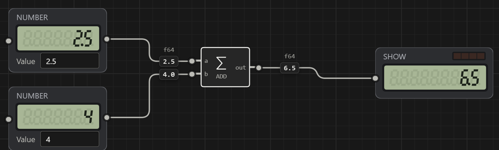

To make a new node, click **+** in the title of the **Nodes** group of the **Project** panel.
Type a name and push Enter. The **Inspector** shows the code of the new node. Edit the code
and push Ctrl+S. Undo removes the new folder while it has only its start files.

To use a crate of crates.io in a node, click **Add crate** in the **Code** tab of the node. Type
the name, for example `rand` or `rand@0.9`, and push Enter. The `Cargo.toml` tab shows the new
dependency, and the next build downloads the crate. Undo removes it.

While the graph runs, a change of a parameter runs it again. Click **Pause** to stop the runs.
Click **Step** to run one frame of the paused graph, for example one clock tick of a computer.
Click **Stop** to also end the active run: Patina starts no new node call. The nodes that did
not start show **Stale**. A node with a long loop can read `patina_sdk::stop_requested()` and
return early. When the status bar shows that a node does not stop, click **Stop** again to end
the node process. The node states are lost, and the next run starts a new node process.

The editor runs the nodes in a separate node process. When a node crashes, the editor stays
open. The **Output** tab and the status bar show the exit code, and on Windows also the node
that ran. Click **Run** or change the graph to start a new node process.

Click **Settings** on the start screen to see the Rust toolchain, the data folders and the
trusted projects. When the toolchain folder is empty, Patina uses the Rust of your system. Click **Remove** to take a project off the trusted list. Patina then asks
again before it builds the project.

Click **About** on the start screen, or **Help** and then **About Patina**, to see the version, the license and the GitHub page of Patina.
Click **Check for updates** to compare it with the newest release on GitHub. Patina does not
connect to the network before you click this button.

If Patina stops before you save, it keeps your changes. When you open the project again, click
**Restore** to get them back, or **Discard** to delete them.

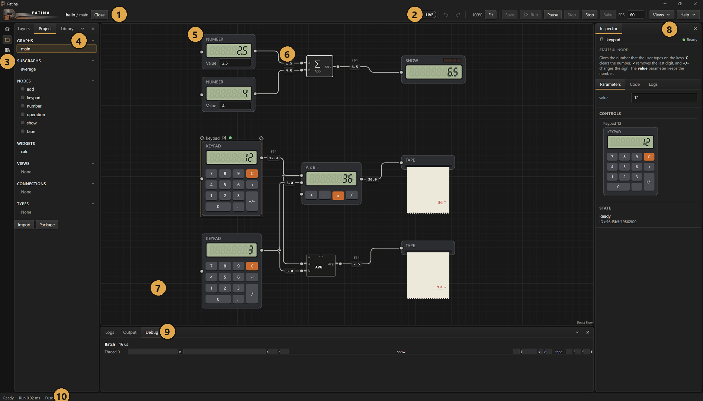

The [editor at a glance](docs/workbenches/README.md#the-editor-at-a-glance) explains each
numbered part of the image. The panels dock at the left, the right and the bottom of the graph:

- Drag a tab to another area, or right-click the tab to move or close it.
- Drag the line between an area and the graph to change the size of the area.
- Use the **Views** menu to show or hide a panel. **Reset layout** gives the default layout.
- Click the icon of the active panel in the rail at the left edge to fold the left area. This
  gives the graph more room. Click an icon again to unfold the area.

Patina keeps the layout and the pan and zoom of each project for each user.

## How it is built

| Part | What it does |
|---|---|
| `patina-engine` | Compiles the graph in layers, schedules it and runs it. No UI code. |
| `patina-editor` | The desktop app: Tauri 2 with a web frontend. |
| `patina-cli` | Runs a project or a package from the command line. |
| `patina-sdk` | The crate that node and view code uses: the `#[node]` and `#[view]` macros, the `Ui` API, the `Graph` handle, viewers, buffer pools and the GPU context. |

All code is Rust, except the web frontend of the editor.

## Status and roadmap

All milestones of this roadmap ended. [STATUS.md](STATUS.md) gives the results and the known
limits. Each milestone gave a tool that works.

0. **Risk prototypes**, proven on Windows first:
   - Rust types across two compiled clusters, with a shared Rust library, and type keys that
     catch a changed type.
   - Hot reload with new file names, with the memory and disk growth measured.
   - The toolchain on a clean Windows computer with no Visual Studio, with Zig as the C compiler
     and linker for crates with C code.
   - A GPU viewport in a panel of the editor window that docks, floats and resizes.
   - A graph view that draws many wires and buses with live values at 60 FPS.
1. Engine: compile one node, load it, and run a simple graph from the command line.
2. Editor: the dock layout, the **Project** panel, the node editor, the code editor, node
   states, errors, value viewers, and wires with bends and live values.
3. The **Install toolchain** button, the portable zip and the installers.
4. Automatic parallelism and the frame domain.
5. Stateful nodes, node GUIs with the full size, custom widgets and generic nodes.
6. Layers: clusters, the base, the slot, fuse back and **Bake**.
7. Subgraphs, and the import and update of folders from other projects.
8. Packaging.
9. GPU.
10. Views.
11. Audio domain.
12. Event domain.

One design question is still open: does Zig remove the need for the Xcode tools on macOS? A
test on a Mac answers it.
[Section 18 of the spec](docs/spec/16-roadmap.md#18-open-questions) lists it and the decided
questions.

## Documentation

- [Changelog](CHANGELOG.md): the changes of each release. Patina uses semantic versioning.
- [Workbench guide](docs/workbenches/README.md): the editor at a glance and one illustrated
  page for each workbench: [hello](docs/workbenches/hello.md),
  [computer](docs/workbenches/computer.md), [gpu](docs/workbenches/gpu.md),
  [synth](docs/workbenches/synth.md), [model](docs/workbenches/model.md),
  [city](docs/workbenches/city.md), [gun](docs/workbenches/gun.md) and
  [laser-level](docs/workbenches/laser-level.md).
- Workbench READMEs, with the full lists of nodes and limits:
  [hello](workbenches/hello/README.md), [computer](workbenches/computer/README.md),
  [gpu](workbenches/gpu/README.md), [synth](workbenches/synth/README.md),
  [model](workbenches/model/README.md), [city](workbenches/city/README.md),
  [gun](workbenches/gun/README.md) and [laser-level](workbenches/laser-level/README.md).
- [Specification](docs/spec/README.md): the full design, in one file for each group of
  sections.
- [Write a custom node](docs/custom-nodes.md): the logic, the GUI, the canvas and the free
  layout of a node, with examples.
- [GUI visual guide](docs/gui-visual-guide.md): the palette, the node sizes, the shared controls
  and the connections.
- [History](docs/history.md): the records of the ended milestones and of the finished work.
- [Circuit graph design](docs/circuit-graph-design.md): buses, ribbon wires and logic circuits.
- [Gate speed](docs/gate-speed.md): why a NAND circuit is slower than in Digital Logic Sim 2,
  and the plan to make it faster.
- [Performance audit](docs/performance-audit.md): execution and display costs, measured checks,
  and proposed improvements for complex graphs.
- [Workbench plan](docs/workbenches-plan.md): the split center area, the name "workbench" for
  the included projects, and the 3D model, city and gun workbenches.
- [Smart material workbench plan](docs/smart-material-workbench.md): the Surface source study,
  material contracts, node design and integration milestones.
- [Laser measurement design](docs/laser-measurement-design.md): nodes and views for a laser
  measurement tool.
- [Before building](docs/before-building.md): the setup, prototypes and decisions that are still
  open, by milestone.
- [Owner feedback of 2026-11-19](docs/feedback-2026-11-19.md): the work list from the test of
  all workbenches.
- [Architecture](docs/architecture.md): the crates, the engine layers, the path from an edit to
  a frame, and the threads.
- [Quality plan](docs/quality-plan.md): the review of the code quality, the architecture and the
  speed, and the plan to fix them before more major work.
- [AGENTS.md](AGENTS.md): working rules for AI agents in this repository.

## Contributing

Issues and pull requests are welcome, from people and from their AI agents. At this stage, a
report about a gap or a contradiction in the spec helps as much as a report about code. Agents
follow the rules in [AGENTS.md](AGENTS.md).

A source file can have 1000 lines at most. When a file gets longer, refactor it.
`cargo test --workspace` checks this limit.

Windows is the main platform. If you use Linux or macOS, your tests and fixes for that system
are welcome. They are the way those builds get better.

To make the portable zip from a checkout:

1. In `crates/patina-editor/frontend`, run `npm ci` one time.
2. In the root folder, run `cargo run -p package`.

The zip goes to `target/package`. On Linux, the `zip` program must be installed.

## License

Patina is under two licenses. You can use it under the license that you choose:

- The [MIT license](LICENSE-MIT)
- The [Apache License 2.0](LICENSE-APACHE)

A contribution that you send for inclusion in Patina is under the same two licenses, with no
other terms. This applies unless you clearly write otherwise. The word "contribution" has the
meaning that the Apache License 2.0 gives it.
