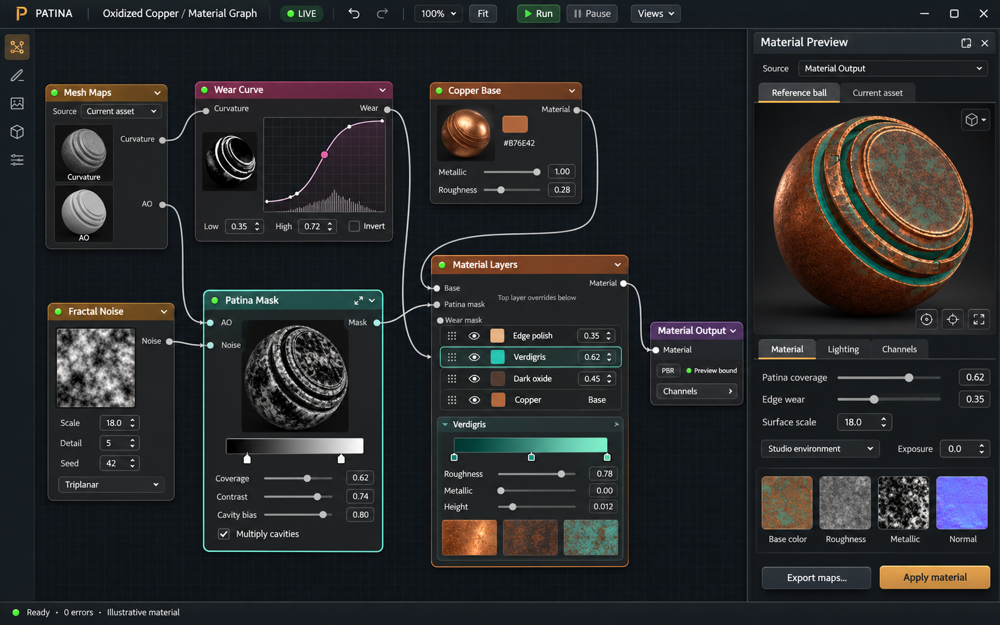
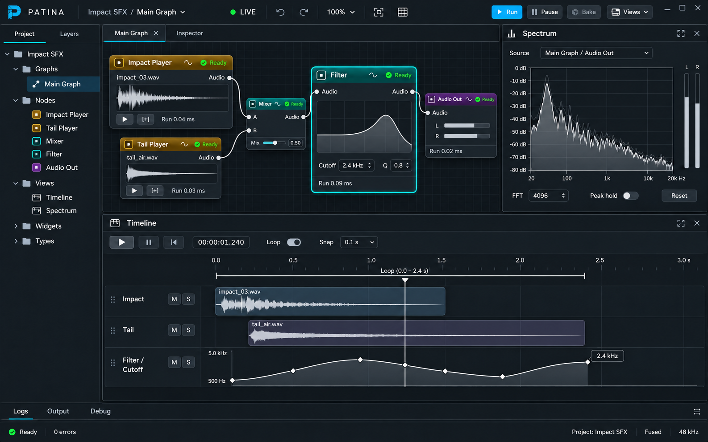
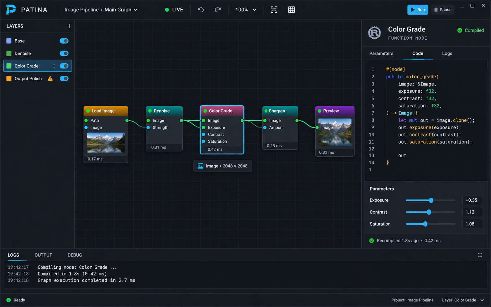
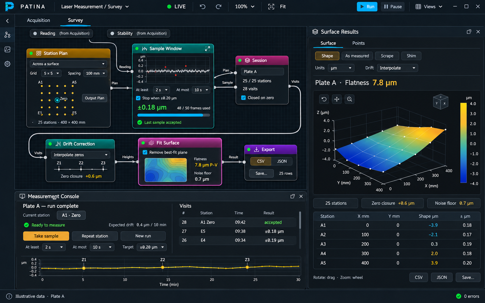
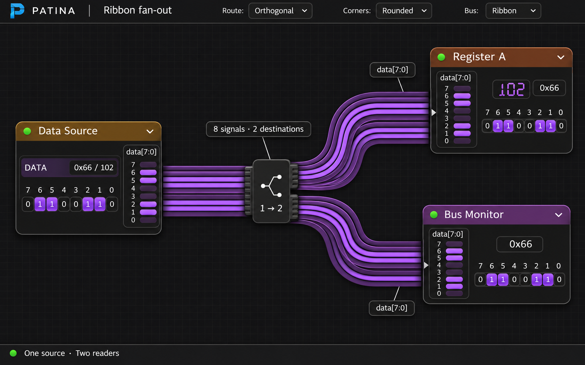
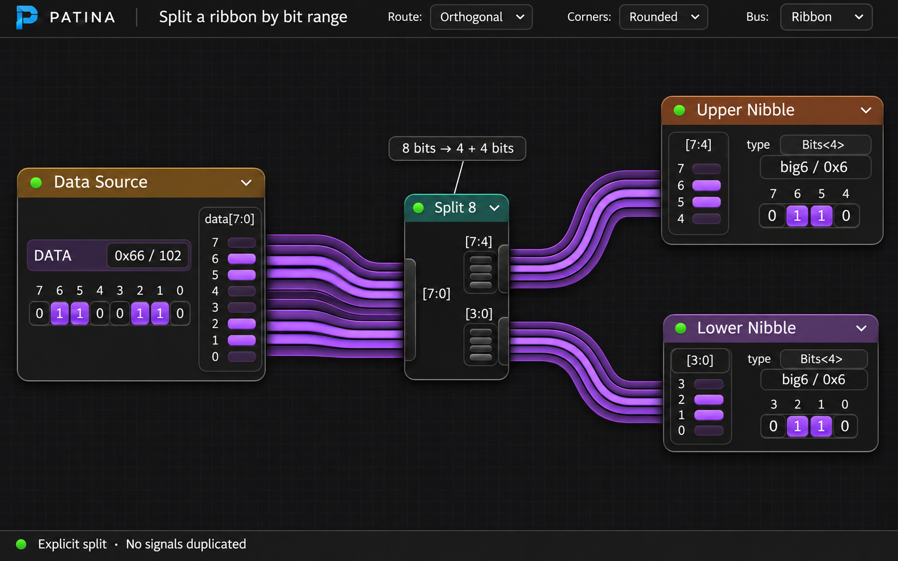
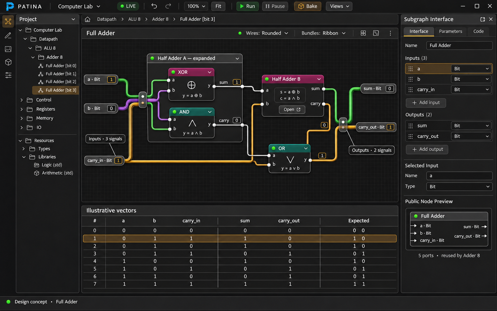
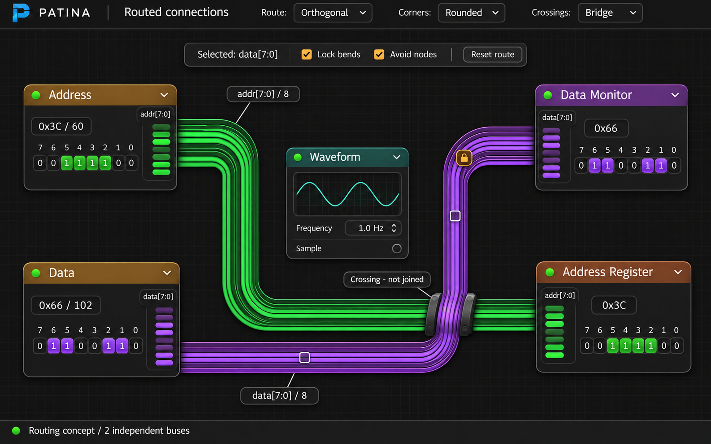
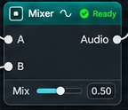
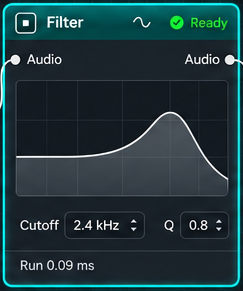

# Patina: illustrated GUI implementation guide

**Purpose:** make the editor, custom nodes and project-specific tools look and
behave like one application. **Primary visual reference:** mockup 9.
**Platform:** Windows first. **Updated:** 2026-11-15.

The **Aged Dovetail** emblem above is the logo. The owner selected it on 2026-11-15,
concept 03 of [contact sheet 04](mockups/branding/patina-logo-contact-sheet-04.png).
[assets/branding](../assets/branding/README.md) has the extracted pieces, the icon
sizes and the resolution limits. The artwork has no text: the application draws
the name **Patina**. Use the aged steel and rust treatment only in branding
artwork, never on controls. The blue faceted logo of the earlier mockups and the
plain amber P of mockup 9 are historical.

## The visual reference set

Each thumbnail leads to its illustrated implementation chapter.

| Main theme: material editor | Custom node controls | Docked audio tools | Readable automation |
|---|---|---|---|
|  |  |  |  |

| Editor structure | Error handling | Scientific acquisition | Measurement workstation |
|---|---|---|---|
|  |  |  |  |

| Ribbon appearance - accepted | Full-bus fork | Bit-range split | Individual breakout |
|---|---|---|---|
|  |  |  |  |

| Computer workbench | Subgraph interface | Workbench with ribbons | Subgraph with cables |
|---|---|---|---|
|  |  |  |  |

## How to use this guide

Read this file before GUI work. Then read the guide files for your task:

- Read the theme and palette for each GUI task.
- Read the shared controls when you make or change a control, a panel or a node GUI.
- Read the connections when you work on wires, buses or routes.
- Read the notes of each mockup that shows the feature.

| Guide file | What it teaches |
|---|---|
| [Theme and palette](gui-visual-guide/theme.md) | Sampled evidence, neutral colors and focus rules |
| [Shared controls and implementation](gui-visual-guide/controls.md) | Typography, shell and docking, pins and reusable widgets |
| [Connections between nodes](gui-visual-guide/connections.md) | Connection meaning, route editing, node clearance, crossings, extension cases and mockup 16 |
| [Editor mockups](gui-visual-guide/editor-mockups.md) | 9 smart material editor (the main theme reference), 1 main editor and 3 error view |
| [Custom GUI mockups](gui-visual-guide/custom-gui-mockups.md) | 4 custom node canvas, 5 custom views and 6 automation graph |
| [Laser mockups](gui-visual-guide/laser-mockups.md) | 7 laser acquisition and 8 laser survey |
| [Circuit mockups](gui-visual-guide/circuit-mockups.md) | 10 to 15: nested subgraphs, public interfaces, ribbon buses, fan-out, split and breakout |

Start with the full layout, then inspect the cutouts beside its implementation
notes. The cutouts are **original pixels**, not generated redrawings. They are
saved under [mockups/details/](mockups/details/) as reusable visual references.
The [crop manifest](mockups/details/crops.json) records each source and rectangle.

The [spec](spec/README.md) defines architecture and behavior. The images establish
visual direction. Written corrections identify things to fix rather than copy.
The exact palette values in the theme file are **proposed implementation tokens**;
the owner selected mockup 9 as the strongest theme reference, not a list of
previously approved hex values.

## The GUI concept

Patina is an editor for building tools. A material editor, an audio tool and a
measurement instrument use the same window shell, control style, graph language
and docking behavior. Their content changes; their basic UI vocabulary does not.

There are four cooperating pieces:

| Piece | Responsibility | Recognizable appearance |
|---|---|---|
| Editor shell | Project navigation, graph, inspector, logs and layout | Neutral panels, stable toolbar and status bar |
| Node GUI | Parameters and immediate feedback for one computation | Colored header, named pins, body sized around its controls |
| Custom view | A workspace spanning one or more nodes | Neutral dock tab, source/selection controls, no graph pins |
| Reusable widget | A consistent editing interaction | Same curve, ramp, field or table behavior wherever it appears |

A node is allowed to be an instrument, not just a title and a list of sockets.
A custom view can turn the graph into a practical tool for someone who rarely
needs to inspect its wiring.

### Shape is information

These two cutouts demonstrate why node size must follow the task:

| Small mixing junction | Larger response editor |
|---|---|
|  |  |
| Two inputs, one output and a mix amount. Its job is understood immediately. | The response curve needs area; frequency and Q need precise controls. |

Do not stretch the Mixer to the Filter's height. Do not compress the Filter until
it resembles the Mixer. Consistency comes from headers, padding, controls and
typography, rather than matching outer dimensions.

Use width for waveforms, ramps and timelines. Use height for lists and layer
stacks. Use both for an image with overlays. Keep a simple sink small.
A selected node gets an outline; selection alone should not change its size.

### Color has three jobs

**Header color** identifies related work. **Status color** reports state.
**Focus color** shows where interaction will go. Keep these independent.

Node bodies and dock surfaces stay charcoal. Data may be colorful: a texture,
gradient, spectral trace or surface map needs its own encoding. A bright preview
must not recolor the surrounding interface.

Use the more restrained balance of mockup 9. The earlier navy backgrounds,
cyan tabs and vivid blue sliders are not the target for the new neutral theme.

### The graph explains dependencies

Prefer short left-to-right connections. Leave routing space around nodes.
Attach wires to named sockets, never to a thumbnail, slider or arbitrary row.
Keep unrelated gallery examples disconnected.

Use neutral wires by default. Named signal families can use color, as in the
ribbon references. Same-domain wires are solid; cross-domain wires are dashed.
A successful run does not turn the whole graph green. Subgraph outlines are
neutral structure, not warning-colored decoration. The
[connection rules](gui-visual-guide/connections.md) apply to every graph,
including those with ordinary wires.

## Interaction states to refine during implementation

The visual references are sufficient to start implementation. Keep these details
visible during visual review; they can be refined alongside the working GUI.

- **Controls and nodes:** compare normal, hovered, focused, selected, disabled
  and error states together. Include a selected node with an error. Keep both
  selection and error indicators readable without one replacing the other.
- **Connections:** show the wire-drag preview, compatible and incompatible
  sockets, selected branches, editable bends and obstructed routes. Distinguish
  a routing obstruction from an invalid connection. Keep endpoints traceable
  while editing, not only after the connection is finished.
- **Docking and resizing:** show docking drop targets, active tabs and minimum
  panel sizes. Check how rich node controls adapt when space becomes tight.
  Preserve readable labels and usable controls instead of shrinking the entire
  GUI or clipping essential actions.

## Delivery check

1. Open the full reference for the feature being implemented.
2. Compare the relevant cutout at a readable size. Check the control arrangement,
   visual hierarchy and spacing, not just its header color.
3. Check that simple nodes remain small and richer editors receive useful space.
4. Trace every wire. Check named pins, manual bends, whole-cable clearance,
   crossing versus junction, and the route after moving or resizing a node.
5. Check one parameter through the node GUI, a bound view and undo. Values must agree.
6. Check the control with mouse and keyboard at the intended Windows display scale.
7. Exercise unavailable, empty, loading, stale and error states where relevant.
   A convincing screenshot must not conceal an operation that does not work.
8. Check the Aged Dovetail branding, neutral surfaces and distinction between header, focus and state.
9. Correct the generated artifacts called out in the matching reference section.
10. Report what was implemented and tested separately from what is still illustrative.

### Reference assets and limits

The eight original mockups remain unchanged. Nine added images cover computer
building and signal ribbons: mockups 10 through 16 and ribbon variants of 10 and 11.
All 38 original close-ups are exact,
unscaled crops. Their source rectangles are in
[crops.json](mockups/details/crops.json). The crops preserve source mistakes;
the adjacent notes explain them.

These are design references, not production icons or working controls. The
palette is a proposed token set. The sampled colors describe the PNG, not an
existing implementation. No image in this guide proves a service connection,
camera workflow, shader compiler or export operation.
