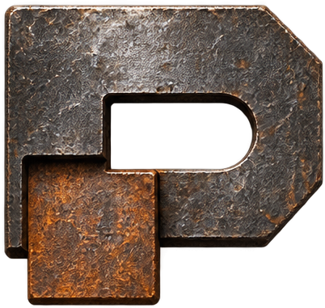

# Patina: GUI implementation guide

**Purpose:** make the editor, custom nodes and project-specific tools look and
behave like one application. **Platform:** Windows first. **Updated:** 2026-11-20.

The **Aged Dovetail** emblem above is the logo. The owner selected it on 2026-11-15.
[assets/branding](../assets/branding/README.md) has the extracted pieces, the icon
sizes and the resolution limits. The artwork has no text: the application draws
the name **Patina**. Use the aged steel and rust treatment only in branding
artwork, never on controls. The wide pieces fade to the right: put the name on
the fade, never in a row beside the artwork.

The design mockups were removed on 2026-11-20. The running editor is now the visual
reference. The rules of this guide and its files stay.

## How to use this guide

Read this file before GUI work. Then read the guide files for your task:

- Read the theme and palette for each GUI task.
- Read the shared controls when you make or change a control, a panel or a node GUI.
- Read the connections when you work on wires, buses or routes.

| Guide file | What it teaches |
|---|---|
| [Theme and palette](gui-visual-guide/theme.md) | Neutral colors, node header families, state and focus rules |
| [Shared controls and implementation](gui-visual-guide/controls.md) | Typography, shell and docking, pins and reusable widgets |
| [Connections between nodes](gui-visual-guide/connections.md) | Connection meaning, route editing, node clearance, crossings and extension cases |

The [spec](spec/README.md) defines architecture and behavior. This guide defines the
look. If the guide and the spec disagree, follow the spec.

## The GUI concept

Patina is an editor for building tools. A material editor, an audio tool and a
measurement instrument use the same window shell, control style, graph language
and docking behavior. Their content changes; their basic UI vocabulary does not.

There are four cooperating pieces:

| Piece | Responsibility | Recognizable appearance |
|---|---|---|
| Editor shell | Project navigation, graph, inspector, logs and layout | Neutral panels, stable toolbar and status bar |
| Node GUI | Parameters and immediate feedback for one computation | Colored header, named pins, body sized around its controls |
| Custom view | A workspace spanning one or more nodes | Neutral dock tab, source/selection controls, no graph pins |
| Reusable widget | A consistent editing interaction | Same curve, ramp, field or table behavior wherever it appears |

A node is allowed to be an instrument, not just a title and a list of sockets.
A custom view can turn the graph into a practical tool for someone who rarely
needs to inspect its wiring.

### Shape is information

Node size must follow the task. A small mixer has two inputs, one output and a mix
amount, so its job is understood immediately. A filter needs area for its response
curve, and precise controls for frequency and Q.

Do not stretch the mixer to the filter's height. Do not compress the filter until
it resembles the mixer. Consistency comes from headers, padding, controls and
typography, rather than matching outer dimensions.

Use width for waveforms, ramps and timelines. Use height for lists and layer
stacks. Use both for an image with overlays. Keep a simple sink small.
A selected node gets an outline; selection alone should not change its size.

### Color has three jobs

**Header color** identifies related work. **Status color** reports state.
**Focus color** shows where interaction will go. Keep these independent.

Node bodies and dock surfaces stay charcoal. Data may be colorful: a texture,
gradient, spectral trace or surface map needs its own encoding. A bright preview
must not recolor the surrounding interface. Do not use navy backgrounds, cyan
tabs or vivid blue sliders.

### The graph explains dependencies

Prefer short left-to-right connections. Leave routing space around nodes.
Attach wires to named sockets, never to a thumbnail, slider or arbitrary row.
Keep unrelated gallery examples disconnected.

Use neutral wires by default. Named signal families can use color, as bus
ribbons do. Same-domain wires are solid; cross-domain wires are dashed.
A successful run does not turn the whole graph green. Subgraph outlines are
neutral structure, not warning-colored decoration. The
[connection rules](gui-visual-guide/connections.md) apply to every graph,
including those with ordinary wires.

## Interaction states to refine during implementation

Keep these details visible during visual review.

- **Controls and nodes:** compare normal, hovered, focused, selected, disabled
  and error states together. Include a selected node with an error. Keep both
  selection and error indicators readable without one replacing the other.
- **Connections:** show the wire-drag preview, compatible and incompatible
  sockets, selected branches, editable bends and obstructed routes. Distinguish
  a routing obstruction from an invalid connection. Keep endpoints traceable
  while editing, not only after the connection is finished.
- **Docking and resizing:** show docking drop targets, active tabs and minimum
  panel sizes. Check how rich node controls adapt when space becomes tight.
  Preserve readable labels and usable controls instead of shrinking the entire
  GUI or clipping essential actions.

## Delivery check

1. Check the control arrangement, visual hierarchy and spacing, not just the header color.
2. Check that simple nodes remain small and richer editors receive useful space.
3. Trace every wire. Check named pins, manual bends, whole-cable clearance,
   crossing versus junction, and the route after moving or resizing a node.
4. Check one parameter through the node GUI, a bound view and undo. Values must agree.
5. Check the control with mouse and keyboard at the intended Windows display scale.
6. Exercise unavailable, empty, loading, stale and error states where relevant.
   A convincing screenshot must not conceal an operation that does not work.
7. Check the Aged Dovetail branding, neutral surfaces and distinction between header, focus and state.
8. Report what was implemented and tested separately from what is still planned.

### Outside references

The owner named these programs as good references (2026-11-17). Take ideas for the layout and the
behavior from them. Keep the Patina palette, sizes and shared controls.

- **VST plugins:** the look of node GUIs, for example knobs, meters, waveforms, envelopes and
  spectrum views.
- **Bespoke Synth:** the animated connections of an audio graph. An audio wire shows the signal
  that goes through it, and a note wire flashes when a note goes through it.
