# Patina: illustrated GUI implementation guide

**Purpose:** make the editor, custom nodes and project-specific tools look and
behave like one application. **Primary visual reference:** mockup 9.
**Platform:** Windows first. **Updated:** 2026-11-14.

The blue faceted **P** and white **PATINA** wordmark above are the logo reference.
This is an exact crop of the existing main-editor image, matching the identity
in the owner's clipped logo. Keep its proportions and spacing. The plain amber
P in mockup 9 is a generated mistake.

## The visual reference set

Each thumbnail leads to its illustrated implementation chapter.

| Main theme: material editor | Custom node controls | Docked audio tools | Readable automation |
|---|---|---|---|
|  | <a href="#4-custom-node-canvas">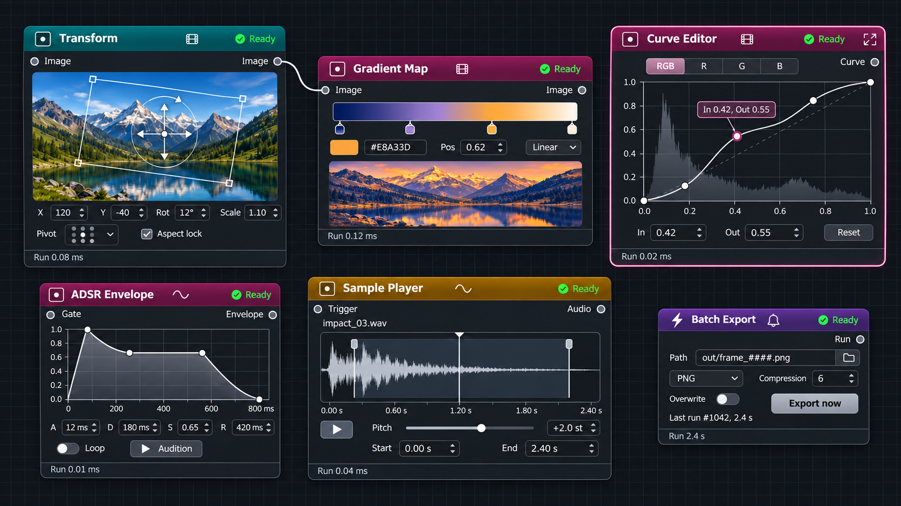</a> |  | <a href="#6-automation-graph">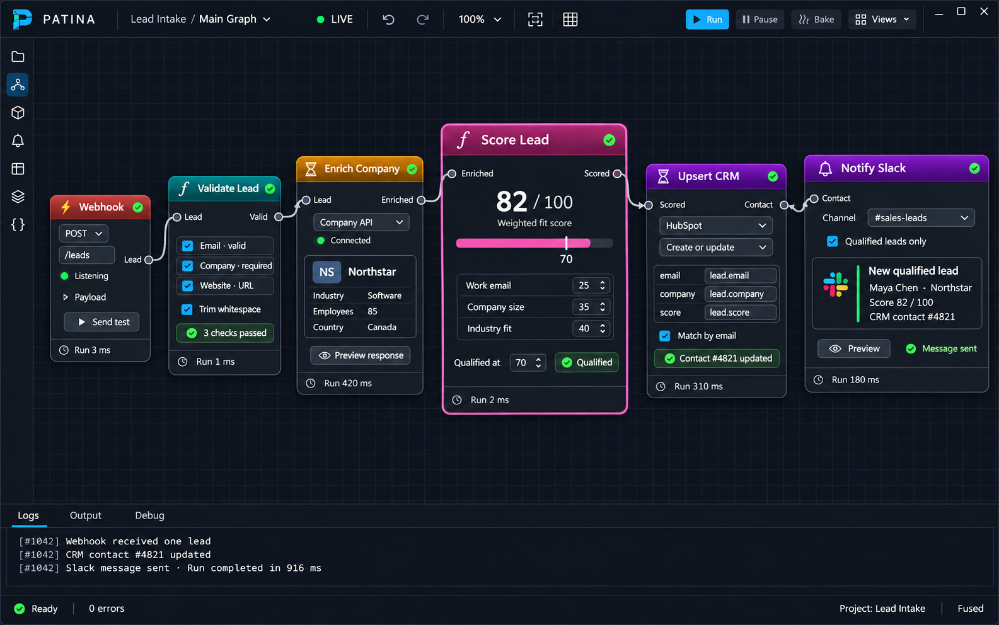</a> |

| Editor structure | Error handling | Scientific acquisition | Measurement workstation |
|---|---|---|---|
|  | <a href="#3-error-view">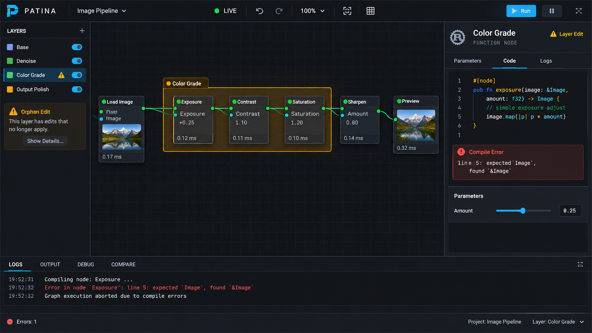</a> | <a href="#7-laser-acquisition">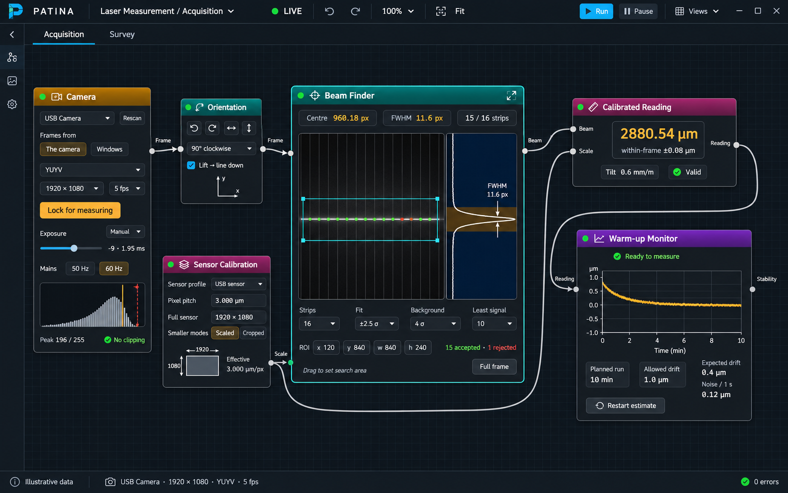</a> |  |

| Ribbon appearance - accepted | Full-bus fork | Bit-range split | Individual breakout |
|---|---|---|---|
| <a href="#ribbon-appearance">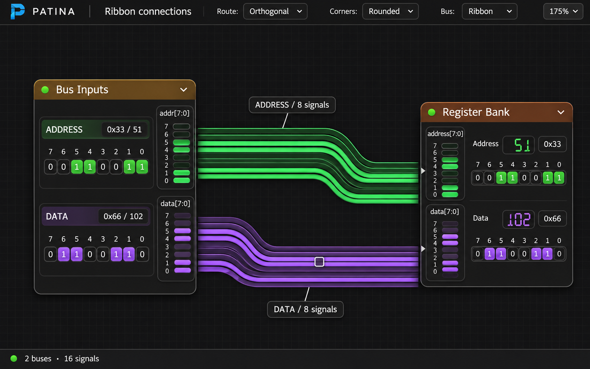</a> |  |  | <a href="#ribbon-breakout">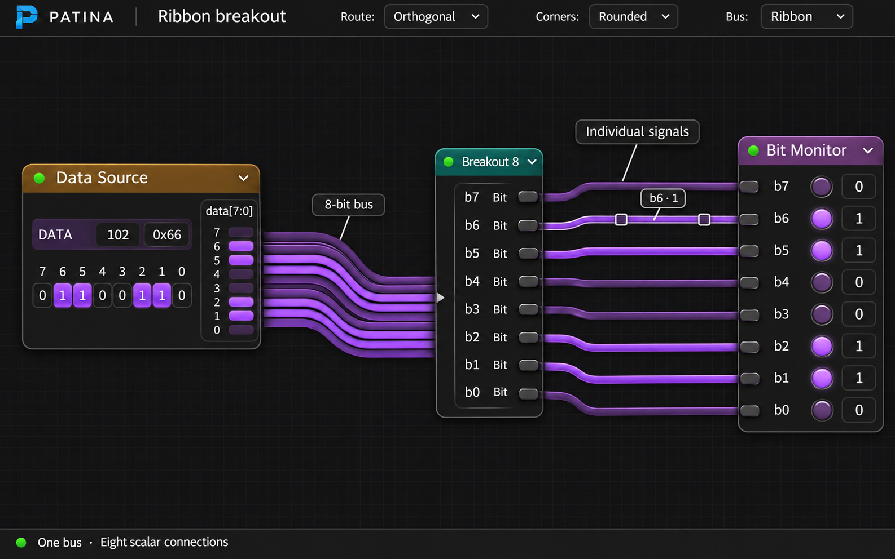</a> |

| Computer workbench | Subgraph interface | Workbench with ribbons | Subgraph with cables |
|---|---|---|---|
| <a href="#computer-workbench">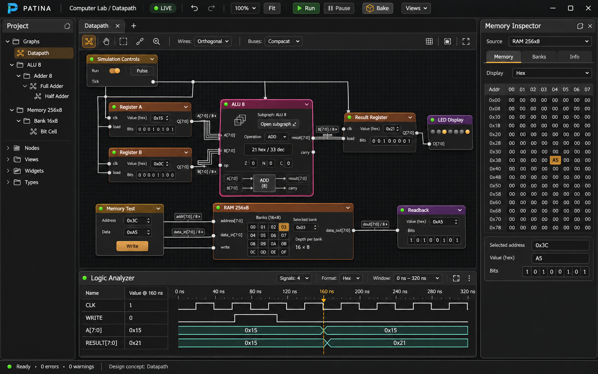</a> | <a href="#subgraph-interface">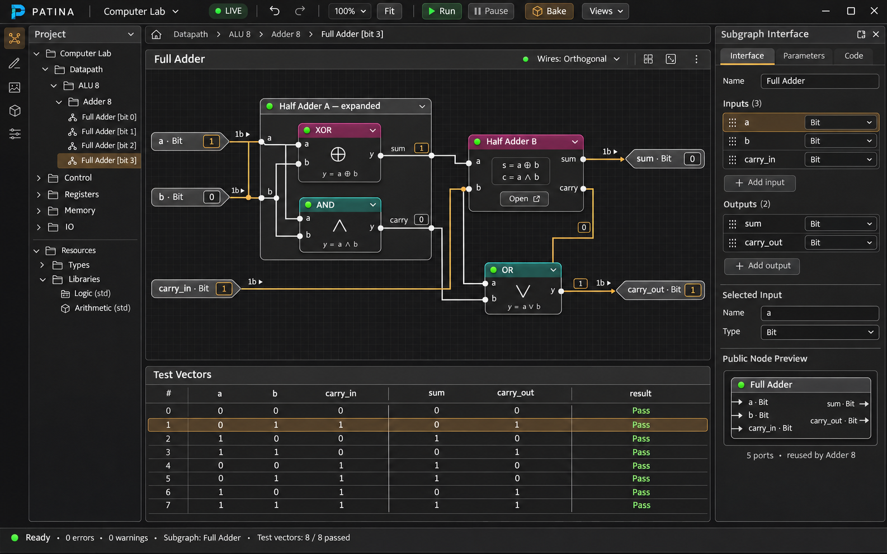</a> | <a href="#electronic-ribbon-variants">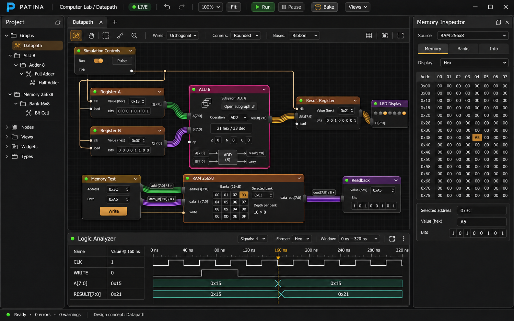</a> |  |

## How to use this guide

Start with the full layout, then inspect the cutouts beside its implementation
notes. The cutouts are **original pixels**, not generated redrawings. They are
saved under [mockups/details/](mockups/details/) as reusable visual references.
The [crop manifest](mockups/details/crops.json) records each source and rectangle.

The [spec](spec/README.md) defines architecture and behavior. The images establish
visual direction. Written corrections below identify things to fix rather than
copy. The exact palette values at the end are **proposed implementation tokens**;
the owner selected mockup 9 as the strongest theme reference, not a list of
previously approved hex values.

| Go to | What it teaches |
|---|---|
| [The GUI concept](#the-gui-concept) | One editor shell, many specialized tools |
| [Connections between nodes](#node-connections) | Connection meaning, route editing, node clearance, crossings and extension cases |
| [9. Smart material editor](#9-smart-material-editor) | Main visual target, rich nodes and a separate 3D view |
| [1. Main editor](#1-main-editor-with-colored-headers) | Window anatomy, toolbar and inspector |
| [3. Error view](#3-error-view) | Local errors and navigation to source |
| [4. Custom node canvas](#4-custom-node-canvas) | Six different custom GUIs with different footprints |
| [5. Custom views](#5-custom-views) | Timeline and spectrum as first-class editor panels |
| [6. Automation graph](#6-automation-graph) | Compact triggers, forms, mapping and message previews |
| [7. Laser acquisition](#7-laser-acquisition) | Scientific image controls and calibration |
| [8. Laser survey](#8-laser-survey) | Operator console, linked data and result visualization |
| [Shared controls and implementation](#shared-controls-and-implementation) | Reusable widgets and interaction behavior |
| [Computer building and ribbons](#circuit-references) | Nested subgraphs, public interfaces, rounded buses, fan-out, split and breakout |
| [Theme and palette](#theme-and-palette) | Sampled evidence, neutral colors and focus rules |
| [Delivery check](#delivery-check) | What to verify before calling GUI work complete |

## The GUI concept

Patina is an editor for building tools. A material editor, an audio tool and a
measurement instrument use the same window shell, control style, graph language
and docking behavior. Their content changes; their basic UI vocabulary does not.

There are four cooperating pieces:

| Piece | Responsibility | Recognizable appearance |
|---|---|---|
| Editor shell | Project navigation, graph, inspector, logs and layout | Neutral panels, stable toolbar and status bar |
| Node GUI | Parameters and immediate feedback for one computation | Colored header, named pins, body sized around its controls |
| Custom view | A workspace spanning one or more nodes | Neutral dock tab, source/selection controls, no graph pins |
| Reusable widget | A consistent editing interaction | Same curve, ramp, field or table behavior wherever it appears |

A node is allowed to be an instrument, not just a title and a list of sockets.
A custom view can turn the graph into a practical tool for someone who rarely
needs to inspect its wiring.

### Shape is information

These two cutouts demonstrate why node size must follow the task:

| Small mixing junction | Larger response editor |
|---|---|
|  |  |
| Two inputs, one output and a mix amount. Its job is understood immediately. | The response curve needs area; frequency and Q need precise controls. |

Do not stretch the Mixer to the Filter's height. Do not compress the Filter until
it resembles the Mixer. Consistency comes from headers, padding, controls and
typography, rather than matching outer dimensions.

Use width for waveforms, ramps and timelines. Use height for lists and layer
stacks. Use both for an image with overlays. Keep a simple sink small.
A selected node gets an outline; selection alone should not change its size.

### Color has three jobs

**Header color** identifies related work. **Status color** reports state.
**Focus color** shows where interaction will go. Keep these independent.

Node bodies and dock surfaces stay charcoal. Data may be colorful: a texture,
gradient, spectral trace or surface map needs its own encoding. A bright preview
must not recolor the surrounding interface.

Use the more restrained balance of mockup 9. The earlier navy backgrounds,
cyan tabs and vivid blue sliders are not the target for the new neutral theme.

### The graph explains dependencies

Prefer short left-to-right connections. Leave routing space around nodes.
Attach wires to named sockets, never to a thumbnail, slider or arbitrary row.
Keep unrelated gallery examples disconnected.

Use neutral wires by default. Named signal families can use color, as in the
ribbon references. Same-domain wires are solid; cross-domain wires are dashed.
A successful run does not turn the whole graph green. Subgraph outlines are
neutral structure, not warning-colored decoration. The connection rules below
apply to every graph, including those with ordinary wires.

## Connections between nodes

Treat the connection as part of the interface: its sockets, labels, route,
selection and meaning must be readable together. This applies to image,
automation, audio and simulation graphs. The ribbon studies demonstrate the
principle; an electrical cable is not the only useful connection style.

[Spec 15.9](spec/15-editor.md#159-connections-and-routing) defines the shared
requirements. The interactions below describe the design target, not current
implementation. Automatic routing and raised bridges are optional refinements.

### Meaning, geometry and finish

Keep three independent decisions: **what connects**, **where the route goes**,
and **how it is drawn**. Changing a spline to a ribbon does not create more
signals. Bending a connection around a node does not add a dependency.

| Connection | What the appearance must explain |
|---|---|
| Ordinary typed wire | Source, destination, direction and type |
| Typed multi-signal bus | Width, ordered lanes and one typed bus socket |
| Visual cable of separate wires | Member names and their separate endpoints; grouping does not merge values |
| Fan-out | One source, several readers; each branch keeps the full value |
| Split, join or merge | A real node with declared input/output mapping or combination behavior |
| Crossing | Two independent routes; no junction marker |
| Order wire | An execution dependency that carries no data |

The distinction is defined by the graph, not by painted geometry. A type with
no lane description (spec 6.3) uses a normal connection and a type label. Do not invent
strands from a value's memory size or from the number of items in a list.

| Appearance control | Purpose |
|---|---|
| **Route** | Curved, Orthogonal or Polyline |
| **Corners** | Sharp or Rounded, where applicable |
| **Bus** | Compact or Ribbon; neither option changes the pin count |
| **Crossings** | Clear gap; optional raised bridge |
| **Use graph default** | Inherit appearance, or override this connection |
| **Lock bends** | Optional protection for manually arranged route points |
| **Reset route** | Discard manual geometry for the selected route; keep connectivity |

Keep the same styling vocabulary across node GUIs and custom Views. A project's
connection family can have a color or channel presentation, while the editor
retains consistent sockets, focus, selection, errors and picking. This does not
define a new connection-plugin API.

### Drawing and editing a route

1. Start at a named socket. Show the source and compatible destinations.
2. Preview the connection while dragging. Leave room to approach the target socket.
3. Place intermediate points when the route needs to wrap around a node.
4. Finish at a compatible socket. Canceling leaves the existing graph intact.
5. Select the connection to reveal route handles and its endpoints.
6. Drag a point, or move an orthogonal segment sideways, to adjust the path.
7. Use **Reset route** to return that connection to automatic or default geometry.

Dragging a route is different from dragging its endpoint. An endpoint reconnect
uses the normal type, ownership and cycle checks. Removing a focused route point
removes that bend, not the connection. Give **Remove route point** and
**Disconnect** separate actions. Support undo, redo, cancellation and keyboard
access. A generous screen-space hit area makes a thin wire usable on Windows
without drawing every wire thick.

A selected trunk identifies all of its branches. A selected branch identifies
one destination. For a crowded cable, offer a member list and trace one named
lane. Keep the rest visible enough to understand the group. A selected colored
wire can use an amber outer mark and handles without replacing its family color.

### Keep space for the whole connection

Route around node bodies, expanded custom GUIs and their controls. Reserve
space for the cable's full width, corner sweep, socket approach and labels.
Rounding a safe centerline must not make the outer lane cut through a node.

When a node moves, resizes or changes its pin layout, update the affected
endpoint approaches and unfixed sections. Preserve the user's manual bends.
If a fixed point now lies inside a node, show **Route obstructed** and expose
the relevant handle. Keep the graph connected. Do not silently erase the
user's route or make a layout problem look like a type or execution failure.

An expanded subgraph can contain its internal routes. Wires crossing its
interface still use the actual boundary ports. An ordinary annotation frame
does not create new ports or hide connectivity.

Automatic routing should prefer a stable, readable route over constant global
rearrangement. Use empty corridors; reduce unnecessary bends and crossings.
At distant zoom, use a compact width badge when individual lanes cannot be
resolved. Close zoom must recover the exact lane order and count.

### Crossings, bridges and locks

Draw a junction only where the graph branches. At an unrelated crossing, keep
both paths traceable with a gap or bridge. Do not use an ordinary filled dot.
For a ribbon, raise the whole cable as one object while preserving every lane.
A bridge has no execution state, ports or latency.

Over/under order should remain stable while panning, zooming or selecting.
Selection can add an outline; it must not silently swap the two routes.
A dense series of bridges is a reason to improve the route, not add more chrome.
Near bends or sockets, prefer a small clear gap if a bridge would not fit.

**Lock bends** means the router preserves manual geometry. It does not freeze
values, disable editing of the node or bypass connection checks. Endpoints
still follow their nodes. If that makes the fixed route impossible, expose
the conflict. Automatic avoidance and locks are optional design directions.

### 16. Routed connections and a crossover bridge

This study adapts the supplied game's use of routing space and crossover
collars to Patina's charcoal theme. It does not establish how the game's
controls work.

- The green address route wraps left and below the unrelated **Waveform** node.
- The violet data route wraps below and to the right. It passes over the green
  bus at the graphite bridge. **Crossing - not joined** explains the distinction.
- Square handles identify an editable route. A padlock identifies a fixed bend.
- **Avoid nodes**, **Lock bends** and **Crossings** show possible routing controls.
  They do not demonstrate working algorithms.
- Keep the restrained highlights and rounded conductors from mockup 12.
  The bridge hardware is optional; the connection must remain readable without it.

**Correct when implementing:** some generated strips have extra cells and the
contact lights do not consistently match the data. Address must be
`0x3C = 00111100`; data must be `0x66 = 01100110`. Lane count, labels and
lights must all come from the same value. The image also needs explicit **1 Hz**
or other actual units on a waveform axis if it presents a measured trace.

### Other connection cases to leave room for

These are extension candidates, not commitments to add every feature.
Use them to check that the connection model is broader than electronics.

| Case | Useful presentation | Semantic boundary |
|---|---|---|
| Named fields or channels | Position x/y/z, audio left/right, or image channels in a labeled cable | Exposing connectable fields requires an explicit typed adapter; a preview alone adds no pins |
| Variable-size collection | Type plus item-count badge and a viewer | A list of 1,000 items is one value, not automatically 1,000 concurrent wires |
| Merge, mixer or selector | Several inputs into a small explicit node | The node defines combination or choice; routing collars never merge sources |
| Stream or cross-domain connection | Direction, Latest value or Queue label, actual drop count | Keep the dashed domain marker and queue rules from spec 9.1 |
| Probe or pinned value viewer | Small attached readout with source and sample age | Observation follows spec 5.3; it does not become a hidden processing stage |
| Feedback route | Clear return path and visible Delay node | A loop-shaped wire does not legalize a cycle |
| Named route continuation | Paired endpoints with matching IDs and navigation between them | Optional presentation only; matching text must never create a hidden connection |
| Request and reply pair | Two labeled lanes in one visual cable | Preserve their separate directions and types; no implicit bidirectional data wire |

Additional types should describe their own values. A connection kind of the
project describes their lanes (spec 6.3). The editor owns routing and the common interaction rules. Exact SDK
extensions remain to be designed; this guide does not choose a framework,
serialization format or arbitrary renderer plugin mechanism.

### Connection checks for implementation

These are checks to run when the editor exists, not results from these images.

- Trace each route to named sockets. Test crowded crossings and fan-out.
- Move and resize an intervening node. Check the whole ribbon clears its GUI.
- Move an endpoint with fixed bends. Check the route stays editable and connected.
- Switch appearance and group or ungroup a visual cable. Check the graph is unchanged.
- Remove a branch, undo, and restore it. Check the other readers remain connected.
- Check narrow wires, labels and keyboard selection at Windows scales 100%, 150% and 200%.

## 9. Smart material editor

[Open the full-size reference](mockups/mockup-9-smart-material-editor.png).

**Match:** the balance of graph and preview, readable controls, neutral bodies,
colored title strips, visible data, and strong differences in node size.
This is the main theme reference, with the remaining blue cast removed by the
proposed neutral palette.

The graph has sources on the left, mask editing in the middle, composition to
the right, and a small output. The preview is a docked workspace.

| Exact image detail | What an agent should implement |
|---|---|
| 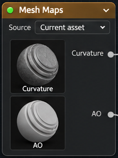 | **Mesh Maps: a source with two kinds of data**  Keep the asset selector at the top and identify each preview next to its output. Curvature and AO must look like distinct channels, not interchangeable decorative balls. The body needs enough width for those names, but no large property form. Reuse the asset picker and channel-image widget. |
| 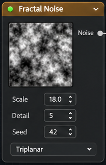 | **Fractal Noise: visual feedback over a short form**  The square texture is the main feedback. The three numeric rows belong below it, followed by projection mode. Keep field widths stable while values change. Scale, detail and seed must update the preview; changing preview zoom must not change the noise. Reuse a preview plus labeled number-field group. |
| 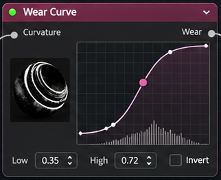 | **Wear Curve: spatial mask beside a remapping function**  The mask thumbnail answers where the operation acts; the curve answers how strongly. Keep the histogram subordinate to the curve. Dragging a point and editing a threshold must affect the same mapping. Reserve width for the two visualizations rather than stacking them into a narrow column. |
| 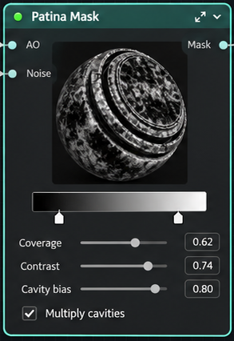 | **Patina Mask: a large interactive mask editor**  Image first, remap ramp second, parameters last. The stops need obvious handles and a selected state. Keep coverage, contrast and cavity bias aligned. The light teal node outline indicates selection; the green dot indicates readiness. The ramp is grayscale data and should not inherit the header hue. |
| 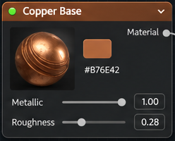 | **Copper Base: compact material properties**  A small rendered image and color swatch establish the material. Two labeled sliders complete the task. This node does not need the height of the layer stack. Clicking the swatch should use the shared color editor; metallic and roughness need exact values as well as dragging. |
| 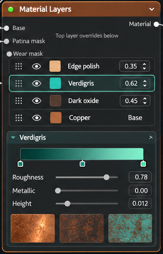 | **Material Layers: an ordered editor inside one node**  Rows combine a reorder handle, visibility, swatch, name and amount. Selection expands one layer below the list. The layer's ramp, roughness, metallic and height form a single coherent property group. The stack needs height; the controls need consistent columns. This is material content, not Patina's compilation Base/Slot panel. |
| 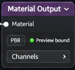 | **Material Output: let a sink stay small**  The input, PBR summary and channel disclosure are sufficient. Do not add a large duplicate preview just to match neighboring nodes. The preview dock can bind to this output. Keep its source binding explicit and distinguish a stale result from a current result. |
| 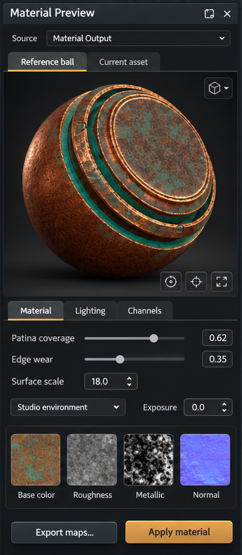 | **Material Preview: the tool's main viewing surface**  A neutral dock header contains source selection and Reference ball/Current asset tabs. Give the 3D object most of the available area. Keep orbit/reset controls on the viewport. Material, lighting and channel controls are distinct groups. The lower sliders edit shared graph values; lighting changes the presentation. Channel thumbnails should come from the actual material result, not independent sample images. |

**Connections to implement:** Curvature feeds Wear Curve; AO and Fractal Noise
feed Patina Mask; Copper Base, the patina mask and the wear mask feed Material
Layers; Material Layers feeds Material Output. The view has no graph cable.

**Correct these details:** the wear cable lands near the Verdigris row in the
image. It must land on **Wear mask**. Restore node kind/domain icons and runtime
labels where needed. Use the blue faceted logo. Rendered material/channel images
must agree with actual graph outputs; the mockup does not validate a shader.

## 1. Main editor with colored headers

[Open the full-size reference](mockups/mockup-1-main-editor-colored-headers.png).

**Match:** a stable shell with navigation at left, graph in the center, inspector
at right and logs below. The graph remains visible while code or parameters are
edited. The right panel gives the selected node context rather than opening an
unrelated window.

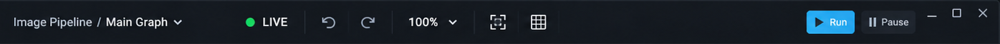

The toolbar has a hierarchy: project/graph path, run state, editing/navigation
controls, then execution and view actions. Keep related controls grouped and
separate them with space or thin dividers. Do not make every tool a colored button.

| Exact image detail | What an agent should implement |
|---|---|
| 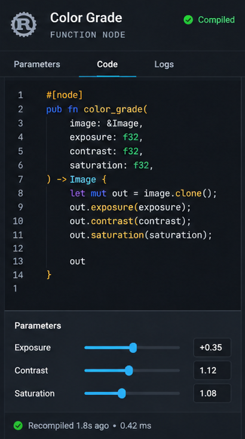 | **Inspector: identity, work area, parameters and feedback**  Keep Parameters/Code/Logs as a stable tab group. Code needs line numbers, syntax highlighting and error locations. Parameters below it use the same fields as the node GUI. The selected-node name and path must remain visible. Use a Patina node-kind icon in place of the Rust logo. Build time and run time must have different labels. |

The five node headers demonstrate a category sequence: amber input, teal
processing, magenta color editing and purple output. Inline images are useful
previews, not a reason to enlarge every node.

**Correct these details:** replace the obsolete edit-layer list and toggles
with compilation **Base** and **Slot**. Remove orphan-edit concepts. The selected
magenta node should have a light pink outline. Apply neutral surfaces instead
of this image's blue cast. The logo remains a valid visual reference.

## 3. Error view

[Open the full-size reference](mockups/mockup-3-error-view.png).

**Match:** an error can be investigated without hiding the graph. An expanded
subgraph exposes its internal dependency chain. The inspector explains the
problem close to the code.

| Exact image detail | What an agent should implement |
|---|---|
| 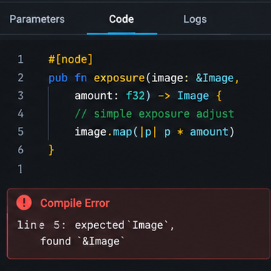 | **Error detail: identify the location and the mismatch**  Give the error an icon, a short heading and a readable message. Mark the actual source line with a gutter marker and underline. Keep code readable above the message. A red-tinted message well can be subtle; the important information is node, source location and expected/actual type. |

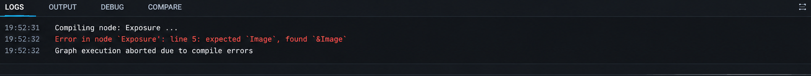

Log entries must link back to the node and source location. Match the compact
timestamp/message structure. Keep prose and code locations readable, and avoid
giving the entire log the same error color.

**Correct these details:** the failing node needs an error border/icon, not a
green ready dot. The subgraph border stays neutral and needs a collapse control.
Remove **Compare**, **Layer Edit** and the orphan edit warning. Do not copy the
claim that the graph aborted: a failed rebuild retains its last successful
build. The status bar, node, code and log must describe the same error.

## 4. Custom node canvas

[Open the full-size reference](mockups/mockup-4-custom-node-canvas.png).

**Match:** varied shapes united by a common header, padding, field style and
runtime footer. This is a widget gallery, not one connected workflow.
The exporter is compact; the visual editors receive space.

| Exact image detail | What an agent should implement |
|---|---|
| 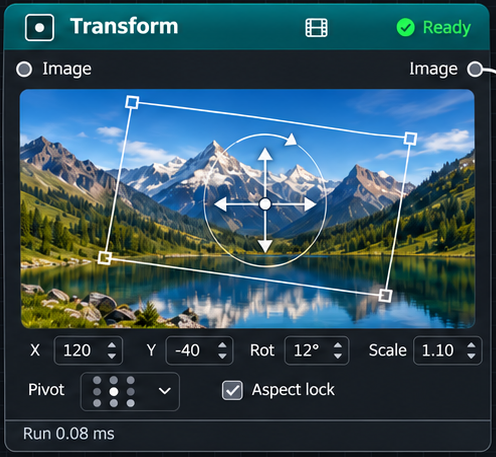 | **Transform: direct manipulation with precise numeric editing**  The rectangle, pivot, rotation arc and axis handles act on the image. Numeric X/Y/rotation/scale fields below are another way to edit the same transform. Aspect lock and pivot presets belong beside those fields. Image interaction must not drag the node. Reuse a 2D gizmo and numeric transform widget. |
| 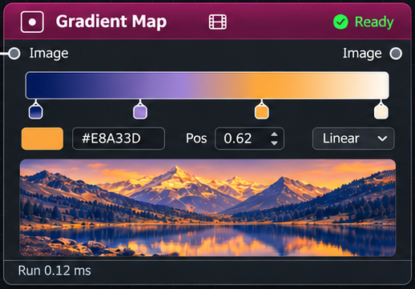 | **Gradient Map: the control explains the result**  The ramp spans the width, with stops below it. The selected stop exposes color, position and interpolation in one row. The shallow image preview shows the effect without turning the node into a tall image viewer. A stop selection is not a new color value until edited. |
| 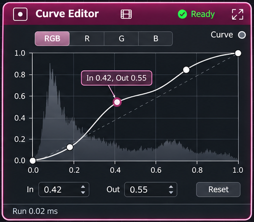 | **Curve Editor: local focus and exact point values**  Channel tabs sit above the plot. The selected handle, tooltip and In/Out fields identify one point. The histogram remains low-contrast behind the curve. The magenta header, pink outline and pink handle form a consistent local focus language. Preserve plot area when resizing its surroundings. |
| 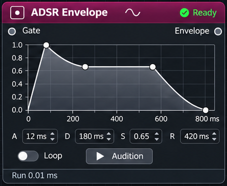 | **ADSR Envelope: one state shown as a graph and fields**  A/D/S/R controls correspond to segments of the envelope. Time and level axes have different units. Keep Audition separate from parameter editing. Dragging a segment and typing a value must agree. The drawn timings are illustrative; implement the envelope from its data, not the screenshot coordinates. |
| 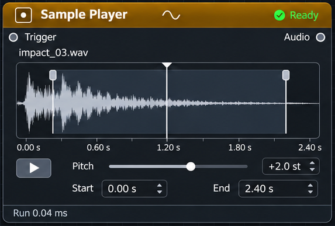 | **Sample Player: width earns its space**  The waveform is wide so trim boundaries and the playhead are legible. Put transport, pitch and start/end values below the waveform. Dragging an endpoint changes the range; playback moves the playhead. Filename, duration and time units should remain visible as state changes. |
| 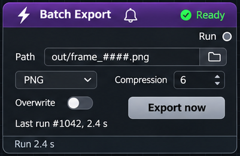 | **Batch Export: compact form and explicit action**  Keep path and browse control together. Format determines available options: this PNG example shows compression. Overwrite is an option, Export now is an action, and the last-run line is feedback. Do not use a full-height preview or oversized button to fill space. |

**Correct these details:** only Transform feeds Gradient Map. There is no valid
ADSR-envelope-to-Sample-Player-trigger wire here. Keep the others disconnected
until their actual types require a connection. Treat plots as illustrations,
and use the neutral palette rather than reproducing the earlier blue background.

## 5. Custom views

[Open the full-size reference](mockups/mockup-5-custom-views.png).

**Match:** three useful work surfaces at once. The upper graph explains the
signal chain; the right Spectrum diagnoses the sound; the lower Timeline edits
time. All share one control system and dock framework.

In the graph, two differently sized players feed a tiny Mixer, a larger Filter
and a narrow Audio Out. Amber identifies sources, teal processing and purple
output. Those colors repeat as small swatches in the Project tree. The earlier
Mixer/Filter comparison shows their relative footprints.

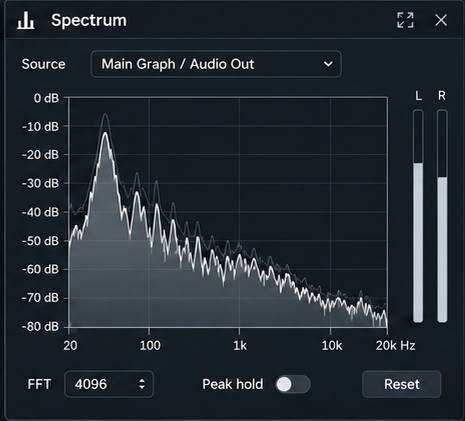

The source selector binds this view to a graph output. The plot needs frequency
and dB axes, restrained grid lines and a trace that remains readable. L/R meters
are separate measurements. FFT size, Peak hold and Reset change this view's
analysis/display behavior. There are no graph sockets on its panel border.

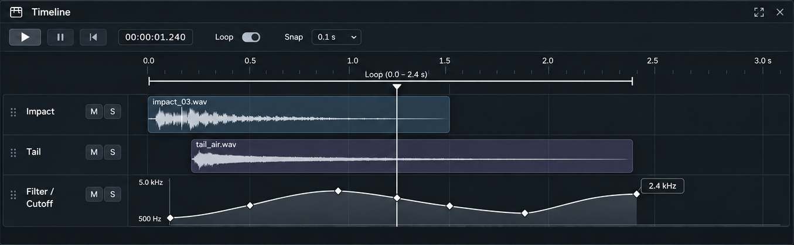

The time ruler, clip lanes and automation lane align horizontally. Transport,
time display, Loop and Snap belong above them. Clips need names, waveform
content, trim boundaries and selection. Automation points share the ruler and
playhead. The cutoff lane needs frequency units, not a generic 0-1 value.

A drag on a clip or automation point edits data. A drag on a dock tab moves
the panel. A graph-pan gesture must not intercept those interactions.

**Correct these details:** use neutral chrome and amber dock focus. The selected
Filter uses its local light teal. Give Mixer its execution-time label when
available. Replace the tiny ambiguous player glyphs with clear named actions.
No wires run to the Timeline or Spectrum.

## 6. Automation graph

[Open the full-size reference](mockups/mockup-6-automation-graph.png).

**Match:** Webhook, Validate Lead, Enrich Company, Score Lead, Upsert CRM, then
Notify Slack. There is no long return wire. The collapsed navigation rail gives
the graph room. Richer steps get larger bodies.

| Exact image detail | What an agent should implement |
|---|---|
| 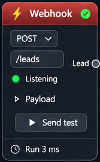 | **Webhook: start small, disclose detail**  Method and endpoint identify the trigger. Listening is state, Payload is expandable detail, and Send test is an action. The output name remains visible. The body should not reserve space for a large payload table while the payload is collapsed. |
| 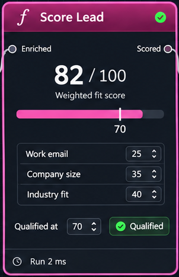 | **Score Lead: give the decision model space**  The prominent score and threshold marker communicate the result. Editable rule weights explain the decision. Keep qualification threshold and result adjacent. A selected magenta node gets pink focus. Do not express qualification only with a green bar; use text and an icon. |
| 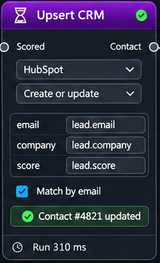 | **Upsert CRM: field mapping as a reusable editor**  Connection choice and operation precede the table. Destination fields and source expressions form two aligned columns. Matching options follow the table; the result comes last. A mapping row should validate its source and destination rather than behave like decorative text. |
| 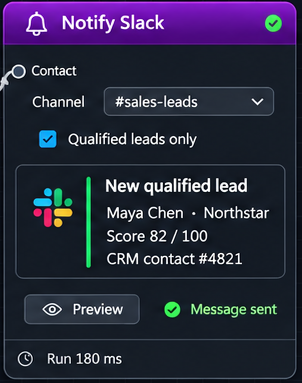 | **Notify Slack: preview the user-facing output**  Channel and filters belong above the message. Give the preview its own inset surface so it reads as a message, not a parameter list. Preview and send/result state are separate. Use representative content when demonstrating, and actual service state in a working integration. |

Validate Lead uses compact rule summaries; it need not repeat a large dropdown
form for every row. Enrich Company uses a concise fetched-data card. Keep
connection, validation and run feedback close to the corresponding node.

**Correct these details:** the CRM-to-Slack arrow has a small generated artifact.
Use clean pin-to-pin routing. Some kind/domain icons were simplified.
No screenshot result proves that a service connection or automation was run.

## 7. Laser acquisition

[Open the full-size reference](mockups/mockup-7-laser-acquisition.png).

**Match:** the beam finder receives the most space because it combines an image
and profile. The camera is a tall form; Orientation is a small utility; the
calibrated reading is short and wide. The graph visually distinguishes setup,
analysis and monitoring.

| Exact image detail | What an agent should implement |
|---|---|
| 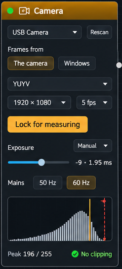 | **Camera: a device form with immediate feedback**  Group device, mode and frame-rate selection before acquisition controls. Show manual exposure and mains frequency together. The histogram explains the exposure result. Lock for measuring is an explicit action with visible outcome. Unsupported Windows camera controls must be unavailable, not fictional working sliders. |
| 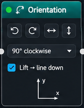 | **Orientation: a small transform utility**  Four icon actions, one orientation value, a sign check and axes are enough. This node should remain much smaller than the camera or beam finder. Give icons accessible names. Rotation, mirror state and the displayed coordinate system must agree. |
| 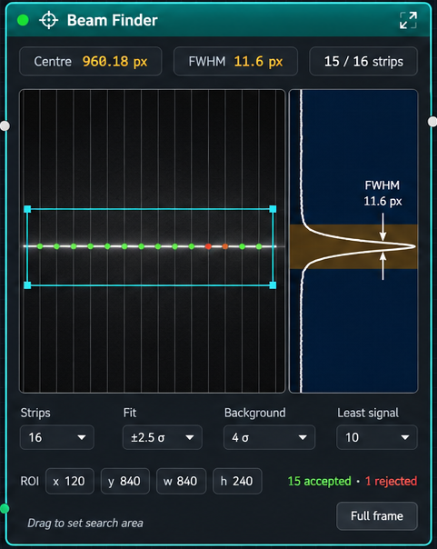 | **Beam Finder: linked scientific editing surfaces**  The image and sideways intensity profile share a vertical coordinate. ROI handles, strip centers and rejected points explain the fit. Numeric ROI fields below are precise alternatives to dragging. Keep image overlays, fit bands, FWHM and threshold values synchronized. This is a 2D image/canvas GUI, not a GPU viewport embedded in the node. |
| 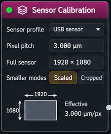 | **Sensor Calibration: make the scale understandable**  The sensor diagram explains the dimensions beside pixel pitch and mode settings. Scaled and cropped modes affect effective scale differently. Keep full-sensor dimensions distinct from acquired-frame dimensions. Show units on the effective output rather than an unexplained scalar. |
| 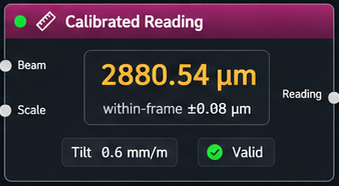 | **Calibrated Reading: a measurement-first node**  Use a large number for the main position and a smaller uncertainty directly below. Units are part of the value. Tilt and validity remain secondary. This is an absolute beam position; do not relabel it as corrected surface height. A failed reading must change validity, not silently retain a convincing old number. |
| 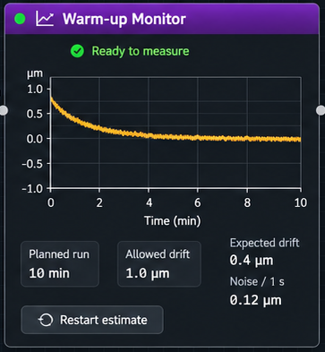 | **Warm-up Monitor: a plot plus a decision**  Time and displacement axes establish what drift means. Planned duration and allowed drift are inputs; expected drift and noise are results. Ready to measure is a named state. Restart estimate is an explicit action. Keep the plot wide enough to distinguish a trend from noise. |

**Correct these details:** remove the extra scale connection into Beam Finder.
Sensor Calibration feeds Calibrated Reading. The ROI geometry and strip counts
in the screenshot are schematic. The real overlay must be derived from the
current frame and fit, with timestamps and validity kept consistent.

## 8. Laser survey

[Open the full-size reference](mockups/mockup-8-laser-survey.png).

**Match:** graph at upper left, an operator console below it, and results at
right. These are three complementary ways to work with the same session.
The console makes the graph usable as an instrument.

| Exact image detail | What an agent should implement |
|---|---|
| 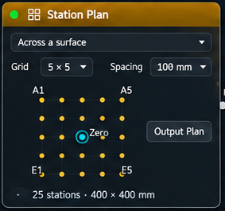 | **Station Plan: an editable spatial control**  The grid, station labels and zero marker are data, not decoration. Selecting a station should update the console and result selection. Spacing and grid size affect the plan. Make the active station and the zero reference visually distinct. |
| 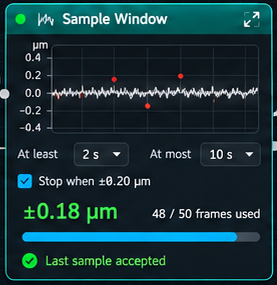 | **Sample Window: quality and progress together**  The scatter plot distinguishes accepted frames and outliers. Time bounds and uncertainty target are inputs. Current uncertainty, used-frame count and progress are results. Sampling actions must refer to one explicit request and station, even if the visible selection changes. |
| 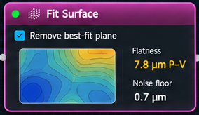 | **Fit Surface: a compact computed summary**  The fit option, contour thumbnail, flatness and noise floor make a useful short node. Do not place an interactive 3D editor inside this body. The thumbnail summarizes the same result that the larger view displays. |

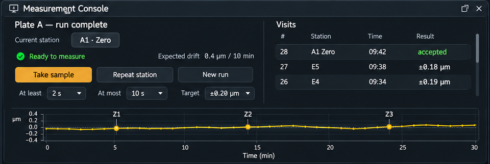

The console combines station identity, readiness, sampling actions, limits,
visits and a zero-history plot. It is one integrated operator panel rather than
a row of unrelated dashboard tiles. Keep high-frequency actions easy to find.
During a sample, show progress and the appropriate cancel/keep actions.

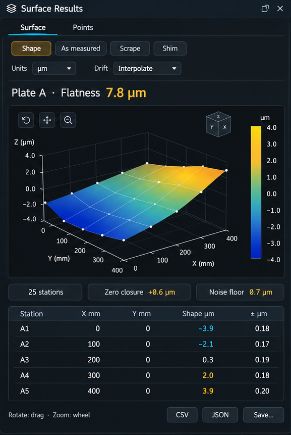

The result view combines a mode selector, 3D surface, color scale, summary
values and a numeric table. Axes and units stay visible. Selecting a row and
selecting a measured point should identify the same station. Distinguish
measured points from the surface interpolated between them. A line survey
uses a line plot and uncertainty bars instead.

**Correct these details:** the Plan cable must route directly to Session,
not behind Sample Window. The central zero marker and **A1 Zero** disagree.
Use one identity. The pictured surface and numbers are illustrative and do
not validate plane removal, uncertainty or drift correction.

## 10 to 15. Computer building and signal ribbons

These references extend the same editor to nested logic circuits. The owner
accepted **mockup 12** as the ribbon appearance target. Mockups 13 to 15 explore
different connection meanings. They are proposals, not a tested simulator.
Read [the circuit design notes](circuit-graph-design.md) for source research,
type rules, routing options and the remaining execution gaps.

### 12. Ribbon connections - appearance reference

This is the owner's accepted image, originally generated as
`exec-7e637849-7b36-4f1d-9578-2ba8fba2c953.png`. Use it for the cable finish.

- A bus contains individually visible signal lanes. Green identifies the address
  bus; violet identifies the data bus. Brightness shows each bit's value.
- Dark gaps separate the lanes. A narrow highlight and soft shadow give them
  depth. Keep this treatment restrained against the neutral canvas.
- The lanes remain parallel around broad rounded bends. Inner lanes need enough
  turning radius. A ribbon never narrows, twists or changes lane order at a bend.
- A single bus socket has a housing with lane contacts. These contacts are a
  visualization of the typed bus, not eight unrelated input pins.
- Names, widths, lane numbers and numeric values explain the connection.
  Color alone is insufficient. Low signals remain visible.
- **Route**, **Corners**, and **Bus** are separate appearance controls. Routing
  changes the path; corner treatment changes its bends; bus display changes
  compact versus ribbon presentation.

**Correct when implementing:** derive toggles, contact lights, cable lanes and
readouts from the same value. Some generated contact lights disagree with the
readout. The address is `0x33 = 00110011`; data is `0x66 = 01100110`, most
significant bit first. The pictured doglegs are softer than strict orthogonal
routing. An orthogonal implementation uses straight axis-aligned runs joined by
rounded corners, unless the user selects **Curved**.

### 13. Ribbon fan-out - one bus, two readers

The neutral collar makes a connection branch easy to recognize. It has no
category header, parameters, execution state or computation. It is a routing
junction. Both outgoing cables carry the **whole** incoming bus.

Keep the width, lane order and family color on every branch. Both readers show
`0x66`. Moving the collar changes the route; it does not add a processing node.
Selecting the shared trunk highlights both destinations. Selecting a branch
identifies that reader. Removing one branch leaves the other connected.

**Correct when implementing:** the generated lower bit strip has an extra
cell. Each leg must contain exactly eight lanes and each byte strip exactly
eight cells. Do not infer electrical multi-driver support from this picture;
there is one source and two readers.

### 14. Ribbon split - eight bits become two groups of four

**Split 8** has a teal category header and typed pins. It is a real conversion
node. This distinguishes it from the neutral fan-out collar.

The upper output carries bits `[7:4]`; the lower carries `[3:0]`. Each
outgoing ribbon has four lanes. Keep the original lane identity in the mapping
labels. The output values each have their own four-bit index range internally.
For `0x66`, both results are `0x6 = 0110`. A **Join** node is the inverse:
it explicitly maps named ranges into a larger typed value.

**Correct when implementing:** replace the generated text **big6 / 0x6** with
**6 / 0x6**. Do not copy the gray output contacts as a disconnected state.
Type and lane mapping must drive these displays.

### 15. Ribbon breakout - individual bit access

The tall narrow **Breakout 8** has one bus input and eight scalar outputs.
Each output has its own label and connection. The right **Bit Monitor** gives
the rows enough height to read and connect them.

A selected scalar wire gets its own route handles and value badge. Selecting
`b6` must not select every bit in the bus. The related lanes can receive a
secondary highlight when tracing the signal back through the adapter.
**Join 8** performs the reverse mapping; merely drawing wires together does not.

**Correct when implementing:** the monitor's eight values, top to bottom, are
`0,1,1,0,0,1,1,0`. Use those values consistently. The generated source strip
has an extra cell. The bus input also needs an explicit named socket; the
small arrow at the adapter's left edge is not sufficient on its own.

### 10. Computer workbench - hierarchy and custom panels

The project tree makes the construction hierarchy visible: ALU, adder, full
adder and half adder; memory, bank and bit cell. A reusable block appears as a
node with an **Open subgraph** action. Its compact GUI can summarize values
without exposing every internal gate.

Registers, the ALU, memory and small sinks have different footprints. The
**Memory Inspector** and **Logic Analyzer** are independent docked Views.
They have no graph pins. Both read graph state; the inspector does not own a
second copy of memory.

**Correct when implementing:** the result register needs separate `data`,
`load` and `clk` inputs. The drawn result bus incorrectly lands on **load**.
Remove the clock line ending at the ALU header; a combinational ALU does not
need that connection. Give **Memory Test** explicit output sockets. Bit strips
must match the hexadecimal values. The analyzer's nanosecond labels illustrate
a possible simulation time scale; they do not establish timing accuracy or an
engine clock domain. This is a datapath and memory bench, not a complete CPU.

### 11. Subgraph interface - public pins and internal structure

The breadcrumbs identify an instance deep in the hierarchy. Graph input and
output terminals expose names, directions and types. They are movable graph
objects, separate from the dock layout.

An expanded neutral frame exposes the first half adder's internal gates.
The second half adder stays collapsed. A tiny OR gate needs less space than
either subgraph. The **Subgraph Interface** inspector lists public ports in
order and previews the collapsed node with the same interface.

An interface edit must preserve connections by stable port identity, not
display name or row position. The design notes describe the proposed mapping.
The **Test Vectors** dock is a custom View bound to results from the graph.

**Correct when implementing:** the generated truth table repeats a combination,
has incorrect rows and shows unverified **Pass** results. Some wire values and
carry connections are also wrong. Use the exact full-adder mapping in the design
notes. The drawing is a layout reference, not a validated circuit or test run.

### Ribbon variants of 10 and 11

The owner accepted both original electronic workspaces and asked to keep them.
These additional variants apply the ribbon finish at normal workspace scale.

The workbench keeps its panels and varied node sizes. Small green and violet
ribbons identify operand and memory buses. Amber identifies the result bus.
Scalar clock and write signals remain single conductors. The result register
now has a separate **data[7:0]** socket, and the stray clock route to the ALU
header is removed.

**Remaining limits:** the lane count is stylized at this scale. Do not reduce
the actual bus width to the number of visible painted stripes. Load controls
and the complete register update sequence still need a functional design.
Generated bit strips and readout details are not authoritative.

The full adder retains one-bit ports. Its grouped input and output routes
illustrate a **visual cable** of named independent wires, unlike the workbench's
typed eight-bit buses. Neutral clamps group the route; they do not join signal
values. Green, violet and amber lanes retain separate identities. The compact
gate conductors use the same rounded finish as the larger ribbons.

**Remaining limits:** the short clamps suggest grouping but do not clearly
show long parallel three-lane and two-lane trunks. The first half adder's AND
inputs are swapped in the drawing (equivalent for AND, but not the intended
port mapping). The second half adder's carry badge still says **0**; it should
be **1**. Its carry route also meets the OR header rather than its named pin.
The table still repeats an input combination. Use the mapping and expected
values in the design notes. **Illustrative vectors** is not a test result.

## Shared controls and implementation

The cutouts above are examples of one control vocabulary. Build shared widgets
for their recurring interactions; do not recreate an unrelated style for each
project. The same parameter shown in two places must represent one value.

### Typography and spacing

Use Segoe UI or the Windows UI font stack for controls. Use a monospace face for
code and logs, with tabular digits for measurements and times. These are starting
metrics at 100% UI scale, not sizes measured from the mockups:

| Element | Starting size |
|---|---|
| Normal label and value | 13 px |
| Secondary text | 12 px |
| Node title | 14 px, semibold |
| Panel title | 14 px, semibold |
| Control height | 26-30 px |
| Node header height | 30-34 px |
| Small icon drawing | 16 px, inside a larger hit area |
| Node body padding | 10-12 px |
| Gap within a control group | 6-8 px |
| Gap between groups | 12-16 px |
| Control corner radius | 3-4 px |
| Node corner radius | 6 px |
| Normal border / selected outline | 1 px / 2 px |

Size for Windows display scaling and readable text. Do not scale a whole PNG
into an interface or compress every control to make a graph fit. Keep labels
and values aligned. Put units beside values. Use short labels and expandable
details instead of repeated large blocks of explanation.

### Shell and docking

The window is a dock system. Keep a narrow top toolbar, a central graph, optional
side panels, optional lower panels, and a slim status bar. The graph should get
most of the space while it is the main task.

**Project** lists **Graphs**, **Nodes**, **Views**, **Widgets** and **Types**.
Its node entries can repeat their header color as small swatches. **Layers**
contains the compilation **Base** and **Slot**. It is not an effects stack.

A custom view has the same neutral tab, title, splitter, float and close controls
as a built-in dock. A selected tab uses the application accent. Docks can move
and float as defined in spec 15.2. Keep the Windows caption controls familiar.

The **Views** menu opens panels. Expanded node GUIs use the graph area and provide
**Back** or Esc. These are different navigation actions.

Keep the status bar concise: state, error count, project and compile-layer state.
Build time and execution time need separate labels. Do not use decorative badges
to imply a service is connected or a node has finished running.

### Header, body and pins

A header contains the node name, kind icon, clock-domain icon and state indicator.
Show the slot marker when relevant. Place expand/collapse actions consistently.
Do not replace kind icons with a Rust logo.

Put inputs on the left and outputs on the right, with readable names. Pins sit
at the body edge. Route wires to pins, not to a control row or a preview image.
The space for a pin label must not collide with a slider or button.

Use subtle gray wires by default, or named signal-family colors where useful.
Same-domain wires are solid. Cross-domain wires are dashed. Do not color all
wires green because the graph ran successfully. Use the application accent
for selection without erasing a cable's lane colors. Follow the full
[connection rules](#node-connections) for routing and interaction.

### Layout and interaction

Arrange dependencies from left to right where practical. Branch only when the
data branches. Keep visible gutters for wires and avoid routing through nodes.
An output can be tiny; it should not resemble a large data editor.

Use neutral borders for subgraphs. Their label and collapse control explain
structure. A subgraph must not look like a warning because its enclosing box
happens to be yellow.

Graph gestures and GUI gestures must stay separate. Dragging a curve handle
edits the curve; dragging a node header moves the node. Interacting with a field,
plot or scrollable table must not accidentally drag the whole node. Keep focus
visible and expose meaningful names for icon-only actions.

### Reusable widgets

Use the same control vocabulary everywhere. A slider in a node and the same
slider in a view should share geometry, text, focus and keyboard behavior.

| Element | Visual and interaction guidance |
|---|---|
| Number field | Label, value and unit; stable alignment; optional compact step buttons |
| Slider | Thin neutral track, clear thumb and an exact numeric field when precision matters |
| Toggle / checkbox | Clear on/off shape; local focus color; no success meaning merely because checked |
| Dropdown | Single-line value, visible disclosure; avoid repeating a full form for a simple summary |
| Curve | Plot axes, meaningful range, visible handles, selected-point values, reset action |
| Color ramp | Stops with handles, selected color and position; do not rely on the ramp alone for precision |
| Image / mask | Stable preview area, optional overlays and handles; explicit crop/ROI coordinates |
| Waveform | Time axis, playhead and trim handles; transport separate from graph execution |
| Table | Aligned columns, units in headings, selected row and compact row actions |
| Layer stack | Ordered rows, drag handles, visibility, amount, selected layer and expandable properties |
| Plot | Labeled axes, units, legible traces, uncertainty where relevant; restrained grid |
| Viewport | Clear source selection, orbit/reset controls and relevant lighting or display controls |

Make reusable widgets for recurring patterns. Do not implement a second curve
editor or a different table style for each example project.

The SDK's Rust **Ui** function describes a widget tree; the editor draws it with
the shared theme. Nodes do not supply arbitrary independent web pages.
Reusable controls live in widget folders. See spec 4.3 and 6.2.

Node GUIs support **Compact** in the body, **Large** in the inspector and optional
**Full** in the graph area. More space should reveal useful controls, not merely
magnify a bitmap. Graph computation must work without the GUI.

Ordinary node UI runs between processing calls. Audio GUI changes use settings
and messages; they do not mutate the realtime processing state directly.
Preserve these rules when implementing responsive controls.

### Node GUI versus custom view

A node GUI edits or displays one node. It has a colored node header and graph
pins. A custom view can coordinate several nodes. It has a neutral dock header,
no pins and no clock domain.

A view reads graph outputs and sends parameter edits or commands through the
same paths as the editor. Do not duplicate the measurement session, timeline
or material state in the panel. Undoable edits use the graph's undo path.

Compact node bodies may show image previews, plots and 2D canvas controls.
Interactive GPU viewports belong in a view or a Large/Full node GUI. A rendered
ball thumbnail inside a node is an image, not a separate interactive 3D surface.

## Theme and palette

### What is actually in mockup 9

The screenshot is the visual reference. Its pixels are not a source theme file.
The table below reports the median red, green and blue values in six small
regions. Coordinates are source-image pixels, written as x, y, width, height.
The [sample record](mockups/details/sampled-surfaces.json) preserves these results.

| Region | Sample rectangle | Observed median | Proposed neutral role |
|---|---|---|---|
| Toolbar | 150, 5, 12, 30 | #171D22 | app: #141414 |
| Canvas, including grid | 1075, 700, 80, 50 | #10151A | canvas: #181818 |
| Material Layers body | 688, 640, 8, 17 | #222426 | node: #262626 |
| Preview dock | 1210, 879, 340, 10 | #15191C | panel: #202020 |
| Raised tab | 1207, 137, 15, 16 | #404446 | raised: #303030 |
| Export button | 1208, 904, 25, 20 | #2B3239 | raised: #303030 |

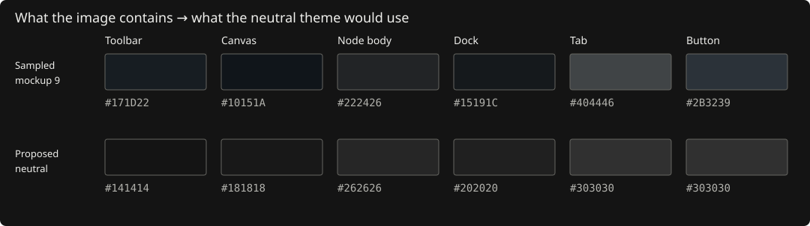

The samples confirm a blue cast even in the preferred image. The proposed
surfaces below deliberately remove that cast. They preserve dark-to-light
hierarchy rather than claim to be exact copies of hidden original CSS values.
The owner's chosen direction is the restrained look of mockup 9 and less blue.
The individual token values remain a design proposal.

### Proposed implementation palette

Use shared tokens, not local guesses in each component. Equal RGB values keep
the large surfaces neutral. Color remains in the blue logo, node headers,
state and visual data. Amber is the proposed global focus/action accent, following
the reference's selected tabs and main material action.

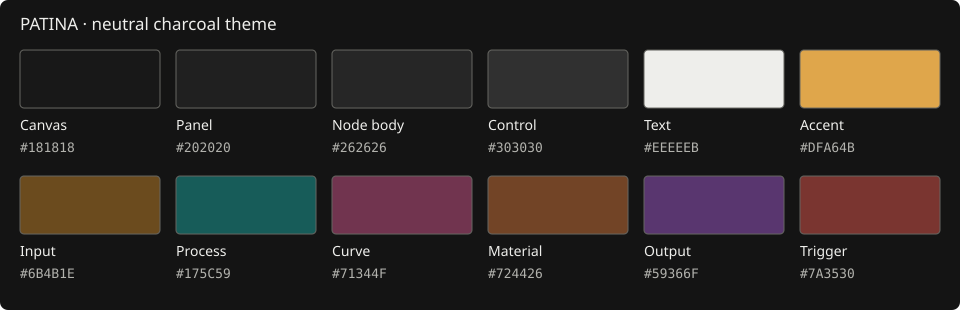

### Surfaces and text

| Token | Hex | Use |
|---|---|---|
| app | #141414 | Window background and narrow outer chrome |
| canvas | #181818 | Graph background |
| panel | #202020 | Docks, inspector and sidebar |
| node | #262626 | Node bodies |
| raised | #303030 | Buttons, tab surfaces and raised controls |
| field | #191919 | Editable fields, inset previews and plot wells |
| hover | #393939 | Neutral hover surface |
| border | #454545 | Panel separators and node outlines |
| control-border | #666661 | Control edges that need stronger definition |
| grid-minor | #202020 | Fine graph grid |
| grid-major | #292929 | Sparse major grid lines |
| text | #EEEEEB | Titles, values and normal labels |
| muted | #B2B2AD | Secondary labels, units and descriptions |
| subtle | #A3A39D | Tertiary information that must remain readable |
| disabled | #73736E | Unavailable controls; also show disabled behavior |
| wire | #BBBBB5 | Normal graph connections |

Use brightness to separate surfaces. Avoid broad blue gradients, glowing panel
edges and black-to-navy backgrounds. A very small neutral header gradient is
acceptable, but flat fills are the default.

### Application accent and state

| Token | Hex | Use |
|---|---|---|
| accent | #DFA64B | Active dock tab, selected wire, focus outside a colored node, primary action |
| accent-hover | #ECC078 | Hover on the primary action |
| accent-ink | #171511 | Text and icons on a filled amber action |
| ready | #75C884 | Ready and successful state |
| warning | #E5B85A | Warning state |
| error | #ED7B78 | Error border, error icon and error text |
| info | #C5C5BF | Informational icon or label |

Use one application accent: amber. Earlier cyan tabs, cyan primary buttons and
blue checked boxes are historical styling. The logo stays blue; its brand color
does not tint the surrounding interface.

Primary action buttons may use amber with dark text. Ordinary buttons stay
neutral. **Run** can be an ordinary button with a play icon; the **Live** indicator
shows running state. Do not give every action button a success-green fill.

Status needs an icon or text as well as color. Amber selection and an amber
warning have different shapes and labels. A neutral slider is not a status
meter. Plots and rendered data may use any colors needed to explain their data.

### Node headers and local focus

These families are defaults for related work. The spec allows a node author to
choose a different header color. Keep similar nodes consistent within a project.
A header color is not a type, clock domain or execution state.

| Family | Header | Selection / focus | Examples |
|---|---|---|---|
| Input / source | #6B4B1E | #E3B869 | Image input, camera, sample player, noise source |
| Processing | #175C59 | #79D4C8 | Filter, mixer, beam finder, mask processing |
| Curve / logic | #71344F | #DE8FBA | Curve editor, ADSR, scoring, remapping |
| Material | #724426 | #D9A17A | Copper base, material layers |
| Output / action | #59366F | #B99BDF | Export, audio output, CRM action |
| Trigger | #7A3530 | #E89C91 | Webhook or event entry |
| Unassigned | #454545 | #DFA64B | A node with no assigned category |

Use **text** on these headers. Keep node bodies neutral. Use the lighter paired
color for a selected node's outline and focused control. A magenta node gets a
pink outline; a teal node gets a light teal outline. An unassigned node follows
the spec and uses the application accent for selection.

Keep the state indicator separate from the title fill. An error retains its
red outer border and error icon even when selected. Use a small inner selection
mark if both states need to be visible.

The listed normal text/header pairs and primary-button pair were checked
numerically. They exceed 4.5:1 contrast. That does not validate every combination
of transparency, hover, chart content or disabled styling in a future UI.

## Interaction states to refine during implementation

The visual references are sufficient to start implementation. Keep these details
visible during visual review; they can be refined alongside the working GUI.

- **Controls and nodes:** compare normal, hovered, focused, selected, disabled
  and error states together. Include a selected node with an error. Keep both
  selection and error indicators readable without one replacing the other.
- **Connections:** show the wire-drag preview, compatible and incompatible
  sockets, selected branches, editable bends and obstructed routes. Distinguish
  a routing obstruction from an invalid connection. Keep endpoints traceable
  while editing, not only after the connection is finished.
- **Docking and resizing:** show docking drop targets, active tabs and minimum
  panel sizes. Check how rich node controls adapt when space becomes tight.
  Preserve readable labels and usable controls instead of shrinking the entire
  GUI or clipping essential actions.

## Delivery check

1. Open the full reference for the feature being implemented.
2. Compare the relevant cutout at a readable size. Check the control arrangement,
   visual hierarchy and spacing, not just its header color.
3. Check that simple nodes remain small and richer editors receive useful space.
4. Trace every wire. Check named pins, manual bends, whole-cable clearance,
   crossing versus junction, and the route after moving or resizing a node.
5. Check one parameter through the node GUI, a bound view and undo. Values must agree.
6. Check the control with mouse and keyboard at the intended Windows display scale.
7. Exercise unavailable, empty, loading, stale and error states where relevant.
   A convincing screenshot must not conceal an operation that does not work.
8. Check the blue logo, neutral surfaces and distinction between header, focus and state.
9. Correct the generated artifacts called out in the matching reference section.
10. Report what was implemented and tested separately from what is still illustrative.

### Reference assets and limits

The eight original mockups remain unchanged. Nine added images cover computer
building and signal ribbons: mockups 10 through 16 and ribbon variants of 10 and 11.
All 38 original close-ups are exact,
unscaled crops. Their source rectangles are in
[crops.json](mockups/details/crops.json). The crops preserve source mistakes;
the adjacent notes explain them.

These are design references, not production icons or working controls. The
palette is a proposed token set. The sampled colors describe the PNG, not an
existing implementation. No image in this guide proves a service connection,
camera workflow, shader compiler or export operation.

