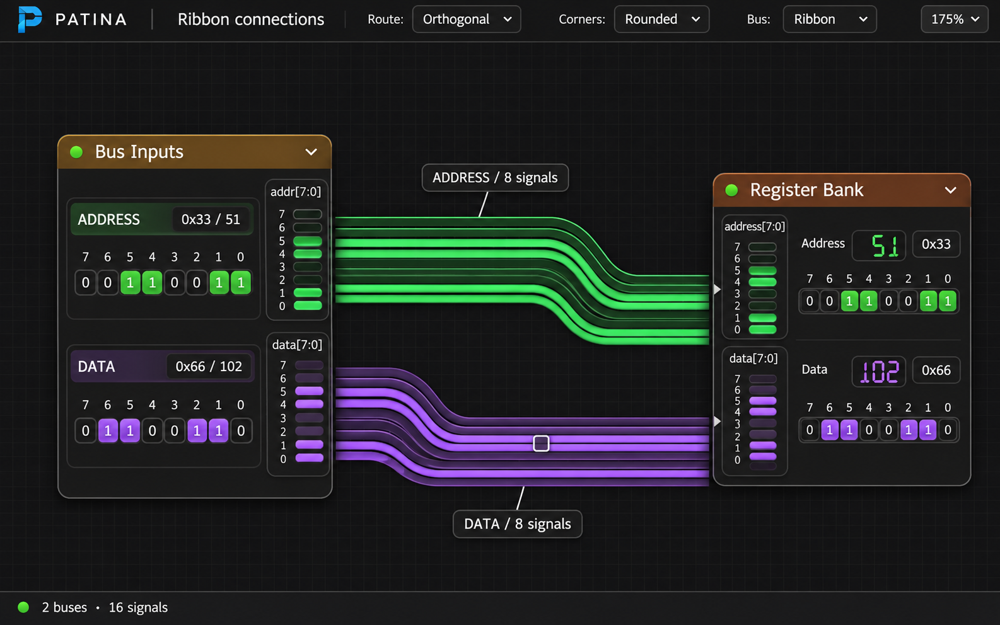
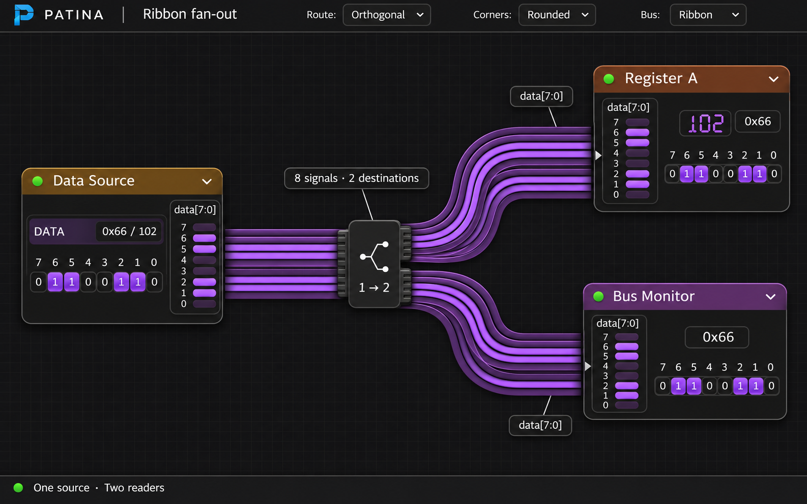
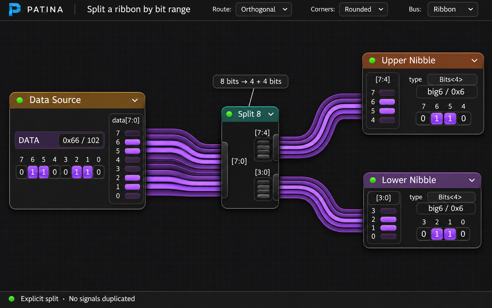
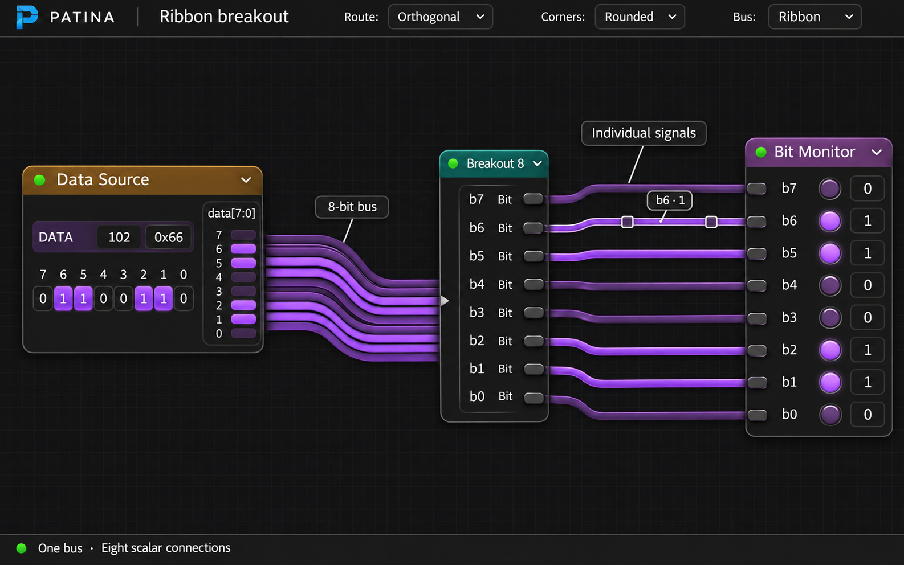
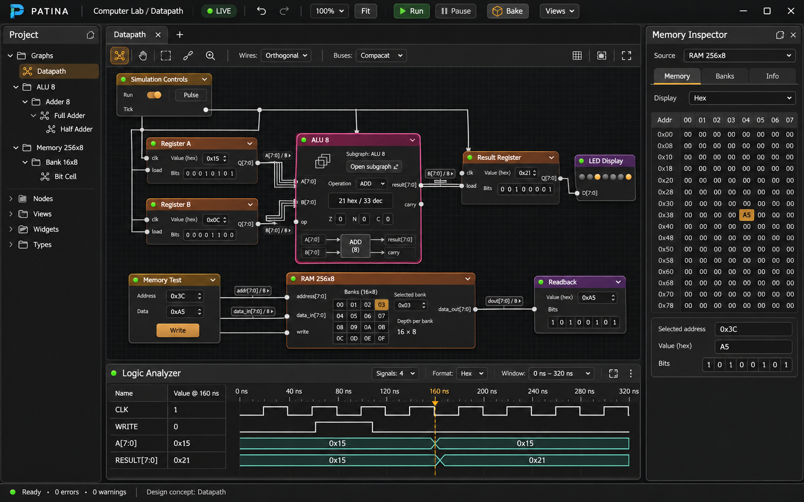
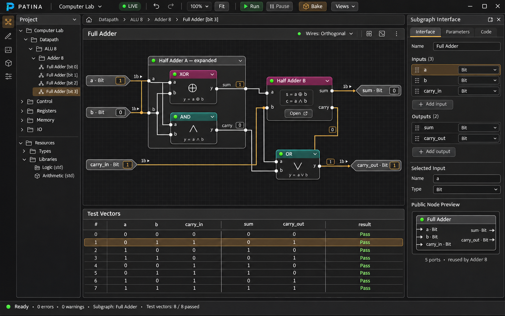
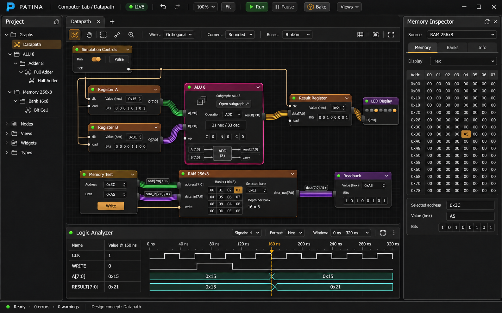
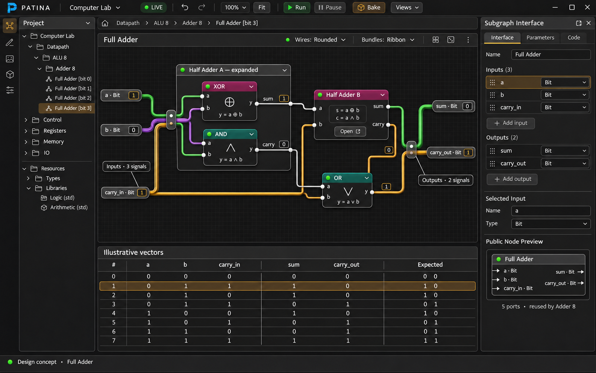

# GUI visual guide: Circuit mockups

Part of the [GUI visual guide](../gui-visual-guide.md).

## 10 to 15. Computer building and signal ribbons

These references extend the same editor to nested logic circuits. The owner
accepted **mockup 12** as the ribbon appearance target. Mockups 13 to 15 explore
different connection meanings. They are proposals, not a tested simulator.
Read [the circuit design notes](../circuit-graph-design.md) for source research,
type rules, routing options and the remaining execution gaps.

### 12. Ribbon connections - appearance reference

This is the owner's accepted image, originally generated as
`exec-7e637849-7b36-4f1d-9578-2ba8fba2c953.png`. Use it for the cable finish.

- A bus contains individually visible signal lanes. Green identifies the address
  bus; violet identifies the data bus. Brightness shows each bit's value.
- Dark gaps separate the lanes. A narrow highlight and soft shadow give them
  depth. Keep this treatment restrained against the neutral canvas.
- The lanes remain parallel around broad rounded bends. Inner lanes need enough
  turning radius. A ribbon never narrows, twists or changes lane order at a bend.
- A single bus socket has a housing with lane contacts. These contacts are a
  visualization of the typed bus, not eight unrelated input pins.
- Names, widths, lane numbers and numeric values explain the connection.
  Color alone is insufficient. Low signals remain visible.
- **Route**, **Corners**, and **Bus** are separate appearance controls. Routing
  changes the path; corner treatment changes its bends; bus display changes
  compact versus ribbon presentation.

**Correct when implementing:** derive toggles, contact lights, cable lanes and
readouts from the same value. Some generated contact lights disagree with the
readout. The address is `0x33 = 00110011`; data is `0x66 = 01100110`, most
significant bit first. The pictured doglegs are softer than strict orthogonal
routing. An orthogonal implementation uses straight axis-aligned runs joined by
rounded corners, unless the user selects **Curved**.

### 13. Ribbon fan-out - one bus, two readers

The neutral collar makes a connection branch easy to recognize. It has no
category header, parameters, execution state or computation. It is a routing
junction. Both outgoing cables carry the **whole** incoming bus.

Keep the width, lane order and family color on every branch. Both readers show
`0x66`. Moving the collar changes the route; it does not add a processing node.
Selecting the shared trunk highlights both destinations. Selecting a branch
identifies that reader. Removing one branch leaves the other connected.

**Correct when implementing:** the generated lower bit strip has an extra
cell. Each leg must contain exactly eight lanes and each byte strip exactly
eight cells. Do not infer electrical multi-driver support from this picture;
there is one source and two readers.

### 14. Ribbon split - eight bits become two groups of four

**Split 8** has a teal category header and typed pins. It is a real conversion
node. This distinguishes it from the neutral fan-out collar.

The upper output carries bits `[7:4]`; the lower carries `[3:0]`. Each
outgoing ribbon has four lanes. Keep the original lane identity in the mapping
labels. The output values each have their own four-bit index range internally.
For `0x66`, both results are `0x6 = 0110`. A **Join** node is the inverse:
it explicitly maps named ranges into a larger typed value.

**Correct when implementing:** replace the generated text **big6 / 0x6** with
**6 / 0x6**. Do not copy the gray output contacts as a disconnected state.
Type and lane mapping must drive these displays.

### 15. Ribbon breakout - individual bit access

The tall narrow **Breakout 8** has one bus input and eight scalar outputs.
Each output has its own label and connection. The right **Bit Monitor** gives
the rows enough height to read and connect them.

A selected scalar wire gets its own route handles and value badge. Selecting
`b6` must not select every bit in the bus. The related lanes can receive a
secondary highlight when tracing the signal back through the adapter.
**Join 8** performs the reverse mapping; merely drawing wires together does not.

**Correct when implementing:** the monitor's eight values, top to bottom, are
`0,1,1,0,0,1,1,0`. Use those values consistently. The generated source strip
has an extra cell. The bus input also needs an explicit named socket; the
small arrow at the adapter's left edge is not sufficient on its own.

### 10. Computer workbench - hierarchy and custom panels

The project tree makes the construction hierarchy visible: ALU, adder, full
adder and half adder; memory, bank and bit cell. A reusable block appears as a
node with an **Open subgraph** action. Its compact GUI can summarize values
without exposing every internal gate.

Registers, the ALU, memory and small sinks have different footprints. The
**Memory Inspector** and **Logic Analyzer** are independent docked Views.
They have no graph pins. Both read graph state; the inspector does not own a
second copy of memory.

**Correct when implementing:** the result register needs separate `data`,
`load` and `clk` inputs. The drawn result bus incorrectly lands on **load**.
Remove the clock line ending at the ALU header; a combinational ALU does not
need that connection. Give **Memory Test** explicit output sockets. Bit strips
must match the hexadecimal values. The analyzer's nanosecond labels illustrate
a possible simulation time scale; they do not establish timing accuracy or an
engine clock domain. This is a datapath and memory bench, not a complete CPU.

### 11. Subgraph interface - public pins and internal structure

The breadcrumbs identify an instance deep in the hierarchy. Graph input and
output terminals expose names, directions and types. They are movable graph
objects, separate from the dock layout.

An expanded neutral frame exposes the first half adder's internal gates.
The second half adder stays collapsed. A tiny OR gate needs less space than
either subgraph. The **Subgraph Interface** inspector lists public ports in
order and previews the collapsed node with the same interface.

An interface edit must preserve connections by stable port identity, not
display name or row position. The design notes describe the proposed mapping.
The **Test Vectors** dock is a custom View bound to results from the graph.

**Correct when implementing:** the generated truth table repeats a combination,
has incorrect rows and shows unverified **Pass** results. Some wire values and
carry connections are also wrong. Use the exact full-adder mapping in the design
notes. The drawing is a layout reference, not a validated circuit or test run.

### Ribbon variants of 10 and 11

The owner accepted both original electronic workspaces and asked to keep them.
These additional variants apply the ribbon finish at normal workspace scale.

The workbench keeps its panels and varied node sizes. Small green and violet
ribbons identify operand and memory buses. Amber identifies the result bus.
Scalar clock and write signals remain single conductors. The result register
now has a separate **data[7:0]** socket, and the stray clock route to the ALU
header is removed.

**Remaining limits:** the lane count is stylized at this scale. Do not reduce
the actual bus width to the number of visible painted stripes. Load controls
and the complete register update sequence still need a functional design.
Generated bit strips and readout details are not authoritative.

The full adder retains one-bit ports. Its grouped input and output routes
illustrate a **visual cable** of named independent wires, unlike the workbench's
typed eight-bit buses. Neutral clamps group the route; they do not join signal
values. Green, violet and amber lanes retain separate identities. The compact
gate conductors use the same rounded finish as the larger ribbons.

**Remaining limits:** the short clamps suggest grouping but do not clearly
show long parallel three-lane and two-lane trunks. The first half adder's AND
inputs are swapped in the drawing (equivalent for AND, but not the intended
port mapping). The second half adder's carry badge still says **0**; it should
be **1**. Its carry route also meets the OR header rather than its named pin.
The table still repeats an input combination. Use the mapping and expected
values in the design notes. **Illustrative vectors** is not a test result.
