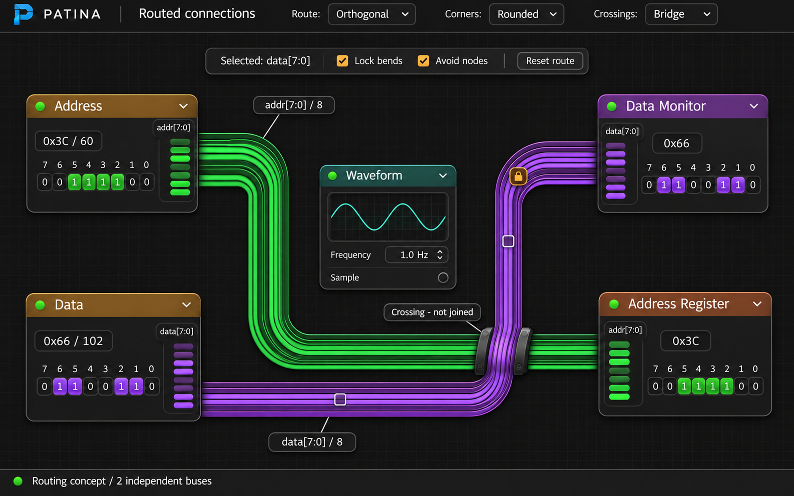

# GUI visual guide: Connections between nodes

Part of the [GUI visual guide](../gui-visual-guide.md).

Treat the connection as part of the interface: its sockets, labels, route,
selection and meaning must be readable together. This applies to image,
automation, audio and simulation graphs. The ribbon studies demonstrate the
principle; an electrical cable is not the only useful connection style.

[Spec 15.9](../spec/15-editor.md#159-connections-and-routing) defines the shared
requirements. The interactions below describe the design target, not current
implementation. Automatic routing and raised bridges are optional refinements.

## Meaning, geometry and finish

Keep three independent decisions: **what connects**, **where the route goes**,
and **how it is drawn**. Changing a spline to a ribbon does not create more
signals. Bending a connection around a node does not add a dependency.

| Connection | What the appearance must explain |
|---|---|
| Ordinary typed wire | Source, destination, direction and type |
| Typed multi-signal bus | Width, ordered lanes and one typed bus socket |
| Visual cable of separate wires | Member names and their separate endpoints; grouping does not merge values |
| Fan-out | One source, several readers; each branch keeps the full value |
| Split, join or merge | A real node with declared input/output mapping or combination behavior |
| Crossing | Two independent routes; no junction marker |
| Order wire | An execution dependency that carries no data |

The distinction is defined by the graph, not by painted geometry. A type with
no lane description (spec 6.3) uses a normal connection and a type label. Do not invent
strands from a value's memory size or from the number of items in a list.

| Appearance control | Purpose |
|---|---|
| **Route** | Curved, Orthogonal or Polyline |
| **Corners** | Sharp or Rounded, where applicable |
| **Bus** | Compact or Ribbon; neither option changes the pin count |
| **Crossings** | Clear gap; optional raised bridge |
| **Use graph default** | Inherit appearance, or override this connection |
| **Lock bends** | Optional protection for manually arranged route points |
| **Reset route** | Discard manual geometry for the selected route; keep connectivity |

Keep the same styling vocabulary across node GUIs and custom Views. A project's
connection family can have a color or channel presentation, while the editor
retains consistent sockets, focus, selection, errors and picking. This does not
define a new connection-plugin API.

## Drawing and editing a route

1. Start at a named socket. Show the source and compatible destinations.
2. Preview the connection while dragging. Leave room to approach the target socket.
3. Place intermediate points when the route needs to wrap around a node.
4. Finish at a compatible socket. Canceling leaves the existing graph intact.
5. Select the connection to reveal route handles and its endpoints.
6. Drag a point, or move an orthogonal segment sideways, to adjust the path.
7. Use **Reset route** to return that connection to automatic or default geometry.

Dragging a route is different from dragging its endpoint. An endpoint reconnect
uses the normal type, ownership and cycle checks. Removing a focused route point
removes that bend, not the connection. Give **Remove route point** and
**Disconnect** separate actions. Support undo, redo, cancellation and keyboard
access. A generous screen-space hit area makes a thin wire usable on Windows
without drawing every wire thick.

A selected trunk identifies all of its branches. A selected branch identifies
one destination. For a crowded cable, offer a member list and trace one named
lane. Keep the rest visible enough to understand the group. A selected colored
wire can use an amber outer mark and handles without replacing its family color.

## Keep space for the whole connection

Route around node bodies, expanded custom GUIs and their controls. Reserve
space for the cable's full width, corner sweep, socket approach and labels.
Rounding a safe centerline must not make the outer lane cut through a node.

When a node moves, resizes or changes its pin layout, update the affected
endpoint approaches and unfixed sections. Preserve the user's manual bends.
If a fixed point now lies inside a node, show **Route obstructed** and expose
the relevant handle. Keep the graph connected. Do not silently erase the
user's route or make a layout problem look like a type or execution failure.

An expanded subgraph can contain its internal routes. Wires crossing its
interface still use the actual boundary ports. An ordinary annotation frame
does not create new ports or hide connectivity.

Automatic routing should prefer a stable, readable route over constant global
rearrangement. Use empty corridors; reduce unnecessary bends and crossings.
At distant zoom, use a compact width badge when individual lanes cannot be
resolved. Close zoom must recover the exact lane order and count.

## Crossings, bridges and locks

Draw a junction only where the graph branches. At an unrelated crossing, keep
both paths traceable with a gap or bridge. Do not use an ordinary filled dot.
For a ribbon, raise the whole cable as one object while preserving every lane.
A bridge has no execution state, ports or latency.

Over/under order should remain stable while panning, zooming or selecting.
Selection can add an outline; it must not silently swap the two routes.
A dense series of bridges is a reason to improve the route, not add more chrome.
Near bends or sockets, prefer a small clear gap if a bridge would not fit.

**Lock bends** means the router preserves manual geometry. It does not freeze
values, disable editing of the node or bypass connection checks. Endpoints
still follow their nodes. If that makes the fixed route impossible, expose
the conflict. Automatic avoidance and locks are optional design directions.

## 16. Routed connections and a crossover bridge

This study adapts the supplied game's use of routing space and crossover
collars to Patina's charcoal theme. It does not establish how the game's
controls work.

- The green address route wraps left and below the unrelated **Waveform** node.
- The violet data route wraps below and to the right. It passes over the green
  bus at the graphite bridge. **Crossing - not joined** explains the distinction.
- Square handles identify an editable route. A padlock identifies a fixed bend.
- **Avoid nodes**, **Lock bends** and **Crossings** show possible routing controls.
  They do not demonstrate working algorithms.
- Keep the restrained highlights and rounded conductors from mockup 12.
  The bridge hardware is optional; the connection must remain readable without it.

**Correct when implementing:** some generated strips have extra cells and the
contact lights do not consistently match the data. Address must be
`0x3C = 00111100`; data must be `0x66 = 01100110`. Lane count, labels and
lights must all come from the same value. The image also needs explicit **1 Hz**
or other actual units on a waveform axis if it presents a measured trace.

## Other connection cases to leave room for

These are extension candidates, not commitments to add every feature.
Use them to check that the connection model is broader than electronics.

| Case | Useful presentation | Semantic boundary |
|---|---|---|
| Named fields or channels | Position x/y/z, audio left/right, or image channels in a labeled cable | Exposing connectable fields requires an explicit typed adapter; a preview alone adds no pins |
| Variable-size collection | Type plus item-count badge and a viewer | A list of 1,000 items is one value, not automatically 1,000 concurrent wires |
| Merge, mixer or selector | Several inputs into a small explicit node | The node defines combination or choice; routing collars never merge sources |
| Stream or cross-domain connection | Direction, Latest value or Queue label, actual drop count | Keep the dashed domain marker and queue rules from spec 9.1 |
| Probe or pinned value viewer | Small attached readout with source and sample age | Observation follows spec 5.3; it does not become a hidden processing stage |
| Feedback route | Clear return path and visible Delay node | A loop-shaped wire does not legalize a cycle |
| Named route continuation | Paired endpoints with matching IDs and navigation between them | Optional presentation only; matching text must never create a hidden connection |
| Request and reply pair | Two labeled lanes in one visual cable | Preserve their separate directions and types; no implicit bidirectional data wire |

Additional types should describe their own values. A connection kind of the
project describes their lanes (spec 6.3). The editor owns routing and the common interaction rules. Exact SDK
extensions remain to be designed; this guide does not choose a framework,
serialization format or arbitrary renderer plugin mechanism.

## Connection checks for implementation

These are checks to run when the editor exists, not results from these images.

- Trace each route to named sockets. Test crowded crossings and fan-out.
- Move and resize an intervening node. Check the whole ribbon clears its GUI.
- Move an endpoint with fixed bends. Check the route stays editable and connected.
- Switch appearance and group or ungroup a visual cable. Check the graph is unchanged.
- Remove a branch, undo, and restore it. Check the other readers remain connected.
- Check narrow wires, labels and keyboard selection at Windows scales 100%, 150% and 200%.
