# GUI visual guide: Custom GUI mockups

Part of the [GUI visual guide](../gui-visual-guide.md).

## 4. Custom node canvas

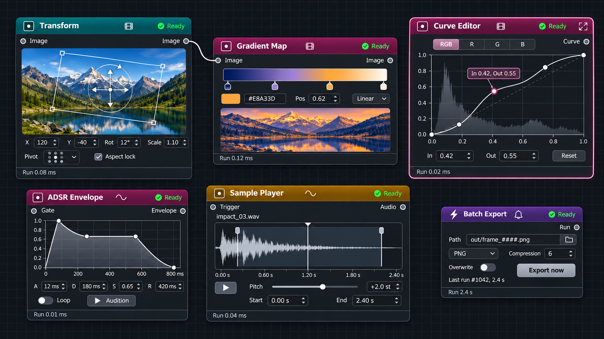

[Open the full-size reference](../mockups/mockup-4-custom-node-canvas.png).

**Match:** varied shapes united by a common header, padding, field style and
runtime footer. This is a widget gallery, not one connected workflow.
The exporter is compact; the visual editors receive space.

| Exact image detail | What an agent should implement |
|---|---|
| 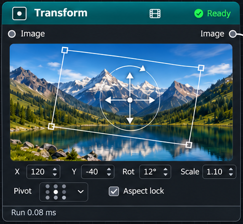 | **Transform: direct manipulation with precise numeric editing**  The rectangle, pivot, rotation arc and axis handles act on the image. Numeric X/Y/rotation/scale fields below are another way to edit the same transform. Aspect lock and pivot presets belong beside those fields. Image interaction must not drag the node. Reuse a 2D gizmo and numeric transform widget. |
| 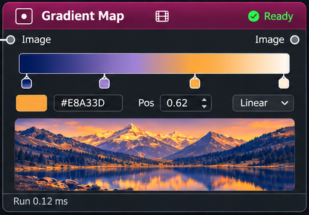 | **Gradient Map: the control explains the result**  The ramp spans the width, with stops below it. The selected stop exposes color, position and interpolation in one row. The shallow image preview shows the effect without turning the node into a tall image viewer. A stop selection is not a new color value until edited. |
| 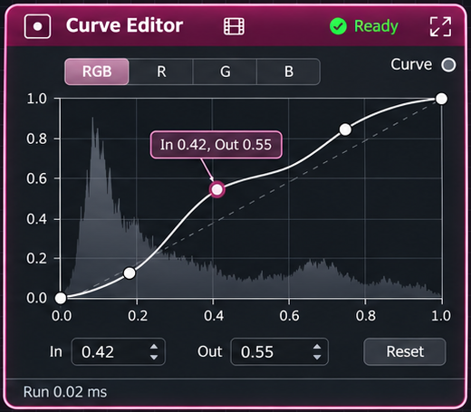 | **Curve Editor: local focus and exact point values**  Channel tabs sit above the plot. The selected handle, tooltip and In/Out fields identify one point. The histogram remains low-contrast behind the curve. The magenta header, pink outline and pink handle form a consistent local focus language. Preserve plot area when resizing its surroundings. |
| 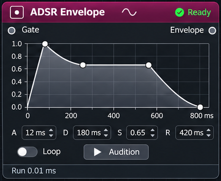 | **ADSR Envelope: one state shown as a graph and fields**  A/D/S/R controls correspond to segments of the envelope. Time and level axes have different units. Keep Audition separate from parameter editing. Dragging a segment and typing a value must agree. The drawn timings are illustrative; implement the envelope from its data, not the screenshot coordinates. |
| 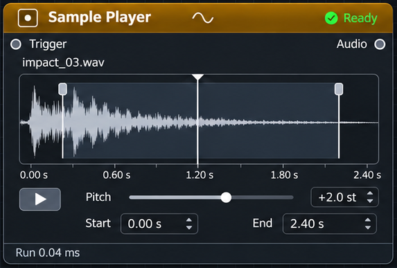 | **Sample Player: width earns its space**  The waveform is wide so trim boundaries and the playhead are legible. Put transport, pitch and start/end values below the waveform. Dragging an endpoint changes the range; playback moves the playhead. Filename, duration and time units should remain visible as state changes. |
| 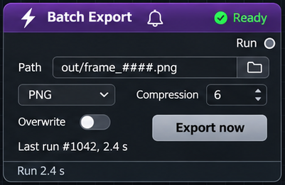 | **Batch Export: compact form and explicit action**  Keep path and browse control together. Format determines available options: this PNG example shows compression. Overwrite is an option, Export now is an action, and the last-run line is feedback. Do not use a full-height preview or oversized button to fill space. |

**Correct these details:** only Transform feeds Gradient Map. There is no valid
ADSR-envelope-to-Sample-Player-trigger wire here. Keep the others disconnected
until their actual types require a connection. Treat plots as illustrations,
and use the neutral palette rather than reproducing the earlier blue background.

## 5. Custom views

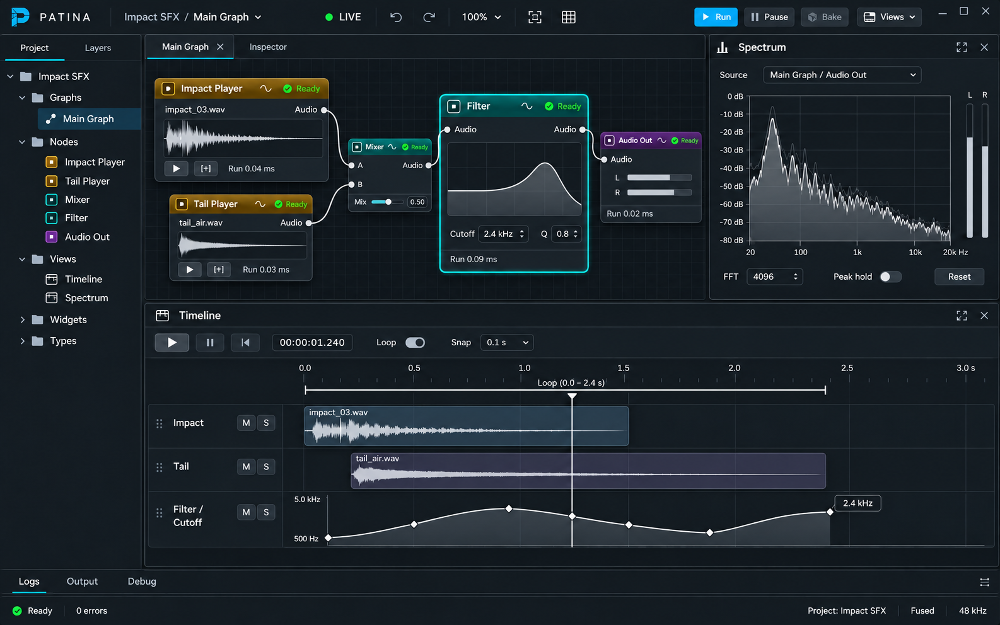

[Open the full-size reference](../mockups/mockup-5-custom-views.png).

**Match:** three useful work surfaces at once. The upper graph explains the
signal chain; the right Spectrum diagnoses the sound; the lower Timeline edits
time. All share one control system and dock framework.

In the graph, two differently sized players feed a tiny Mixer, a larger Filter
and a narrow Audio Out. Amber identifies sources, teal processing and purple
output. Those colors repeat as small swatches in the Project tree. The earlier
Mixer/Filter comparison shows their relative footprints.

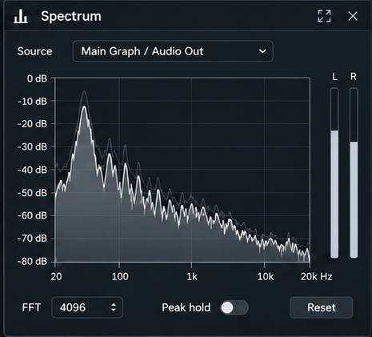

The source selector binds this view to a graph output. The plot needs frequency
and dB axes, restrained grid lines and a trace that remains readable. L/R meters
are separate measurements. FFT size, Peak hold and Reset change this view's
analysis/display behavior. There are no graph sockets on its panel border.

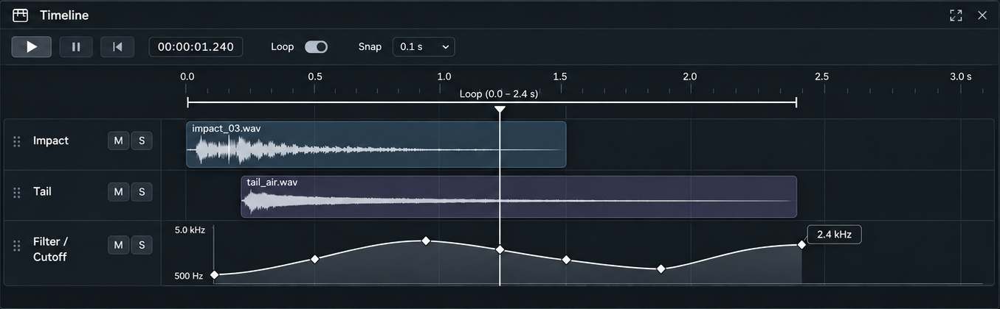

The time ruler, clip lanes and automation lane align horizontally. Transport,
time display, Loop and Snap belong above them. Clips need names, waveform
content, trim boundaries and selection. Automation points share the ruler and
playhead. The cutoff lane needs frequency units, not a generic 0-1 value.

A drag on a clip or automation point edits data. A drag on a dock tab moves
the panel. A graph-pan gesture must not intercept those interactions.

**Correct these details:** use neutral chrome and amber dock focus. The selected
Filter uses its local light teal. Give Mixer its execution-time label when
available. Replace the tiny ambiguous player glyphs with clear named actions.
No wires run to the Timeline or Spectrum.

## 6. Automation graph

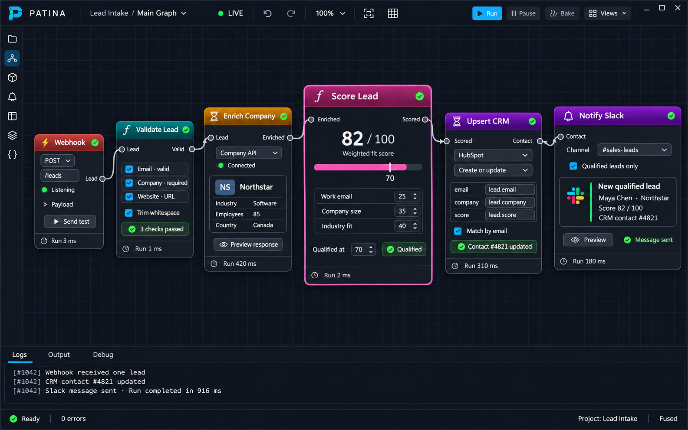

[Open the full-size reference](../mockups/mockup-6-automation-graph.png).

**Match:** Webhook, Validate Lead, Enrich Company, Score Lead, Upsert CRM, then
Notify Slack. There is no long return wire. The collapsed navigation rail gives
the graph room. Richer steps get larger bodies.

| Exact image detail | What an agent should implement |
|---|---|
| 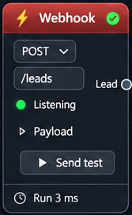 | **Webhook: start small, disclose detail**  Method and endpoint identify the trigger. Listening is state, Payload is expandable detail, and Send test is an action. The output name remains visible. The body should not reserve space for a large payload table while the payload is collapsed. |
| 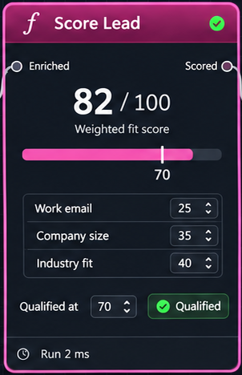 | **Score Lead: give the decision model space**  The prominent score and threshold marker communicate the result. Editable rule weights explain the decision. Keep qualification threshold and result adjacent. A selected magenta node gets pink focus. Do not express qualification only with a green bar; use text and an icon. |
| 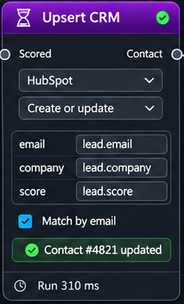 | **Upsert CRM: field mapping as a reusable editor**  Connection choice and operation precede the table. Destination fields and source expressions form two aligned columns. Matching options follow the table; the result comes last. A mapping row should validate its source and destination rather than behave like decorative text. |
| 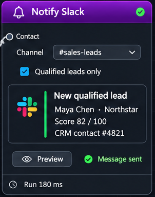 | **Notify Slack: preview the user-facing output**  Channel and filters belong above the message. Give the preview its own inset surface so it reads as a message, not a parameter list. Preview and send/result state are separate. Use representative content when demonstrating, and actual service state in a working integration. |

Validate Lead uses compact rule summaries; it need not repeat a large dropdown
form for every row. Enrich Company uses a concise fetched-data card. Keep
connection, validation and run feedback close to the corresponding node.

**Correct these details:** the CRM-to-Slack arrow has a small generated artifact.
Use clean pin-to-pin routing. Some kind/domain icons were simplified.
No screenshot result proves that a service connection or automation was run.
