# GUI visual guide: Editor mockups

Part of the [GUI visual guide](../gui-visual-guide.md).

## 9. Smart material editor

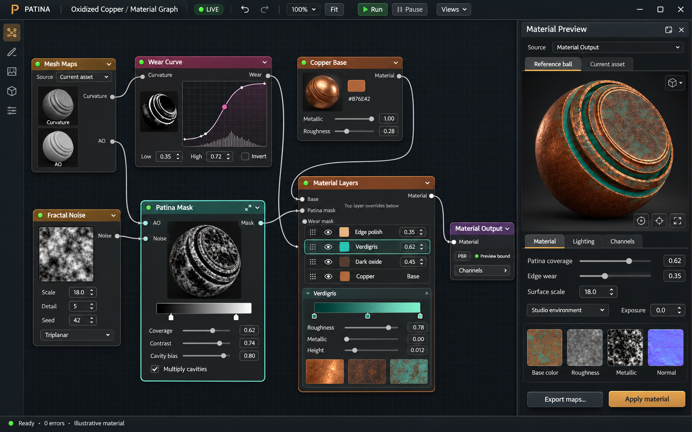

[Open the full-size reference](../mockups/mockup-9-smart-material-editor.png).

**Match:** the balance of graph and preview, readable controls, neutral bodies,
colored title strips, visible data, and strong differences in node size.
This is the main theme reference, with the remaining blue cast removed by the
proposed neutral palette.

The graph has sources on the left, mask editing in the middle, composition to
the right, and a small output. The preview is a docked workspace.

| Exact image detail | What an agent should implement |
|---|---|
| 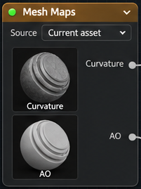 | **Mesh Maps: a source with two kinds of data**  Keep the asset selector at the top and identify each preview next to its output. Curvature and AO must look like distinct channels, not interchangeable decorative balls. The body needs enough width for those names, but no large property form. Reuse the asset picker and channel-image widget. |
| 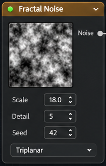 | **Fractal Noise: visual feedback over a short form**  The square texture is the main feedback. The three numeric rows belong below it, followed by projection mode. Keep field widths stable while values change. Scale, detail and seed must update the preview; changing preview zoom must not change the noise. Reuse a preview plus labeled number-field group. |
| 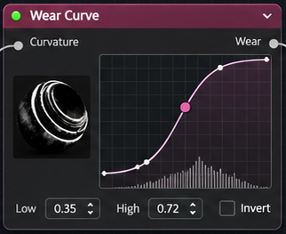 | **Wear Curve: spatial mask beside a remapping function**  The mask thumbnail answers where the operation acts; the curve answers how strongly. Keep the histogram subordinate to the curve. Dragging a point and editing a threshold must affect the same mapping. Reserve width for the two visualizations rather than stacking them into a narrow column. |
| 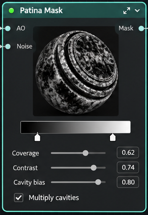 | **Patina Mask: a large interactive mask editor**  Image first, remap ramp second, parameters last. The stops need obvious handles and a selected state. Keep coverage, contrast and cavity bias aligned. The light teal node outline indicates selection; the green dot indicates readiness. The ramp is grayscale data and should not inherit the header hue. |
| 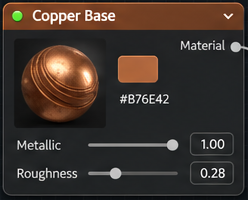 | **Copper Base: compact material properties**  A small rendered image and color swatch establish the material. Two labeled sliders complete the task. This node does not need the height of the layer stack. Clicking the swatch should use the shared color editor; metallic and roughness need exact values as well as dragging. |
| 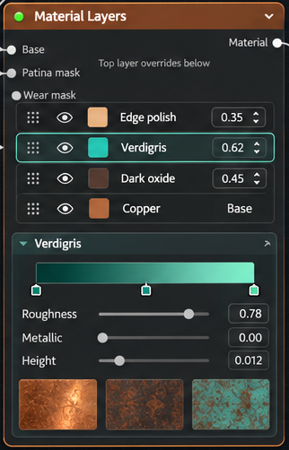 | **Material Layers: an ordered editor inside one node**  Rows combine a reorder handle, visibility, swatch, name and amount. Selection expands one layer below the list. The layer's ramp, roughness, metallic and height form a single coherent property group. The stack needs height; the controls need consistent columns. This is material content, not Patina's compilation Base/Slot panel. |
| 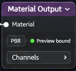 | **Material Output: let a sink stay small**  The input, PBR summary and channel disclosure are sufficient. Do not add a large duplicate preview just to match neighboring nodes. The preview dock can bind to this output. Keep its source binding explicit and distinguish a stale result from a current result. |
| 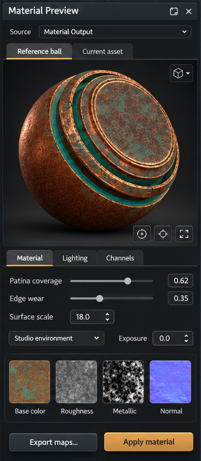 | **Material Preview: the tool's main viewing surface**  A neutral dock header contains source selection and Reference ball/Current asset tabs. Give the 3D object most of the available area. Keep orbit/reset controls on the viewport. Material, lighting and channel controls are distinct groups. The lower sliders edit shared graph values; lighting changes the presentation. Channel thumbnails should come from the actual material result, not independent sample images. |

**Connections to implement:** Curvature feeds Wear Curve; AO and Fractal Noise
feed Patina Mask; Copper Base, the patina mask and the wear mask feed Material
Layers; Material Layers feeds Material Output. The view has no graph cable.

**Correct these details:** the wear cable lands near the Verdigris row in the
image. It must land on **Wear mask**. Restore node kind/domain icons and runtime
labels where needed. Use the blue faceted logo. Rendered material/channel images
must agree with actual graph outputs; the mockup does not validate a shader.

## 1. Main editor with colored headers

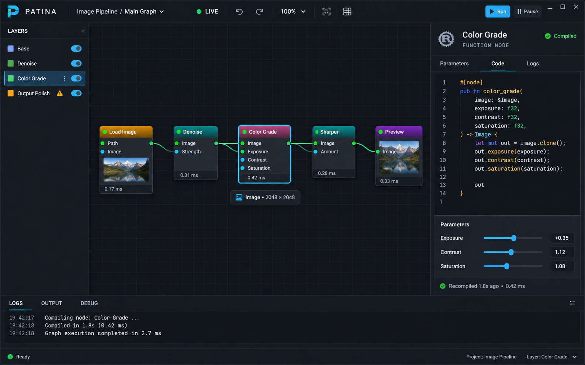

[Open the full-size reference](../mockups/mockup-1-main-editor-colored-headers.png).

**Match:** a stable shell with navigation at left, graph in the center, inspector
at right and logs below. The graph remains visible while code or parameters are
edited. The right panel gives the selected node context rather than opening an
unrelated window.

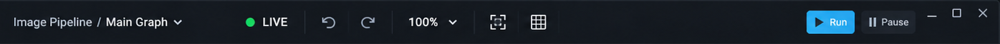

The toolbar has a hierarchy: project/graph path, run state, editing/navigation
controls, then execution and view actions. Keep related controls grouped and
separate them with space or thin dividers. Do not make every tool a colored button.

| Exact image detail | What an agent should implement |
|---|---|
| 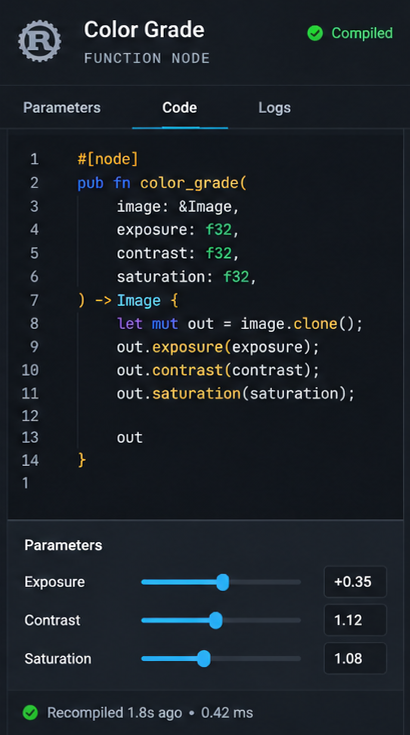 | **Inspector: identity, work area, parameters and feedback**  Keep Parameters/Code/Logs as a stable tab group. Code needs line numbers, syntax highlighting and error locations. Parameters below it use the same fields as the node GUI. The selected-node name and path must remain visible. Use a Patina node-kind icon in place of the Rust logo. Build time and run time must have different labels. |

The five node headers demonstrate a category sequence: amber input, teal
processing, magenta color editing and purple output. Inline images are useful
previews, not a reason to enlarge every node.

**Correct these details:** replace the obsolete edit-layer list and toggles
with compilation **Base** and **Slot**. Remove orphan-edit concepts. The selected
magenta node should have a light pink outline. Apply neutral surfaces instead
of this image's blue cast. The logo remains a valid visual reference.

## 3. Error view

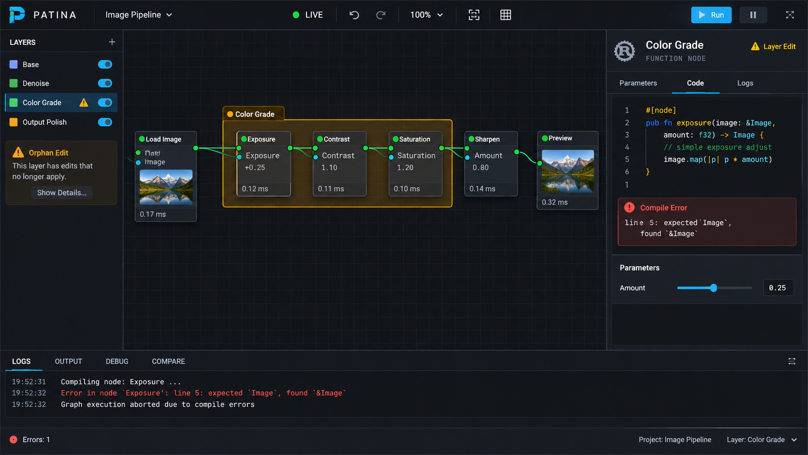

[Open the full-size reference](../mockups/mockup-3-error-view.png).

**Match:** an error can be investigated without hiding the graph. An expanded
subgraph exposes its internal dependency chain. The inspector explains the
problem close to the code.

| Exact image detail | What an agent should implement |
|---|---|
| 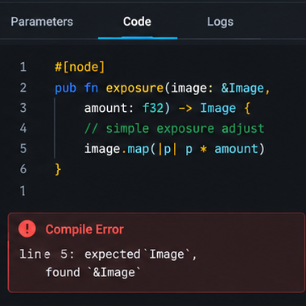 | **Error detail: identify the location and the mismatch**  Give the error an icon, a short heading and a readable message. Mark the actual source line with a gutter marker and underline. Keep code readable above the message. A red-tinted message well can be subtle; the important information is node, source location and expected/actual type. |

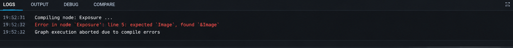

Log entries must link back to the node and source location. Match the compact
timestamp/message structure. Keep prose and code locations readable, and avoid
giving the entire log the same error color.

**Correct these details:** the failing node needs an error border/icon, not a
green ready dot. The subgraph border stays neutral and needs a collapse control.
Remove **Compare**, **Layer Edit** and the orphan edit warning. Do not copy the
claim that the graph aborted: a failed rebuild retains its last successful
build. The status bar, node, code and log must describe the same error.
