# GUI visual guide: Laser mockups

Part of the [GUI visual guide](../gui-visual-guide.md).

## 7. Laser acquisition

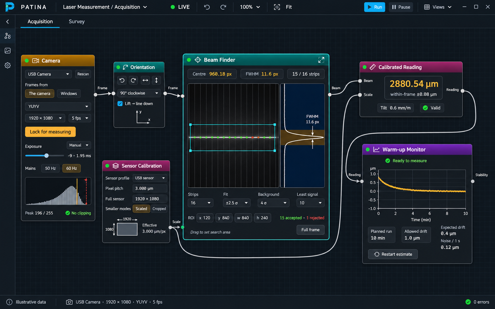

[Open the full-size reference](../mockups/mockup-7-laser-acquisition.png).

**Match:** the beam finder receives the most space because it combines an image
and profile. The camera is a tall form; Orientation is a small utility; the
calibrated reading is short and wide. The graph visually distinguishes setup,
analysis and monitoring.

| Exact image detail | What an agent should implement |
|---|---|
| 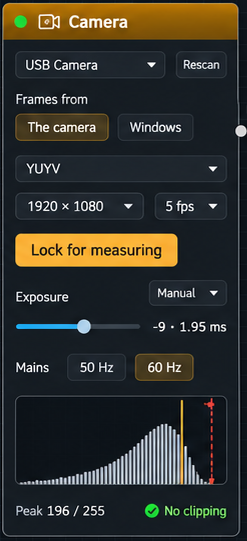 | **Camera: a device form with immediate feedback**  Group device, mode and frame-rate selection before acquisition controls. Show manual exposure and mains frequency together. The histogram explains the exposure result. Lock for measuring is an explicit action with visible outcome. Unsupported Windows camera controls must be unavailable, not fictional working sliders. |
| 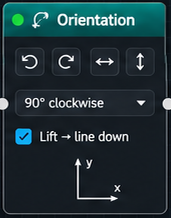 | **Orientation: a small transform utility**  Four icon actions, one orientation value, a sign check and axes are enough. This node should remain much smaller than the camera or beam finder. Give icons accessible names. Rotation, mirror state and the displayed coordinate system must agree. |
| 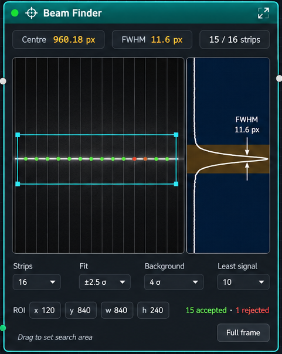 | **Beam Finder: linked scientific editing surfaces**  The image and sideways intensity profile share a vertical coordinate. ROI handles, strip centers and rejected points explain the fit. Numeric ROI fields below are precise alternatives to dragging. Keep image overlays, fit bands, FWHM and threshold values synchronized. This is a 2D image/canvas GUI, not a GPU viewport embedded in the node. |
| 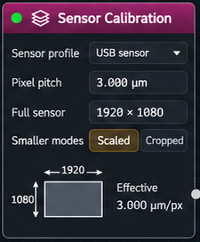 | **Sensor Calibration: make the scale understandable**  The sensor diagram explains the dimensions beside pixel pitch and mode settings. Scaled and cropped modes affect effective scale differently. Keep full-sensor dimensions distinct from acquired-frame dimensions. Show units on the effective output rather than an unexplained scalar. |
| 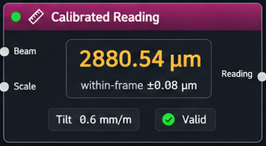 | **Calibrated Reading: a measurement-first node**  Use a large number for the main position and a smaller uncertainty directly below. Units are part of the value. Tilt and validity remain secondary. This is an absolute beam position; do not relabel it as corrected surface height. A failed reading must change validity, not silently retain a convincing old number. |
| 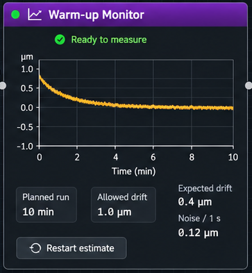 | **Warm-up Monitor: a plot plus a decision**  Time and displacement axes establish what drift means. Planned duration and allowed drift are inputs; expected drift and noise are results. Ready to measure is a named state. Restart estimate is an explicit action. Keep the plot wide enough to distinguish a trend from noise. |

**Correct these details:** remove the extra scale connection into Beam Finder.
Sensor Calibration feeds Calibrated Reading. The ROI geometry and strip counts
in the screenshot are schematic. The real overlay must be derived from the
current frame and fit, with timestamps and validity kept consistent.

## 8. Laser survey

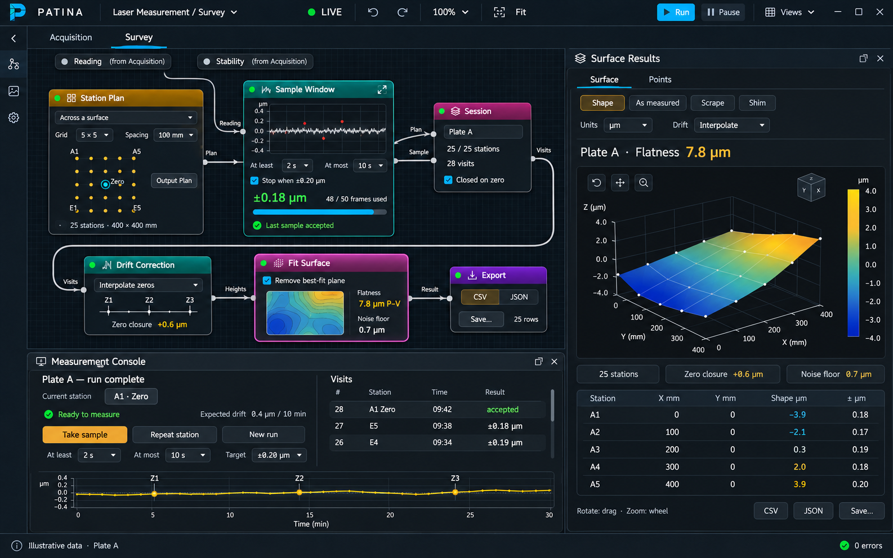

[Open the full-size reference](../mockups/mockup-8-laser-survey.png).

**Match:** graph at upper left, an operator console below it, and results at
right. These are three complementary ways to work with the same session.
The console makes the graph usable as an instrument.

| Exact image detail | What an agent should implement |
|---|---|
| 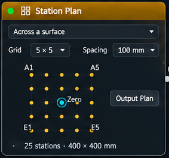 | **Station Plan: an editable spatial control**  The grid, station labels and zero marker are data, not decoration. Selecting a station should update the console and result selection. Spacing and grid size affect the plan. Make the active station and the zero reference visually distinct. |
| 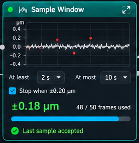 | **Sample Window: quality and progress together**  The scatter plot distinguishes accepted frames and outliers. Time bounds and uncertainty target are inputs. Current uncertainty, used-frame count and progress are results. Sampling actions must refer to one explicit request and station, even if the visible selection changes. |
| 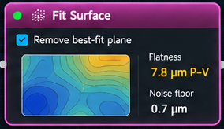 | **Fit Surface: a compact computed summary**  The fit option, contour thumbnail, flatness and noise floor make a useful short node. The node can show a projected 3D plot with orbit controls. A separate GPU view shows the same measured geometry. |

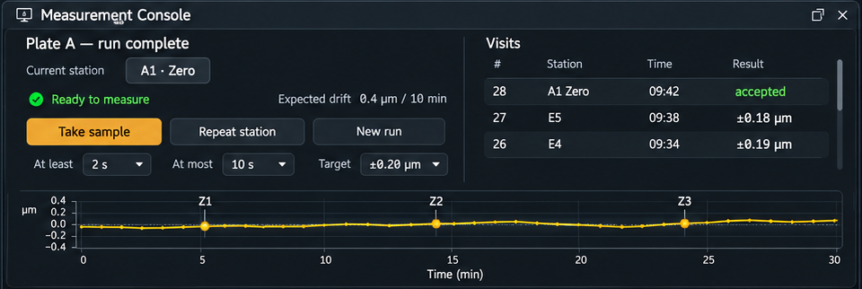

The console combines station identity, readiness, sampling actions, limits,
visits and a zero-history plot. It is one integrated operator panel rather than
a row of unrelated dashboard tiles. Keep high-frequency actions easy to find.
During a sample, show progress and the appropriate cancel/keep actions.

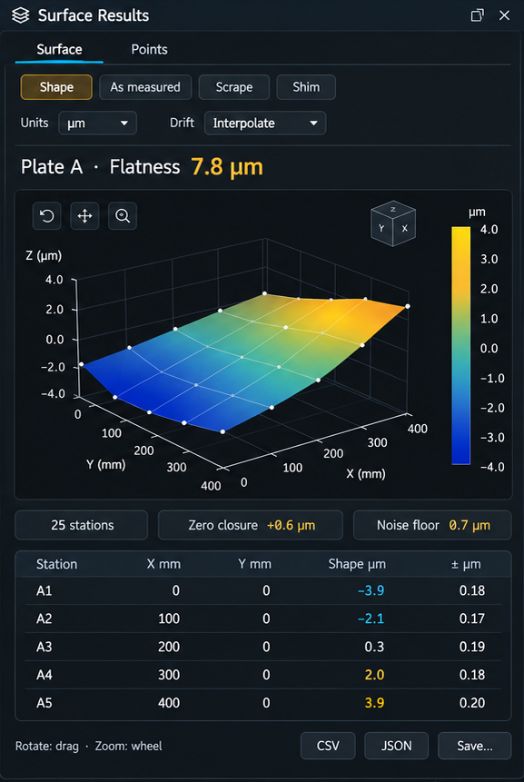

The result view combines a mode selector, 3D surface, color scale, summary
values and a numeric table. Axes and units stay visible. Selecting a row and
selecting a measured point should identify the same station. Distinguish
measured points from the surface interpolated between them. A line survey
uses a line plot and uncertainty bars instead.

**Correct these details:** the Plan cable must route directly to Session,
not behind Sample Window. The central zero marker and **A1 Zero** disagree.
Use one identity. The pictured surface and numbers are illustrative and do
not validate plane removal, uncertainty or drift correction.

## Surface probing update, 2026-11-20

The owner requested colored 3D results and a coin scan. Surface probing must retain the object shape by default.
Use **Measured height** for the raw geometry relative to zero. Keep plane removal under **Leveled**.
A node canvas can project the measured mesh and accept orbit input. The GPU viewport remains in a separate view.
Show a height legend, physical units, and the display exaggeration. Do not fill missing measurements from the simulation target.
