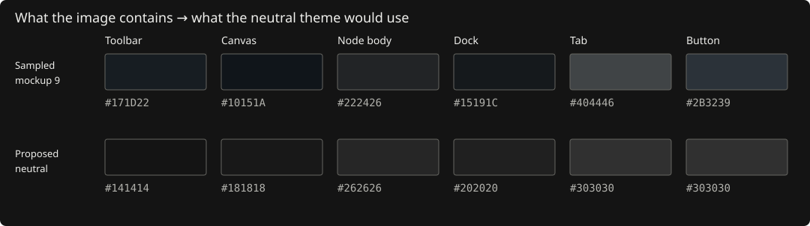
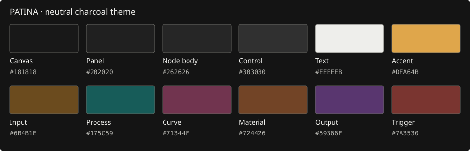

# GUI visual guide: Theme and palette

Part of the [GUI visual guide](../gui-visual-guide.md).

## What is actually in mockup 9

The screenshot is the visual reference. Its pixels are not a source theme file.
The table below reports the median red, green and blue values in six small
regions. Coordinates are source-image pixels, written as x, y, width, height.
The [sample record](../mockups/details/sampled-surfaces.json) preserves these results.

| Region | Sample rectangle | Observed median | Proposed neutral role |
|---|---|---|---|
| Toolbar | 150, 5, 12, 30 | #171D22 | app: #141414 |
| Canvas, including grid | 1075, 700, 80, 50 | #10151A | canvas: #181818 |
| Material Layers body | 688, 640, 8, 17 | #222426 | node: #262626 |
| Preview dock | 1210, 879, 340, 10 | #15191C | panel: #202020 |
| Raised tab | 1207, 137, 15, 16 | #404446 | raised: #303030 |
| Export button | 1208, 904, 25, 20 | #2B3239 | raised: #303030 |

The samples confirm a blue cast even in the preferred image. The proposed
surfaces below deliberately remove that cast. They preserve dark-to-light
hierarchy rather than claim to be exact copies of hidden original CSS values.
The owner's chosen direction is the restrained look of mockup 9 and less blue.
The individual token values remain a design proposal.

## Proposed implementation palette

Use shared tokens, not local guesses in each component. Equal RGB values keep
the large surfaces neutral. Color remains in the blue logo, node headers,
state and visual data. Amber is the proposed global focus/action accent, following
the reference's selected tabs and main material action.

## Surfaces and text

| Token | Hex | Use |
|---|---|---|
| app | #141414 | Window background and narrow outer chrome |
| canvas | #181818 | Graph background |
| panel | #202020 | Docks, inspector and sidebar |
| node | #262626 | Node bodies |
| raised | #303030 | Buttons, tab surfaces and raised controls |
| field | #191919 | Editable fields, inset previews and plot wells |
| hover | #393939 | Neutral hover surface |
| border | #454545 | Panel separators and node outlines |
| control-border | #666661 | Control edges that need stronger definition |
| grid-minor | #202020 | Fine graph grid |
| grid-major | #292929 | Sparse major grid lines |
| text | #EEEEEB | Titles, values and normal labels |
| muted | #B2B2AD | Secondary labels, units and descriptions |
| subtle | #A3A39D | Tertiary information that must remain readable |
| disabled | #73736E | Unavailable controls; also show disabled behavior |
| wire | #BBBBB5 | Normal graph connections |

Use brightness to separate surfaces. Avoid broad blue gradients, glowing panel
edges and black-to-navy backgrounds. A very small neutral header gradient is
acceptable, but flat fills are the default.

## Application accent and state

| Token | Hex | Use |
|---|---|---|
| accent | #DFA64B | Active dock tab, selected wire, focus outside a colored node, primary action |
| accent-hover | #ECC078 | Hover on the primary action |
| accent-ink | #171511 | Text and icons on a filled amber action |
| ready | #75C884 | Ready and successful state |
| warning | #E6D35C | Warning state |
| error | #ED7B78 | Error border, error icon and error text |
| info | #C5C5BF | Informational icon or label |

Use one application accent: amber. Earlier cyan tabs, cyan primary buttons and
blue checked boxes are historical styling. The logo stays blue; its brand color
does not tint the surrounding interface.

Primary action buttons may use amber with dark text. Ordinary buttons stay
neutral. **Run** can be an ordinary button with a play icon; the **Live** indicator
shows running state. Do not give every action button a success-green fill.

Status needs an icon or text as well as color. Amber selection and an amber
warning have different shapes and labels. A neutral slider is not a status
meter. Plots and rendered data may use any colors needed to explain their data.

The warning is yellow, not amber, so it does not look like the selection or a
primary action. Amber selection and a yellow warning also have different shapes
and labels.

## Node headers and local focus

These families are defaults for related work. The spec allows a node author to
choose a different header color. Keep similar nodes consistent within a project.
A header color is not a type, clock domain or execution state.

| Family | Header | Selection / focus | Examples |
|---|---|---|---|
| Input / source | #655219 | #E3B869 | Image input, camera, sample player, noise source |
| Processing | #175C59 | #79D4C8 | Filter, mixer, beam finder, mask processing |
| Curve / logic | #71344F | #DE8FBA | Curve editor, ADSR, scoring, remapping |
| Material | #724426 | #D9A17A | Copper base, material layers |
| Output / action | #59366F | #B99BDF | Export, audio output, CRM action |
| Trigger | #7A3530 | #F2C4B8 | Webhook or event entry |
| Unassigned | #454545 | #DFA64B | A node with no assigned category |

Use **text** on these headers. Keep node bodies neutral. Use the lighter paired
color for a selected node's outline and focused control. A magenta node gets a
pink outline; a teal node gets a light teal outline. An unassigned node follows
the spec and uses the application accent for selection.

Keep the state indicator separate from the title fill. An error retains its
red outer border and error icon even when selected. Use a small inner selection
mark if both states need to be visible.

## Color decisions of 2026-11-15

These are agent decisions. The owner can change them. The distances are CIE76
delta E values in Lab space. A value under 10 is hard to see on a small mark.

| Change | Old | New | Reason |
|---|---|---|---|
| Trigger selection | #E89C91 | #F2C4B8 | It was 18 from the error red #ED7B78. It is now 36, a pale rose that does not read as an error. |
| Warning | #E5B85A | #E6D35C | It was 8 from the accent and 7 from the Input selection. It is now 24 and 21. |
| Input / source header | #6B4B1E | #655219 | It was 10 from the Material header. The gold is now 18 from the copper. |

- The accent and the Input selection stay close. Both mean selection, so the
  user reads the same state.
- The error keeps its red outer border and its icon. The warning keeps its icon
  and its text. Color is never the only sign of a state.
- Each header keeps a contrast of 6.5:1 or more with **text**. The warning has
  a contrast of 10:1 on the node and panel surfaces.
- The [palette image](../mockups/details/gui-palette.svg), the mockups and the
  image requests show the old values. The tables of this file win.

The listed normal text/header pairs and primary-button pair were checked
numerically. They exceed 4.5:1 contrast. That does not validate every combination
of transparency, hover, chart content or disabled styling in a future UI.
