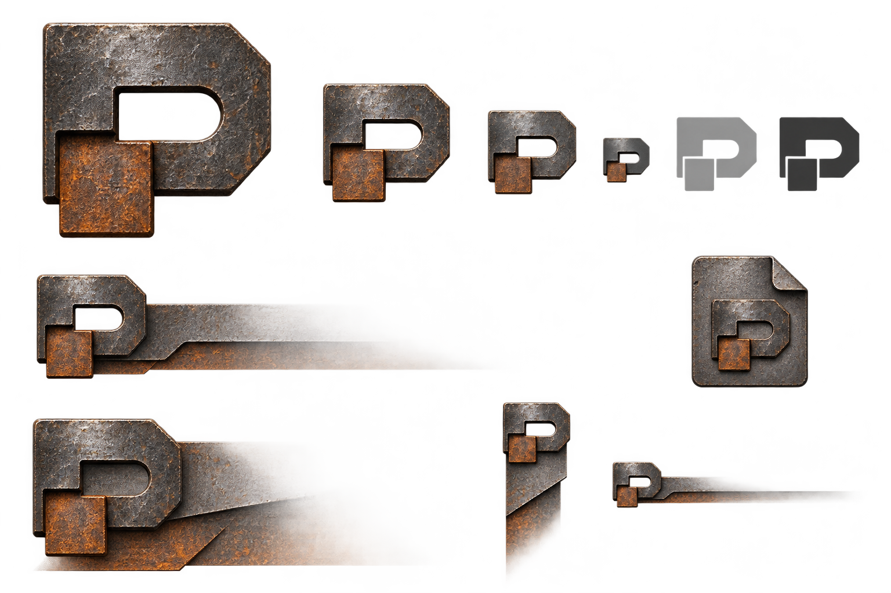

# Aged Dovetail branding artwork 01

Date: 2026-11-15.



The owner selected concept 03, **Aged Dovetail**, from [sheet 04](patina-logo-contact-sheet-04.png).
The owner requested reusable artwork with no baked-in text.

## Artwork on the sheet

| Location | Artwork |
|---|---|
| Upper left | Large detailed emblem |
| Upper middle | Three smaller icon treatments |
| Upper right | Light and dark flat marks |
| Middle left | Wide banner accent |
| Middle right | Project-file symbol |
| Lower left | Splash or About artwork |
| Lower middle | Vertical installer artwork |
| Lower right | Narrow title-bar or help-header accent |

The icon treatments reduce surface detail as the marks become smaller.
The wide artwork leaves space for text that the application draws separately.
The installer artwork can also serve an uninstall screen.
The sheet contains no names, labels, buttons or interface text.

## Generation and checks

The built-in imagegen tool used only the clean contrast sheet as its image reference.
It made one branding sheet.
The PNG is 1536 x 1024 pixels in RGBA format.
The prompt requested a larger image; the tool returned this size.
The source and saved copy have the same SHA256 hash.

The alpha channel ranges from 0 to 254.
It contains 827688 fully transparent pixels.
Sampled corners, a gutter and the large icon counter have alpha values of 0 or 1.
Visual inspection checked the selected shape, artwork placement and absence of text.

This is a contact sheet.
Separate PNG assets and a Windows ICO file have not been exported.
Exact-size readability remains unchecked.

## Generation prompt

```text
Use case: logo-brand.
Create ONE ART-ONLY contact sheet of reusable Patina branding elements.
Use ONLY concept 03 AGED DOVETAIL from the supplied image as the logo identity.
That is the THIRD emblem in the TOP ROW.
All pieces must consistently use that selected mark.
Do not explore new logo shapes.

SELECTED MARK:
An interlocking P formed from two substantial metal pieces.
The upper body is aged dark steel with a squared left shoulder and a chamfered outer corner.
It surrounds a clean rounded rectangular counter.
The lower-left stem is a stepped rusty iron piece fitted into the upper body.
Keep the recognizable stepped joint, proportions and open counter.
Use the slightly stronger contrast of the supplied reference: selective silver wear on steel, dark seams, matte umber and brown-orange rust.
Preserve the iron material. No copper, gold, verdigris, blue or green.
Selective metallic highlights must help it read at small sizes without making it chrome.

ABSOLUTELY NO BAKED-IN TEXT:
No PATINA wordmark.
No titles, names, labels, numbers, letters used as text, captions, version strings, button text or tiny pseudo-text.
The P-shaped EMBLEM is the only letterform allowed.
The app will add all typography separately.
No interface controls, window frames, screenshots, mock dialogs, progress bars, buttons or cursor graphics.
Deliver reusable visual artwork, not a completed UI mockup.

CANVAS:
One high-resolution landscape contact sheet, ideally 3072 x 2048.
Real RGBA transparency.
All space between elements is transparent.
No shared background, presentation board, checkerboard, card containers, borders or annotations.
Give every separate element generous transparent gutters so it can be extracted cleanly.
Make the large emblem substantially larger than in the source contact sheet.
Avoid external cast shadows that spread into neighboring assets.

ARRANGEMENT AND CONTENT:
UPPER LEFT: one large detailed master emblem, roughly 500 x 500 at the intended sheet resolution.
Keep the emblem's cutout fully transparent.
This is the hero artwork for a splash or About view.

UPPER RIGHT: a neatly spaced family of the SAME emblem at three smaller visual scales.
One medium detailed app icon.
One compact icon with quieter grain and clearer broad steel-versus-rust regions.
One tiny-size treatment with simplified surface detail and strong silhouette.
Do not label their sizes.
Alongside them, include two small flat silhouette versions of the same construction: light gray and graphite.
Preserve the negative counter and the interlocking seam in the flat versions.

MIDDLE LEFT AND CENTER: a wide horizontal brand accent, approximately 5:1.
Place the emblem at its left.
Use a restrained sweep of layered steel and rusty iron extending right and fading into real transparency.
Keep most of the middle and right open for application-rendered text.
No writing. No badge rectangle.

MIDDLE RIGHT: a compact standalone project-file symbol.
Use a restrained folded sheet silhouette with the selected emblem inset.
Steel gray with a small rust accent, transparent outer background.
No document text or lines that resemble writing.

LOWER LEFT: a wide splash/About artwork, approximately 3:1.
Use the selected emblem larger on the left, with a few shallow steel planes and matte rust seams.
Let the composition become sparse toward the right, leaving transparent space for live content.
Keep the same identity and material as the master emblem.
This is artwork only, not a dialog or screen.

LOWER CENTER: a narrow vertical installer-side artwork, approximately 1:3.
Place the selected emblem near its upper end.
Continue the interlocking metal motif downward as a restrained tapering arrangement.
Leave transparent negative space between the forms.
The same artwork must suit install and uninstall flows, so add no action-specific symbols.

LOWER RIGHT: a slim horizontal title-bar or help-header accent, approximately 6:1.
Use a small clean emblem at the left and a short quiet steel-and-rust edge treatment.
Keep the rest transparent for text placed by the application.
No frame or controls.

Make these coherent applications of one selected brand mark.
Favor practical silhouettes, readable contrast and reusable transparent shapes.
Retain natural iron weathering in the large artwork and reduce visual noise in smaller icons.
No annotation colors, no decorative dots and no background texture.
One transparent contact sheet only.
```
