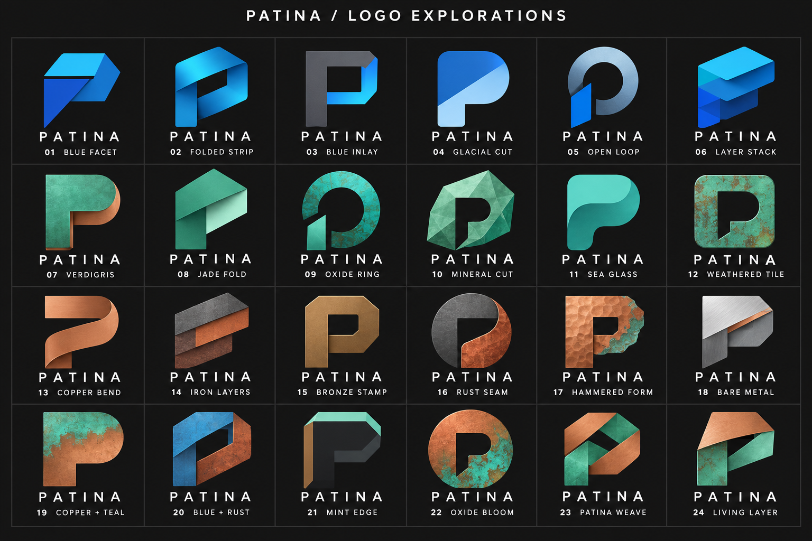

# Patina logo contact sheet 01

Date: 2026-11-15.



The sheet explores metal, rust and patina through different shapes and colors.
Read the numbers from left to right, then from top to bottom.

- 01 to 06: blue.
- 07 to 12: verdigris, jade and turquoise.
- 13 to 18: copper, rust, bronze and steel.
- 19 to 24: mixed metal and patina colors.

The owner will select a direction before we make larger branding assets.
The current application logo remains the reference until that selection.

## Generation and checks

The built-in imagegen tool made one contact sheet.
The saved PNG is 1536 x 1024 pixels.
The prompt requested a larger image; the tool returned this size.
The source and saved copy have the same SHA256 hash.

Visual inspection confirmed 24 numbered concepts and the PATINA spelling.
This is a raster concept sheet.
Small-icon readability and vector reproduction remain unchecked.

## Generation prompt

```text
Use case: logo-brand.
Create ONE polished contact sheet for the desktop node-editor brand PATINA.
This is a logo exploration board for the owner to select a direction.
Deliver one landscape image, ideally 3072 x 2048, with a precise 6-column by 4-row grid containing EXACTLY 24 different logo concepts.
Use generous outer margins, equal cells, and subtle charcoal dividers.
Background: flat neutral charcoal #181818, never navy.
A small top heading reads "PATINA / LOGO EXPLORATIONS".
Each cell contains a large emblem, the white wordmark "PATINA" below it, and a readable two-digit number plus short concept name.
Read left to right, top to bottom, numbered 01 through 24.
Use the same restrained, widely spaced uppercase sans-serif wordmark throughout so the emblems are easy to compare.
Give the emblems most of each cell's area. No explanatory paragraphs.

Creative idea: computational tools close to bare metal; metal gains rust, oxidation, mineral layers and patina over time.
Translate this metaphor into strong software brand marks rather than literal photographs.
Explore folds, layered surfaces, cut metal, negative space, oxidation boundaries and mineral facets.
The existing identity is a geometric faceted uppercase P in cyan and blue, with a dark horizontal seam.
Include several evolutions of that idea alongside substantially different silhouettes.
Each concept must have a distinct construction. Do not repeat one P with different colors.

ROW 1: blue directions, retaining the owner's affinity for blue.
01 BLUE FACET: crisp angular P assembled from three cyan and deep-blue metal facets.
02 FOLDED STRIP: continuous folded blue sheet forming an open P with a sharp inner counter.
03 BLUE INLAY: solid graphite P with one bright blue inset edge and a generous open counter.
04 GLACIAL CUT: rounded geometric P, diagonally divided into cobalt and pale icy-blue planes.
05 OPEN LOOP: bold incomplete circular metal loop with a blue descending stem, suggesting P.
06 LAYER STACK: three offset blue plates whose silhouette and negative space imply a P.

ROW 2: natural verdigris, jade, sea-green and turquoise.
07 VERDIGRIS: strong simple P with a copper edge exposed beneath a matte green surface.
08 JADE FOLD: angular folded jade ribbon, with one pale mint face.
09 OXIDE RING: interrupted turquoise ring with a short stem; an emblem without a literal letter.
10 MINERAL CUT: asymmetric green crystal-like slab with a precise P-shaped negative cutout.
11 SEA GLASS: flowing but substantial turquoise P with a soft organic inner boundary.
12 WEATHERED TILE: rounded square green metal tile with a sharply cut negative-space P.

ROW 3: copper, bronze, rust and warm steel.
13 COPPER BEND: broad copper strip bent into a confident P.
14 IRON LAYERS: three dark iron and terracotta strata forming an abstract stepped emblem.
15 BRONZE STAMP: chunky bronze P with chamfered corners and a clean stamped appearance.
16 RUST SEAM: graphite disk with a wide rust-colored split that creates a P-like opening.
17 HAMMERED FORM: bold copper monogram with one irregular oxidized edge, all other edges precise.
18 BARE METAL: silver and dark steel folded P, with a restrained narrow copper accent.

ROW 4: contrasting substrate and patina, strongest mixed-color explorations.
19 COPPER + TEAL: a broad P with copper substrate and green patina following its upper contour.
20 BLUE + RUST: two interlocking blue and rust metal pieces forming one open geometric P.
21 MINT EDGE: nearly black solid P with mint and bronze edge faces.
22 OXIDE BLOOM: bold copper medallion with a broad teal oxidation patch shaping a negative-space P.
23 PATINA WEAVE: two broad copper and verdigris strips interleaved into an abstract compact emblem.
24 LIVING LAYER: asymmetrical copper-and-green folded plate with a clean angular P silhouette.

Finish: professional brand identity presentation, crisp vector-like contours, convincing negative space and restrained material depth.
Most designs use two or three flat colored regions.
Allow subtle surface variation on only a few emblems to suggest oxidation.
Keep every mark legible as a small application icon.
Use blue #28B6DD, cobalt #2378B8, verdigris #63B89C, deep teal #267B73, pale mint #A5CFB3, copper #B87648, rust #99503B, bronze #9D854F, and silver #BEC4C3 as a starting palette.
Do not include the Rust gear, crab, plant or leaf mascots.
Avoid generic AI sparkle symbols, circuit-board clutter, thin fragile lines, glowing neon, dramatic 3D scenes, product mockups or decorative backgrounds.
Exact brand spelling: P A T I N A.
Render only the requested contact sheet.
```
