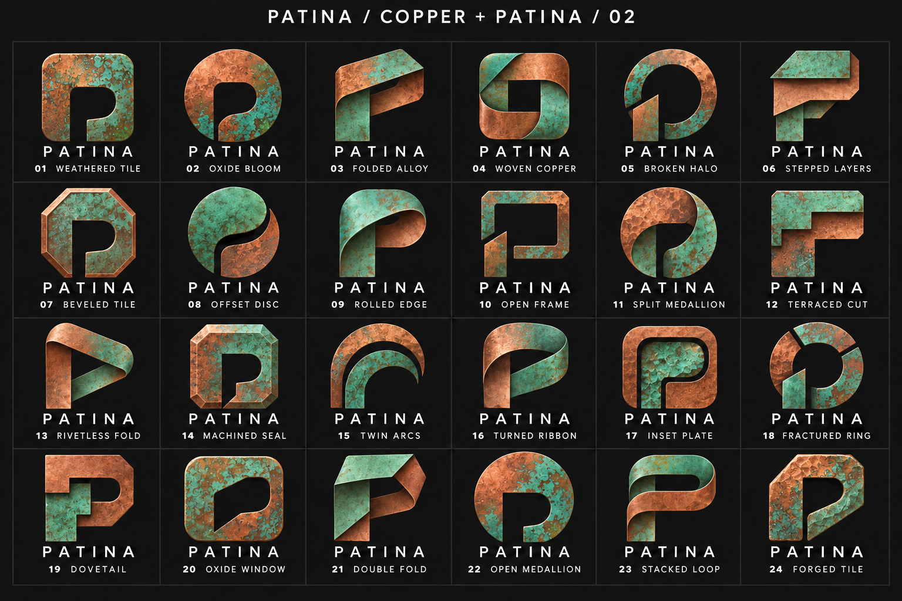

# Patina logo contact sheet 02

Date: 2026-11-15.



## Owner direction

The owner selected the material character of concepts 12 and 22 from [sheet 01](patina-logo-contact-sheet-01.png).
The owner particularly liked the copper and green variation in concept 22.
The owner also liked other shapes, but rejected simple forms such as 01, 04 and 19.

This sheet combines that material direction with cutouts, folds, rings and layered forms.
The numbers restart at 01.
Use the sheet number and concept number when recording a selection.
The final logo selection remains open.

## Generation and checks

The built-in imagegen tool used sheet 01 as the reference.
It made one new contact sheet.
The saved PNG is 1536 x 1024 pixels.
The source and saved copy have the same SHA256 hash.

Visual inspection confirmed 24 numbered concepts and the PATINA spelling.
This is a raster concept sheet.
Small-icon readability and vector reproduction remain unchecked.

## Generation prompt

```text
Use case: logo-brand.
Create a second Patina logo contact sheet by revising the supplied first sheet.
Keep the same landscape format, neutral charcoal background, six columns, four rows, equal cells, white wordmarks and readable numbering.
Replace the 24 emblems with 24 new designs.
Heading: "PATINA / COPPER + PATINA / 02".
Each cell has a large emblem, the wordmark "PATINA", and its number plus short name.
Number 01 through 24, left to right and top to bottom.

REFERENCE AND OWNER FEEDBACK:
The owner particularly likes reference 12 WEATHERED TILE and reference 22 OXIDE BLOOM.
Use their warm copper substrate, irregular green verdigris patches, subtle mineral texture and convincing aged-metal character.
Reference 22's natural copper-to-green variation is especially important.
The owner likes the more interesting shapes elsewhere, including folded forms and cutouts.
The owner dislikes simple designs such as reference 01 BLUE FACET, 04 GLACIAL CUT and 19 COPPER + TEAL.
Do not reproduce their plain solid P silhouettes, elementary facets or simple diagonally divided fills.
This is a new exploration of shapes with the favored materials, not 24 recolors of one P.

MATERIAL DIRECTION:
All designs use copper and green patina together.
Show natural asymmetric oxidation: mottled islands, branching mineral boundaries, subtle pits and exposed warm metal.
Some are copper dominant, some green dominant, some balanced.
Let the copper read orange-brown or red-brown, and the patina range from deep jade to pale mint or blue-green.
Use restrained metallic edge highlights and shallow thickness where helpful.
The marks must remain designed graphic logos with clean contours and purposeful negative space.
Give the surface enough fine detail to see oxidation, but keep the silhouette readable.
No generic glow, plastic gradients, gemstones or oversized 3D objects.
Do not apply the same diagonal patina boundary to every design.

24 DISTINCT SHAPES:
01 WEATHERED TILE: evolved rounded square plate, with a deeply cut P counter that opens through the lower edge.
02 OXIDE BLOOM: evolved circular copper medallion; curved P-shaped aperture and spreading green mineral patches across one side.
03 FOLDED ALLOY: a broad oxidized copper strip folds into an angular P, exposing darker inner metal.
04 WOVEN COPPER: two broad copper and green bands interlock around a clean square negative space.
05 BROKEN HALO: a substantial open circular ring with an offset rising stem, suggesting P.
06 STEPPED LAYERS: three overlapping metal plates create an angular P through their staggered edges.
07 BEVELED TILE: octagonal tile with a rounded internal P aperture and copper bevels.
08 OFFSET DISC: two offset partial discs make a P-like mark, with a small open seam.
09 ROLLED EDGE: a sheet curls around a deep P counter, revealing warm copper under the green face.
10 OPEN FRAME: an asymmetric squared ring joins a vertical stem with an intentional gap.
11 SPLIT MEDALLION: a circular emblem divides into two interlocking shapes around a P-shaped void.
12 TERRACED CUT: a stepped rectangular P with two visible metal strata and strong inset negative space.
13 RIVETLESS FOLD: a continuous folded strip makes a compact triangular loop and descending stem.
14 MACHINED SEAL: a thick chamfered square with a precise off-center P cutout and naturally mottled patina.
15 TWIN ARCS: two broad nested offset arcs create an abstract P and a clear open center.
16 TURNED RIBBON: a broad metal ribbon makes one controlled twist into a compact P.
17 INSET PLATE: a rounded copper frame surrounds an irregular green insert, separated by a P-shaped dark channel.
18 FRACTURED RING: three substantial curved pieces assemble into a circular P emblem with narrow intentional gaps.
19 DOVETAIL: two interlocking stepped metal pieces form a distinctive P with a deep geometric counter.
20 OXIDE WINDOW: a rounded rectangular outer plate has a diagonal internal aperture and a hooked inner corner.
21 DOUBLE FOLD: two angular folds make a P with a visible copper underside and green front planes.
22 OPEN MEDALLION: a copper-green disc opens into the bottom edge through a broad P-shaped channel.
23 STACKED LOOP: two offset thick rounded loops share a descending metal stem, suggesting a P.
24 FORGED TILE: an asymmetric chamfered badge contains a sculpted P aperture and irregular copper-green weathering.

Keep all marks individually distinct.
Use short names exactly as listed.
Typography must remain crisp and spelled correctly: PATINA.
Keep the same wordmark throughout so shape and material can be compared.
No literal Rust gear or crab, no leaf mascots, no tiny circuits, no bolts or decorative screws.
Make one complete contact sheet. Do not add extra images.
```
