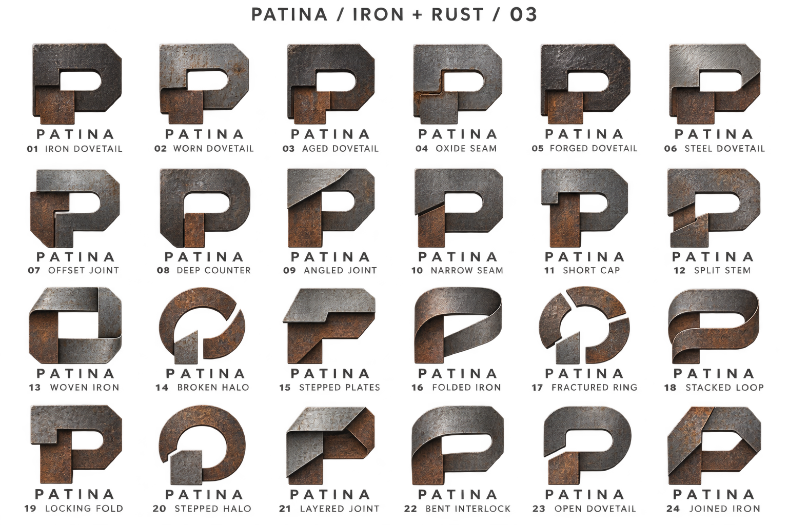

# Patina logo contact sheet 03

Date: 2026-11-15.



## Owner direction

The owner prefers iron and steel with aged rust surfaces.
Copper and green patina no longer define the material direction.

These preferences refer to [sheet 02](patina-logo-contact-sheet-02.png):

- Favorite: 19, **Dovetail**.
- Liked: 04, 05, 06, 13, 18, 19 and 23.
- Disliked: 01, 02, 07, 12, 15, 17, 20 and 22.
- The owner did not rate the remaining concepts.

The owner supplied colored annotations to identify the preferences.
Only the clean sheet 02 went to the image tool.
The annotation colors did not define the new palette.

Concepts 01 to 12 develop the favorite interlocking shape.
Concepts 13 to 18 explore the other liked shapes.
Concepts 19 to 24 combine those forms.
The numbers restart on each sheet.
The final logo selection remains open.

## Material direction

Patina here means the aged surface of iron, including its corrosion and wear.
The design uses gray steel, dark oxide, brown rust and brighter worn edges.
The rust has a matte surface.
The material must remain identifiable as iron or steel.

The [Canadian Conservation Institute](https://www.canada.ca/en/conservation-institute/services/conservation-preservation-publications/canadian-conservation-institute-notes/recognizing-active-corrosion.html) describes compact iron corrosion surfaces from dark tones to red-brown.
That description informs the material study.
It does not imply that all rust protects steel.

## Generation and checks

The built-in imagegen tool made one sheet with transparency enabled.
The saved PNG is 1536 x 1024 pixels in RGBA format.
The source and saved copy have the same SHA256 hash.

The alpha channel ranges from 0 to 254.
It has 812523 fully transparent pixels.
Sampled background areas and an open counter have zero alpha.
Sampled metal areas have alpha values from 250 to 253.

Visual inspection confirmed 24 numbered concepts and the PATINA spelling.
This is a raster concept sheet.
Small-icon readability and vector reproduction remain unchecked.

## Generation prompt

```text
Use case: logo-brand.
Make ONE new Patina logo contact sheet from the supplied CLEAN sheet 02.
The source is a SHAPE reference only. Replace all its copper and green materials.
The owner wants iron, steel, rust and the patina of age.

TRANSPARENCY:
The entire canvas must have a real transparent alpha background.
No charcoal board, no white board, no checkerboard painted into the image, no colored cards, no full-sheet shadow.
Keep empty space fully transparent between all logos and inside their open cutouts.
Arrange 24 logos in six columns and four rows, with generous transparent gutters.
Include a small graphite heading "PATINA / IRON + RUST / 03".
Each cell has its emblem, the wordmark "PATINA", and a two-digit number with a short name.
Use crisp dark graphite typography on the transparent background.
Do not use colored preference dots, circles, annotation marks or selection highlights.

OWNER PREFERENCES FROM SHEET 02:
19 DOVETAIL is the strongest favorite. Its two interlocking stepped pieces form a P.
Also favored: 04 WOVEN COPPER, 05 BROKEN HALO, 06 STEPPED LAYERS, 13 RIVETLESS FOLD, 18 FRACTURED RING, 23 STACKED LOOP.
Rejected: 01, 02, 07, 12, 15, 17, 20, 22.
Other unmarked concepts were not rated.
Use the favorite construction heavily. Keep the angular mechanical interlock and clear negative counter.
Avoid rounded-square badge plates, solid circular medallions, inset letter tiles and generic plain block-letter P marks.

MATERIAL LOGIC:
Patina means the character of an aged surface.
For this design, the rust and dark oxide ARE part of the aged iron surface.
Show coherent aging of ferrous metal rather than decorative colored stains.
Use graphite iron, dull silver-gray steel, compact dark brown oxide, muted reddish-brown rust and small earthy ochre accents.
Keep worn edges subtly brighter, seams darker, and some pits and sheltered recesses rusted.
Some forms can have substantial dark brown rust coverage; others retain more gray metal.
Keep visible material differences between adjoining pieces of the interlock.
The contrast is between aged dark iron, matte rust and exposed steel.
The rust should look matte and mineral. The steel should look dull and slightly directional.
Do not make the rust shiny like copper.
No copper, bronze, gold, peach metal, green verdigris, turquoise, cyan or saturated annotation red or blue.
No bright orange blanket over every face.
No polished chrome, excessive flakes, theatrical decay, painted camouflage or gritty texture outside the emblem.
Use controlled shallow thickness and clean silhouettes with natural small-scale surface variation.

FIRST ROW: six close studies of favorite 19, keeping its identifiable stepped interlocking P shape.
01 IRON DOVETAIL: charcoal iron outer piece, deep rust-brown lower interlocking leg, restrained steel wear on edges.
02 WORN DOVETAIL: worn gray steel outer piece, dark brown oxide lower piece, rust visible in small pits.
03 AGED DOVETAIL: mostly dark matte iron with broad muted reddish-brown aging on the lower piece.
04 OXIDE SEAM: gray iron pieces meet at a stepped dark rust seam, with a clear rounded counter.
05 FORGED DOVETAIL: dark hand-forged texture, a russet inner piece, and subtle worn gray edges.
06 STEEL DOVETAIL: a lighter brushed steel upper piece meets a dark oxidized lower leg with brown weathering.

SECOND ROW: structural variations of the favorite.
07 OFFSET JOINT: a staggered stepped interlock with a deeper counter.
08 DEEP COUNTER: a broad outer iron P loop and a narrower rusted interlocking stem.
09 ANGLED JOINT: a diagonal dovetail joint within the same compact P family.
10 NARROW SEAM: two substantial interlocking pieces separated by a precise dark gap.
11 SHORT CAP: a shorter upper cap and a taller stepped stem, with an open readable counter.
12 SPLIT STEM: two offset sections form the stem and curl into one strong P silhouette.

THIRD ROW: reinterpret other liked shapes as aged ferrous metal.
13 WOVEN IRON: two broad interlocked iron bands around a square opening, based on sheet 02 concept 04.
14 BROKEN HALO: an open iron ring with an offset stem, based on sheet 02 concept 05.
15 STEPPED PLATES: overlapping steel planes and one darker rusted layer, based on sheet 02 concept 06.
16 FOLDED IRON: a broad folded strip and angular open counter, based on sheet 02 concept 13.
17 FRACTURED RING: three substantial iron arcs with deliberate gaps, based on sheet 02 concept 18.
18 STACKED LOOP: two broad layered iron loops sharing a stem, based on sheet 02 concept 23.

FOURTH ROW: hybrids led by the favorite interlocking construction.
19 LOCKING FOLD: a stepped P with one folded upper plate and one oxidized inner leg.
20 STEPPED HALO: an open circular upper loop locks into a squared lower iron stem.
21 LAYERED JOINT: two visible stepped layers form the P, with aged iron and exposed steel faces.
22 BENT INTERLOCK: a broad bent steel cap joins a dark rusted dovetail stem.
23 OPEN DOVETAIL: the favorite P construction with an intentional small break in its outer loop.
24 JOINED IRON: a strong angular P assembled from three broad interlocking iron pieces.

Keep the outer contours sharp and the wear restrained enough for brand use.
These are graphic logo emblems, not photos of tools or piles of metal.
Use the same restrained sans-serif PATINA wordmark throughout.
Spell all text correctly.
The sheet must contain exactly 24 numbered concepts and a genuinely transparent background.
```
