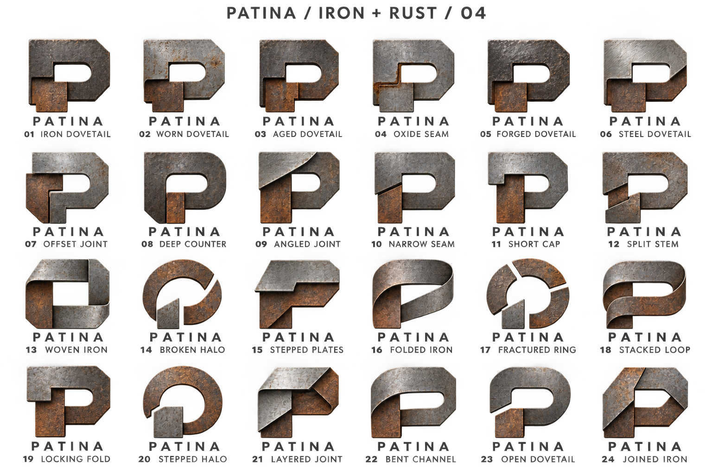

# Patina logo contact sheet 04

Date: 2026-11-15.



This sheet refines the contrast of [sheet 03](patina-logo-contact-sheet-03.png).
The owner requested brighter steel areas, clearer seams and stronger rust contrast.
Concepts 06 and 21 guided the metallic highlights.
The numbering follows sheet 03.

The owner then selected concept 03, **Aged Dovetail**.
The [branding artwork](patina-aged-dovetail-branding-sheet-01.png) develops that selected mark.

## Generation and checks

The built-in imagegen tool made one edited sheet.
The PNG is 1536 x 1024 pixels in RGBA format.
It contains 640043 fully transparent pixels.
The source and saved copy have the same SHA256 hash.
Small-icon readability remains unchecked.

## Generation prompt

```text
Use case: lighting-weather.
Edit the supplied Patina logo contact sheet with a restrained contrast and metallic-highlight refinement.
Keep all 24 existing logo shapes, their sizes, positions, numbers, names and wordmarks.
Keep the iron, steel and rust material identity.
Change the heading suffix from 03 to 04.
This is a refinement of the same concepts, not a new set of shapes.

The owner says concepts 06 STEEL DOVETAIL and 21 LAYERED JOINT already stand out because they have stronger metallic highlights.
Use those as the reference for selective brightness and legible planes.
Keep their treatment strong without making them much shinier.

For the other designs:
- Lift selected exposed steel faces and worn edges toward a clean light silver-gray.
- Use small restrained near-white highlights on a few bevels and directional brushed-metal planes.
- Deepen recessed seams and inner faces slightly so adjoining pieces separate clearly.
- Give the brown rust more variation between dark umber and muted burnt sienna.
- Keep rust matte. Preserve the contrast between oxidized surfaces and exposed metal.
- Favor broad readable light, middle and dark areas that remain distinct when the logo is small.
- Reduce muddy gray-brown midtone haze and overly fine noisy mottling where it hides the construction.
- Retain natural weathering and enough dark iron to keep the aged character.
- Keep differences in sheen between concepts. Do not make every face shiny.

Aim for a moderate increase in contrast, not a dramatic relighting.
Preserve silhouette detail and avoid clipping steel faces to featureless white.
No chrome mirror finish, glow, starbursts, lens flares or bright outlines around every edge.
No copper sheen, verdigris, green, blue accents or annotation dots.
Keep the same graphite typography and readable labels.

TRANSPARENCY IS REQUIRED:
Return a real RGBA PNG with a fully transparent background.
Preserve transparency in gutters and open counters.
Keep emblem surfaces solid; use alpha only at edges and genuinely transparent areas.
Do not add a painted background, smoky backdrop, checkerboard, card panels or external cast shadows.
Any backdrop visible in the source preview is not part of the requested design.
Make one revised contact sheet only.
```
