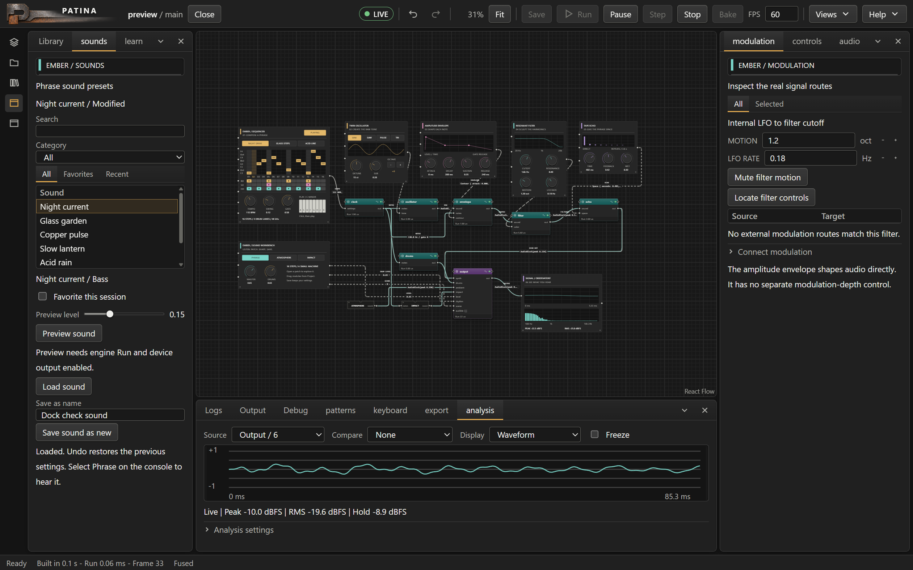
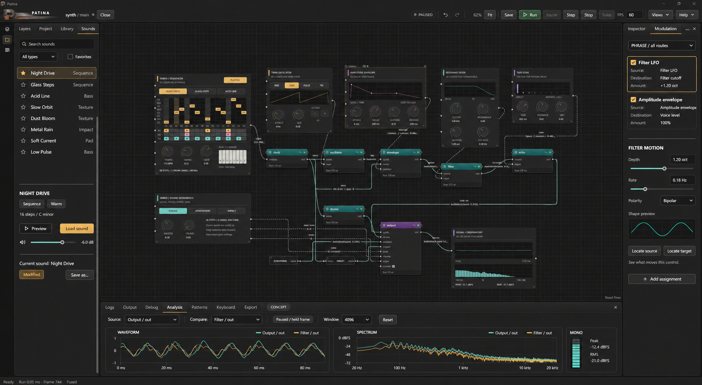

# Synthesizer dock design

Research, concept, and implementation record, 2026-11-18.

## Implemented tools

The nine tabs now run as Ember views. The canvas and existing instrument nodes remain the main workspace.
The [user guide](../workbenches/synth/README.md#use-the-dock-tools) gives the operating steps.

| Dock | Implemented behavior |
| --- | --- |
| Left | **sounds** searches factory and user presets, protects changes, saves new files, and previews an independent phrase voice. |
| Left | **learn** follows selection, provides listening experiments, and selects the related node. |
| Right | **modulation** reads real routes, edits supported depth controls, connects compatible pins, and removes selected routes. |
| Right | **controls** pins exact parameter editors with node selection. **audio** shows measured mono levels and output controls. |
| Bottom | **analysis** provides continuous waveform and spectrum capture, comparison, freeze, trigger, window selection, and peak hold. |
| Bottom | **patterns** edits the selected 16-step sequencer and its three drum lanes. |
| Bottom | **keyboard** plays chromatic notes with octave, velocity, last-note priority, and release protection. |
| Bottom | **export** runs the saved-patch renderer, shows progress, cancels its process tree, and protects existing files. |

Views use the real graph for saved parameters and connections. Transient preview and keyboard input do not change saved parameters.
Each view declares its initial dock in `[package.metadata.patina]`. Saved dock placements take precedence after opening.
The tab menu keeps each tab reachable at narrow widths. Side controls stack, and bottom controls wrap.

The design sections below record the original proposal. Their diagrams contain illustrative values.
The implementation has these explicit limits:

- Presets target the original main patch's phrase controls and score. They do not store arbitrary graph topology or the other scenes.
- Favorites, recent entries, and pinned controls last for one tab instance.
- Analysis captures six processor types. The existing scope node still uses its separate, short-block display path.
- Comparison captures can differ by one block. Modulation history and spectrogram modes remain open.
- Modulation shows the available real controls. It does not invent generic depth, polarity, or bypass parameters.
- Audio uses mono, 48 kHz, 256-sample blocks, and the system default device. Device selection and connection status need host support.
- MIDI, samples, polyphony, stereo buses, live recording, and arrangement remain open.
- Export reads saved files and includes saved mute state. It adds no effect tail or end fade.
- File publication can briefly block the view on volumes without hard-link support. The fallback preserves existing files.

No claim of listening quality or device playback comes from a GUI test.

## Verification on Windows

The checks used an isolated source copy. They preserved the owner's working graphs and the other agent's uncommitted files.
Workspace Clippy, workspace tests, editor frontend checks, both prototype frontend builds, and the standalone synth checks passed.

The hidden editor test passed these workflows:

- Open all nine tabs and resize side docks to 220 and 360 logical pixels.
- Use a 190-pixel bottom dock in a 1280 x 720 logical window without sideways control overflow.
- Change pattern tempo and restore the graph parameter with **Undo**.
- Save a sound and reject a second save with the same name.
- Preview a sound without changing the graph parameters.
- Protect modified sound settings during loading and undo a loaded preset.
- Hold a keyboard note and release it through the focus-loss handler.
- Capture live analysis, freeze it, and mark paused samples as stale.
- Export a WAV, protect an existing destination, and cancel a long export.
- Inspect all three graphs, their node controls, cable routes, contrast, and focus styles.

The keyboard test supplies a focus-loss event when the hidden desktop does not emit one.
It does not prove physical keyboard operation in a visible window.
The exported test file contains 4800 finite samples and nonzero audio. Cancellation left no destination or render folder.

One release-mode capture writer averaged 1.35 microseconds per 256-sample block over 2000 calls.
The allocation counter measured zero allocations after initialization. The writer takes no mutex and performs no retry loop.
This measures one capture writer, not the complete graph, audio device, or GUI.
Preview processing also passed its allocation and expiry checks. FFT tests resolved a low-frequency test tone.

Speaker playback, subjective sound quality, physical MIDI, Linux, and macOS were not checked.
The original 150-pixel dock target and every proposed accessibility workflow were not verified.

## Owner direction

Keep the node canvas as the main workspace. Use the existing left, right, and bottom docks for additional tabs.
Keep the **EMBER / SOUND WORKBENCH** console node and the other instrument nodes.
Make each added panel adapt to its dock. Do not shrink a fixed instrument panel to fit.

[Open the full concept](mockups/synth-docks/dock-concept.png).
The concept uses the owner's screenshot as the edit target. The graph remains the central work surface.
The left dock shows **Sounds**. The right dock shows **Modulation**. The bottom dock shows **Analysis**.
Other tools occupy alternate tabs. They do not all appear at once.

The image contains illustrative sound names, assignments, plots, and measurements.
The application is paused, so the analysis header says **Paused / held frame**.
The concept does not prove live capture, preset loading, or modulation editing.
Generated details can differ from the original screenshot. Existing source code defines the nodes, labels, connections, and values.

## Research findings

The following sources describe useful interaction patterns. The proposed placements are an Ember design decision.

| Primary source | Observed pattern | Application to Ember |
| --- | --- | --- |
| [Ableton browser manual](https://www.ableton.com/en/live-manual/12/working-with-the-browser/) | Search, filters, result lists, adjustable browser width, and preview controls | Put sound discovery in a vertical list. Keep preview and loading distinct. |
| [Surge XT manual](https://surge-synthesizer.github.io/manual-xt/) | Patch favorites, modified state, and protection for unsaved changes | Show the current sound and its modified state. Protect changes when another sound loads. |
| [Surge XT modulation list](https://surge-synthesizer.github.io/manual-xt/#modulation-list) | Source/target grouping, filtering, depth, mute, and removal | Make modulation assignments inspectable without tracing every cable. |
| [Bitwig panel guide](https://www.bitwig.com/userguide/latest/a_musical_swiss_army_knife/) | Separate browser, inspector, mapping, note/audio editor, keyboard, and output monitoring panels | Give each dock tab a specific task. Let users keep the graph visible. |
| [Bespoke reference](https://www.bespokesynth.com/docs/) | Waveform and spectrum modules, a looping note editor, and a keyboard display | Support signal inspection and note editing alongside a modular graph. |

Vertical space suits lists, assignments, and selected-item properties.
Horizontal space suits time, frequency, steps, notes, and keyboard keys.
These are layout inferences from the references and the owner's screenshot.

## Left dock: find and learn

### Sounds

Use a searchable list of sound presets, with category filters, favorites, and recent entries.
Show the sound name first. Put category or author on a second line when space is narrow.
Keep details for the selected item below the list. Let the list use the remaining height.

Use **Preview** to audition the selected item. Use **Load sound** to apply it to the patch.
Keep preview level separate from the saved master level. Stop preview when selection changes or the panel closes.
Show the current preset, a **Modified** marker, and **Save as**.
Loading must offer to save, discard, or cancel when changes would be lost.

The existing **Project** and **Library** tabs retain their code and graph navigation tasks.
The new **Sounds** tab browses musical content. It does not replace those tabs.

### Learn

Use a second tab for short, selection-aware lessons and a signal glossary.
Show one experiment at a time, with a **Locate node** action and a clear listening task.
For example: reduce cutoff, compare the filter input and output, and inspect the lost harmonics.
Keep longer explanations in expandable sections. The graph stays visible during a lesson.

### Samples, later

Add file search, duration, sample rate, preview, and import after sample playback works.
Put waveform trim and loop editing in the bottom dock, where time has enough width.
Do not show working import or audition controls before their audio and file paths exist.

## Right dock: inspect and connect

### Modulation

Show assignments as a vertical list. Each item identifies source, destination, depth, polarity, and enabled state.
Offer filters for the selected node, one source, or all assignments in the open patch.
Keep the selected assignment's precise controls below the list.
Provide **Locate source** and **Locate target** actions so the graph explains each assignment.

Use existing graph connections and parameters as the source of truth.
An internal modulation path can appear as a read-only summary until the node exposes an editable amount.
The concept's envelope amount illustrates the proposed control. The existing envelope path does not provide a general modulation-depth editor.
Adding, muting, or removing an assignment must change the real patch and support undo.
The panel must not create a separate routing model that disagrees with the canvas.

### Audio

Use another tab for output status, channel level, clipping, audio device, sample rate, and block status.
Use one meter for the current mono path. Add stereo controls only after stereo processing works.
Keep setup details in expandable sections. Keep mute, output availability, and clipping visible.
Do not display a connected device or a healthy signal when that state cannot be read.

### Controls, optional

Use a compact list of named macros or pinned parameters when a patch needs them.
Use sliders with values and visible assignments. Put an XY pad here only when its two targets are clear.
Avoid duplicating every knob from the graph. Pin controls that users need while inspecting another part of the patch.
Keep the built-in **Inspector** available for node properties and code.

## Bottom dock: inspect and edit signals over time

### Analysis

Provide source selection and an optional comparison source.
Use waveform, spectrum, and modulation-history modes. Add a spectrogram after continuous capture works.
Label time, frequency, amplitude, and dB units. Include trigger, freeze, analysis-window size, and peak-hold controls where applicable.
Show a compact output meter beside the plots when width permits.

The screenshot shows two illustrative traces to compare **Output / out** with **Filter / out**.
This can help explain the delay's effect on the sound.
For a filter lesson, compare its input and output instead.
Use one captured signal path for the node display and the dock view.
Pause, stopped, stale, and unavailable states must remain explicit.

### Patterns

Bind the view to the selected sequencer. Show its name, pattern, tempo, length, play position, and step grid.
Start with the existing 16-step phrase and drum data.
At short heights, show a pitch row and three drum rows. Open detailed pitch editing when the dock grows.
Add velocity, note duration, and arbitrary piano-roll editing only when the note data model supports them.
Keep sequence transport distinct from the application's engine **Run** and **Stop** actions.

### Keyboard

Provide a horizontal keyboard with octave selection, velocity, and **All notes off**.
Keep keys at a usable size. Change the visible octave range when width changes.
Show held notes and release them on focus loss. Label unsupported polyphony or MIDI input clearly.
Pitch bend, modulation wheel, and sustain need tested input and voice behavior before they become active controls.

### Export

Expose saved-patch WAV rendering through a compact form: destination, duration, format, progress, cancellation, and result.
The renderer already has a CLI path. An editor action still needs a tested job and file workflow.
Keep recording separate from offline export. The current renderer does not prove live recording support.

Keep **Logs**, **Output**, and **Debug** as alternate tabs in this dock.
Do not replace the bottom area with a tall fixed-size performance card.

## Resize behavior

These dimensions are proposed logical pixels, before Windows display scaling. They are acceptance targets, not measured runtime support.

| Panel shape | Narrow or short arrangement | Wider or taller arrangement |
| --- | --- | --- |
| Side dock, 220 to 280 px wide | One column; labels above fields; selected-row details below; collapsible filters | At 320 to 400 px, put short labels beside values and show optional list metadata |
| Side dock with limited height | Scroll the main content; retain the active title and essential actions | Let the list grow; expand details on request |
| Bottom analysis, 150 to 190 px high | One plot with a mode selector; compact source row; meter values in one line | Above 220 px, expose more analysis settings and larger axes |
| Bottom analysis, below 900 px wide | Select waveform or spectrum; keep comparison available within that plot | Above 1100 px, show waveform and spectrum side by side with a narrow meter |
| Bottom patterns | Step and drum rows; horizontal scroll when needed | Larger pitch editor and velocity lane when height permits |
| Bottom keyboard | Show fewer octaves with octave controls | Show more octaves at the same key size |
| Export form | Stack label/value rows or wrap small groups | Put destination and duration beside each other; keep progress readable |

Use the space between the analysis thresholds to retain the current mode without repeated layout switching.
Keep dock width independent from graph zoom. Never shrink all text or controls to fit the dock.
Use approximately 13 px labels, 26 to 30 px controls, and the shared Patina spacing.
Maintain visible keyboard focus and accessible names for icon actions.
Use a tab overflow menu when the tab strip becomes too short. Keep the active tab reachable.
Side panels must not need horizontal scrolling for ordinary controls.
Plots can simplify tick labels when narrow. They must retain the axis name and units.

At 1280 x 720 logical pixels, keep both side docks optional and the bottom dock shallow.
The graph keeps most of the center area. Users can collapse a dock or enlarge an editor for a specific task.
When dimensions fall below a panel's usable minimum, show a compact mode or a clear resize action.

## Implementation order and dependencies

1. Add shared responsive groups and reliable view gesture undo.
2. Add **Learn** and a selected-pattern view using existing graph data.
3. Add **Sounds** after a preset schema, safe loading, and audition path are tested.
4. Add **Analysis** after a continuous audio-to-display capture path is tested.
5. Add **Modulation** after editable routes map to real connections and parameters.
6. Add **Audio**, **Export**, and deeper musical editors with their required host support.

The image shows the proposed destination, rather than the implementation order.
Do not add active-looking placeholders for backend work that remains open.
The SDK already has views, fields, plots, waveform, table, curve, and timeline building blocks.
Their presence does not provide audio capture, preset persistence, MIDI, or automation playback.

## Checks before implementation is accepted

- Resize side docks through 220, 280, and 400 logical pixels.
- Resize the bottom dock through 150, 220, and 320 logical pixels in height.
- Check a 1280 x 720 logical window and Windows display scaling.
- Check long preset names, empty search results, missing sources, stopped audio, and unsaved sounds.
- Operate fields, lists, tabs, and plots with the keyboard.
- Change a parameter in a dock, inspect its node, save, reopen, and undo.
- Verify that a complete drag produces one undo step.
- Measure capture and drawing cost with complex graphs. Keep analysis work outside the audio callback.

## Asset provenance and current limits

The built-in imagegen tool edited the screenshot supplied by the owner.
The final asset is [dock-concept.png](mockups/synth-docks/dock-concept.png).
The exact request is [prompt.txt](mockups/synth-docks/prompt.txt).

The image above remains the original concept. It is not a screenshot of the implemented controls.
The implementation record separates measured checks from the original resize targets.
