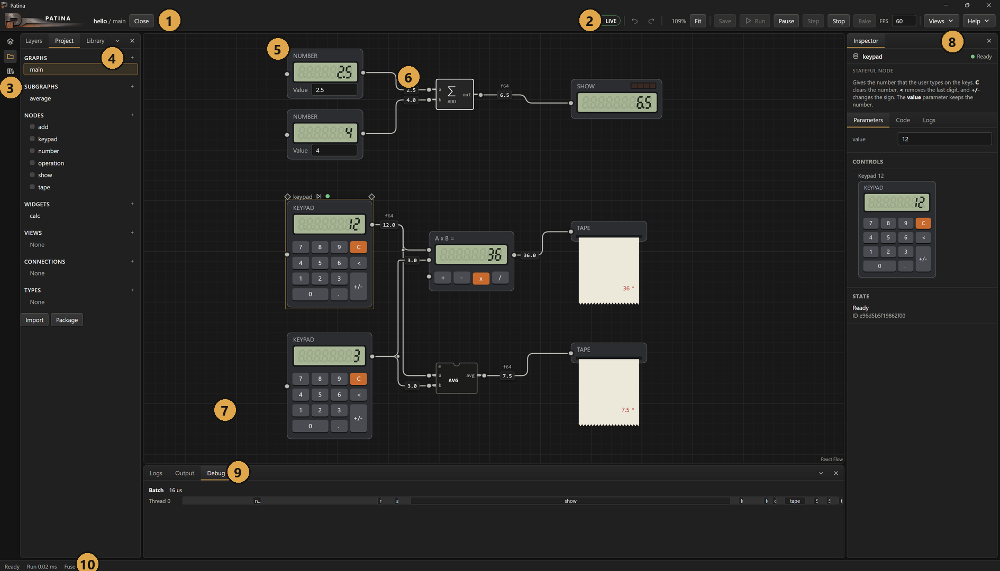
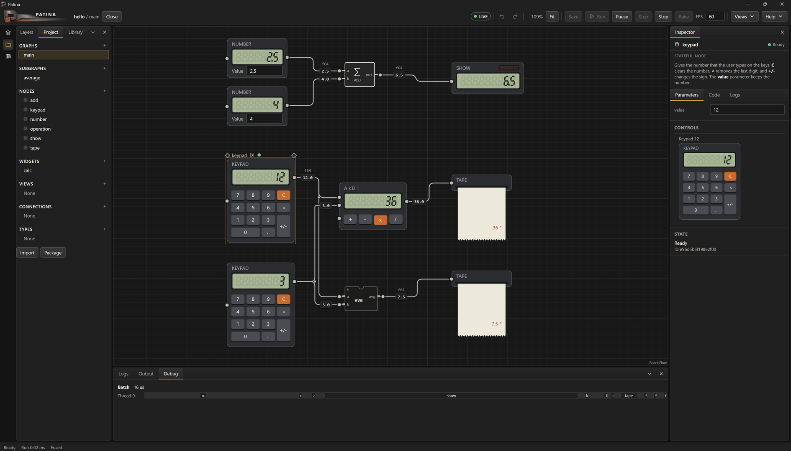
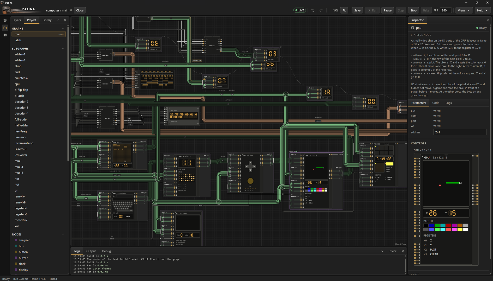
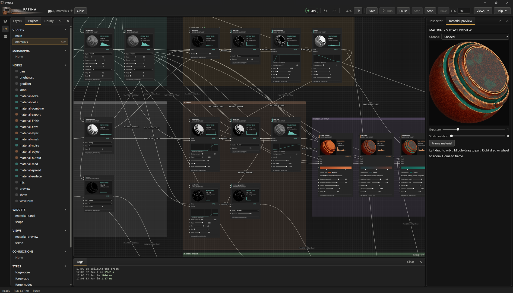
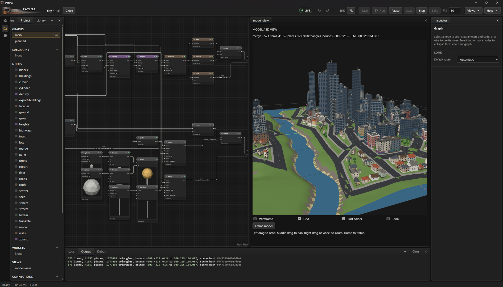
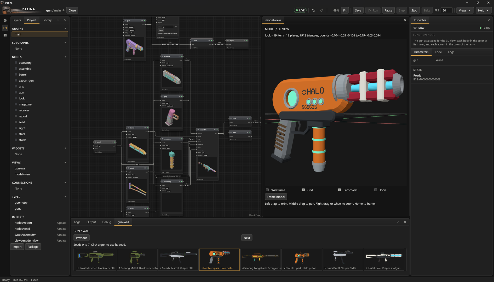
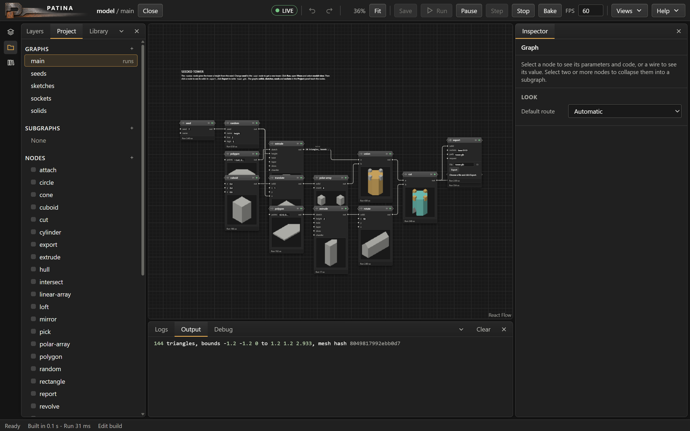
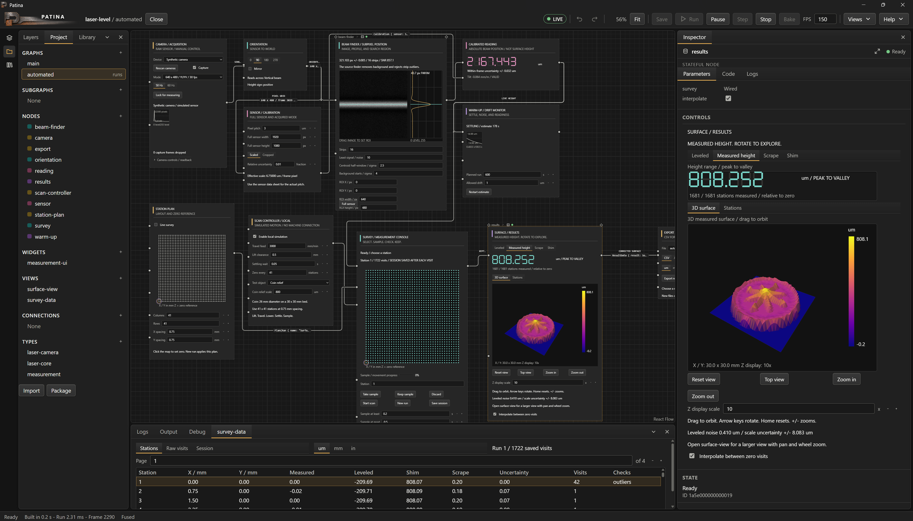
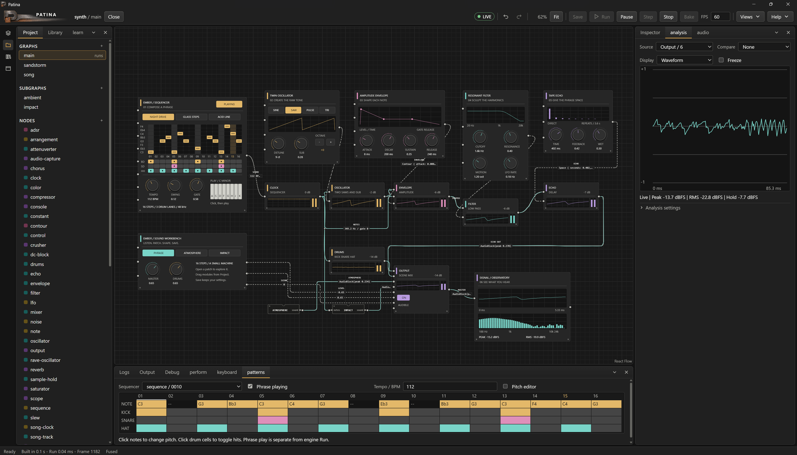

# Workbenches

A workbench is a Patina project that comes with the program. Each workbench shows one domain
with real nodes, node GUIs and views. Open a workbench to learn the editor, or copy its nodes
into your own project.

To open a workbench, click **Open** next to its name in the **Workbenches** box of the start
screen. In a checkout of this repository, click **Open project** and select a folder in
`workbenches/`.

## Contents

- [The editor at a glance](#the-editor-at-a-glance)
- [The workbenches](#the-workbenches)
- [Run a workbench from the command line](#run-a-workbench-from-the-command-line)

## The editor at a glance

All workbenches use the same editor. The image shows the **hello** workbench. The numbers
identify the parts of the editor.



1. **Title bar.** It shows the logo, the project and the graph, for example **hello / main**.
   **Close** goes back to the start screen.
2. **Toolbar.** **LIVE** shows that the graph runs again after each change. The toolbar also
   has undo and redo, the zoom, **Fit**, **Save**, **Run**, **Pause**, **Step**, **Stop**,
   **Bake**, the **FPS** limit, **Views** and **Help**.
3. **Left rail.** Each icon opens a panel in the left area: **Layers**, **Project** and
   **Library**. Click the icon of the active panel to fold the area.
4. **Project panel.** It lists the graphs, subgraphs, nodes, widgets and views of the project.
   Drag an item into the graph to add it. **Import** copies folders from other projects, and
   **Package** makes a package.
5. **Node with a GUI.** A node can draw its own controls on the canvas. The **number** node
   shows a field for its value.
6. **Wire value.** Each wire has a badge with its type and its last value. Click a wire to see
   the full value in the **Inspector**.
7. **Canvas.** This is the graph. Double-click an empty area to find and add a node. Drag from
   a pin to connect it.
8. **Inspector.** It shows the selected node: its kind, its description, and the tabs
   **Parameters**, **Code** and **Logs**.
9. **Bottom dock.** The **Logs** tab shows build and run messages. The **Output** tab shows
   the standard output of the nodes. The **Debug** tab shows the time of each node on each
   thread.
10. **Status bar.** It shows the state of the engine and the time of the last run. **Fused**
    shows that all nodes run in the optimized base. See [Layers](../../README.md#layers).

Drag a tab to move a panel to another area. Use the **Views** menu to show or hide a panel.
**Reset layout** gives the default layout.

## The workbenches

| | Workbench | What it shows |
|---|---|---|
| [](hello.md) | [hello](hello.md) | The smallest project: numbers, a keypad, a calculator and a subgraph. Start here. |
| [](computer.md) | [computer](computer.md) | An 8-bit computer of NAND gates, with RAM, a video chip, a keyboard and displays. |
| [](gpu.md) | [gpu](gpu.md) | Smart materials on the GPU: noise, masks, layers and a material preview. |
| [](city.md) | [city](city.md) | Seeded cities: terrain, a river, streets, lots and buildings in a 3D view. |
| [](gun.md) | [gun](gun.md) | Seeded guns for a game, from the parts of four makers. |
| [](model.md) | [model](model.md) | Procedural 3D models with solids, sketches, booleans and export. |
| [](laser-level.md) | [laser-level](laser-level.md) | Surface measurement with a camera and a laser level, with a simulated scan. |
| [](synth.md) | [synth](synth.md) | Ember, a sound workbench: a sequencer, a synth voice, effects and analysis. |

Each page shows the workbench in the editor and explains each part. Each workbench folder also
has a README with the full list of its nodes and its limits.

## Run a workbench from the command line

`patina-cli` runs a workbench without the editor. From the root of a checkout, use this
command:

```
cargo run -p patina-cli -- run workbenches/hello
```

Each page gives the commands for its workbench. For all the options, see
[Run a project from the command line](../../README.md#run-a-project-from-the-command-line).
