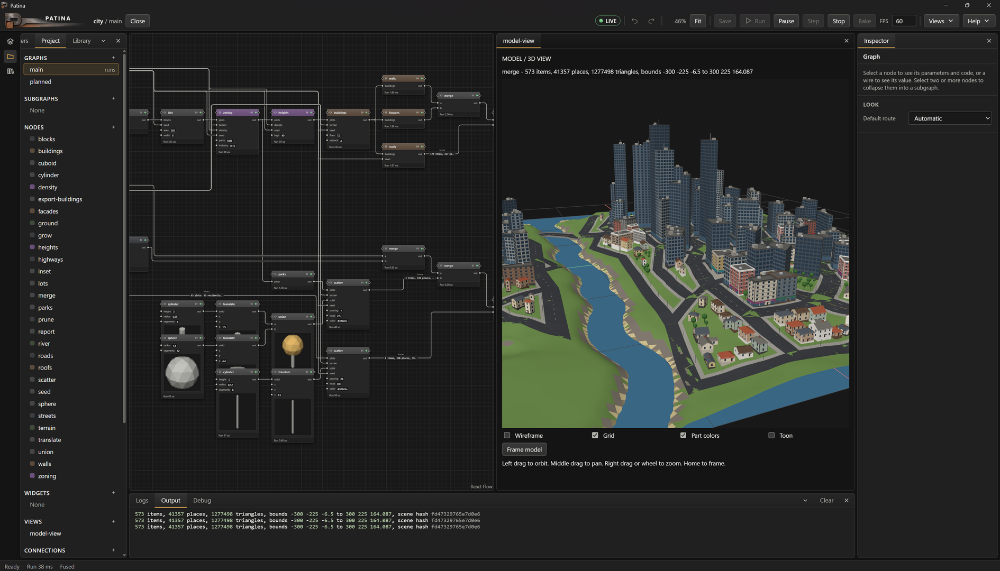
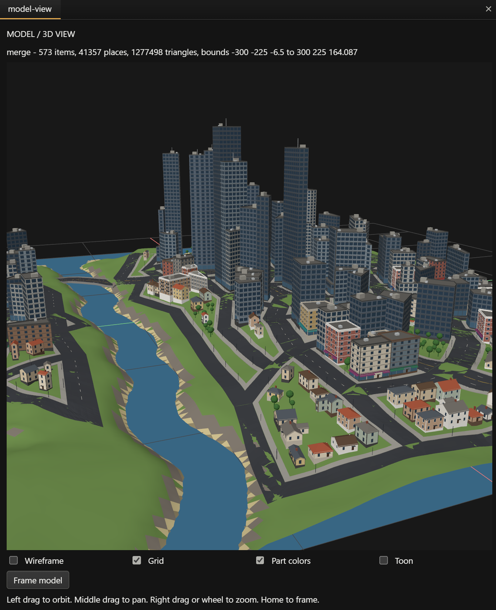
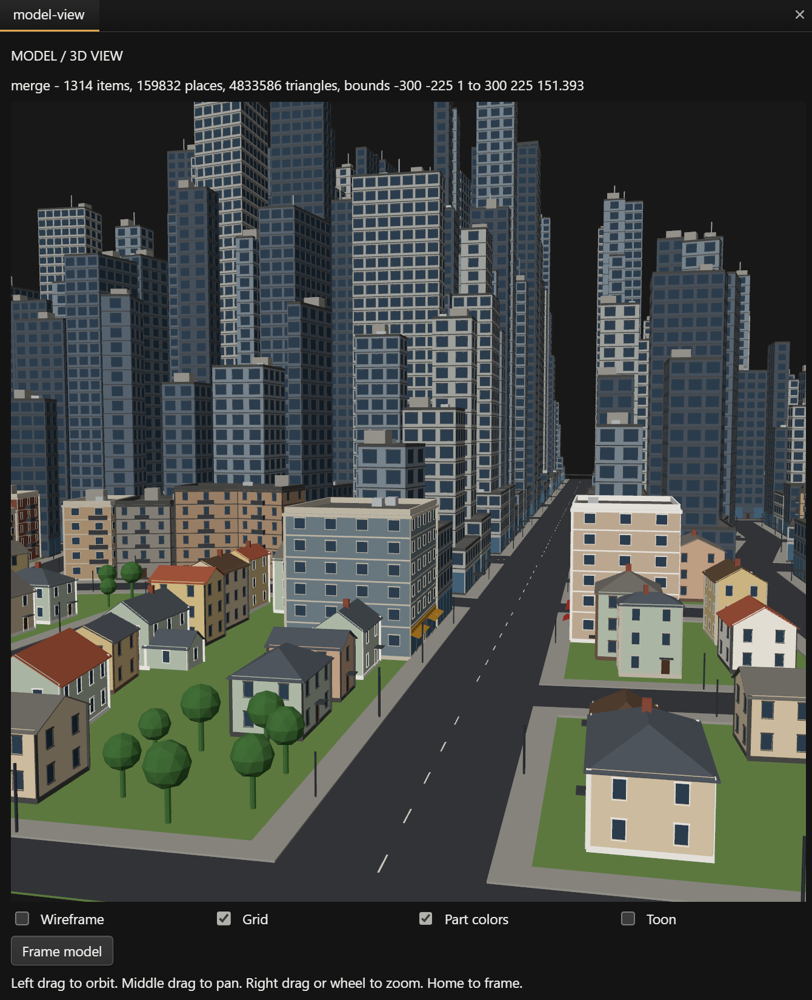
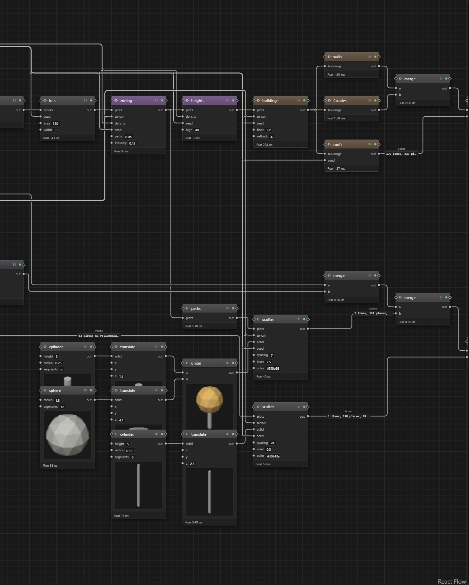
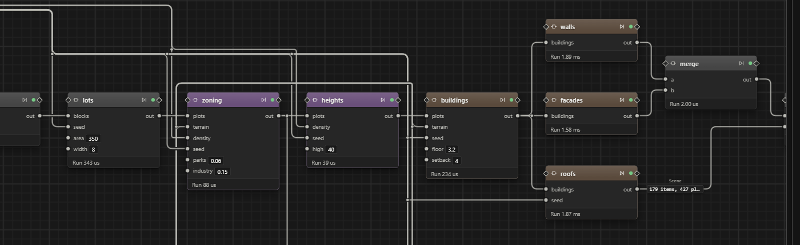
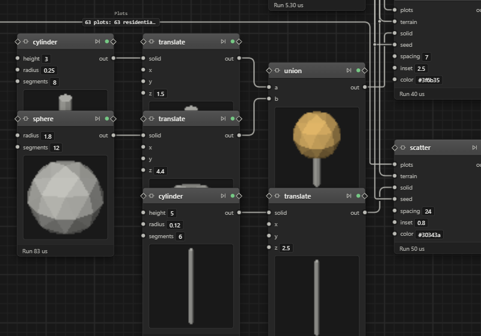
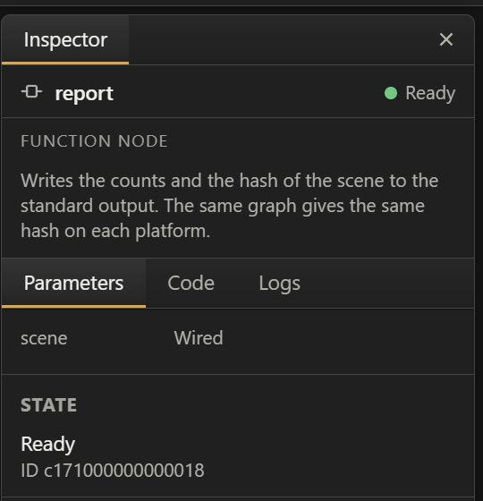
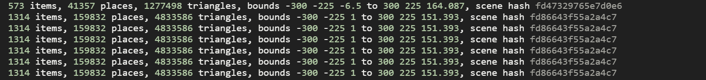

# city

The **city** workbench makes seeded cities: terrain, a river, streets, blocks, lots and
buildings. A seed changes the full city. Each step of the city is a node, so you can change or
replace one step. The workbench uses the [model](model.md) workbench as a library.



## Contents

- [Run it](#run-it)
- [Two cities](#two-cities)
- [The graph](#the-graph)
- [The steps of a city](#the-steps-of-a-city)
- [Trees and lamps from primitives](#trees-and-lamps-from-primitives)
- [The report node](#the-report-node)
- [The 3D view](#the-3d-view)
- [Scenes and instances](#scenes-and-instances)
- [Export the buildings](#export-the-buildings)
- [Measurements and limits](#measurements-and-limits)

## Run it

In the editor:

1. On the start screen, click **Open** next to **city**.
2. Click **Run**. The first build compiles the C++ kernel of the model workbench in about 5 to
   10 s.
3. Open **Views** and select **model-view**.
4. Click `report` or `merge` to see the full city. Click a step, for example `buildings`, to see
   that step.

From the command line, in the root of a checkout:

```
cargo run -p patina-cli -- run workbenches/city --frames 1
cargo run -p patina-cli -- run workbenches/city --graph planned --frames 1
```

## Two cities

The project has two top graphs.

The **main** graph makes an organic city of 600 m x 450 m on hills, with a river and a coast. In
the image, the city has 573 items at 41357 places, with 1277498 triangles.



The **planned** graph puts the same kinds of buildings on a grid of streets on flat land. In the
image, the city has 1314 items at 159832 places, with 4833586 triangles.



## The graph

The graph goes from left to right: the land, the streets, the lots, the buildings and the
scene. The bottom rows build the trees and the lamps from primitives.



Each node shows its run time under its pins. The status bar shows the time of the full run, for
example **Run 38 ms**.

## The steps of a city



The **main** graph has these steps:

1. **Land.** `terrain` makes the hills from the seed, with a slope down to the coast. Drops of
   rain cut the valleys and sharpen the ridges. **erosion** sets the drops for each sample, from
   0 to 8. `river` cuts a river along the routes of the water. **valley** sets the width of each
   side of its valley in meters. `ground` shows the grass, the sand, the rock and the water.
2. **People.** `density` puts the people on the land: a main center and sub-centers, less on
   steep slopes and none on the water.
3. **Streets.** `highways` joins gates on the edge to the center. A steep slope costs more, and
   the water costs a bridge. `grow` grows the arterial roads and the local streets. `prune`
   removes the dead ends.
4. **Lots.** `blocks` gives the faces between the streets. `inset` moves the edges in for a
   sidewalk. `lots` splits each block into lots, and each lot keeps a street edge.
5. **Zones.** `zoning` gives each lot a zone: residential, commercial, industrial or park.
   `heights` gives each lot a number of floors from the density and the zone.
6. **Plans.** `buildings` plans a house, an apartment, a shop, a tower or a warehouse on each
   lot. The plan has the footprint, the wings, the step-backs, the floors, the roof form and a
   style.
7. **Bodies.** `walls` builds the bodies, the floor bands, the cornices and the parapets.
   `facades` puts the windows, the doors, the shop fronts and the balconies on the walls.
   `roofs` builds the gable, hip, flat and sawtooth roofs.
8. **Streets and parks.** `roads` makes the asphalt, the sidewalks, the center lines and the
   bridges. `parks` gives the park lots, and `scatter` puts a solid along the edges of the
   plots.
9. **Scene.** `merge` puts two scenes into one. `report` writes the scene as text.

In the **planned** graph, `streets` makes the grid from the seed in place of steps 1 to 3. Each
**avenue**th line is a wide, straight avenue. **jitter** moves the crossings, and **drop**
removes a part of the inner streets.

## Trees and lamps from primitives

The bottom rows use the primitive nodes of the model workbench. Each node shows its solid as a
3D thumbnail.



1. A **cylinder** (height 3, radius 0.25) moves up 1.5 with **translate**. This is the trunk.
2. A **sphere** (radius 1.8) moves up 4.4. This is the crown.
3. **union** joins the trunk and the crown into one tree.
4. The first **scatter** puts trees along the park plots, with **spacing** 7 and the color
   `#3f6b35`.
5. A thin **cylinder** (height 5, radius 0.12) moves up 2.5. This is a lamp post.
6. The second **scatter** puts the lamps along the sidewalks, with **spacing** 24 and **inset**
   0.8.

The wire label shows the plots that go into the scatter, for example **63 plots: 63
residential**.

## The report node

Select `report` to see it in the **Inspector**.



The `report` node is a **FUNCTION NODE**. It writes the counts and the hash of the scene to the
standard output. The same graph gives the same hash on each platform. The **Output** tab shows
one line for each run:



The line gives the items, the places, the triangles, the bounds in meters and the scene hash.
Use the hash to see if a change of a node changed the city.

## The 3D view

The **model-view** view shows a scene with GPU instances. The top line shows the selected node
and the size of its scene.

- Drag with the left button to orbit, the middle button to pan, and the right button to zoom.
  The wheel also zooms.
- Push Home or click **Frame model** to frame the scene.
- **Wireframe** shows the edges of the triangles.
- **Grid** shows the ground grid and the X and Y axes.
- **Part colors** gives each part its own color.
- **Toon** gives three light bands and dark outlines.

## Scenes and instances

The city wires carry a `Scene`, not one solid. A scene has items, and each item is one mesh at
many places. All windows are one mesh at many thousands of places, so the build makes no boolean
for them. Each building is a group, so the export can write each building alone.

## Export the buildings

The `export-buildings` node writes each building to its own file `building-<group>.glb`. The
center of the base of each building is at the origin. Each item, for example the walls or the
windows, is one primitive with its own material.

1. Click **Folder** in the node and choose a folder. A relative path starts at the project
   folder.
2. Click **Export**.

The node writes only after a click on **Export**, or at each fire of a trigger with an order
wire to the node. A run after a change does not write.

## Measurements and limits

Measured on 2026-11-19 on a Windows computer, with a bake build:

- The **main** graph runs in about 0.7 s in a CLI run after the build.
- A city of 1 km x 1 km has 93244 places and 2886571 triangles. It runs in 0.33 s.
- The erosion takes about 19 ms for **main**.

A street at the edge of the land turns along the edge, and the roads stop at the edge.

The [city README](../../workbenches/city/README.md) has the full list of nodes. The plan is in
the [workbenches plan](../workbenches-plan.md), task E.
