# computer

The **computer** workbench is a small 8-bit computer made of NAND gates. The style is the style
of a digital logic simulator: each gate, adder, register and memory is a subgraph that you can
open. The CPU runs programs in a small assembly language. It reads a keyboard, a joystick and a
random source, and it writes a terminal, a video chip, sprites and displays.

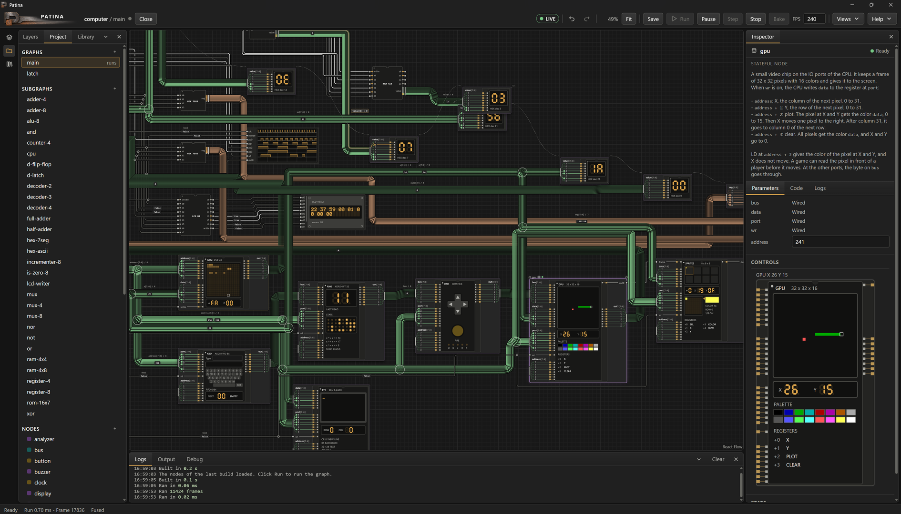

## Contents

- [Run it](#run-it)
- [The main graph](#the-main-graph)
- [Displays and readouts](#displays-and-readouts)
- [Memory and IO devices](#memory-and-io-devices)
- [The video chip, the joystick and the sprites](#the-video-chip-the-joystick-and-the-sprites)
- [Inside the CPU](#inside-the-cpu)
- [Inside a register](#inside-a-register)
- [The subgraph interface](#the-subgraph-interface)
- [Programs](#programs)
- [The instruction set](#the-instruction-set)
- [Parts](#parts)

## Run it

In the editor:

1. On the start screen, click **Open** next to **computer**.
2. Click **Run**. The CPU starts the selected program.

From the command line, in the root of a checkout:

```
cargo run -p patina-cli -- run workbenches/computer --frames 16
cargo run -p patina-cli -- run workbenches/computer --graph latch --frames 16
```

Each frame is one clock step. Each frame writes ten lines: the count, the count plus 3, an
accumulator, a memory, the three registers of the CPU and the segments of the three displays.

## The main graph

The main graph has the `cpu` subgraph in the center, with the `program` node, the `clock` and
the `ram` chip. The devices of the IO ports are below it. The displays and the logic analyzer
are above it. The project runs at 240 frames each second (**FPS** 240 in the toolbar).

In the run of the image, the **Logs** tab shows **Ran 11424 frames**, and the status bar shows
**Run 0.70 ms** for each frame.

A 1-bit wire is lit when it is true. A wire of the `byte` kind is a ribbon of 8 lanes, with the
label `bus[7:0] / 8`. Each lane is lit when its bit is true, and the badge shows the value of
the byte.

## Displays and readouts

The top of the graph shows the state of the computer.

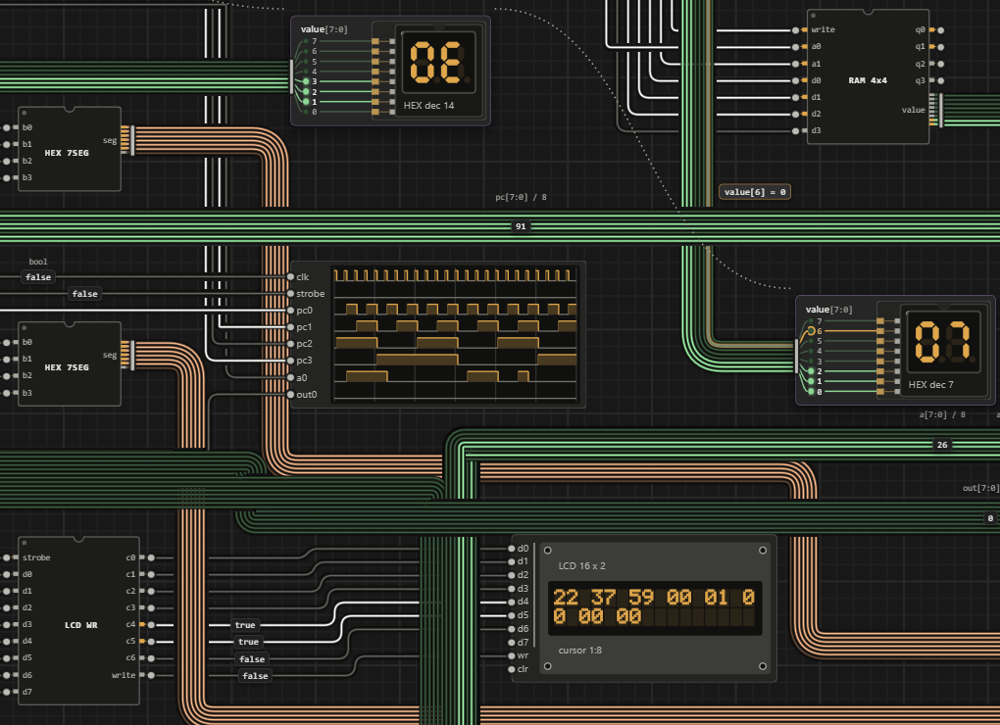

- The **HEX 7SEG** chips change a 4-bit value into the 7 segments a to g. Each `display` node
  gets one copper `segment-bus` wire. Put the pointer on a lane to see its name and its state.
- The `readout` nodes show a byte as 8 lamps and as a number, for example **value[7:0]**.
- The **RAM 4x4** chip keeps 4 words of 4 bits.
- The `analyzer` node is a logic analyzer. It draws the last 96 frames of its 8 inputs as
  waveforms. In the example, it shows the clock, the strobe, the PC bits, A0 and OUT0.
- The **LCD WR** chip is the `lcd-writer` subgraph. At each OUT instruction, it writes the two
  hex digits of OUT and a space to the **LCD 16 x 2**, one character at each step.

## Memory and IO devices

The CPU reads and writes memory at the addresses 0 to 255. Addresses 0 to 239 are the RAM, and
addresses 240 to 255 (0xF0 to 0xFF) are the IO ports.

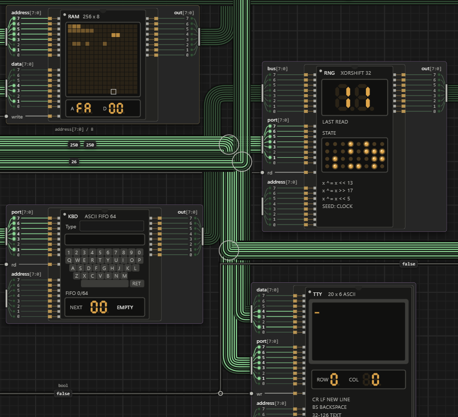

- **RAM 256 x 8** is the `ram` node. It keeps 256 bytes and shows the byte at the last address.
  Expand it to see all bytes in hexadecimal. The last byte that the CPU wrote is lit.
- **RNG XORSHIFT 32** is the `random` node (port 0xF5). Each read gives a new random byte.
- **KBD ASCII FIFO 64** is the `keyboard` node (port 0xF0). Type a text into the **Type** field
  and push Enter. A read of 0xF0 gives the first key, or 0 when the buffer is empty.
- **TTY 20 x 6** is the `terminal` node (port 0xF0). A write to 0xF0 prints the character on 6
  lines of 20 characters.

The `cpu` has one **io** input, so the devices are a chain: `keyboard` to `random` to
`joystick` to `gpu` to the CPU. The **address** parameter of a device sets its first port.

## The video chip, the joystick and the sprites

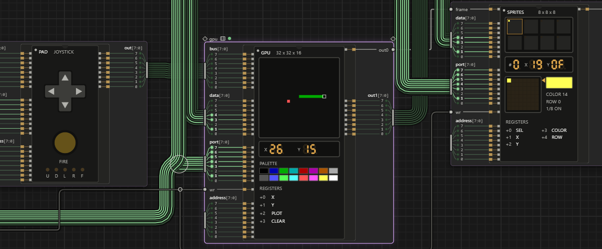

- **PAD JOYSTICK** is the `joystick` node (ports 0xF6 to 0xF8). Click the pad, then hold the
  arrow keys or W, A, S and D, and Space for fire.
- **GPU 32 x 32 x 16** is the `gpu` node (ports 0xF1 to 0xF4). It keeps a frame of 32 x 32
  pixels in 16 colors. Its register list shows the ports: **+0 X**, **+1 Y**, **+2 PLOT** and
  **+3 CLEAR**.
- **SPRITES 8 x 8 x 8** is the `sprites` node (ports 0xF9 to 0xFD). It draws 8 sprites of
  8 x 8 pixels over the frame. Its registers are **SEL**, **X**, **Y**, **COLOR** and **ROW**.

Select the `gpu` node to see it in the **Inspector**. The description tells how the CPU uses
the chip. **address** is the first port, here 241 (0xF1).

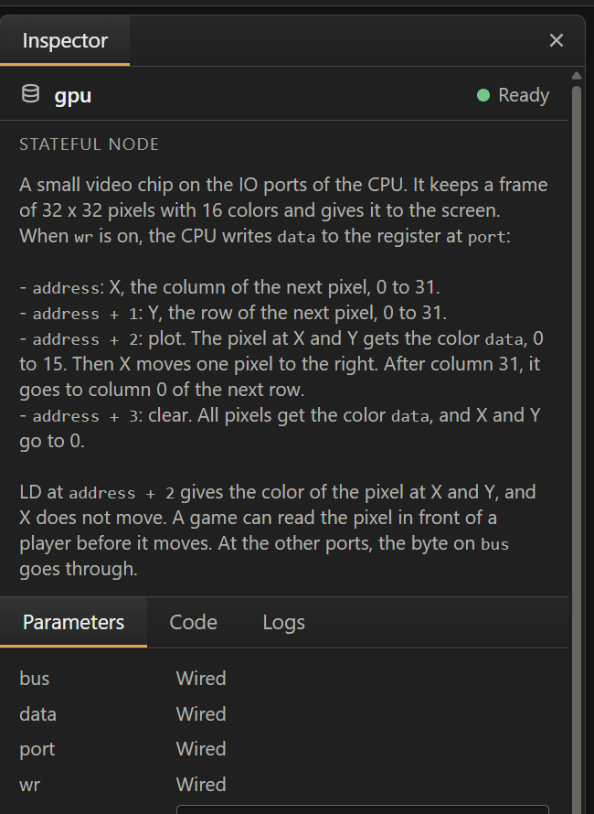

**Controls** shows a live copy of the node GUI, with the screen and the palette. Use it to see
the screen when the node is small on the canvas.

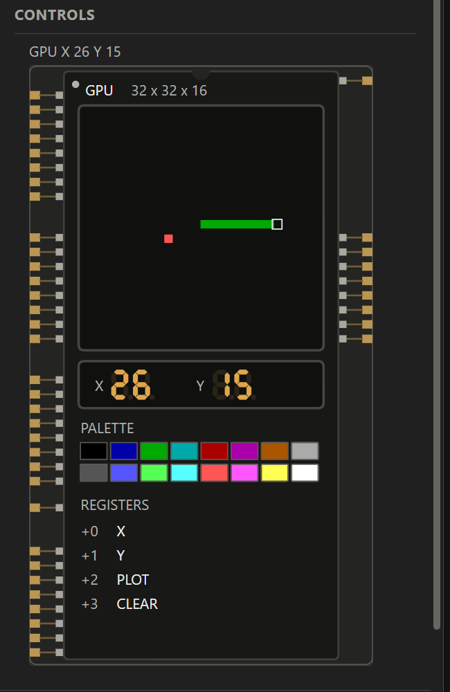

Select the wire from the `gpu` node to see the frame type viewer: a thumbnail, the screen
larger, and a plot of the pixels of each color. Open **monitor** from the **Views** menu to
draw the screen with `wgpu` on the real GPU.

## Inside the CPU

Double-click the `cpu` node to open it. The subgraph opens with the live values of that use. The
path bar shows **main / cpu**. Click **main** to go back.

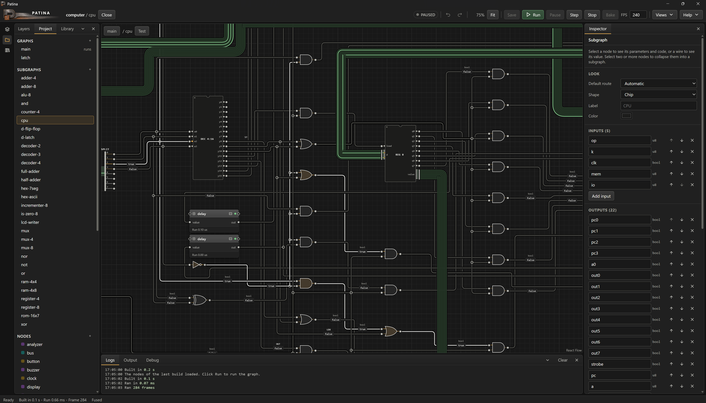

The `cpu` is an 8-bit computer of 794 NAND gates. The image shows the graph while it is
**PAUSED**. A `decoder-4` subgraph (**DEC 4:16**) gives one line for each opcode. Gates combine
the lines into the control signals. The **REG 8** chips keep the registers, and `delay` nodes
keep a bit for one clock step.

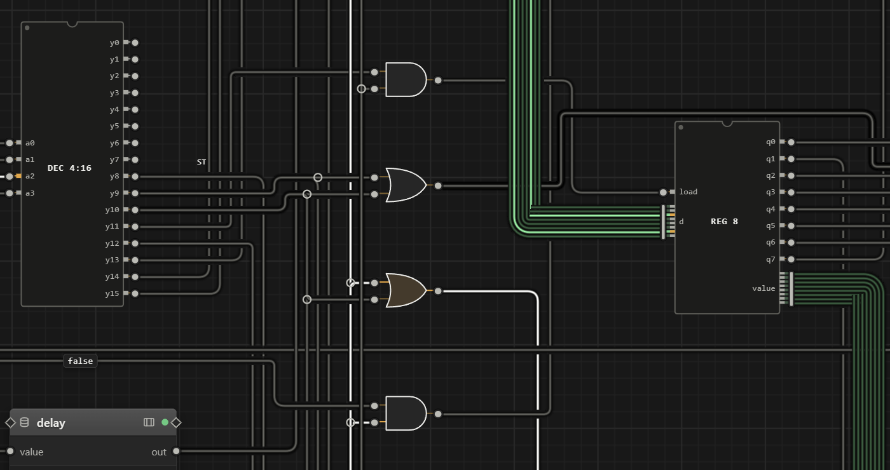

Bits 0 and 1 of the opcode select the function of the `alu-8` subgraph: b, a + b, a - b or
a and b. Bit 2 selects the byte at the address in place of k. The `incrementer-8` subgraph
gives the next program counter, and `is-zero-8` gives the zero flag.

To see the inside of a use with no change of graph, click **Show inner nodes** in its header.
To test a subgraph alone, open it and click **Test** in the path bar. Click the switch at the
left of an input to toggle it. Click **End test** to return.

## Inside a register

Open a **REG 8** chip in the CPU, then a **REG 4** chip in it. The path bar shows each use from
the main graph.


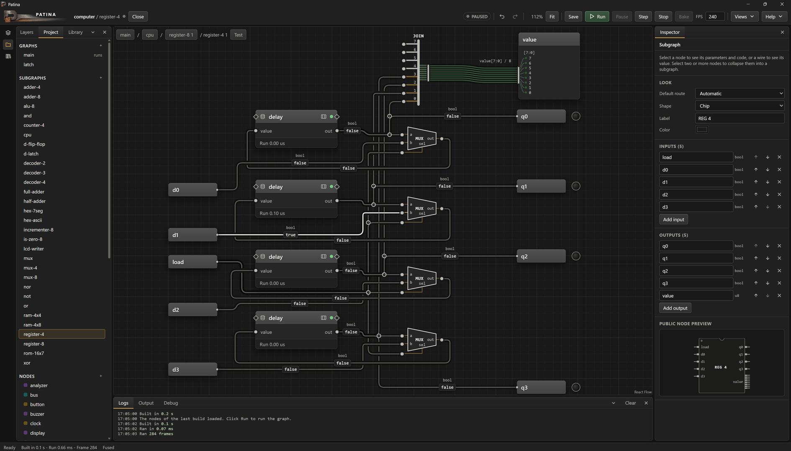

The `register-4` subgraph keeps 4 bits. It takes new bits when its **load** input is on.

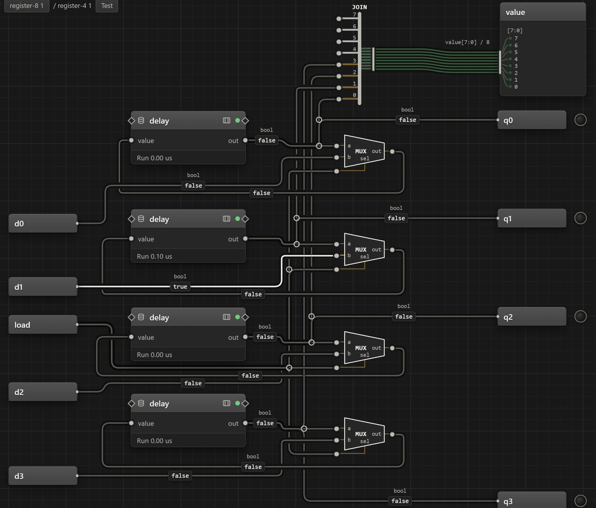

Each bit has the same parts:

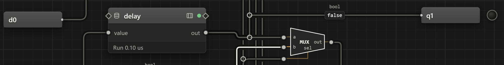

1. A `delay` node keeps the bit for one clock step.
2. A **MUX** selects the input **d** when **load** is on. Else it selects the old bit from the
   `delay` node.
3. The output of the **MUX** goes back into the `delay` node and out to **q**.

A **JOIN** node puts the four bits into the byte output **value[7:0]**.

## The subgraph interface

Click an empty part of an open subgraph. The **Inspector** shows the **Subgraph interface**.

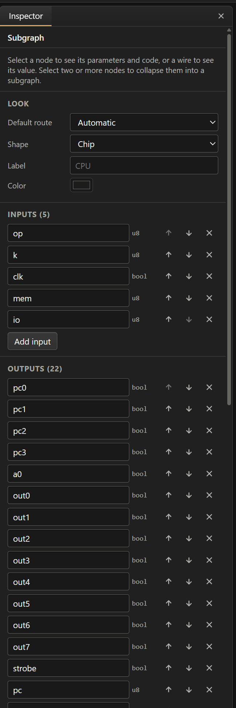

- **Look** sets the shape, the label and the color of each use. The `cpu` is a **Chip** with
  the label **CPU**.
- **Inputs** and **Outputs** list the public pins in the order of each use. Each pin has a name
  field, a type, **Move up**, **Move down** and **Remove**.
- **Add input** and **Add output** add a pin below the last pin.

The `register-4` subgraph has 5 inputs and 5 outputs:

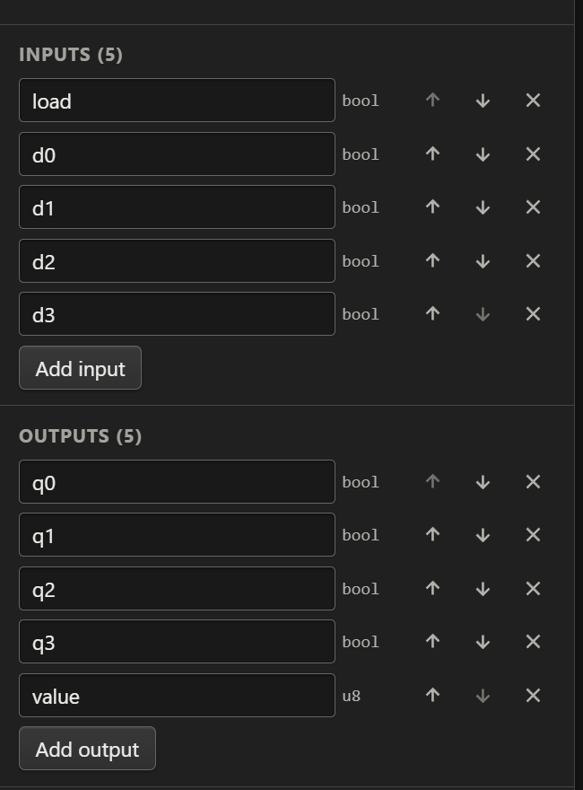

The **Public node preview** shows the use as other graphs see it:

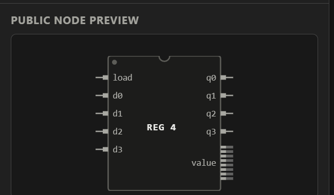

To make a new subgraph, select two or more nodes and collapse them into a subgraph.

## Programs

The `program` node keeps 256 instructions. Select a program in the **File** dropdown of the
node, or click **New**. Expand the node to edit the code. It shows line numbers, the line that
runs and the errors.

| Program | What it does |
|---|---|
| `fibonacci.asm` | Writes the Fibonacci numbers 1 to 233 to the OUT register. |
| `count.asm` | Counts up on OUT from 0 to 255, then starts again at 0. |
| `echo.asm` | Shows each key on the terminal. |
| `stripes.asm` | Paints the screen with the 16 colors, one pixel after the other. |
| `noise.asm`, `confetti.asm` | Paint pixels of random colors on the screen. |
| `dice.asm` | Shows a random number on OUT at each key. |
| `paint.asm` | Paints with the joystick. |
| `snake.asm` | Plays Snake. Set **every** of the `clock` to 1. |

The `clock` node gives one tick each **every** frames. To change the speed, set **FPS** in the
toolbar or **every** in the **Inspector**. Click **Pause** on the clock node to stop it, then
**Step** to give one tick.

## The instruction set

Each instruction has a 4-bit opcode and an 8-bit value k. The CPU has the register A, the index
register X, the OUT register, the carry flag C and the zero flag Z.

| Opcode | Instruction | What it does |
|---|---|---|
| 0 | **LDI k** | A takes k. |
| 1 | **ADDI k** | A takes A + k. C takes the carry. |
| 2 | **SUBI k** | A takes A - k. C is on when there is no borrow. |
| 3 | **ANDI k** | A takes A and k, bit by bit. |
| 4 | **LD k** | A takes the byte at address k. |
| 5 to 7 | **ADD k**, **SUB k**, **AND k** | As ADDI, SUBI and ANDI, with the byte at address k. |
| 8 | **ST k** | The byte at address k takes A. |
| 9 | **STX k** | The byte at address k + X takes A. |
| 10 | **LDX k** | A takes the byte at address k + X. |
| 11 | **TAX** | X takes A. |
| 12 | **OUT** | OUT takes A. |
| 13 | **JMP k** | The program counter takes k. |
| 14 | **JC k** | The program counter takes k when C is on. |
| 15 | **JZ k** | The program counter takes k when Z is on. |

The [Logic circuits](../../README.md#logic-circuits) section of the main README gives the
assembly language and all IO ports.

## Parts

The subgraphs, from small to large:

- **Gates:** `not`, `and`, `or`, `nor`, `xor`, `mux`, `d-latch`, `d-flip-flop`.
- **Arithmetic:** `half-adder`, `full-adder`, `adder-4`, `adder-8`, `incrementer-8`, `alu-8`,
  `is-zero-8`.
- **Selection:** `mux-4`, `mux-8`, `decoder-2`, `decoder-3`, `decoder-4`.
- **Memory:** `register-4`, `register-8`, `ram-4x4`, `ram-4x8`, `rom-16x7`, `counter-4`.
- **Output:** `hex-7seg`, `hex-ascii`, `lcd-writer`.
- **The computer:** `cpu`.

The workbench also has the parts of Digital Logic Sim 2: `d-flip-flop`, `rom`, `pulse`, `bus`,
`led`, `dot-display`, `rgb-display` and `buzzer`. See
[Build the computers of Digital Logic Sim 2](../dls2-parity.md).

The [computer README](../../workbenches/computer/README.md) lists all nodes, views and folders.
