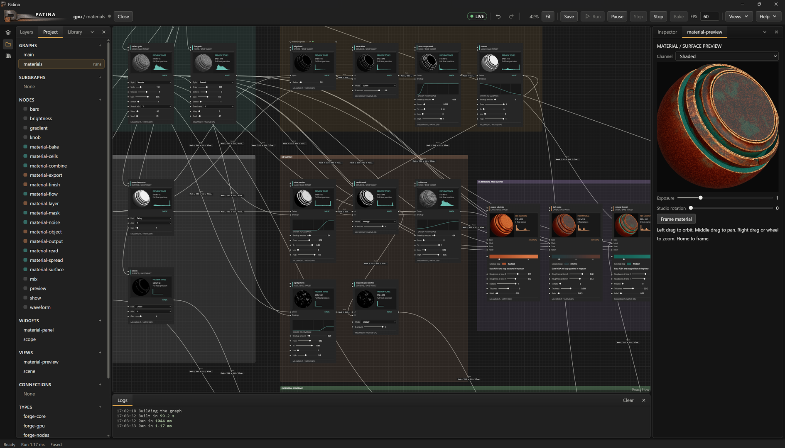
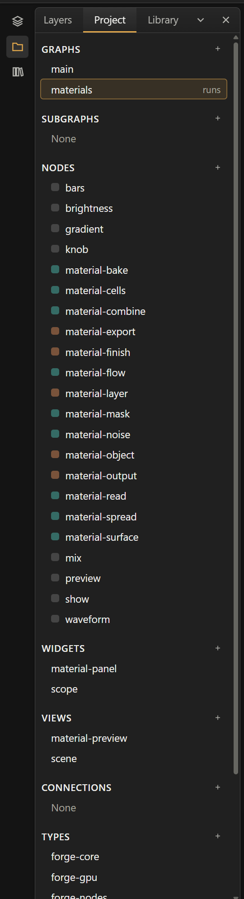
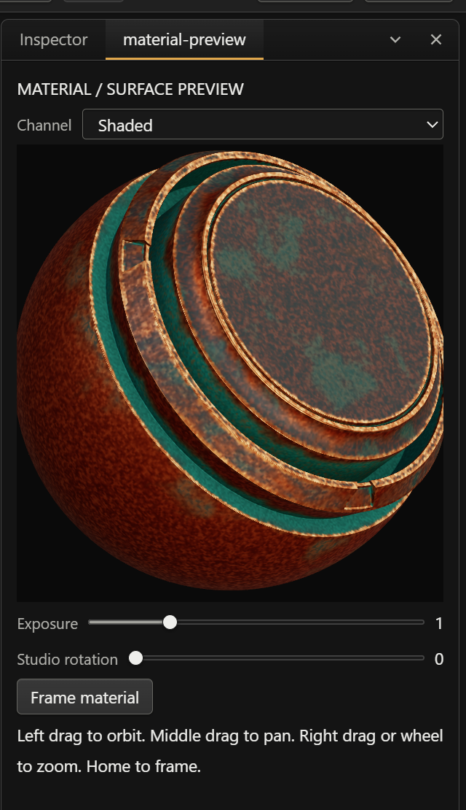
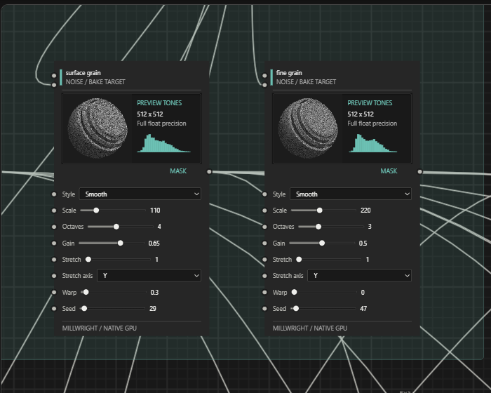
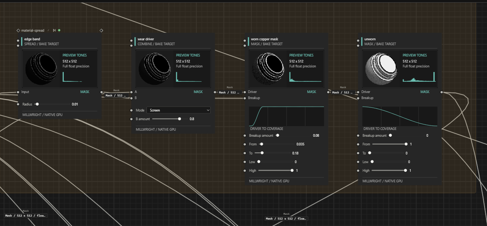
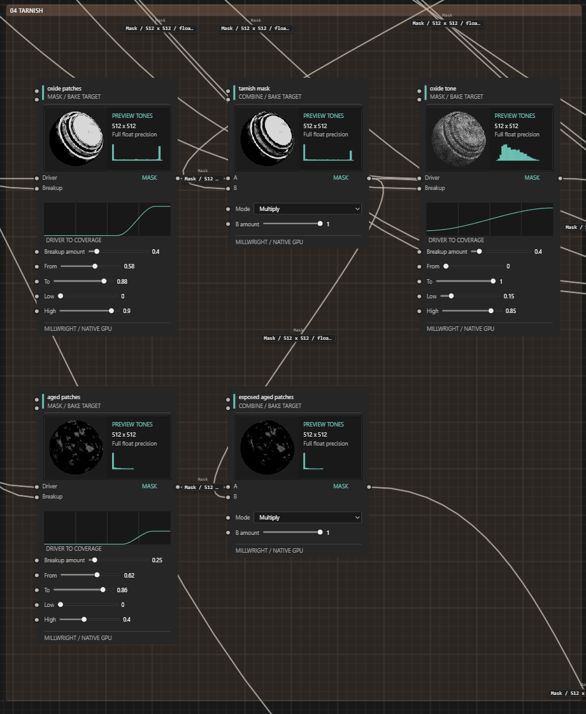
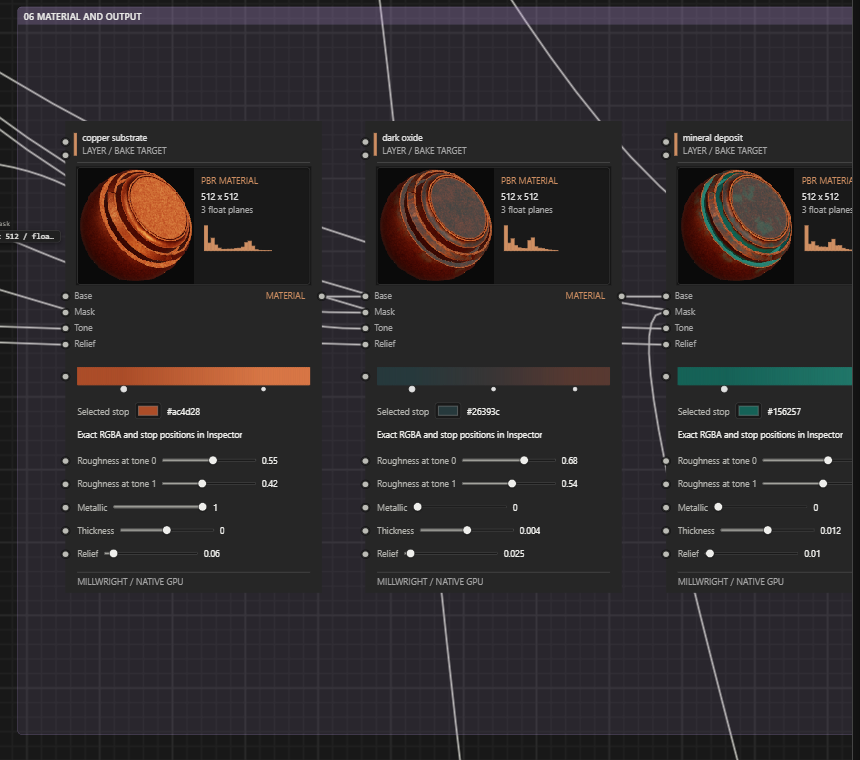

# gpu

The **gpu** workbench runs nodes on the GPU with WESL shaders through `wgpu`. It has two top
graphs:

- **materials** is a smart material workbench. It builds an aged copper material from noise,
  masks and layers, and shows it on a sphere with full PBR shading.
- **main** has small GPU experiments with the look of lab instruments: a gradient, color bars,
  a mixer and a waveform monitor.



## Contents

- [Run it](#run-it)
- [The project](#the-project)
- [The material preview](#the-material-preview)
- [How the material is built](#how-the-material-is-built)
- [Noise nodes](#noise-nodes)
- [Wear masks](#wear-masks)
- [Tarnish masks](#tarnish-masks)
- [Layers and output](#layers-and-output)
- [Edit a shader](#edit-a-shader)
- [Objects, bakes and export](#objects-bakes-and-export)
- [The main graph](#the-main-graph)
- [Limits](#limits)

## Run it

In the editor:

1. On the start screen, click **Open** next to **gpu**.
2. In the **Project** panel, click **materials**.
3. Click **Run**. The first build of the shaders and the GPU code takes some time. In the run
   of the image, the **Logs** tab shows **Built in 39.1 s** and **Ran in 1044 ms**.
4. Open **material-preview** from the **Views** menu.
5. Click **Run** again to capture the finished material.

From the command line, in the root of a checkout. The workbench needs Rust 1.100.0:

```
cargo +1.100.0 run -p patina-cli -- run workbenches/gpu --graph materials
cargo +1.100.0 run -p patina-cli -- run workbenches/gpu
```

The second command runs the main graph. It writes the mean brightness of the gradient, about
`0.336`.

## The project



- **Graphs**: `main` and `materials`.
- **Nodes**: the `material-*` nodes of the smart material workbench, and the nodes of the main
  graph: `bars`, `brightness`, `gradient`, `knob`, `mix`, `preview`, `show` and `waveform`.
- **Widgets**: `material-panel` and `scope`, the drawing parts of the node GUIs.
- **Views**: `material-preview` and `scene`.
- **Types**: the shared material types of the `forge-*` crates.

## The material preview

The **material-preview** view shows the material on a sphere, with full PBR shading.



- The **Channel** list selects what the view shows: **Shaded**, base color, roughness,
  metallic, height, occlusion or normal.
- **Exposure** sets the brightness of the image.
- **Studio rotation** turns the light around the sphere.
- **Frame material** restores the camera.

The mouse works as in Maya. Drag with the left button to orbit, the middle button to pan, and
the right button to zoom. The wheel also zooms. Push Home to frame the sphere.

## How the material is built

The graph has 28 material nodes, three workflow nodes and six labeled groups. Each group has a
color on the canvas.

1. **Shared noise** gives each coat its surface variation.
2. **Mesh maps** find the exposed edges, the creases and the enclosed areas of the object.
3. **Wear** masks show the copper at the exposed edges.
4. **Tarnish** masks control the oxide coat.
5. **Mineral** masks put the deposits on the surface.
6. **Material and output**: four layers build the material. **Finish** derives the normal from
   the combined height.

Each node body shows a real GPU preview, a tone histogram and its main controls. The pins show
the difference between a mask and a full material. The footer **MILLWRIGHT / NATIVE GPU** shows
that the node runs the Millwright kernel on the GPU.

## Noise nodes

The **Shared noise** group makes the variation that all coats use.



Each **NOISE / BAKE TARGET** node gives a **MASK**. **PREVIEW TONES** shows the mask on the
sphere and its histogram, at 512 x 512 with full float precision.

| Control | surface grain | fine grain | What it does |
|---|---|---|---|
| **Style** | **Smooth** | **Smooth** | The kind of noise. |
| **Scale** | 110 | 220 | The size of the pattern. A larger value gives smaller grains. |
| **Octaves** | 4 | 3 | The number of noise layers that add detail. |
| **Gain** | 0.65 | 0.5 | The strength of each next octave. |
| **Stretch** and **Stretch axis** | 1, Y | 1, Y | Stretch the pattern along one axis. |
| **Warp** | 0.3 | 0 | Bends the pattern with a second noise. |
| **Seed** | 29 | 47 | Selects a different pattern. |

## Wear masks

The **Wear** group finds where the surface rubs and shows the bare copper there.



1. **edge band** (**SPREAD**) spreads the edge mask of the mesh maps over a band.
2. **wear driver** (**COMBINE**, mode **Screen**) combines the band with a second mask.
3. **worn copper mask** (**MASK**) changes the driver into the coverage of the worn copper.
4. **unworn** (**MASK**) is the area that keeps its coats.

A **MASK** node shows its **DRIVER TO COVERAGE** curve. **From** and **To** set where the curve
starts and ends. **Low** and **High** set the coverage at the two ends. **Breakup amount** adds
noise to the edge of the mask.

## Tarnish masks

The **04 TARNISH** group controls where the green oxide grows.



- **oxide patches** (**MASK**) makes patches from the noise. In the image, the curve goes from
  **From** 0.58 to **To** 0.88, with **Low** 0 and **High** 0.9.
- **tarnish mask** (**COMBINE**, mode **Multiply**) multiplies the patches with a second
  mask.
- **oxide tone** (**MASK**) gives the tone of the oxide.
- **aged patches** (**MASK**) makes a second set of patches. **exposed aged patches**
  (**COMBINE**, mode **Multiply**) multiplies them with a second mask.

## Layers and output

The **06 MATERIAL AND OUTPUT** group stacks the coats. Each **LAYER / BAKE TARGET** node takes a
**Base** material, a **Mask**, a **Tone** and a **Relief**, and gives a **MATERIAL**.



The node shows **PBR MATERIAL** with a preview at 512 x 512, and a color ramp. The tone selects
a color on the ramp.

| Control | copper substrate | dark oxide | mineral deposit |
|---|---|---|---|
| Selected stop | `#ac4d28` | `#26393c` | `#156257` |
| **Roughness at tone 0** | 0.55 | 0.68 | - |
| **Roughness at tone 1** | 0.42 | 0.54 | - |
| **Metallic** | 1 | 0 | 0 |
| **Thickness** | 0 | 0.004 | 0.012 |
| **Relief** | 0.06 | 0.025 | 0.01 |

To change a color:

1. Click a stop under the ramp. The node shows the **Selected stop** and its color.
2. Change the color of the selected stop.
3. For exact values, use the float RGBA and position fields in the **Inspector**.

Click **Restore kernel defaults** in the **Inspector** to start from the original settings of
the kernel. The node library also has **Cells**, **Flow** and **Read**. They make cell
patterns, carry masks along a surface and extract material channels.

## Edit a shader

Each material node has its GPU code in `nodes/material-*/assets/kernel.wesl`.

1. Open the file and change the shader body. Keep the port and parameter declarations. The
   Rust node defines those public controls.
2. Click **Run**. Patina compiles the shader again. A shader change needs no Rust compile.
3. If the shader has an error, the node keeps its last valid state and shows the error.

## Objects, bakes and export

- **Object** loads a Millwright `asset.json` with its `mesh.bin`, or a triangulated OBJ. The OBJ
  needs a UV atlas from 0 to 1 with no overlaps. The graph loads the original Millwright
  material sphere.
- **Bake / Object maps** bakes position, normal, curvature, occlusion, thickness, part and
  contact data. The sphere uses its original 2048 x 2048 bake. Click **Bake maps again** to run
  the baker again.
- **Material resolution** sets the size of the material textures. Connect its output to the
  **Bake target** input of each source node. The default is 512 x 512 float32.
- **Export** writes eight PNG passes in a ZIP file when you click **Export passes**. The passes
  are base color, roughness, metallic, occlusion, normal, height, opacity and packed ORM. Export
  does not replace a file.

## The main graph

Click **main** in the **Project** panel. The nodes look like the front panels of lab
instruments.

- The first row draws a gray gradient on the GPU, finds its mean brightness and shows a small
  copy.
- The second row makes color bars, mixes them with the gradient and shows the result on a
  monitor and a waveform monitor.

Try this:

- Drag the knob up or to the right. The color bars, the monitor and the waveform get brighter.
- Drag the fader of the mix node from **A** to **B**.
- Click the **INV** switch of the gradient. The histogram and the mean change.
- Open `nodes/bars/assets/bars.wesl` and change the colors. Click **Run**.

## Limits

- The workbench has the copper recipe. It does not import other recipes and it has no paint
  workspace.
- It does not unwrap UVs, find overlapping UVs, import OBJ materials or import glTF.
- The material workflow is checked on Windows x64 with MSVC only.

The [gpu README](../../workbenches/gpu/README.md) has the full details. See also the
[smart material workbench plan](../smart-material-workbench.md) and the
[GPU](../../README.md#gpu) section of the main README.
