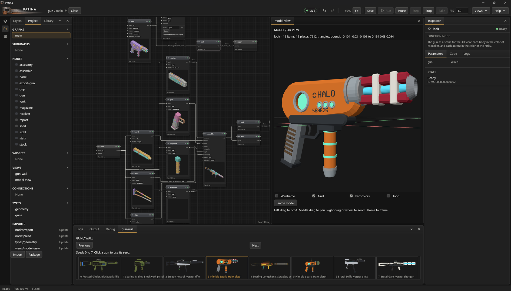
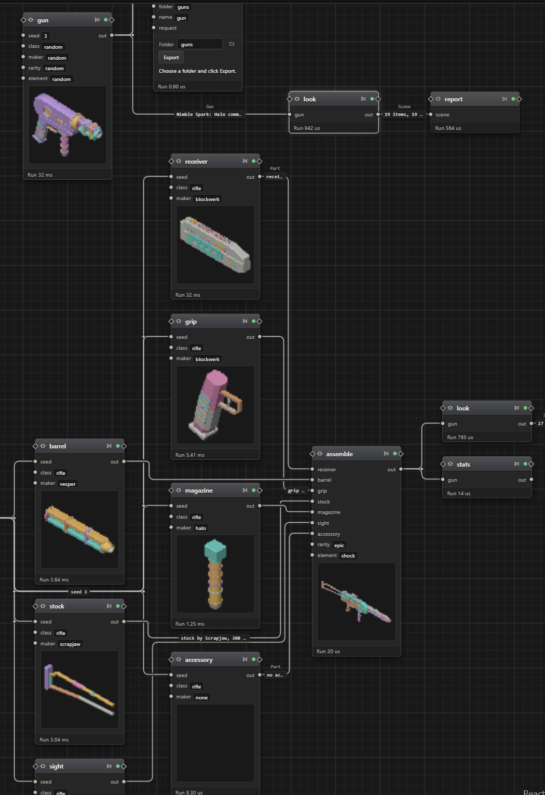
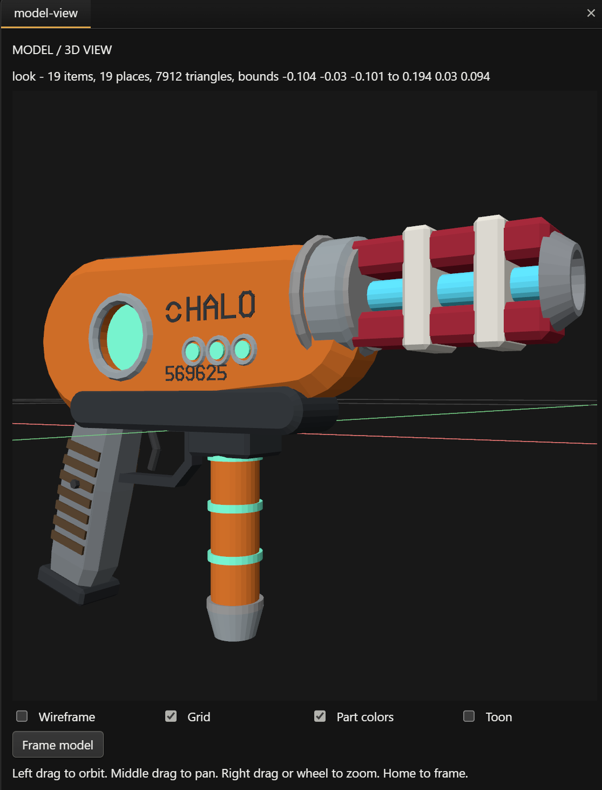
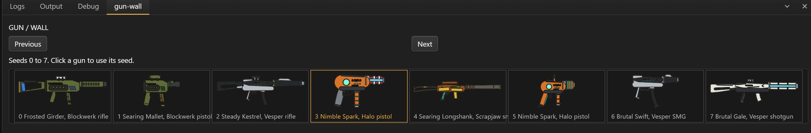
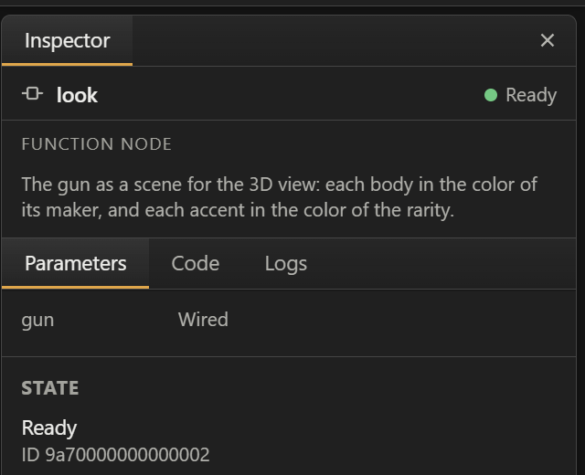

# gun

The **gun** workbench makes seeded guns for a game. A gun has a class, parts from four original
makers, a rarity and an element. A seed changes the full gun. The workbench uses the
[model](model.md) workbench as a library for its solids.



## Contents

- [Run it](#run-it)
- [The window](#the-window)
- [Two ways to make a gun](#two-ways-to-make-a-gun)
- [The classes](#the-classes)
- [The parts](#the-parts)
- [The makers](#the-makers)
- [Maker marks and materials](#maker-marks-and-materials)
- [The rarity](#the-rarity)
- [The elements](#the-elements)
- [The names](#the-names)
- [The 3D view](#the-3d-view)
- [The gun wall](#the-gun-wall)
- [The look node](#the-look-node)
- [Export a gun](#export-a-gun)
- [Crates and limits](#crates-and-limits)

## Run it

In the editor:

1. On the start screen, click **Open** next to **gun**.
2. Click **Run**. The first build compiles the C++ kernel of the model workbench in about 5 to
   10 s.
3. Open **Views** and select **model-view**. Click a `look` node to see its gun in 3D.
4. Open **Views** and select **gun-wall** to see the guns of eight seeds.

From the command line, in the root of a checkout:

```
cargo run -p patina-cli -- run workbenches/gun --frames 1
```

The two `stats` nodes write the name, the maker, the rarity, the class, the element, the stats
and the parts of two guns, for example `Brutal Gale`, `Vesper common shotgun` and `damage 95`.
The two `report` nodes write the counts and the hash of each `look` scene.

## The window

The image shows the default layout of the workbench:

- The canvas in the center has the `main` graph. Each node with a solid shows it as a 3D
  thumbnail.
- The **model-view** panel at the right shows the gun of the selected `look` node.
- The **gun-wall** tab of the bottom dock shows the guns of eight seeds.
- The **Project** panel at the left lists the nodes, the views and the types.

## Two ways to make a gun



The `main` graph makes two guns.

**From one seed.** The `gun` node at the top left makes a full gun from its **seed**. Its
**class**, **maker**, **rarity** and **element** are **random** in the image. A **random** value
comes from the seed, so the same seed always gives the same gun. The `gun` node goes into a
`look` node, and the `look` node goes into a `report` node. The wire label shows the name of the
gun, for example **Nimble Spark: Halo common**.

**From parts.** The lower rows have one node for each part: `receiver`, `grip`, `barrel`,
`magazine`, `stock`, `accessory` and `sight`.

1. Each part node has a **seed**, a **class** and a **maker**. The node shows its part as a 3D
   thumbnail.
2. The maker **none** removes the part.
3. `assemble` puts each part on its socket of the receiver. It also applies the **rarity** and
   the **element**.
4. The `look` and `stats` nodes at the right take the assembled gun.

The same seed, class and maker as a part of the `gun` node give the same part. Thus you can
start from a `gun` node and then change one part.

The `export-gun` node at the top writes the gun to a file. See [Export a gun](#export-a-gun).

## The classes

The class sets the size of each part, the base stats and the chance of each extra part.

| Class | Chance | Shape and stats |
|---|---|---|
| **pistol** | 24 % | A short body and barrel, a medium damage and a small magazine. |
| **smg** | 20 % | A compact body, a high fire rate and a large magazine. |
| **rifle** | 22 % | A long body, a stock and a medium fire rate. |
| **shotgun** | 14 % | A wide barrel or two barrels, high damage and a slow fire rate. |
| **sniper** | 12 % | A long barrel and a long scope, high damage and high accuracy. It always has a sight. |
| **launcher** | 8 % | A wide tube and a back blast pipe, very high damage and a magazine of two. |

The chance is the chance of a **random** class.

## The parts

| Part | What it is |
|---|---|
| `receiver` | The body of the gun, with a socket for each other part. It sets the base stats. |
| `barrel` | The barrel, with the `muzzle` socket at its end. A long barrel gives accuracy. |
| `grip` | The grip and the trigger guard, with the `hand` socket. |
| `stock` | The stock. It gives accuracy and a slower reload. |
| `magazine` | The magazine. A large magazine reloads slower. |
| `sight` | The sight. It gives accuracy. |
| `accessory` | The accessory under the barrel. Each maker changes other stats. |

## The makers

Each maker has its own shape language, stat bias, three paint schemes, a metal color and a
glow color.

| Maker | Shapes | Stats | Paint |
|---|---|---|---|
| **Blockwerk** | Heavy slabs with chamfers, vents, bolts and stripes. | High damage and a low fire rate. | Olive, tan or gray. |
| **Vesper** | Sleek turned shapes, tapers, fins and glow strips. | High accuracy. | White, black or red. |
| **Scrapjaw** | Plates at random offsets, pipes, bolts, tape and wire. | A high fire rate and large magazines. | Rust, teal or red. |
| **Halo** | Rings, coils, capsules and glow cells. | A fast reload. | Teal, purple or orange. |

The `gun` node uses the maker of the gun for most parts. Some parts come from another maker.

## Maker marks and materials

Each receiver has the maker mark on its two sides: the logo of the maker and its name in raised
letters of the trim color.

| Maker | Logo |
|---|---|
| **Blockwerk** | Three blocks. |
| **Vesper** | A crescent. |
| **Scrapjaw** | Two jaws. |
| **Halo** | A ring. |

The right side of each receiver also has a serial number of six digits. The seed of the gun sets
the number. In the image of [The 3D view](#the-3d-view), the Halo pistol has the serial
**569625**.

Each part has six materials, each with its own color: **paint**, **trim**, **metal**, **grip**,
**rarity** and **glow**. The rarity accents use the color of the rarity. The glow parts use the
color of the element, or the glow color of the maker when the gun has no element.

## The rarity

| Rarity | Chance | Accent color |
|---|---|---|
| **common** | 50 % | Gray |
| **uncommon** | 25 % | Green |
| **rare** | 14 % | Blue |
| **epic** | 8 % | Purple |
| **legendary** | 3 % | Orange |

A higher rarity does these things:

- It gives more damage, a higher fire rate, more accuracy, a larger magazine and a faster
  reload.
- It adds a stock, a sight and an accessory more frequently.
- It adds an element more frequently.

## The elements

| Element | Glow color |
|---|---|
| **none** | The glow color of the maker. |
| **fire** | Orange |
| **shock** | Blue |
| **corrosive** | Green |
| **cryo** | Pale blue |

A gun with an element does 15 percent less direct damage.

## The names

Each maker has a model name for each class, for example **Kestrel** for a Vesper rifle. The
first word of the name comes from the element, for example **Searing** for fire. A gun with no
element gets the word of its largest part bonus:

| Word | Bonus |
|---|---|
| **Brutal** | Damage |
| **Rapid** | Fire rate |
| **Steady** | Accuracy |
| **Hoarding** | Magazine |
| **Nimble** | Reload |

A gun with no large bonus has only the model name.

## The 3D view

The **model-view** view shows the scene of the selected `look` node.



The top line shows the node and the size of the scene. In the image, it is **look - 19 items,
19 places, 7912 triangles**, with the bounds in meters. The gun is a Halo pistol with orange
paint, rings, coils and glow cells. The receiver shows the ring logo, the name **HALO** and the
serial number.

- Drag with the left button to orbit, the middle button to pan, and the right button to zoom.
  The wheel also zooms. Push Home or click **Frame model** to frame the gun.
- **Wireframe** shows the edges of the triangles.
- **Grid** shows the ground grid and the X and Y axes.
- **Part colors** gives each part its own color.
- **Toon** gives three light bands, dark outlines and ink lines on the sharp edges.

## The gun wall

The **gun-wall** view shows the guns of eight seeds side by side. Each gun uses the class, the
maker, the rarity and the element of the `gun` node.



The image shows seeds 0 to 7:

| Seed | Name | Gun |
|---|---|---|
| 0 | **Frosted Girder** | A Blockwerk rifle |
| 1 | **Searing Mallet** | A Blockwerk pistol |
| 2 | **Steady Kestrel** | A Vesper rifle |
| 3 | **Nimble Spark** | A Halo pistol (selected) |
| 4 | **Searing Longshank** | A Scrapjaw sniper |
| 5 | **Nimble Spark** | A Halo pistol |
| 6 | **Brutal Swift** | A Vesper SMG |
| 7 | **Brutal Gale** | A Vesper shotgun |

To use a gun of the wall:

1. Click a gun. The view gives its seed to the `gun` node, and the graph runs again.
2. Click **Previous** or **Next** to see the next eight seeds.

## The look node

Select a `look` node to see it in the **Inspector**.



The `look` node is a **FUNCTION NODE**. It changes a gun into a scene for the 3D view. Each body
gets the color of its maker, and each accent gets the color of the rarity. Its **gun** input
shows **Wired**, because a wire gives the value.

## Export a gun

The `export-gun` node writes the gun to `<name>.glb` and its stats to `<name>.txt`.

- The `.glb` file has the `muzzle` and `grip` sockets in the glTF extras.
- It has the look of the 3D view: one primitive for each material of each part, and one glTF
  material for each color.

Do these steps:

1. Click **Folder** in the node and choose a folder. A relative path starts at the project
   folder. In the graph, the folder is `guns` and the name is `gun`.
2. Click **Export**.

The node writes only after a click on **Export**, or at each fire of a trigger with an order
wire to the node. A run after a change does not write.

## Crates and limits

- `types/geometry` is an import of the model types. `types/guns` has the parts, the classes,
  the makers, the materials, the elements, the rarity, the stats, the names and the side view.
- `nodes/seed` is an import from the model workbench, and `nodes/report` is an import from the
  city workbench. The other nodes are thin nodes on `types/guns`.
- `views/model-view` is an import of the model view. `views/gun-wall` is the gun wall.

Known limits:

- The parts are made from extrusions, turned profiles and booleans. The Vesper and Halo grips
  and stocks are lofts through outlines, with a taper, a swell and a waist. The Blockwerk grip
  and stock are lofts through chamfered outlines. The Scrapjaw grip and stocks are planks and
  pipes.
- The gun wall draws flat side views with paths, not 3D images.
- The maker mark and the serial number are the only text on a gun.

The [gun README](../../workbenches/gun/README.md) has the full details. The plan is in the
[workbenches plan](../workbenches-plan.md), task F.
