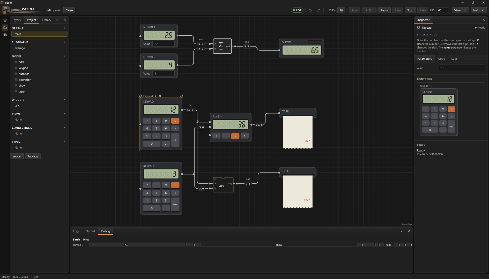
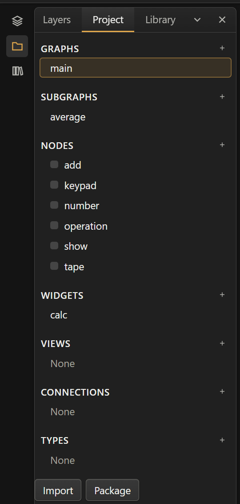
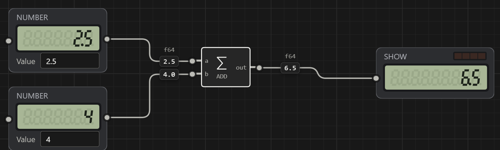
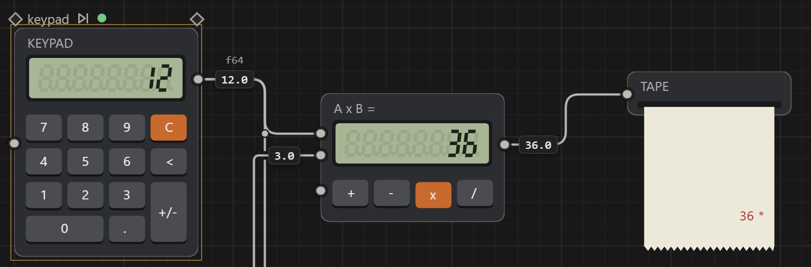
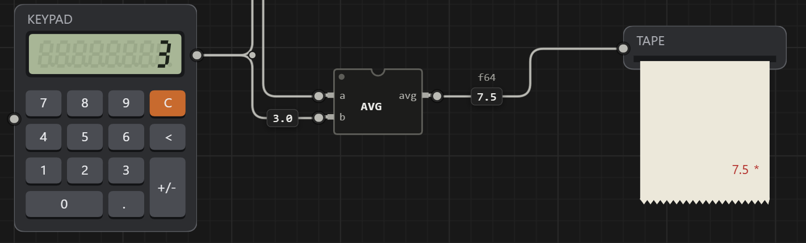
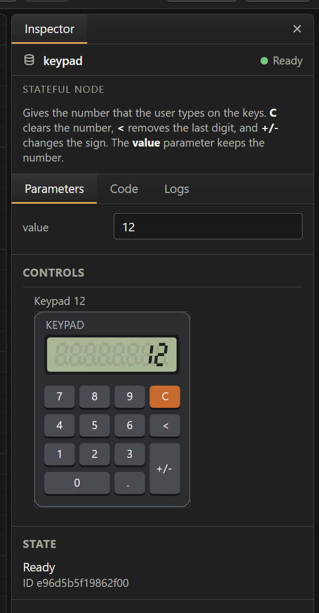

# hello

The **hello** workbench is the smallest Patina project. Two numbers go into an add node, and a
show node writes the sum. Below them, a small pocket calculator has two keypads, an operation,
a subgraph and two paper tapes. Start with this workbench to learn the parts of a project and
of the editor.



## Contents

- [Run it](#run-it)
- [The window](#the-window)
- [The project panel](#the-project-panel)
- [The sum](#the-sum)
- [The calculator](#the-calculator)
- [The average subgraph](#the-average-subgraph)
- [The Inspector](#the-inspector)
- [Try this](#try-this)
- [Files](#files)

## Run it

In the editor:

1. On the start screen, click **Open** next to **hello**.
2. Click **Run**.

From the command line, in the root of a checkout:

```
cargo run -p patina-cli -- run workbenches/hello
cargo run -p patina-cli -- run workbenches/hello --frames 3
```

The show node writes `6.5`, which is 2.5 + 4. The first tape prints `36`, which is 12 x 3. The
second tape prints `7.5`, the average of 12 and 3.

## The window

The title bar shows the project and the active graph. **Close** goes back to the start screen.


The toolbar controls the run of the graph:


| Control | What it does |
|---|---|
| **LIVE** | Shows that the graph runs again after each change. |
| Undo and redo | Undo or redo the last edit of the graph. |
| Zoom and **Fit** | Show the zoom of the canvas. **Fit** shows all nodes. |
| **Save** | Writes the graph files. Only **Save** writes them. |
| **Run** | Builds the changed nodes and runs the graph. |
| **Pause** | Stops the runs after the current frame. |
| **Step** | Runs one frame of the paused graph. |
| **Stop** | Ends the active run. The nodes that did not start show **Stale**. |
| **Bake** | Fuses the node that you edit back into the optimized base. |
| **FPS** | Sets the maximum frame rate of the run. |
| **Views** | Shows or hides the panels and the views. |
| **Help** | Opens the help and **About Patina**. |

The status bar at the bottom shows **Ready**, the time of the last run (**Run 0.02 ms**) and
**Fused**. **Fused** shows that all nodes run in the optimized base, as
[Layers](../../README.md#layers) tells. The **Debug** tab of the bottom dock shows the time of
each node on each thread. For this graph, one batch takes about 16 us.

For a map of all parts of the window, see
[The editor at a glance](README.md#the-editor-at-a-glance).

## The project panel

The **Project** panel lists all parts of the project in groups.



- **Graphs**: `main`. Click a graph to open it.
- **Subgraphs**: `average`. A subgraph is a graph that you use as one node.
- **Nodes**: `add`, `keypad`, `number`, `operation`, `show` and `tape`. Each node is a Rust
  crate.
- **Widgets**: `calc`. A widget is a shared drawing part for node GUIs.

Drag an item into the graph to add it. Click **+** in the title of the **Nodes** group to make
a new node. **Import** copies folders from another project. **Package** makes a package of the
project.

## The sum

The first row is the simplest graph. Two **NUMBER** nodes give `2.5` and `4`. The **ADD** node
adds its inputs **a** and **b** and gives the sum at **out**. The **SHOW** node writes the
value to the output.



Each wire shows its type, here `f64`, and its last value. The **SHOW** node shows `6.5`, and
the **Output** tab shows the same value.

## The calculator

The second row is a pocket calculator. It uses node GUIs: each node draws its own keys, LCD and
paper tape on the canvas.



1. The two **KEYPAD** nodes give the numbers that you type on their keys, here `12` and `3`.
2. The **operation** node gives a + b, a - b, a x b or a / b. Click a key to select the
   operation. Its LCD shows **A x B = 36**.
3. The **TAPE** node prints each new value, like the paper tape of a printing calculator.

On a keypad, **C** clears the number and **<** removes the last digit.

## The average subgraph

The third row uses the **AVG** chip. The chip is the `average` subgraph. It gives the average
of **a** and **b** at its **avg** output.



The tape prints `7.5`, the average of 12 and 3. Double-click the **AVG** chip to open the
subgraph. The breadcrumb at the top of the canvas shows the path. Click **main** in the
breadcrumb to go back.

## The Inspector

Select a node to see it in the **Inspector**. The image shows the first keypad.



- The kind of the node, here **STATEFUL NODE**. A stateful node keeps its state between
  frames.
- The description from the code of the node.
- The **Parameters** tab with the parameters, here the **value** `12`.
- **Controls** shows a live copy of the node GUI. Use it when the node is small on the canvas.
- **State** shows that the node process is **Ready**.
- The **Code** tab shows the Rust code of the node. Edit the code and push Ctrl+S. The editor
  builds the node and runs the graph again.
- The **Logs** tab shows the build and run messages of the node.

## Try this

- Select a **NUMBER** node and set its **value** in the **Inspector**. The sum changes at once.
- Type a number on a keypad.
- Click the **/** key of the operation. The first tape prints the new result in red.
- Double-click the **AVG** chip to see the subgraph inside it.
- Click **Code** in the **Inspector** of the **ADD** node. Change `a + b` to `a * b` and push
  Ctrl+S.
- Make a package of the project:

  ```
  cargo run -p patina-cli -- package workbenches/hello hello-pkg
  ```

## Files

| Path | What it is |
|---|---|
| `patina.toml` | The project file. It sets the Rust version. |
| `graphs/main.toml` | The main graph: the nodes, their parameters and the wires. |
| `graphs/average.toml` | The subgraph of the **AVG** chip. |
| `nodes/<name>/` | One Rust crate for each node, with a function or struct marked with `#[node]`. |
| `widgets/calc/` | The case, the LCD and the keys of the calculator style. |

The [hello README](../../workbenches/hello/README.md) has the full list. To write your own
node, see [Write a custom node](../custom-nodes.md).
