# laser-level

The **laser-level** workbench measures a line or a surface with a laser level and a camera
sensor with no lens. The laser beam falls on the sensor, and the nodes find the center of the
beam to a fraction of a pixel. A change of the height of the sensor moves the beam on the
sensor. The nodes form the panel of the instrument, and the **survey-data** tab shows the data
below the canvas.

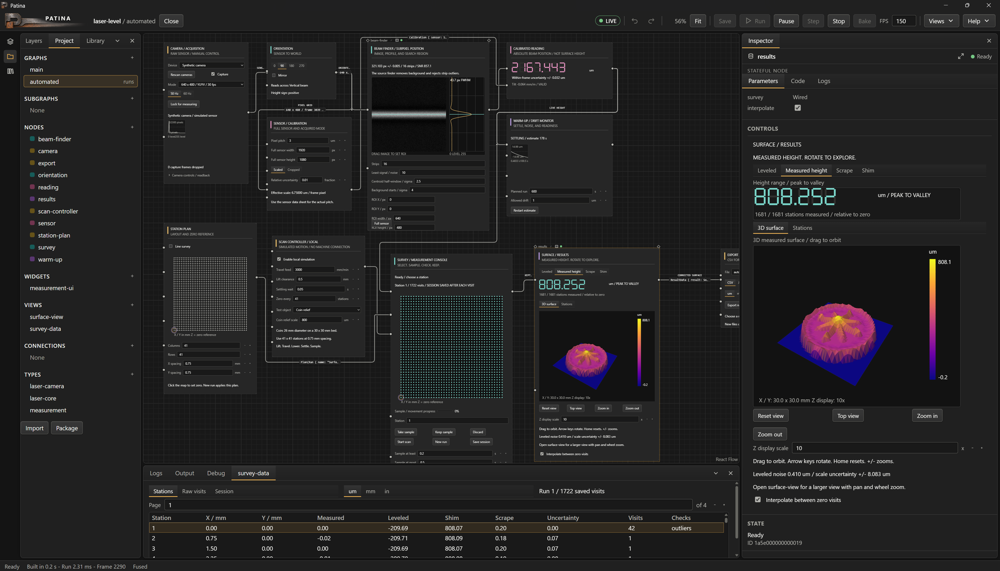

## Contents

- [Run it without hardware](#run-it-without-hardware)
- [The signal chain](#the-signal-chain)
- [Camera](#camera)
- [Orientation and sensor](#orientation-and-sensor)
- [Beam finder](#beam-finder)
- [Reading and warm-up](#reading-and-warm-up)
- [Station plan](#station-plan)
- [Scan controller](#scan-controller)
- [Survey](#survey)
- [Results](#results)
- [The survey data](#the-survey-data)
- [Measure by hand](#measure-by-hand)
- [Files and export](#files-and-export)
- [Limits](#limits)

## Run it without hardware

The workbench starts with a synthetic camera. It makes sensor images with beam noise and
warm-up drift, so you can try all of the workbench with no hardware.

1. On the start screen, click **Open** next to **laser-level**.
2. In the **Project** panel, click the **automated** graph.
3. Click **Run**.
4. Click **Start scan** in the **Survey** node.
5. Look at the station map during the scan.
6. Look at the **Results** node when the measurements come in.
7. Open **surface-view** from the **Views** menu for a larger 3D view.
8. Open **survey-data** from the **Views** menu to see all stations.

The **automated** graph scans a coin relief on a bed of 30 x 30 mm. The coin has a raised rim,
beads, engraved rings and a compass rose. It is a synthetic test object. The normal beam finder
measures each image, so the results are not a stored animation.

The default grid has 41 x 41 stations at 0.75 mm. The graph runs at 150 updates each second, and
the synthetic camera moves 1/30 s for each update. This is a 5x simulation. A full scan takes
about two minutes. If an open workbench still uses 30, set **FPS** in the toolbar to **150**.

The graph has no network connection. It does not send machine commands.

## The signal chain

The data goes through the nodes from the top left to the right:

1. **Camera** gives the sensor images.
2. **Orientation** and **Sensor** tell how the sensor is installed and how large its pixels are.
3. **Beam Finder** finds the center of the beam in each image.
4. **Reading** changes the center into an absolute beam position in um.
5. **Warm-up** watches the drift of the laser.
6. **Station Plan** and **Scan Controller** set the stations and move the simulated block.
7. **Survey** takes, checks and keeps a sample at each station.
8. **Results** shows the surface. **Export** writes the results to a file.

Each node has a colored bar next to its title. The wire labels show the values that go between
the nodes, for example **PIXEL GRID** and **LIVE HEIGHT**.

## Camera

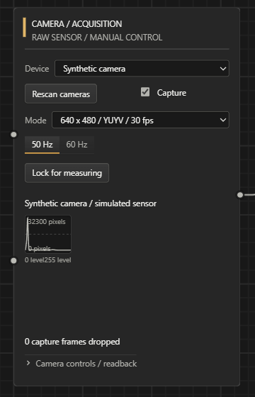

The **CAMERA / ACQUISITION** node controls the raw sensor.

- **Device** selects the camera. The first source is **Synthetic camera**. Click **Rescan
  cameras** to find the cameras on the computer.
- **Capture** starts and stops the images.
- **Mode** sets the size, the pixel format and the frame rate, for example
  **640 x 480 / YUYV / 30 fps**.
- **50 Hz** and **60 Hz** set the mains frequency for the power line filter of the camera.
- **Lock for measuring** locks the camera controls for a measurement.
- The histogram shows the levels from 0 to 255 of the last image.
- **0 capture frames dropped** shows that the node got all images.
- **Camera controls / readback** shows the controls that the camera reports.

To use a real camera:

1. Click **Rescan cameras**.
2. Select the camera and its mode.
3. Set the orientation to match the installation of the sensor.
4. Enter the sensor pitch and the full sensor dimensions.
5. Select **Scaled** or **Cropped** to match the smaller modes of the camera.
6. Click **Lock for measuring**.
7. Look at the camera controls that the camera reports.
8. Adjust the exposure until the beam is clear and not clipped.

Windows uses Media Foundation. The camera controls are different for each device.

## Orientation and sensor

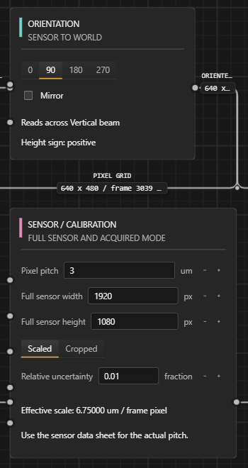

The **ORIENTATION** node tells how the sensor is installed.

- **0**, **90**, **180** and **270** set the rotation of the sensor.
- **Mirror** flips the image.
- The node shows the axis of the measurement, for example **Reads across Vertical beam**, and
  the **Height sign**.

The **SENSOR / CALIBRATION** node gives the scale.

- **Pixel pitch** is the size of one pixel of the sensor, here 3 um.
- **Full sensor width** and **Full sensor height** are the full sensor size, here 1920 x 1080.
- **Scaled** and **Cropped** tell how a smaller camera mode uses the sensor.
- **Relative uncertainty** is the uncertainty of the pitch, as a fraction.
- The node shows the **Effective scale**, here **6.75000 um / frame pixel**.

Use the data sheet of the sensor for the pitch.

## Beam finder

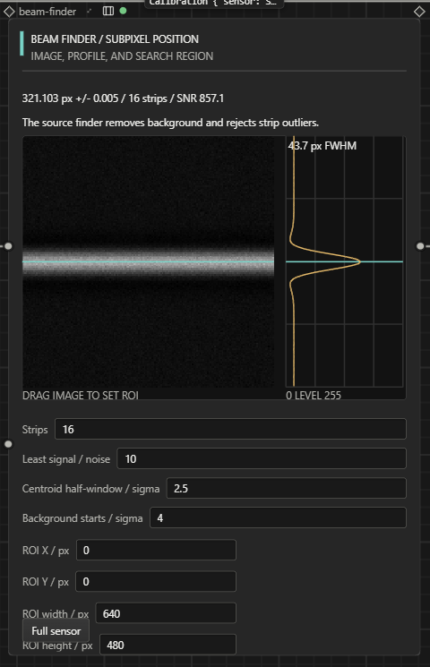

The **BEAM FINDER / SUBPIXEL POSITION** node finds the center of the beam in each image.

- The top line gives the center, its uncertainty, the number of strips and the signal to noise
  ratio, for example **321.103 px +/- 0.005 / 16 strips / SNR 857.1**.
- The image shows the beam on the sensor. The plot at the right shows the intensity profile
  across the beam and its width, here **43.7 px FWHM**.
- The finder removes the background and rejects strips that are outliers.

| Control | What it does |
|---|---|
| **Strips** | Cuts the image into strips. The node finds the center in each strip. |
| **Least signal / noise** | The lowest signal to noise ratio of a strip. |
| **Centroid half-window / sigma** | The width of the window around the peak, in sigma. |
| **Background starts / sigma** | The distance from the peak where the background starts. |
| **ROI X**, **ROI Y**, **ROI width**, **ROI height** | The search region in sensor pixels. |

To set the search region, drag across the image. Use the ROI fields for exact sensor
coordinates. Click **Full sensor** to clear the region.

## Reading and warm-up

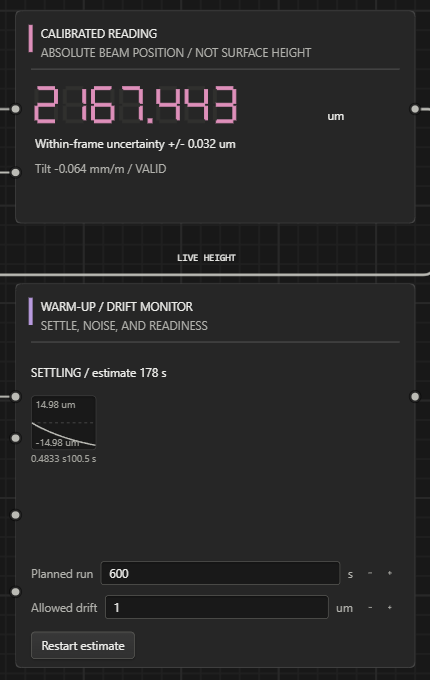

The **CALIBRATED READING** node shows the absolute beam position on the sensor in um, here
**2167.443 um**. This is not yet a surface height. The node also shows the uncertainty in one
frame, the tilt and the state, for example **Tilt -0.064 mm/m / VALID**.

A laser level drifts while it warms up. The **WARM-UP / DRIFT MONITOR** node watches the drift.

- The state and the estimate show when the laser is ready, for example **SETTLING / estimate
  178 s**.
- The plot shows the drift history.
- **Planned run** is the length of the planned measurement in s.
- **Allowed drift** is the largest drift in um for that run.
- **Restart estimate** starts a new estimate.

## Station plan

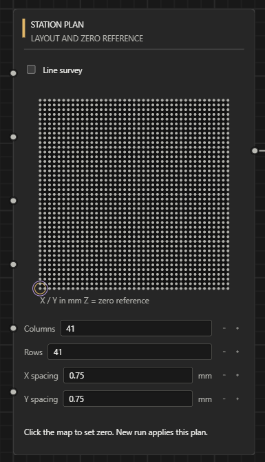

The **STATION PLAN** node sets the stations of the measurement.

- **Line survey** measures a line in place of a grid.
- **Columns** and **Rows** set the number of stations, here 41 x 41.
- **X spacing** and **Y spacing** set the distance between the stations, here 0.75 mm.
- The map shows each station. The ring marks the zero reference. Click the map to set the
  zero.

**New run** in the **Survey** node applies a changed plan. The maps use equal X and Y scales, so
a square plan shows as a square.

## Scan controller

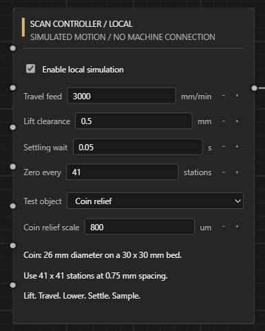

The **SCAN CONTROLLER / LOCAL** node moves a simulated block. It has no machine connection.

| Control | What it does |
|---|---|
| **Enable local simulation** | Moves the simulated block to each station. |
| **Travel feed** | The speed of a move, here 3000 mm/min. |
| **Lift clearance** | The lift before a move, here 0.5 mm. |
| **Settling wait** | The wait after a move, here 0.05 s. |
| **Zero every** | Goes back to the zero station after this number of stations, here 41. |
| **Test object** | **Surface plate** or **Coin relief**. |
| **Coin relief scale** | The height of the simulated coin, here 800 um. |

At each station, the controller does these steps: lift, travel, lower, settle and sample. It
goes back to zero at intervals and at the end. Start a new scan after a change of the test
object. For finer detail, use 61 x 61 stations at 0.5 mm. The scan then takes longer.

## Survey

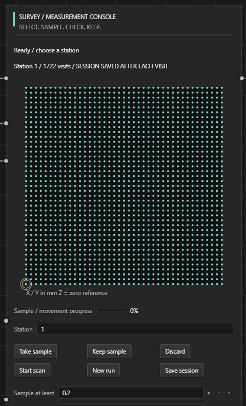

The **SURVEY / MEASUREMENT CONSOLE** node takes the samples.

- The top lines show the state and the active station, for example **Station 1 / 1722 visits /
  SESSION SAVED AFTER EACH VISIT**. The scan has 1681 stations and 41 visits back to zero.
- The map shows each station. A measured station is lit.
- **Sample / movement progress** shows the progress of the active sample or move.
- **Station** selects a station. A click on a station of the map also selects it.

| Button | What it does |
|---|---|
| **Take sample** | Starts a sample at the selected station. |
| **Keep sample** | Saves the sample as a visit. |
| **Discard** | Removes an unfinished or pending sample. It keeps all saved visits. |
| **Start scan** | Starts the automated scan. |
| **New run** | Starts a new run with the station plan. |
| **Save session** | Saves the session file. |

**Sample at least** sets the shortest time of a sample in s. The automated graph uses 0.2 to
0.5 s.

## Results

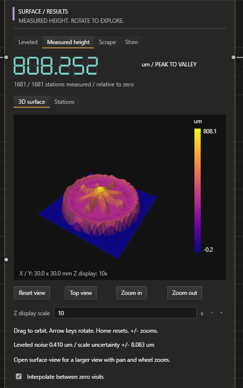

The **SURFACE / RESULTS** node shows the measured surface. The large number is the peak to
valley range of the selected channel, here **808.252 um**. The line below it shows the number
of measured stations, here **1681 / 1681**.

| Tab | What it shows |
|---|---|
| **Leveled** | The heights with a fitted line or plane removed. |
| **Measured height** | The height relative to the zero station, with the laser drift removed. It keeps the shape and the slope of the object. This is the default. |
| **Scrape** | The height above the lowest station. |
| **Shim** | The distance below the highest station. |

**3D surface** shows the surface, and **Stations** shows a plot of the stations.

- Drag the 3D plot to turn it. With the plot in focus, the arrow keys turn it, plus and minus
  zoom, and Home resets the view.
- Use **Reset view**, **Top view**, **Zoom in** and **Zoom out**.
- **Z display scale** makes the shown height larger, here 10x. It does not change the
  measurements, the tables or the exports.
- The node shows the noise estimate and the scale uncertainty, for example **Leveled noise 0.410
  um / scale uncertainty +/- 8.083 um**. Use the noise to tell surface shape from measurement
  noise.
- **Interpolate between zero visits** gets the zero of each reading from the two zero visits
  around it, by time. This removes the laser drift during the run.

The 3D surface joins the measured grid cells with triangles. A missing measurement stays a
hole. The surface never reads the simulated object.

Select the node to see the same controls in the **Inspector**. The `results` node is a
**STATEFUL NODE**, and its **survey** input is wired.

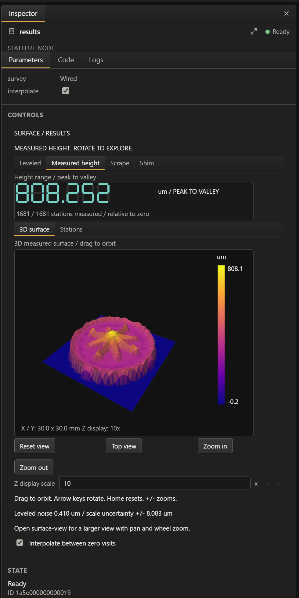

Open **surface-view** for a larger 3D view next to the graph. Drag with the left button to turn,
with the middle button or Shift to pan, and with the right button or the wheel to zoom. Push
Home to reset the view.

## The survey data

Open **survey-data** from the **Views** menu. It shows the data in the bottom dock.

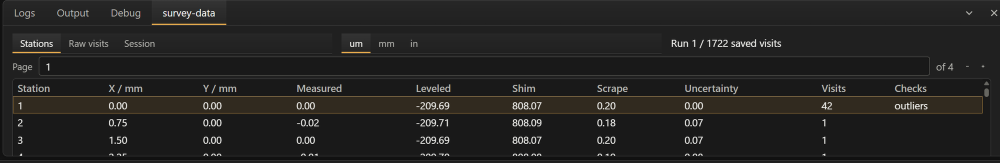

| Tab | What it shows |
|---|---|
| **Stations** | The position, the measured and leveled heights, the shim, the scrape, the uncertainty, the visits and the checks of each station. |
| **Raw visits** | The readings of each sample and their frame counts. |
| **Session** | The session file and the controls to open or start a session. |

- **um**, **mm** and **in** set the unit of the heights. The station positions stay in mm.
- The tables have pages of 500 rows. Change **Page** to see later rows.
- A click on a row selects that station in the **Survey** node.

In the image, station 1 is the zero station. It has 42 visits: the first visit and the 41 visits
back to zero.

## Measure by hand

The **main** graph measures by hand.

1. In the **Project** panel, click **main**.
2. Click **Run**.
3. Set the stations in **Station Plan**.
4. Click **New run** in **Survey** to apply a changed plan.
5. Select the zero station.
6. Put the measurement block on that station.
7. Click **Take sample**.
8. Look at the sample information.
9. Click **Keep sample** to save the visit.
10. Do these steps again at the other stations.
11. Go back to zero at intervals and after the last station.

With the synthetic camera, a selected station also moves the simulated block. With a real
camera, move the block yourself. The station selector does not move hardware.

## Files and export

Each kept visit saves the session in `measurements/` in the workbench folder. The **main** graph
uses `manual.json`, and the **automated** graph uses `coin.json`. The session has the frame
readings, the settings, the station plans and the run history. It has no camera images.

- **Save** in the toolbar saves the graph parameters and the layout.
- **Keep sample** and **Save session** save the measurements.
- Undo changes the graph parameters. It does not remove saved measurements.

Use **Export new file** in the **Export** node to write the surface results. CSV uses the
selected height unit. JSON uses um for heights and mm for positions. Export does not replace a
file, so give a new file name for each export.

## Limits

- The results show the current run. The session file keeps the earlier runs.
- Gauge block calibration of the scale has no GUI yet.
- The frame path allocates camera and analysis buffers. It is not a real-time control loop.
- Real cameras and the Linux and macOS camera backends need checks with hardware.
- The 3D dock needs Windows.
- The workbench uses local simulated motion. A LinuxCNC adapter comes later.

The [laser-level README](../../workbenches/laser-level/README.md) has the full details. See also
the [laser workbench notes](../laser-workbench.md), the
[measurement design](../laser-measurement-design.md) and the
[source details](../../workbenches/laser-level/types/SOURCE.md).
