# model

The **model** workbench makes procedural 3D models. Nodes make solids, sketches and moves, and a
seed changes the output. The [city](city.md) and the [gun](gun.md) workbenches use it as a
library. The solids come from the [Manifold](https://github.com/elalish/manifold) kernel, so
each boolean gives a closed solid.

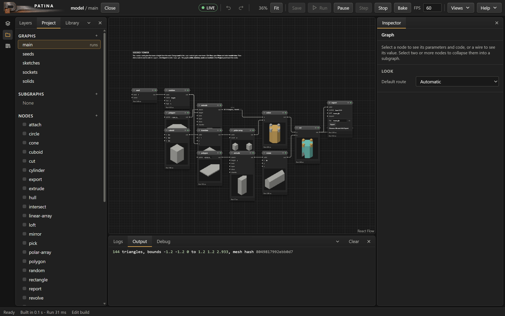

## Contents

- [Run it](#run-it)
- [The seeded tower](#the-seeded-tower)
- [The 3D view](#the-3d-view)
- [The guide graphs](#the-guide-graphs)
- [Extrude, taper and twist](#extrude-taper-and-twist)
- [Seeds](#seeds)
- [Export a model](#export-a-model)
- [The report output](#the-report-output)
- [Types and nodes](#types-and-nodes)
- [Limits](#limits)

## Run it

In the editor:

1. On the start screen, click **Open** next to **model**.
2. Click **Run**. The first build compiles the C++ kernel in about 5 to 10 s.
3. Open **Views** and select **model-view**.
4. Click a model node, for example `union`, to see its solid.

From the command line, in the root of a checkout:

```
cargo run -p patina-cli -- run workbenches/model --frames 1
cargo run -p patina-cli -- run workbenches/model --graph seeds --frames 1
```

The first command runs the **main** graph. The `report` node writes
`144 triangles, bounds -1.2 -1.2 0 to 1.2 1.2 2.933, mesh hash 8049817992ebb0d7`.

A model builds at **Run** and after each change, not at each frame. The model nodes run in the
batch domain.

## The seeded tower

The **main** graph makes a small tower: an octagon with a random height, four merlons on top and
a door. The note at the top of the graph tells what the graph shows.

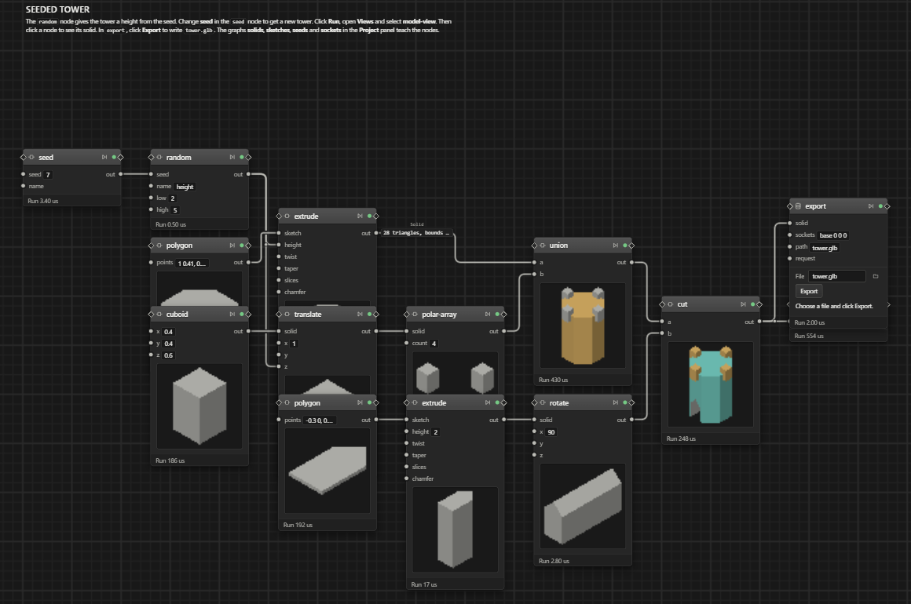

The graph goes from left to right:

1. `seed` gives the seed **7** to the graph.
2. `random` gives a **height** from 2 to 5 from the seed.
3. A `polygon` gives an octagon. `extrude` makes it thick along Z, with the random height.
4. A `cuboid` of 0.4 x 0.4 x 0.6 moves out with `translate`. `polar-array` makes **4** copies
   around the Z axis. These are the merlons.
5. `union` joins the body and the merlons.
6. A second `polygon` gives the outline of a door. `extrude` makes it 2 thick, and `rotate`
   turns it 90 degrees around X.
7. `cut` removes the door from the tower.
8. `report` writes the solid as text, and `export` writes it to `tower.glb`.

Each node shows its solid as a 3D thumbnail. A wire shows its type, here `Solid`, and a short
text of its value, for example **28 triangles, bounds ...** after the first `extrude`.

## The 3D view

The **model-view** view shows the solid of the selected node. It opens in the second center pane,
next to the graph.

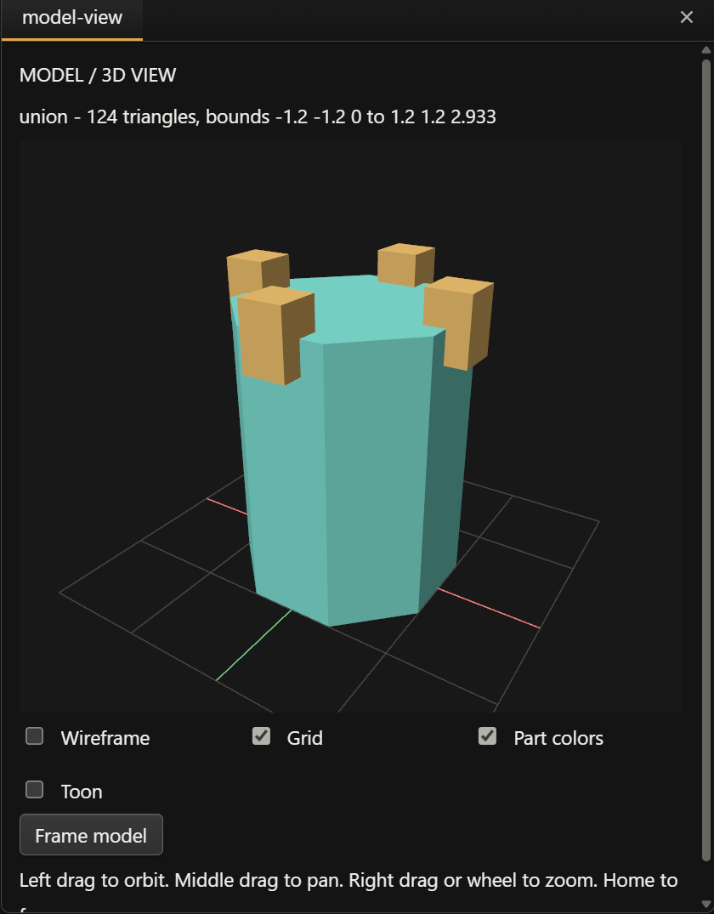

The top line shows the node, the triangle count and the bounds. In the image, it is **union -
124 triangles, bounds -1.2 -1.2 0 to 1.2 1.2 2.933**. The `union` has no door yet, so it has
fewer triangles than the 144 of the `cut`.

The view shows the output of the node, also when the output has no wire. For a node with no
solid output, for example `report`, it shows the solid that goes into the node. When the
selection has no solid, the view keeps the last solid.

- The mouse works as in Maya. Drag with the left button to orbit, the middle button to pan, and
  the right button to zoom. Alt and a button does the same. Shift and a left drag also pans.
- Turn the wheel to zoom. Push Home or click **Frame model** to frame the model.
- **Wireframe** shows the triangle edges.
- **Grid** shows the ground grid and the X and Y axes.
- **Part colors** gives each part its own color.
- **Toon** gives three light bands and dark outlines.

Each new value of the node, for example after a seed change, shows at once. The camera stays.

## The guide graphs

Open a graph in the **Project** panel. Each graph has a note that tells what it shows.

| Graph | What it shows |
|---|---|
| **main** | A seeded tower and the `export` node. |
| **solids** | Primitives, `cut`, `translate` and `union`. |
| **sketches** | `rectangle`, `circle` and `polygon`, with `extrude`, `revolve` and `loft`. |
| **seeds** | A house from a seed: `seed`, `random` and `pick`. |
| **sockets** | `attach` at named sockets, and `export` with the sockets in the `.glb` file. |

**Solids.** A primitive node makes a solid with its center at the origin. Z is up. A `cuboid`
of 2 x 2 x 1 gets a hole from a `cylinder` with `cut`. A `sphere` moves up with `translate`, and
`union` joins it to the box. `intersect` keeps the common part of two solids, and `hull` wraps
both.

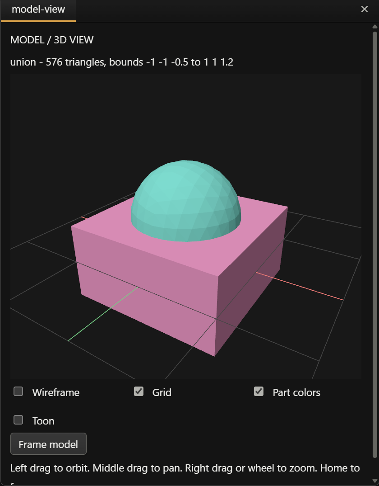

**Sketches.** A sketch is a flat shape on the XY plane. The image shows four solids from
sketches:

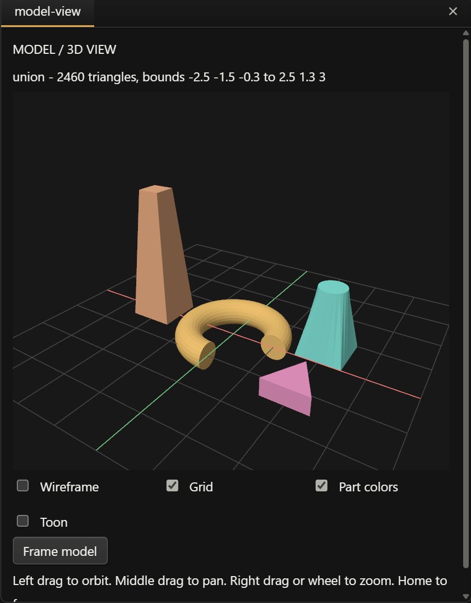

- The tall solid at the left is a square, made 3 thick by `extrude` with **twist** 90 and
  **taper** 0.5.
- The ring is a `circle` that `revolve` turns around the Y axis, with a **gap** of 90 degrees.
- The small wedge is a triangle from a `polygon` (`0 0, 1 0, 0.5 0.9`), made 0.4 thick.
- The solid at the right is a `loft` from a square at the bottom to a circle at a height of 1.5.

**Sockets.** A socket is a named frame: a name, a position and three optional turns in degrees,
for example `muzzle 1.5 0 0.2 0 90 0`. `attach` moves a solid to a socket, with the Z axis of the
solid on the Z axis of the socket. In the image, a barrel goes on the **muzzle** socket and a
grip goes on the **grip** socket of a body.

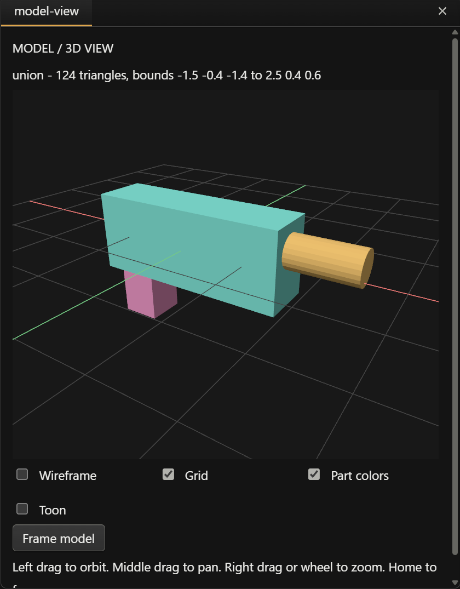

## Extrude, taper and twist

Select an `extrude` node to see its parameters in the **Inspector**.

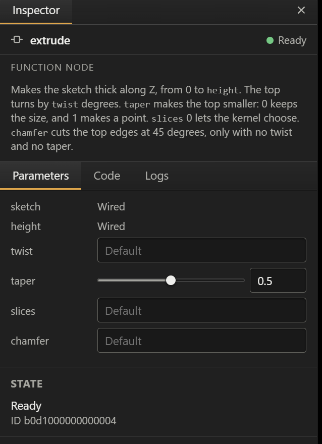

`extrude` is a **FUNCTION NODE**. It makes the sketch thick along Z, from 0 to **height**.

| Parameter | What it does |
|---|---|
| **sketch** | The flat shape. In the image, a wire gives it (**Wired**). |
| **height** | The thickness along Z. |
| **twist** | Turns the top by this angle in degrees. |
| **taper** | Makes the top smaller: 0 keeps the size, and 1 makes a point. |
| **slices** | The number of steps along Z. 0 lets the kernel choose. |
| **chamfer** | Cuts the top edges at 45 degrees. It works only with no twist and no taper. |

An empty field shows **Default**. Drag the **taper** slider to see the change at once. The two
images show the octagon of the tower with **taper** 0 and with **taper** 0.5:

| Taper 0 | Taper 0.5 |
|---|---|
| 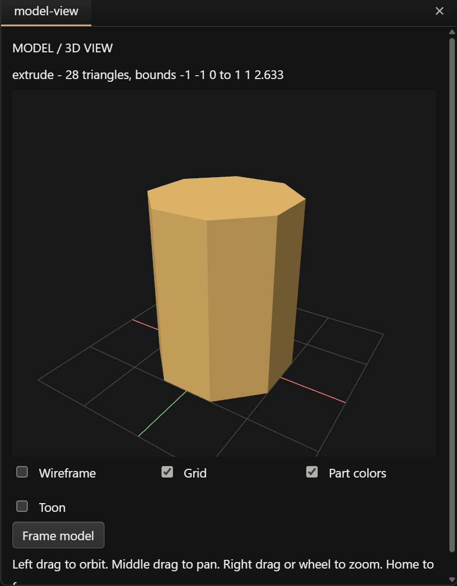 | 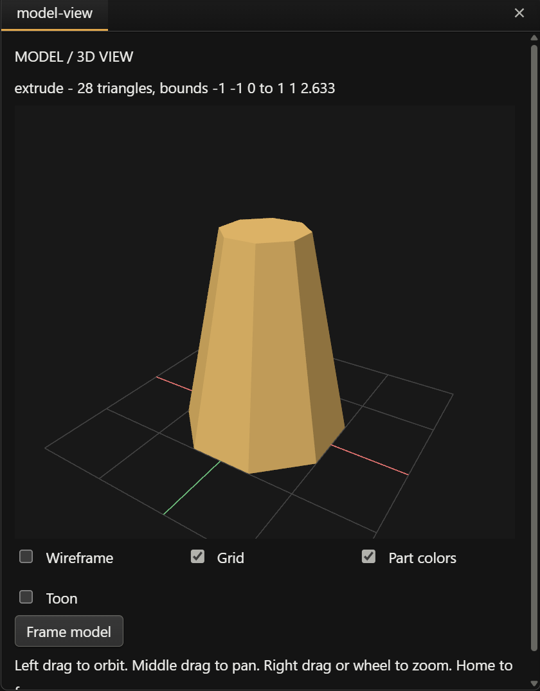 |

## Seeds

A `Seed` gives random values. The `seed` node makes a sub-seed from its **name**. `random` gives
a number in a range, and `pick` chooses one of two solids by **weights**. Each random value has
its own name, so a new name changes only that value. The same seed gives the same mesh at each
run.

In the **seeds** graph, `random` gives the **width** (1 to 3) and the **height** (1 to 4) of a
house. `pick` chooses the **roof**: a cone with four sides or a dome. With the seed 3, the house
gets the dome.

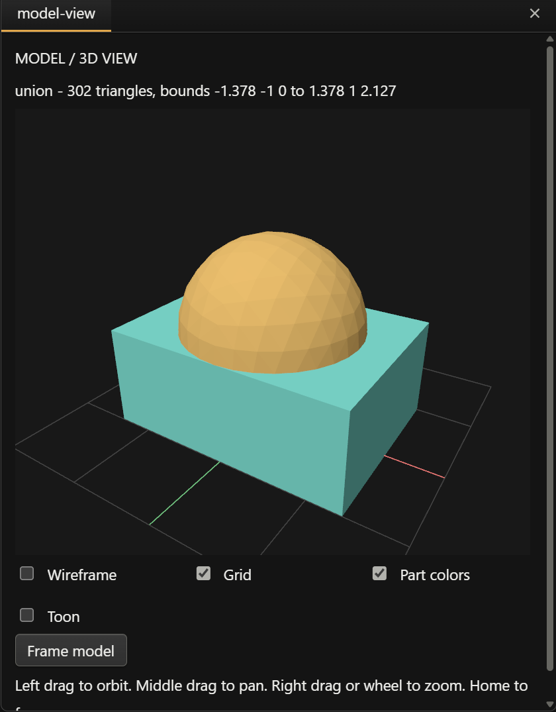

In the **main** graph, change **seed** of the `seed` node from 7 to 8. The tower gets a new
height, and the bounds go to 3.398:

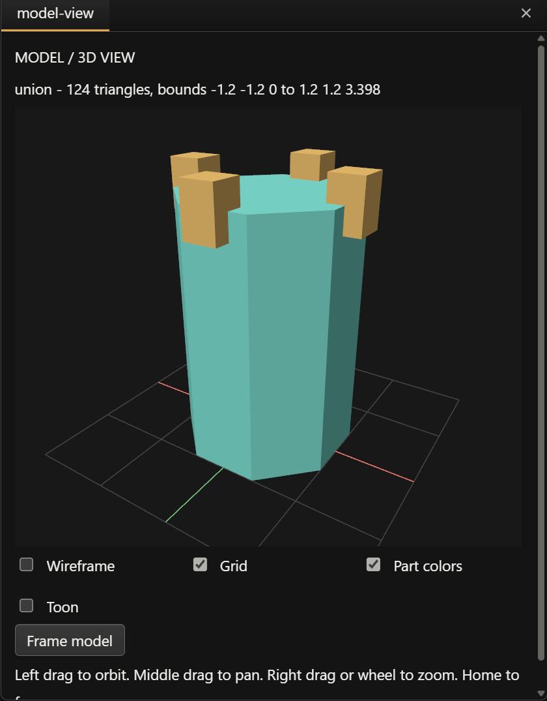

## Export a model

The `export` node writes its solid to a `.glb`, `.obj` or `.stl` file.

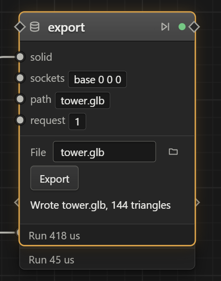

1. Connect a solid to the **solid** input of an `export` node.
2. Click **File** in the node and choose a file name. The file extension selects the format. A
   relative path starts at the project folder.
3. Click **Export**. The node shows the result, for example **Wrote tower.glb, 144 triangles**.

The **sockets** input is a text of sockets, for example `base 0 0 0`. Select the node to see it
in the **Inspector**:

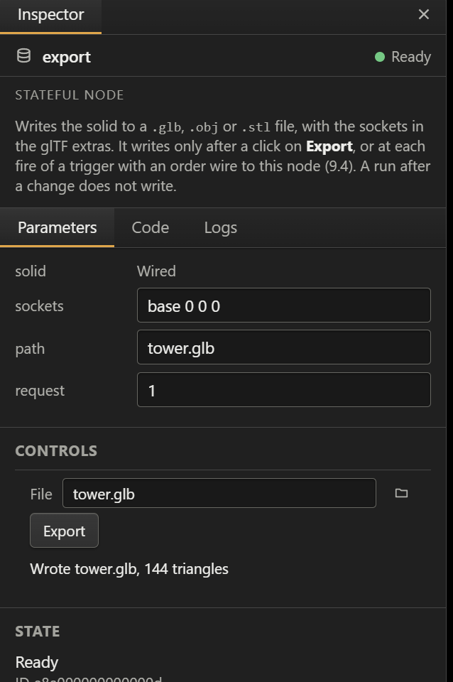

The `export` node is a **STATEFUL NODE**. It writes only after a click on **Export**, or at each
fire of a trigger with an order wire to this node. A run after a change does not write.
`patina-cli run workbenches/model --events 1` fires each trigger one time.

- The `.glb` file has one primitive for each part. The sockets go into the glTF extras, as
  `extras.sockets`.
- The `.glb` and the `.obj` files have Y up, as glTF and most game tools expect. The `.stl`
  file keeps Z up.
- The node writes a temporary file first and then replaces the old file. A failed write keeps
  the old file.

## The report output

The `report` node writes the triangle count, the bounds and the mesh hash to the **Output** tab
at each run.

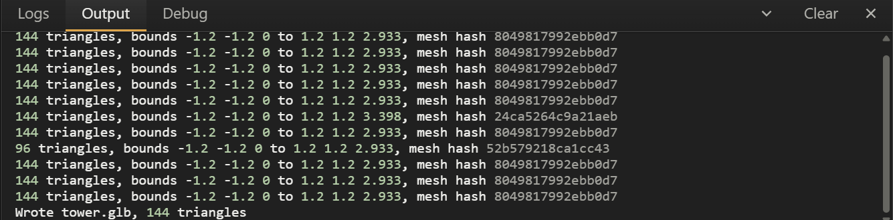

The same graph gives the same hash at each run. A change of the seed changes the hash and the
bounds. In the image, the line with **3.398** is the run with the seed 8, and the last line is
the write of the `export` node.

## Types and nodes

`types/geometry` holds the types of the model wires:

| Type | What it is |
|---|---|
| `Solid` | A closed solid of the Manifold kernel, with the primitives, the booleans and the moves. Z is up. |
| `Mesh` | The triangles of a solid: positions, normals, UV and a part index. |
| `Sockets` | Named frames, for example `muzzle` and `grip`. |
| `Sketch` | A flat shape on the XY plane, with holes. |
| `Seed` | Gives random values. `seed.child("barrel")` gives a sub-seed for one part. |

The **Inspector** shows a solid, a sketch or a mesh as a picture, with the triangle count and
the bounds.

| Group | Nodes |
|---|---|
| Solids | `cuboid`, `cylinder`, `cone`, `sphere`, `torus` |
| Sketches | `rectangle`, `circle`, `polygon` |
| Sketch to solid | `extrude`, `revolve`, `loft` |
| Moves | `translate`, `rotate`, `scale`, `mirror`, `linear-array`, `polar-array` |
| Booleans | `union`, `cut`, `intersect`, `hull` |
| Sockets | `attach` |
| Random | `seed`, `random`, `pick` |
| Output | `report`, `export` |

`types/geometry/vendor` has the C++ sources of Manifold and Clipper2, with their licenses. The
build needs no download of C++ sources and no CMake.

To measure the build times, run this command from `workbenches/model`:

```
cargo test --release -p geometry measure -- --ignored --nocapture
```

## Limits

- In the editor, a build stops the frames, the node GUIs and the views until it ends. A block of
  500 houses takes about 0.13 s.
- A shape has 1024 segments at most, and an array has 1000 copies at most.
- The kernel has no fillet. The **chamfer** of `extrude` cuts only the top edges.
- A loft of very different outlines can give sides that cross, and a crossing gives an error.
- The `.obj` and the `.stl` files have no sockets. A solid has no colors, so `export` writes no
  materials. The export nodes of the city and the gun write one material for each color.
- A number input with no wire, no text and no default starts at 0. Thus **taper** 0 keeps the top
  size, **gap** 0 makes a full turn and **segments** 0 lets the kernel choose.

The [model README](../../workbenches/model/README.md) has the full details. The plan is in the
[workbenches plan](../workbenches-plan.md), task D.
