# synth

The **synth** workbench is **Ember**, a modular synthesizer for learning and sound design. The
graph shows how a score becomes sound: a sequencer, a synth voice, effects, drums, an output and
a scope. Each step is a node with its own instrument panel.

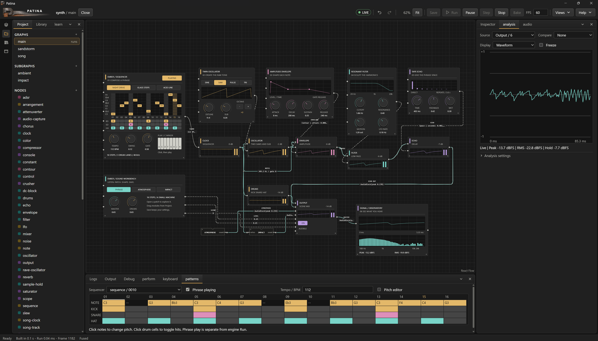

## Contents

- [Run it](#run-it)
- [The window](#the-window)
- [The console](#the-console)
- [The sequencer](#the-sequencer)
- [The instrument panels](#the-instrument-panels)
- [The signal chain](#the-signal-chain)
- [Drums, output and scope](#drums-output-and-scope)
- [The analysis dock](#the-analysis-dock)
- [The patterns dock](#the-patterns-dock)
- [The performance view and the other docks](#the-performance-view-and-the-other-docks)
- [The project and the node library](#the-project-and-the-node-library)
- [Learn by listening](#learn-by-listening)
- [The sandstorm and song graphs](#the-sandstorm-and-song-graphs)
- [Export a sound](#export-a-sound)
- [Checks and measurements](#checks-and-measurements)
- [Limits](#limits)

## Run it

In the editor:

1. On the start screen, click **Open** next to **synth**.
2. Set a low speaker volume.
3. Click **Run**. The **main** graph starts to play.
4. Select **PHRASE**, **ATMOSPHERE** or **IMPACT** on the console.
5. Drag a knob up or down to change its value.
6. Click **Save** to keep the parameters.

The knobs also accept the arrow keys when they have the focus. The **Inspector** shows the exact
value and a short explanation of each parameter. A large panel can open at **Full size** from
the node menu.

From the command line, in the root of a checkout:

```
cargo run -p patina-cli -- render workbenches/synth ember.wav --seconds 16
```

The command writes 16 s of the **main** graph to `ember.wav`. It does not open a sound device.

## The window

The image at the top shows the **main** graph while it plays:

- The toolbar shows **LIVE**, because the engine runs. **Pause**, **Step** and **Stop** control
  the run.
- The canvas has the patch. The upper row is the voice, and the lower row has the console, the
  drums, the output and the scope.
- The **analysis** tab of the right dock shows the output waveform.
- The **patterns** tab of the bottom dock shows the 16 steps of the score.
- The status bar shows the build and run times, for example **Built in 0.1 s - Run 0.04 ms**.

Each audio wire moves with the samples of the running graph, so the motion comes from the
sound. The score and the settings use separate typed wires with dashed lines.

## The console

The **EMBER / SOUND WORKBENCH** console selects the patch that you hear.

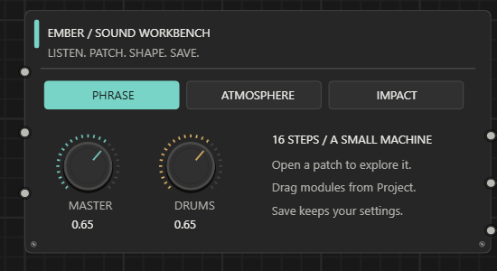

- **PHRASE** plays the 16-step synth with a kick, a snare and a hi-hat.
- **ATMOSPHERE** plays two low oscillators with slow random motion, chorus and reverb.
- **IMPACT** plays pitched percussion and noise with saturation, a bit crusher, compression and
  reverb.
- **MASTER** sets the output level. **DRUMS** sets the drum level. Both are 0.65 in the image.

The scene buttons crossfade the outputs. All three patches continue to run. Double-click the
**Atmosphere** or **Impact** subgraph to open its patch. The three large knobs of each subgraph
control the main parts of its sound.

## The sequencer

The **EMBER / SEQUENCER** panel writes the score: one phrase of 16 steps in C minor.

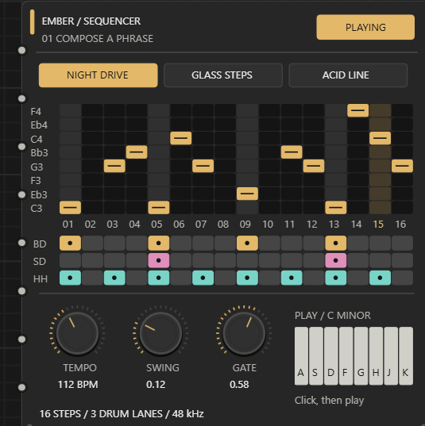

- **NIGHT DRIVE**, **GLASS STEPS** and **ACID LINE** load three phrases.
- The pitch grid has the notes from C3 to F4. Click a cell to change the pitch of a step.
- The **BD**, **SD** and **HH** lanes are the kick, the snare and the hi-hat. Click a cell to
  add or remove a hit.
- **TEMPO** sets the speed. In the image, it is **112 BPM**.
- **SWING** makes the steps longer and shorter in turn. The length of the bar stays the same.
- **GATE** sets the note length in a step.
- **PLAYING** holds the sequencer or starts it again. The keyboard stays live.

The keyboard at the right plays the voice. Click it, then push the keys A, S, D, F, G, H, J and
K. The footer **16 STEPS / 3 DRUM LANES / 48 kHz** gives the size of the score and the sample
rate.

## The instrument panels

Four panels shape the voice of the phrase. Each panel has a number that shows its place in the
chain, from **02** to **05**.

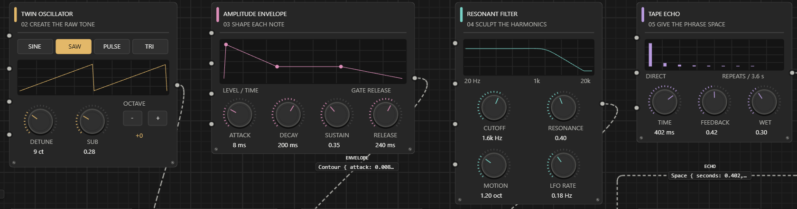

| Panel | Controls | Values in the image |
|---|---|---|
| **TWIN OSCILLATOR** | **SINE**, **SAW**, **PULSE** or **TRI**, **DETUNE**, **SUB** and **OCTAVE** | **SAW**, 9 ct, 0.28, +0 |
| **AMPLITUDE ENVELOPE** | **ATTACK**, **DECAY**, **SUSTAIN** and **RELEASE** | 8 ms, 200 ms, 0.35, 240 ms |
| **RESONANT FILTER** | **CUTOFF**, **RESONANCE**, **MOTION** and **LFO RATE** | 1.6k Hz, 0.40, 1.20 oct, 0.18 Hz |
| **TAPE ECHO** | **TIME**, **FEEDBACK** and **WET** | 402 ms, 0.42, 0.30 |

Each panel draws what its controls do:

- The oscillator draws one cycle of the selected wave.
- The envelope draws the level against the time, up to the gate release.
- The filter draws its response from 20 Hz to 20 kHz.
- The echo draws the direct sound and the repeats. **REPEATS / 3.6 s** is the time until the
  repeats are quiet.

The panel output goes on a dashed wire. The wire label shows the value, for example
**Contour { attack: 0.008...** from the envelope and **Space { seconds: 0.402...** from the echo.

## The signal chain

The audio nodes under the panels make the sound. Each node shows a short waveform of its output
and a level meter. The top line gives the level in dB.

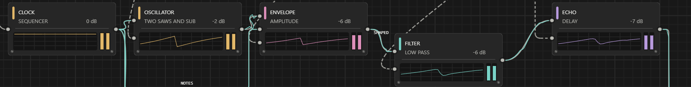

1. **CLOCK** (**SEQUENCER**) makes the pitch, the gate and the drum triggers, accurate to the
   sample.
2. **OSCILLATOR** (**TWO SAWS AND SUB**) makes the raw sound.
3. **ENVELOPE** (**AMPLITUDE**) shapes each note.
4. **FILTER** (**LOW PASS**) removes harmonics.
5. **ECHO** (**DELAY**) adds the repeats.

The wire labels **NOTES** and **SHAPED** name the signal between two nodes.

## Drums, output and scope

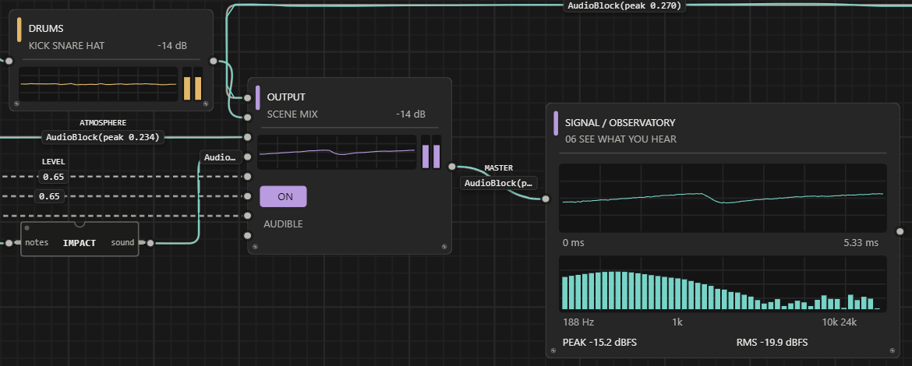

- **DRUMS** (**KICK SNARE HAT**) plays the drum lanes of the score.
- **OUTPUT** (**SCENE MIX**) mixes the voice, the drums and the two other patches. The dashed
  inputs get the master level, the drum level and the scene from the console.
- **ON** under **AUDIBLE** sends the mix to the sound device. Keep it on for a CLI render.
- **SIGNAL / OBSERVATORY** (**06 SEE WHAT YOU HEAR**) is the scope. It measures the real output.

The upper trace of the scope shows one block of 256 samples, or 5.33 ms. The lower display
shows a spectrum from about 188 Hz to 24 kHz. Its short window does not show deep bass. **PEAK**
and **RMS** give the levels relative to digital full scale, for example **PEAK -15.2 dBFS**.

An audio wire label gives the peak of its block, for example **AudioBlock(peak 0.270)**.

## The analysis dock

Open **Views**, then **analysis**. The tool opens in the right dock.

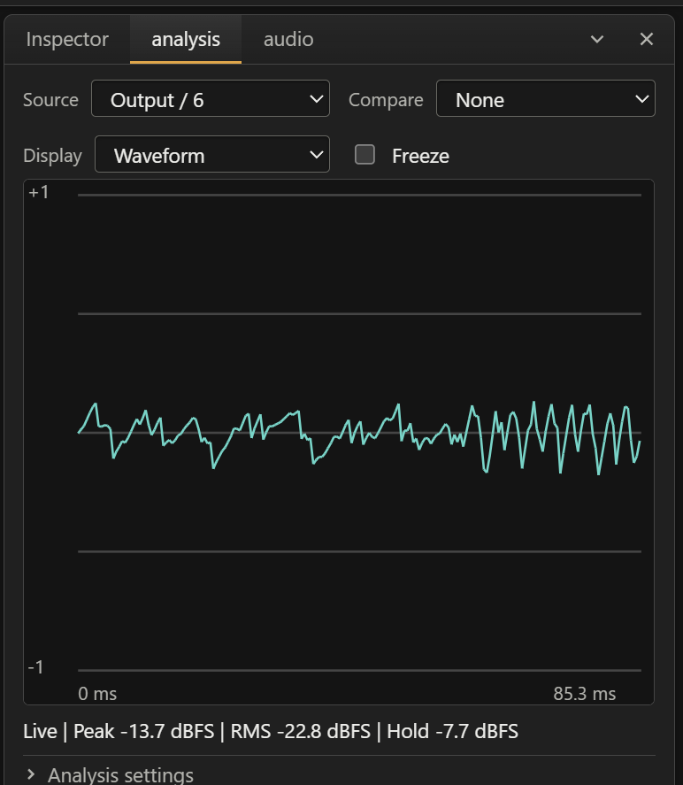

- **Source** selects the signal: the oscillator, the envelope, the filter, the echo, the drums
  or the output.
- **Compare** selects a second signal. **None** shows only the source.
- **Display** selects **Waveform** or a spectrum.
- **Freeze** holds the samples.
- **Analysis settings** has the trigger, the window size and the peak reset.

The line under the display gives the state and the levels, for example **Live | Peak -13.7
dBFS | RMS -22.8 dBFS | Hold -7.7 dBFS**. The teal trace is the source, and the violet trace is
the comparison.

The tool keeps up to 8192 samples. The longest window is 171 ms, so it shows lower frequencies
than the scope node. Two captures can be one audio block apart.

## The patterns dock

Open **Views**, then **patterns**. The tool opens in the bottom dock and edits the same score
as the sequencer panel.

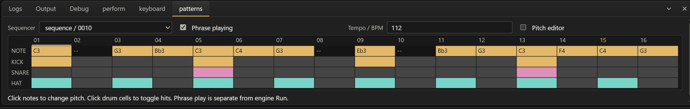

1. Select the sequencer in **Sequencer**, for example **sequence / 0010**.
2. Click a cell in the **NOTE** row to change the pitch of a step.
3. Click a cell in the **KICK**, **SNARE** or **HAT** row to add or remove a hit.
4. Type a value in **Tempo / BPM** to change the speed.

**Phrase playing** starts and stops the score. It does not stop the engine or the other
patches. **Pitch editor** opens a larger note grid. Make the bottom dock taller for that grid.

## The performance view and the other docks

Open **Views**, then **perform**. The view has the main controls of the **PHRASE** patch on one
page.

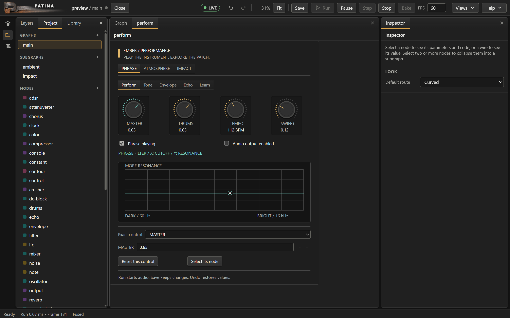

- **Perform** has the master level, the drums, the tempo, the swing and the filter XY pad. The
  pad sets the cutoff from left to right and the resonance from bottom to top.
- **Tone**, **Envelope** and **Echo** shape the phrase.
- **Exact control** lets you type a value or reset it.
- **Select its node** selects the node of a control on the graph.

The view writes the same parameters as the nodes. **Save** keeps the changes, and **Undo**
restores the values.

Each tool of **Views** opens in its preferred dock. Drag a tab to move it to another dock.

| Dock | Tool | Use |
|---|---|---|
| Left | **sounds** | Find, preview, load and save phrase sounds. |
| Left | **learn** | Follow six listening tests and find their nodes. |
| Right | **modulation** | See, connect or remove modulation routes. Edit their depth and rate. |
| Right | **controls** | Pin phrase parameters, type exact values and find their nodes. |
| Right | **audio** | Read the output meter, reset the clip mark and control the device output. |
| Bottom | **analysis** | Compare signals as waveforms or spectra. |
| Bottom | **patterns** | Edit the 16 steps, the pitch, the drum hits and the tempo. |
| Bottom | **keyboard** | Play notes with the computer keys or the mouse. Set the octave and the velocity. |
| Bottom | **export** | Render the saved patch to a WAV file, with progress and cancel. |

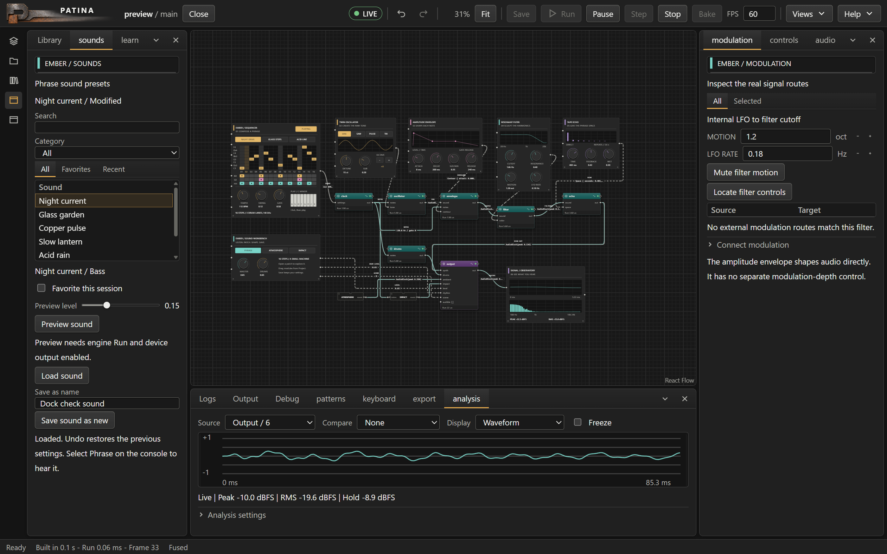

**Save sound as new** in **sounds** writes `sounds/<name>.ember`. It does not replace a file. A
sound keeps the phrase controls and the pattern, not the graph.

## The project and the node library

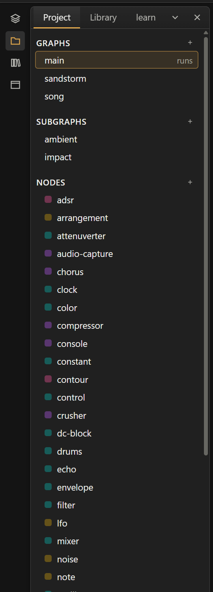

- **GRAPHS**: **main**, **sandstorm** and **song**. The label **runs** marks the graph that
  runs.
- **SUBGRAPHS**: **ambient** and **impact**, the patches of **ATMOSPHERE** and **IMPACT**.
- **NODES**: the 42 node types. Drag a node from the list onto the graph.

| Group | Modules |
|---|---|
| Instrument panels | Sequence, Timbre, Contour, Color, Space, Scope, Console, Control |
| Sources and timing | Clock, Oscillator, Rave, Vco, Noise, Drums, Note, Transpose |
| Modulation | Lfo, Adsr, Attenuverter, SampleHold, Slew, Constant |
| Level and mixing | Envelope, Vca, Mixer, Output |
| Filters and effects | Filter, Svf, Echo, Saturator, Crusher, Compressor, Chorus, Reverb, DcBlock |
| Song and stereo | Arrangement, SongClock, SongTrack, StereoMix, StereoOutput, StereoChannel, StereoPair |

The instrument panels and the **Control** knob run in the frame domain. The audio processors
run in the audio domain. An audio block has 256 samples at 48 kHz.

Rules for a new patch:

- Connect each audio input. Use **Constant** at 0 for a mixer input that you do not use.
- An LFO goes from -1 to 1. An envelope goes from 0 to 1.
- The pitch input of **Vco** uses octaves: 1 doubles the pitch, and -1 halves it.
- **Svf** has four modes: low-pass, high-pass, band-pass and notch.
- **Noise** has three modes: white, pink and brown.
- Use **StereoChannel** to get the left (0), the right (1) or the mean (2) of a stereo signal.

## Learn by listening

| Try this | Listen for this |
|---|---|
| Select **SINE**, then **SAW**. | A saw has more upper harmonics than a sine. |
| Increase **DETUNE**. | Two close pitches beat against each other. |
| Increase **ATTACK**. | Each note fades in more slowly. |
| Decrease **CUTOFF**. | The filter removes the high frequencies. |
| Increase **RESONANCE**. | The filter adds a peak near its cutoff. |
| Increase **MOTION**. | The LFO moves the filter through a wider range. |
| Increase **TIME** and **FEEDBACK**. | The echoes spread out and last longer. |
| Click a pitch cell or a drum pad. | The next pass plays your edited score. |

## The sandstorm and song graphs

The **sandstorm** graph is a short study of a well-known trance hook at 136 BPM. It has a lead,
a bass, a kick, a snare, a hi-hat and a pad track. The sound is an approximation, not the
original recording.

1. Open the **sandstorm** graph.
2. Open **Views**, then **arrange**.
3. Click **Run**.
4. Open **Mixer** and set **Solo** on the lead to hear it alone.
5. Open **Sound** to change the source, the envelopes and the effects.
6. Use **Piano roll** to see the notes of the hook.

The **Spectrogram** node of the graph shows the melody: frequency up, recent time across and
level as color.

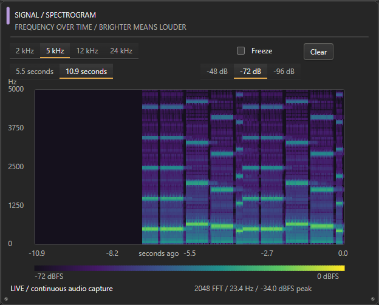

The **song** graph is an original 32-bar trance study at 136 BPM, with six tracks. The
**arrange** view shows the tracks on a timeline.

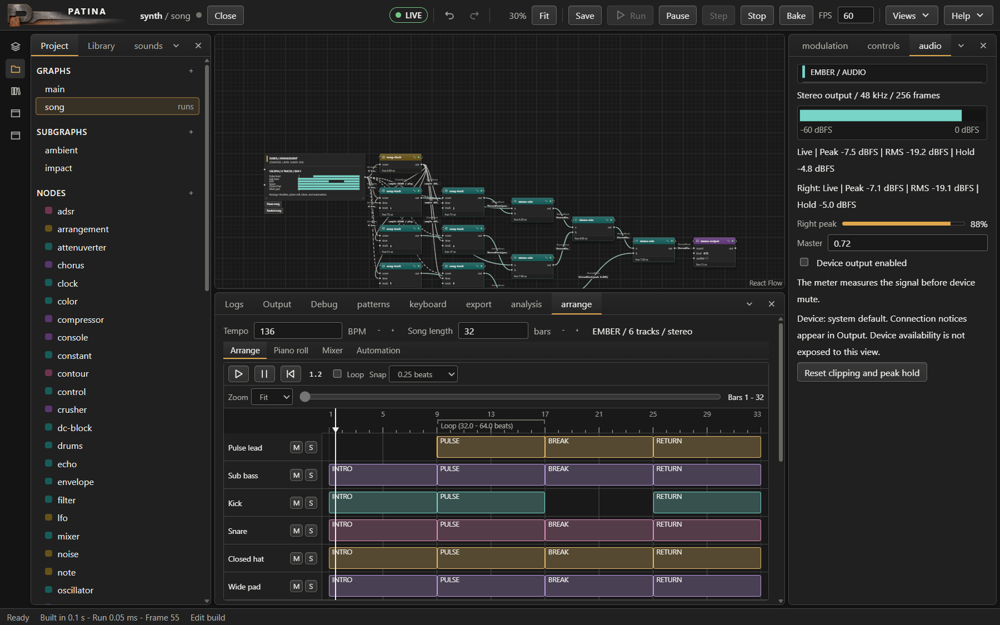

- Click a bar on the ruler to play from there. **Loop** repeats the selected region.
- Drag a clip to move it. Drag an end of a clip to trim it.
- **Piano roll** edits the notes of a clip, with their length and velocity.
- **Import WAV clip** adds recorded audio. **Sampler** plays a WAV file from notes.
- **Mixer** has the stereo meters, gain, balance, mute, solo and track effects. **Automation**
  changes the gain, the pan, the cutoff and the delay send across the song.

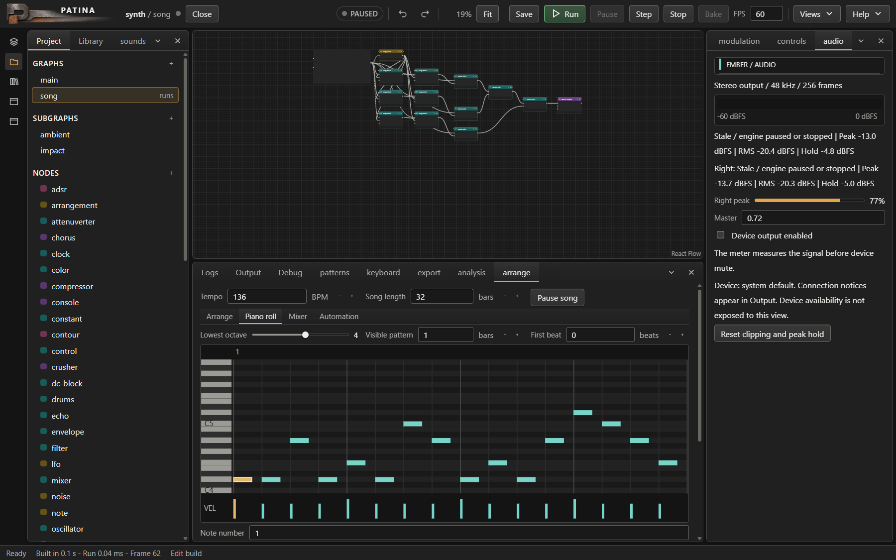

The [synth README](../../workbenches/synth/README.md) has the full steps for the two graphs.

## Export a sound

1. Select a scene on the console.
2. Adjust the sound and click **Save**.
3. Keep **AUDIBLE** on in the output node.
4. Open **Views**, then **export**. Choose a file and a duration.
5. Click **Export saved patch**.

Or run the command of [Run it](#run-it). Both write stereo, 32-bit float WAV audio at 48 kHz.

- The render uses the saved parameters and starts the patch from its initial state. It does not
  record live knob movements.
- An existing file stays the same. Choose a new name for each render.
- Cancel stops the render and removes its partial files.
- `--edit` gives a faster build. The default build is **Bake**.

For the other graphs, add `--graph sandstorm` or `--graph song`, for example:

```
cargo run -p patina-cli -- render workbenches/synth sandstorm-hook.wav --graph sandstorm --seconds 10
```

## Checks and measurements

Run the DSP and panel checks from the root of a checkout:

```
cargo test --manifest-path workbenches/synth/Cargo.toml --workspace --release -- --nocapture
```

The CLI test builds the graph in **Edit** and in **Bake**, compares their samples and checks
live parameter writes. The editor check moves the controls on a hidden Windows desktop.

Measured on Windows, with zero allocations after warm-up:

| Test | Date | Mean per block | p95 |
|---|---|---|---|
| Core DSP | 2026-11-18 | 0.015 ms | 0.016 ms |
| 15 processors | 2026-11-18 | 0.030 ms | 0.032 ms |
| Six-track song with track effects | 2026-11-19 | 0.159 ms | 0.182 ms |

These tests measure the DSP only, without the editor, the device or the graph scheduler.

## Limits

- The learning patch uses mono signals, one note at a time and a fixed C minor phrase grid.
- Hardware MIDI and microphone input are not available.
- The song engine has no time stretch, no compressed audio import, no VST hosting and no stem
  export.
- The tests check samples and controls. Speaker playback and sound quality are not checked.

The [synth README](../../workbenches/synth/README.md) has the full details. See also the
[arrangement design](../synth-arranger.md), the [sound workbench notes](../sound-workbench.md)
and the [dock design](../synth-dock-design.md).
