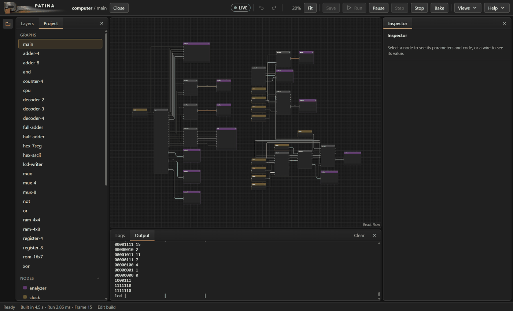
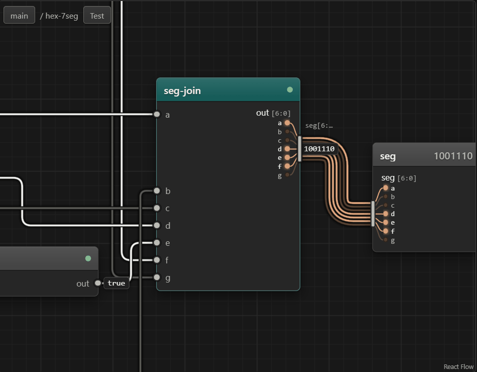

# Computer

A small 8-bit computer, made of NAND gates. The style is the style of a digital logic
simulator: each gate, adder, register and memory is a subgraph that you can open.



## Run the example

Run these commands from the root of the repository.

- Run 16 frames in the terminal:

  ```
  cargo run -p patina-cli -- run examples/computer --frames 16
  ```

- Open the editor, then open the `examples/computer` folder. Click **Run**.

Each frame is one clock step. Each frame writes ten lines: the count, the count plus 3, an
accumulator, a memory, the three registers of the CPU and the segments of the three displays.

## What it shows

- **The CPU.** The `cpu` subgraph runs the program of the `program` node. Select a program in
  the **File** dropdown of the node, or click **New**. Expand the node to edit the code with line
  numbers, the line that runs and the errors. The example program writes the Fibonacci numbers 1 to 233 to the OUT
  register.
- **The RAM chip.** The `ram` node keeps 256 bytes for the CPU. Expand it to see all bytes.
- **Byte wires.** A wire of the `byte` kind is a ribbon of 8 lanes. The badge shows the value
  of the byte. Each lane is lit when its bit is true.
- **Segment buses.** A `segment-bus` wire has the 7 lanes a to g of a 7-segment display. It
  is copper.
- **Live subgraphs.** Double-click a use of a subgraph, for example the `cpu` node. The
  subgraph opens with the live values of that use.
- **Node GUIs.** The `program`, `ram`, `readout`, `display`, `lcd`, `clock`, `analyzer`,
  `keyboard`, `terminal`, `screen` and `joystick` nodes draw their values in the graph.
- **IO devices.** The CPU reads a `keyboard`, a `random`, a `joystick` and the pixels of the `gpu`. It
  writes a `terminal`, a `gpu` and a `sprites` chip on its IO ports. The `screen` shows the 32 x 32
  frame with the sprites.
- **A view on the GPU.** Open **monitor** from the **Views** menu. The view draws the screen with
  `wgpu`, with a dark gap between the pixels.




## The parts

| Folder | Parts |
| --- | --- |
| `nodes/` | `nand`, `switch`, `clock`, `program`, `ram`, `split`, `join`, `seg-join`, `readout`, `display`, `lcd`, `analyzer`, `keyboard`, `terminal`, `gpu`, `sprites`, `screen`, `random`, `joystick` |
| `views/` | `monitor` |
| `programs/` | `fibonacci.asm`, `count.asm`, `echo.asm`, `stripes.asm`, `noise.asm`, `confetti.asm`, `dice.asm`, `paint.asm` |
| `connections/` | `byte`, `segment-bus` |
| `types/` | `segments`, `frame` |
| `graphs/` | `main` and 27 subgraphs |

The subgraphs, from small to large:

- **Gates:** `not`, `and`, `or`, `xor`, `mux`.
- **Arithmetic:** `half-adder`, `full-adder`, `adder-4`, `adder-8`, `incrementer-8`,
  `alu-8`, `is-zero-8`.
- **Selection:** `mux-4`, `mux-8`, `decoder-2`, `decoder-3`, `decoder-4`.
- **Memory:** `register-4`, `register-8`, `ram-4x4`, `ram-4x8`, `rom-16x7`, `counter-4`.
- **Output:** `hex-7seg`, `hex-ascii`, `lcd-writer`.
- **The computer:** `cpu`.


## The instruction set

Each instruction has a 4-bit opcode and an 8-bit value k. The CPU has 16 operations, 256 words
of program, 240 bytes of RAM in the `ram` node and 16 IO ports. The
[Logic circuits](../../README.md#logic-circuits) section of the main README gives the full
list, the assembly language, the clock, the LCD and the IO ports. To change the program, select the `program`
node and edit its code, or expand the node.
