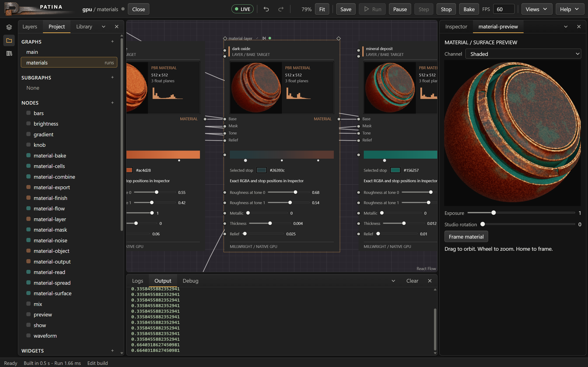
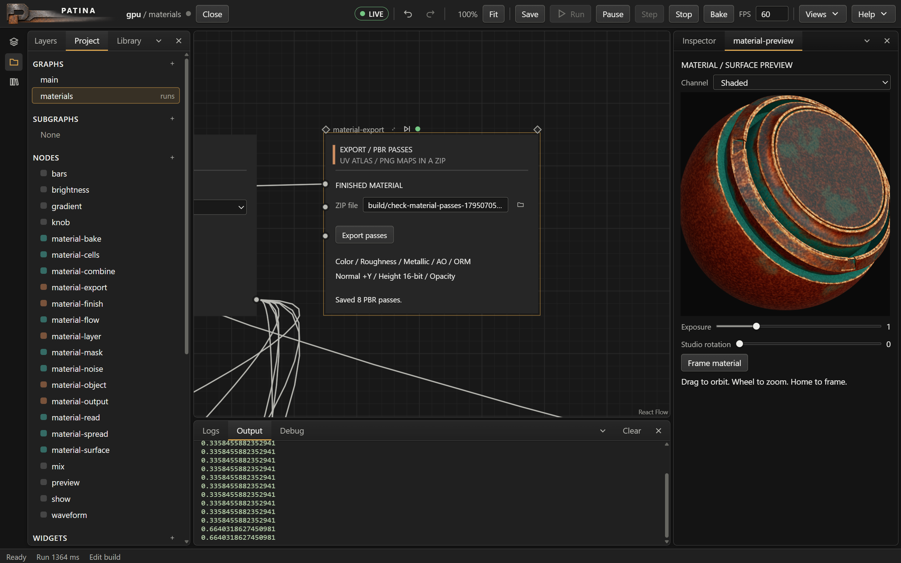
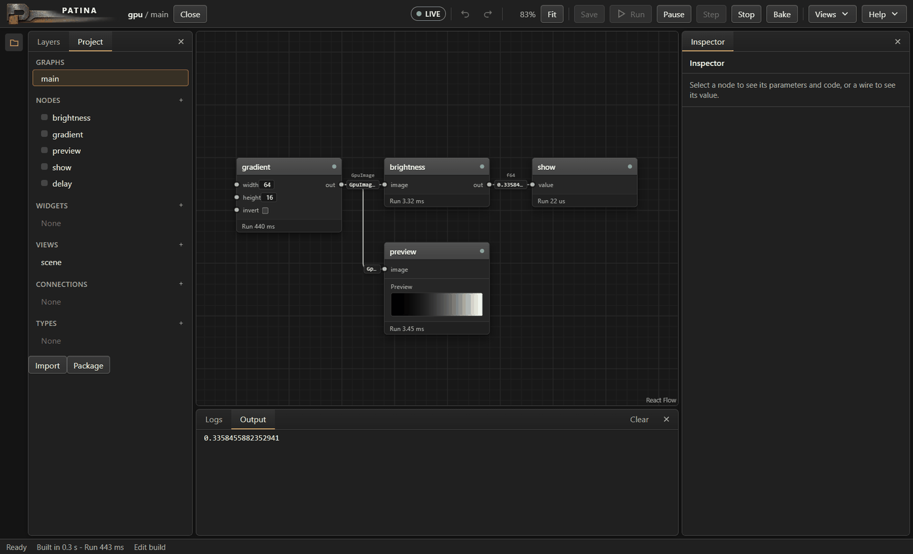

# GPU

The project has two top graphs. **main** shows small GPU experiments.
**materials** is a native smart material workbench built from Millwright Surface.

## Smart materials

Open **materials** in the **Project** panel. Click **Run** to evaluate the copper recipe.
Open **material-preview** from **Views**. Click **Run** again to capture the finished material.
Drag the preview to orbit. Use the wheel to zoom. **Frame material** restores the camera.
The **Channel** list shows shading, base color, roughness, metallic, height, occlusion, and normal.

The graph has 28 material nodes, three workflow nodes, and six labeled groups:

1. Shared noise gives each coat its surface variation.
2. Mesh maps identify exposed edges, creases, and enclosed areas.
3. Wear masks reveal the copper at exposed edges.
4. Tarnish masks control the oxide coat.
5. Mineral masks place the deposits.
6. Four layers build the material. **Finish** derives its normal from the combined height.

Node bodies show real GPU previews, thumbnail tone histograms, and their main controls.
**Mask** shows its threshold curve. **Layer** shows its color ramp and PBR settings.
Select a ramp stop to change its color. The **Inspector** gives exact float RGBA and position fields.
Unedited ramp values keep their original precision and alpha.
Use **Restore kernel defaults** in the **Inspector** to start from a kernel's original settings.
Unwired mask and material inputs use the kernel's declared defaults.

The node library also includes **Cells**, **Flow**, and **Read**.
These make cell patterns, carry masks along a surface, and extract material channels.
Pins distinguish masks from complete materials.

Change `nodes/material-*/assets/kernel.wesl`, then click **Run** to compile the shader body.
Keep its port and parameter declarations. The Rust node defines those public controls.
A shader error leaves the last valid node state and reports the error.

Run the second graph without the editor:

```
cargo +1.100.0 run -p patina-cli -- run examples/gpu --graph materials
```

**Object** loads a Millwright `asset.json` with its adjacent `mesh.bin`, or a triangulated OBJ.
The OBJ needs a non-overlapping UV atlas from 0 to 1. Import does not unwrap UVs or load material files.
The graph loads Millwright's original material sphere, with its original mesh and UV atlas.

The **Bake / Object maps** node bakes position, normal, curvature, occlusion, thickness, part, and contact data.
It loads the object's saved maps after Millwright validates their mesh and resolution key.
The sphere uses its original 2048 x 2048 bake. No replacement mesh or UV atlas is generated.
Missing maps use Millwright's UV rasterizer and ray tracer at the object's atlas resolution.
Click **Bake maps again** to run that same baker on the sphere or a loaded object.
**Material resolution** controls downstream material textures, independently of the object's maps.
Connect its output to each source node's **Bake target** input.
Other nodes receive the target through their mask and material inputs.
Inputs from different bake targets produce an error.

**Export** writes eight PNG passes in a ZIP file when you click **Export passes**.
Choose a new filename. Export does not replace existing files or run when you reopen the graph.
The passes are base color, roughness, metallic, occlusion, normal, height, opacity, and packed ORM.
Base color uses sRGB. Other passes use linear data. Height uses 16 bits; the other passes use 8 bits.
Normal uses tangent space with OpenGL +Y. ORM stores occlusion, roughness, and metallic in RGB.
The first image row is UV v=0, as in Millwright's export.

The default graph uses 512 x 512 float32 material textures and the sphere's original 2048 x 2048 maps.
An unconnected bake target also uses this original reference sphere and bake.
Unchanged node inputs reuse their GPU outputs. Thumbnail readback does not block GUI frames.
The PBR view redraws when its material, camera, light, or size changes.

Windows x64 MSVC builds use static DXC. A source build needs Visual C++ ATL.
The build finds an installed ATL library without a PATH change.
The first build downloads a compiler archive and checks its SHA256.
The compiled project needs no extra compiler DLL.





The renderer, shaders, object loader, mesh baker, and export code all stay inside this example.
This version includes the copper recipe. It does not provide general recipe import or the Paint workspace.
UV unwrapping, overlapping UV detection, OBJ material import, and glTF import remain open.
Windows GNU, Linux, and macOS material workflows are not verified.
See [source notices](NOTICE.md) and the [implementation record](../../docs/smart-material-workbench.md).

A project that uses the GPU with WESL shaders through `wgpu`. The nodes look like the front
panels of lab instruments. The first row draws a gray gradient on the GPU, finds its mean
brightness and shows a small copy. The second row makes color bars, mixes them with the gradient
and shows the result on a monitor and a waveform monitor.



## Run the example

The example needs Rust 1.100.0, as all examples do. Run
this command from the root of the repository:

```
cargo +1.100.0 run -p patina-cli -- run examples/gpu
```

The command writes the mean brightness of the gradient, about `0.336`.

To open it in the editor, start the editor with Rust 1.100.0 or later. Then open the
`examples/gpu` folder and click **Run**.

## The parts

| Path | What it is |
| --- | --- |
| `nodes/gradient/` | Draws a gray gradient on the GPU, with the shaders in `assets/`. The **INV** switch sets **invert**, so the gradient goes from white to black. |
| `nodes/brightness/` | Gives the mean of the red channel. It copies the image to the CPU and shows a histogram with a line at the mean. |
| `nodes/preview/` | Shows a small copy of the image on the screen of a monitor. |
| `nodes/show/` | Writes its value to the output, and shows it with a bar. |
| `nodes/knob/` | A knob that gives a value from 0 to 1. |
| `nodes/bars/` | Makes the color bars of a test signal on the GPU, with a gray ramp under them. The **level** input sets the brightness through a WGSL `override` constant. |
| `nodes/mix/` | Mixes two images on the GPU, as the crossfader of a video mixer. The result has the size of the image on **a**. |
| `nodes/waveform/` | Shows the brightness of each column of the image, as a waveform monitor does. |
| `widgets/scope/` | The drawing parts of the node GUIs: the panel, the screws, the screens and the readouts. |
| `views/scene/` | A view with a GPU viewport. A drag sets the color. The wheel and the arrow keys set the light. |

The images stay on the GPU between the GPU nodes. A shader change needs no Rust compile. The
[GPU](../../README.md#gpu) section of the main README tells how a node uses the GPU.

## Try this

- Drag the knob up or to the right. The color bars, the monitor and the waveform get brighter.
- Drag the fader of the mix node from **A** to **B**. The gradient comes in over the color bars.
- Click the **INV** switch of the gradient. The histogram and the mean change.
- Open `nodes/bars/assets/bars.wesl` and change the colors. Click **Run** to see the change.
