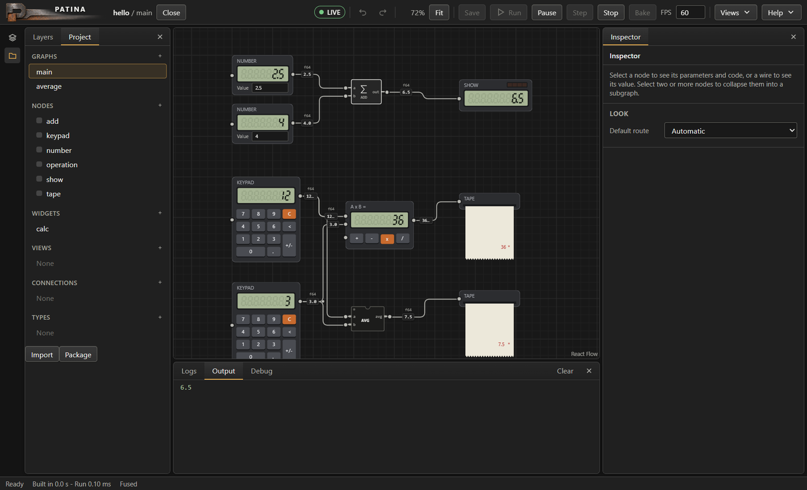

# Hello

The first Patina project. Two numbers go into an add node, and a show node writes the sum. Below
them, a small pocket calculator: two keypads, an operation and two paper tapes. Start with this
example to learn the parts of a project.



## Run the example

Run these commands from the root of the repository.

- Run the graph one time:

  ```
  cargo run -p patina-cli -- run examples/hello
  ```

- Run the graph for 3 frames:

  ```
  cargo run -p patina-cli -- run examples/hello --frames 3
  ```

- Open the editor, then open the `examples/hello` folder. Click **Run**.

The show node writes `6.5`, which is 2.5 + 4. The first tape prints `36`, which is 12 x 3. The
second tape prints `7.5`, the average of 12 and 3.

## The parts

| Path | What it is |
| --- | --- |
| `patina.toml` | The project file. It sets the Rust version. |
| `graphs/main.toml` | The main graph: the nodes, their parameters and the wires. |
| `graphs/average.toml` | A subgraph that gives the average of **a** and **b**. Its use shows as an **AVG** chip. |
| `nodes/number/` | A node with a **value** parameter. It gives the value at its **out** output. |
| `nodes/add/` | A node that adds its inputs **a** and **b**. |
| `nodes/show/` | A node that writes its **value** input to the output. |
| `nodes/keypad/` | A calculator keypad. It gives the number that you type on its keys. |
| `nodes/operation/` | Gives a + b, a - b, a x b or a / b. Click a key to select the operation. |
| `nodes/tape/` | The paper tape of a printing calculator. It prints each new value. |
| `widgets/calc/` | The drawing parts of the calculator style: the case, the LCD and the keys. |

Each node is a Rust crate with one function or struct, marked with `#[node]`. Open a node in
the editor to see its code. Change the code, and the editor builds and runs the graph again.

## Try this

- Select a number node, and set its **value** in the **Inspector**.
- Type a number on a keypad. **C** clears the number, and **<** removes the last digit.
- Click the **/** key of the operation. The first tape prints the new result in red.
- Double-click the **AVG** chip to see the subgraph inside it.
- Make a package of the example:

  ```
  cargo run -p patina-cli -- package examples/hello hello-pkg
  ```
