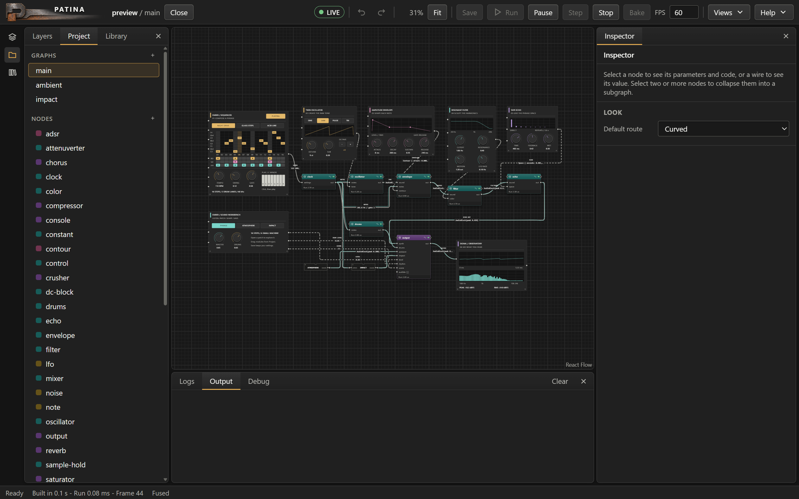
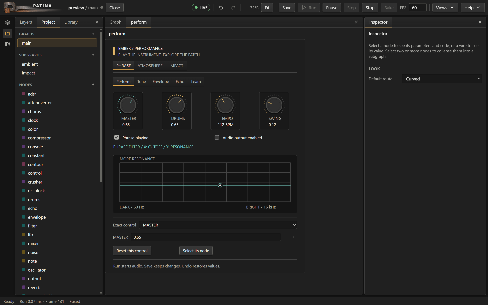
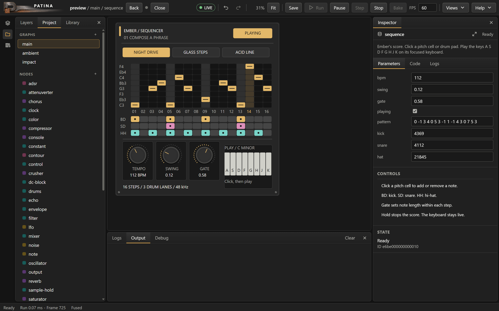

# Ember sound workbench

Ember is a modular synthesizer for learning and sound design. Its graph shows how a score becomes sound.
The instrument panels have different sizes. Each panel has room for its controls and displays.



## Play

1. Open `examples/synth` in Patina.
2. Click **Run**.
3. Start with a low speaker volume.
4. Select **PHRASE**, **ATMOSPHERE**, or **IMPACT** on the workbench panel.
5. Click **NIGHT DRIVE**, **GLASS STEPS**, or **ACID LINE** to change the phrase.
6. Drag a knob up or down to change its value.
7. Click the keyboard, then play A, S, D, F, G, H, J, and K.
8. Click **PLAYING** to hold the sequencer. The keyboard stays live.
9. Click **Save** to keep the graph parameters.

The knobs also accept arrow keys when they have focus. The **Inspector** shows exact parameter values and short explanations.
The large panels also support **Full size**. Use the node menu to open one.

## Play from the performance view



1. Open the **main** graph.
2. Open **Views**, then **perform**.
3. Select **PHRASE**, **ATMOSPHERE**, or **IMPACT**.
4. Click **Run** to start the engine.
5. Use **Perform** for master level, drums, tempo, swing, and the filter XY pad.
6. Use **Tone**, **Envelope**, and **Echo** to shape the phrase.
7. Select an **Exact control** to type its value or reset it.
8. Open **Learn** for short listening experiments.

The view controls the same parameters as the graph nodes. **Save** keeps changes, and **Undo** restores values.
The XY pad changes cutoff horizontally and resonance vertically. Its arrow keys make small changes.
**Select its node** selects the corresponding graph node. Open **Graph** to see it.

**Phrase playing** controls the score. It does not stop the ambient patch or the engine.
**Audio output enabled** controls the output node's audio submission. Keep it enabled for CLI rendering.
The tone, envelope, echo, and filter controls affect **PHRASE**. Edit the other patches inside their subgraphs.

The view requires the original main patch's node IDs and folders. It reports missing or connected controls instead of writing hidden overrides.
The envelope display is a settings preview. It shows a 0.4-second sustain hold, followed by release.
The view has no live audio analyzer or device-status display yet.

## Explore the patches

**PHRASE** combines the 16-step synth with kick, snare, and hi-hat.
**ATMOSPHERE** combines two low oscillators with slow random modulation, chorus, and reverb.
**IMPACT** combines pitched percussion and noise with saturation, reduced bit depth, compression, and reverb.
The scene buttons crossfade the outputs. All three patches keep running.

Double-click the **Atmosphere** or **Impact** subgraph to open its patch.
The three large knobs in each subgraph control useful parts of its sound.
Use the **Inspector** to change the other processor parameters.

## Learn by listening

| Try this | Listen for this |
| --- | --- |
| Select **SINE**, then **SAW**. | A saw has more upper harmonics than a sine. |
| Increase **DETUNE**. | Two close pitches beat against each other. |
| Increase **ATTACK**. | Each note fades in more slowly. |
| Reduce **CUTOFF**. | The filter removes high frequencies. |
| Increase **RESONANCE**. | The filter adds emphasis near its cutoff. |
| Increase **MOTION**. | The LFO moves the filter through a wider range. |
| Increase **TIME** and **FEEDBACK**. | The echoes spread out and last longer. |
| Click a pitch cell or drum pad. | The next pass uses your edited score. |

The score has 16 steps in C minor. **BD**, **SD**, and **HH** mean kick, snare, and hi-hat.
**GATE** controls note length within a step. **SWING** alternates longer and shorter steps without changing the bar length.



## Follow the signal

The clock produces sample-accurate pitch, gate, and drum triggers.
The oscillator makes the raw sound. The amplitude envelope shapes each note.
The filter removes harmonics. The echo adds repeats. The output mixes the voice and drums.

The scope measures the actual output. The upper trace shows one 256-sample block, or 5.33 ms.
The lower display shows a windowed spectrum from about 188 Hz to 24 kHz.
Its short window does not resolve deep bass. **PEAK** and **RMS** show levels relative to digital full scale.

Audio cables show samples from the running graph. Their motion comes from the sound.
The score and settings use separate typed connections.

## Build another instrument

The library contains 34 node types. Drag a node from **Project** onto the graph.
The seven dedicated instrument panels and the general control knob run in the frame domain.
The audio processors run in the audio domain.

| Group | Modules |
| --- | --- |
| Instrument panels | Sequence, Timbre, Contour, Color, Space, Scope, Console, Control |
| Sources and timing | Clock, Oscillator, Vco, Noise, Drums, Note, Transpose |
| Modulation | Lfo, Adsr, Attenuverter, SampleHold, Slew, Constant |
| Level and mixing | Envelope, Vca, Mixer, Output |
| Filters and effects | Filter, Svf, Echo, Saturator, Crusher, Compressor, Chorus, Reverb, DcBlock |

Audio and modulation use the same mono block type. A block has 256 samples at 48 kHz.
An LFO usually spans -1 to 1. An envelope spans 0 to 1.
The VCO pitch input uses octaves: 1 doubles the pitch, and -1 halves it.
The filter modulation depth also uses octaves.

Use **Constant** for an unchanging modulation signal. Its value of 0 supplies a neutral pitch input.
Connect every audio input. Use **Constant** at 0 for unused mixer inputs.
**Control** supplies a frame parameter, such as a cutoff frequency. It does not replace an audio block.
**Note** supplies a held note and gate. **Clock** supplies a changing score.

Try these small edits inside **Atmosphere**:

- Raise **MOTION** to speed up the random filter movement.
- Change the **Svf** mode from 0 to 1 for a high-pass sound.
- Replace the LFO signal at **SampleHold** with another periodic source.
- Change the mixer levels to balance the two oscillators and noise.

**Svf** modes are low-pass, high-pass, band-pass, and notch, in that order.
**Noise** modes are white, pink, and brown. **Crusher** deliberately adds digital distortion.
The saw and pulse oscillators reduce aliasing. The triangle sums harmonics below the Nyquist frequency.
**Saturator** uses antiderivative antialiasing. These methods reduce aliasing; they do not remove it at every setting.

## Export a sound

1. Select a scene in the workbench panel.
2. Adjust its sound and click **Save**.
3. Keep **audible** enabled on the output node.
4. Run this command from the repository root:

```
cargo run -p patina-cli -- render examples/synth ember.wav --seconds 16
```

The command writes mono, 32-bit float WAV audio at 48 kHz. It does not open a sound device.
An existing output file stays unchanged. Choose a new name for another render.
Use `--edit` for a faster build. The default uses **Bake**.

The render uses the saved parameters and starts the patch from its initial state.
It does not record live knob movements. The duration includes no extra effect tail or end fade.
Import the WAV file into a sound editor to trim it or add a fade.
Audio export currently uses the CLI. The editor has no export button.

## Code and checks

- `nodes/` contains the graph modules and their instrument panels.
- `types/synth-dsp/` contains the DSP and shared control types.
- `widgets/panel/` contains the reusable knobs and drawing parts.
- `graphs/main.toml` contains the saved patch and its parameter values.

The controls run on the frame thread. The sound processors run on the audio thread.
This uses the current Patina audio model. Direct GUIs on audio nodes remain deferred.

Run the DSP and panel checks from the repository root:

```
cargo test --manifest-path examples/synth/Cargo.toml --workspace --release -- --nocapture
```

The CLI integration test builds the graph in **Edit** and **Bake**. It compares their samples and checks live parameter writes.
The editor screenshot check operates the controls on a hidden Windows desktop.

On 2026-11-18, the core DSP averaged 0.015 ms per block over 2,000 warm blocks.
The p95 was 0.016 ms. The expanded 15-processor path averaged 0.030 ms, with a p95 of 0.032 ms.
Both tests counted zero allocations after warmup.
These measurements cover DSP processing, without the editor, device, or graph scheduler.

## Design references

[Bespoke Synth](https://www.bespokesynth.com/docs/) is the open source synth with animated patch cables.
[VCV Rack](https://vcvrack.com/Free) shows a useful modular vocabulary and separate control inputs.
[Vital](https://vital.audio/) shows waveforms, envelopes, and filter responses beside their controls.
Ember uses its own code and panel drawings.

The [workbench notes](../../docs/sound-workbench.md) record the wider node and GUI needs.

Current limits: mono output, monophonic note input, and a fixed C minor keyboard.
MIDI, sample import, and song arrangement are not implemented.
The tests check samples and controls. Speaker playback and listening quality have not been checked.
