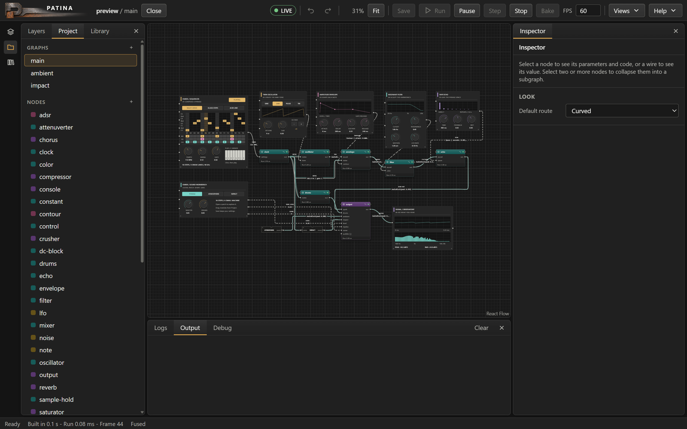
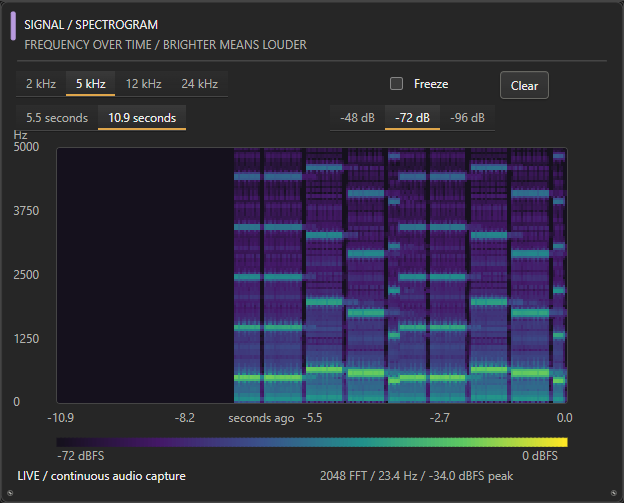
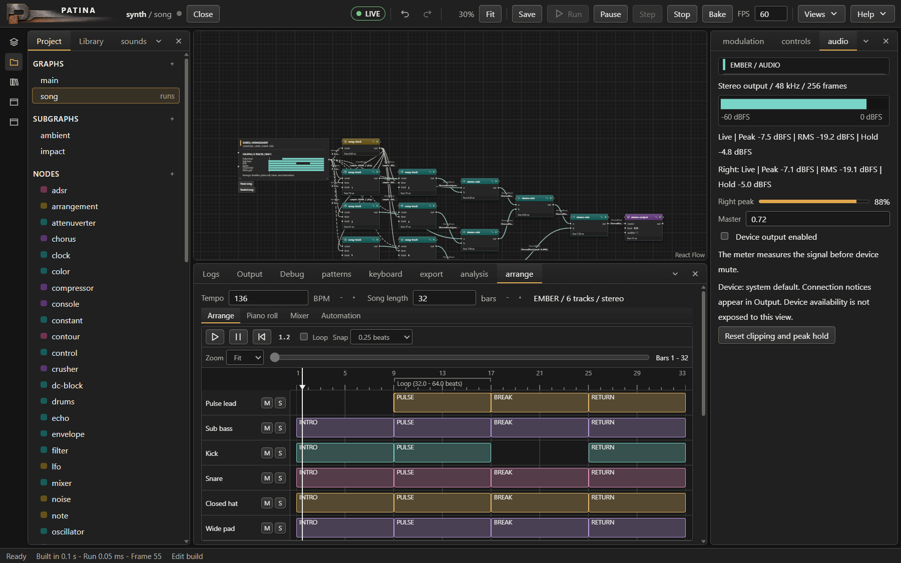
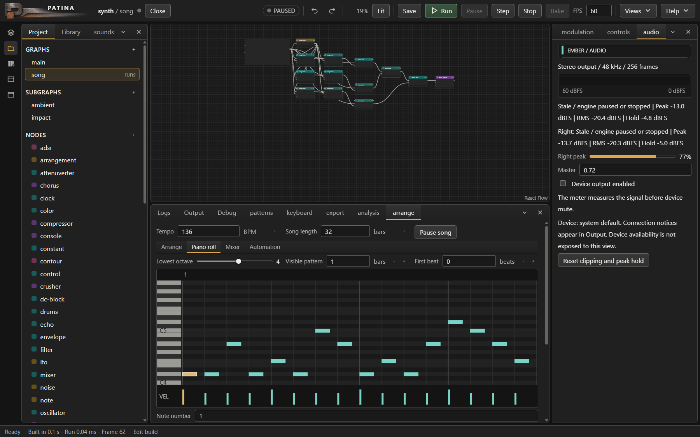
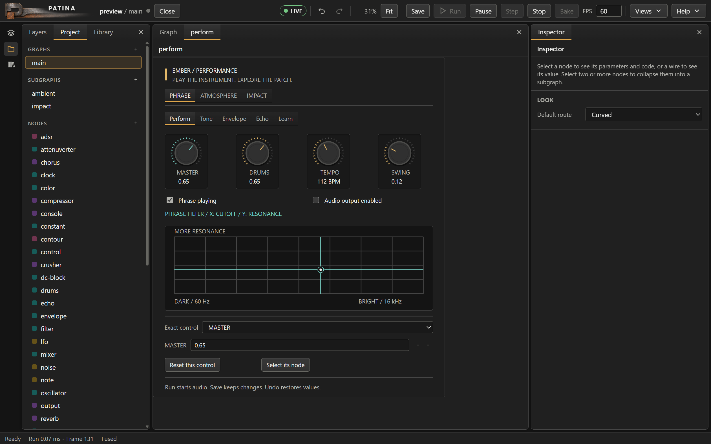
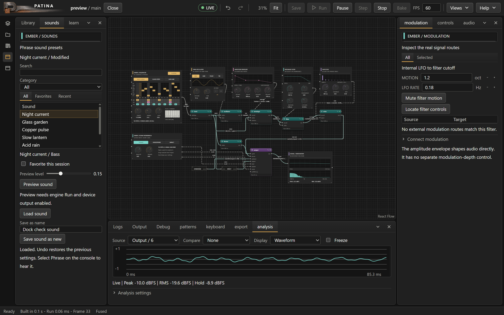
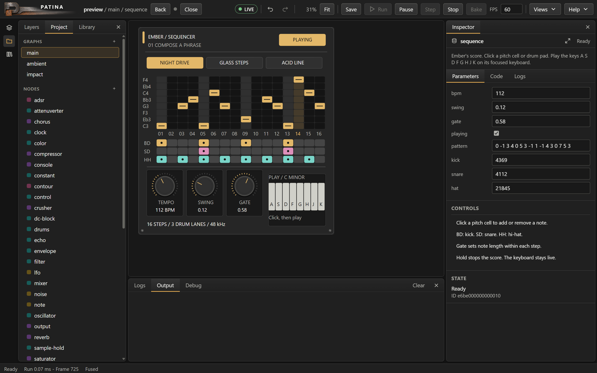

# Ember sound workbench

Ember is a modular synthesizer for learning and sound design. Its graph shows how a score becomes sound.
The instrument panels have different sizes. Each panel has room for its controls and displays.



## Sandstorm hook study

The **sandstorm** graph attempts a short hook from **Darude - Sandstorm** at 136 BPM.
It repeats a two-bar excerpt twice, with separate lead, bass, kick, snare, hi-hat, and pad tracks.
The accompaniment and sound are approximations. This is a short synthesis study, not the full song or its original recording.

1. Open the **sandstorm** graph.
2. Open **Views**, then **arrange**.
3. Click **Run**.
4. Open **Mixer** and enable **Solo** on the lead to hear its source clearly.
5. Open **Sound** to change the source, filter envelope, amplitude envelope, and effects.
6. Disable **Solo** to hear the full mix.
7. Use **Piano roll** to inspect the hook's notes and timing.
8. Click **Save** to keep the changes.

The **Rave lead** instrument plays a pulse at the note pitch, with a saw 31 semitones below it.
Source distortion runs at four times the sample rate, before the voice filter and amplitude envelope.
The starting settings use **Fifth level** at 1, a 4600 Hz source filter, 8 bits, and **Source edge** at 1.05.
**Fifth level** controls the high pulse. The low saw supplies the rough undertone.
The source interval follows [Syntorial's published remake](https://www.syntorial.com/preset-recipe/darude-sandstorm-lead/).
These are approximate synthesis settings. Darude's original lead used a processed sample.

The **rave-oscillator** node supplies the same source and distortion for custom modular patches.
Connect **Notes** to it, then connect its output to **Filter** and **Envelope**.
Set **fifth** to 1, **body** to 4600, **bits** to 8, and **edge** to 1.05.
This source has no amplitude envelope. The downstream envelope controls note length.

The **Sound** page edits the selected track. Use **Track** below the page to select another instrument.
Its columns wrap when the dock becomes narrow.

| Instrument or section | Controls and behavior |
| --- | --- |
| Lead and pad | Seven band-limited oscillators, detune, stereo width, and separate amplitude and filter envelopes. |
| Bass | An aligned sine body and shaped saw feed a resonant filter. |
| Rave lead | Pulse melody, low saw, source filtering, bit reduction, oversampled distortion, and note envelopes. |
| Kick | A falling pitch, saturated body, and short noise transient. |
| Snare | Two body resonances, filtered wire noise, and a short bright transient. |
| Hats | Metallic oscillators and filtered noise. Note 46 opens the hat; note 42 closes it. |
| Track effects | Low cut, stereo room, ping-pong delay, and a quarter-note volume dip. |

Drums play one shot. Their **Drum length** controls decay independently from the note length.
Stopping the song releases the drums. A closed hat releases an open hat through **Stop release / seconds**.
**Beat duck** follows the transport. It does not detect another track's audio.
The sampler and imported WAV clips remain available. These synthesized drums do not contain acoustic drum recordings.

For export, set **Saved top graph** to **sandstorm** and **Duration** to 10 seconds.
The musical excerpt lasts about 7.06 seconds. The rest allows the effect tail to decay.
The CLI can render the same saved graph:

```
cargo run -p patina-cli -- render workbenches/synth sandstorm-hook.wav --graph sandstorm --seconds 10
```

## Spectrogram node

The **sandstorm** graph includes a **Spectrogram** connected to its melody track.
It shows frequency vertically, recent time horizontally, and signal level through colour.



For another signal:

1. Add an **audio-capture** node from **Project**.
2. Connect a mono audio output to its **sound** input.
3. Add a **spectrogram** node.
4. Connect the capture output to its **source** input.
5. Click **Run**.

For stereo audio, use **stereo-channel** before the capture node.
Select channel 0 for left, 1 for right, or 2 for their mean.
The capture connection runs beside the audio output. It does not change the sound.

Use **Frequency range** to inspect bass, melody harmonics, or the full audio band.
Use **Time span** for 5.5 or 10.9 seconds of history.
Use **Level floor** to reveal quiet harmonics.
**Freeze** holds the display. Resuming starts a new history. **Clear** removes the captured history.
The output pin reports the latest captured peak amplitude.

The analyzer uses a 2048-sample Hann window with 50 percent overlap at 48 kHz.
Its frequency spacing is 23.4 Hz. It uses peak levels when several bins share a display pixel.
FFT work runs in the frame domain. Audio capture uses the existing bounded buffer without locks or allocations.
A frame stall longer than the 171 ms capture buffer can lose samples. The display resets and reports that gap.
The illustration shows the actual widget renderer. It is not a screenshot of the complete editor.

## Arrange a song

The **song** graph adds a 32-bar trance study at 136 BPM.
It has a lead, bass, kick, snare, hi-hat, and stereo pad.
Sandstorm informed the feature study. The included music is original.



1. Open the **song** graph.
2. Open **Views**, then **arrange**.
3. Increase the bottom dock height, or move its tab to the center.
4. Click **Run**.
5. Click bar 9 on the ruler to hear the lead section.
6. Use **Loop** to repeat the selected region.
7. Drag clips to move them. Drag their ends to trim them.
8. Open **Piano roll** to edit the selected note clip.
9. Open **Mixer** to select instruments and change track controls.
10. Click **Save** to keep the score and routing.

The **Arrange** page shows eight tracks at a time. Track pages support up to 32 tracks.
**Zoom** and horizontal scrolling change the visible range. Clip positions stay on the song's beat grid.
Each track accepts note clips and recorded WAV clips together.
**Add track** creates its player node and connects it to the song clock and stereo mix.
**Remove selected track** preserves the remaining mix. It requires the normal workbench mixer route.
Track order changes keep the same track IDs and sound routes.

Use **Add note clip**, **Duplicate clip**, **Split position**, **Split clip**, and **Delete clip** to build the arrangement.
Use **Move clip to track** to change a clip's destination.
The piano roll supports overlapping chromatic notes, note lengths, and velocity.
Drag a note's right edge to resize it. Arrow keys move the selected note. **Delete** removes it.
Exact note fields provide keyboard access without a pointer.



Use **Audio clip / WAV** and **Import WAV clip** to add recorded audio.
Import copies the file into `types/synth-dsp/samples/`. Packages include that directory.
Undo removes the clip edit but keeps the imported file for redo and other clips.
WAV import supports mono and stereo PCM8, PCM16, PCM24, PCM32, float32, and float64.
Source rates can range from 8 kHz to 192 kHz. Playback converts them to 48 kHz.
**Reload WAV files** reloads modified sources. A failed import keeps the last valid score active and shows its error.

The **Sampler** instrument plays a WAV from notes. **Root MIDI note** sets its original pitch.
Recorded clips play at their natural speed. Tempo changes adjust their beat lengths to keep their duration.
Clip offsets and fades use seconds. Note positions and loop lengths use beats.
**Playback rate** changes both speed and pitch; this is not time stretching.

The mixer provides stereo meters, gain, balance, mute, solo, attack, release, cutoff, drive, and tempo-based stereo delay.
The **Automation** page edits gain, pan, cutoff, and delay send across the song.
Its curves run in the audio domain. Closing the view does not stop playback.
Each track has 32 voices. A full voice pool replaces the quietest voice and reports the count in the mixer.

Open **export** to render the saved song. Set **Saved top graph** to **song**.
**Use song duration plus 2 seconds** sets a starting duration. Increase it for longer effect tails.
Saved loop settings apply to export. Disable **Loop** for a full song render.

The song engine does not capture microphones or hardware MIDI.
It does not provide time stretching, compressed audio import, VST hosting, or stem export.
The [design and checks](https://github.com/bhowiebkr/Patina/blob/main/docs/synth-arranger.md) record the architecture and current evidence.

## Play

1. Open `workbenches/synth` in Patina.
2. Click **Run**.
3. Start with a low speaker volume.
4. Select **PHRASE**, **ATMOSPHERE**, or **IMPACT** on the workbench panel.
5. Click **NIGHT DRIVE**, **GLASS STEPS**, or **ACID LINE** to change the phrase.
6. Drag a knob up or down to change its value.
7. Click the keyboard, then play A, S, D, F, G, H, J, and K.
8. Click **PLAYING** to hold the sequencer. The keyboard stays live.
9. Click **Save** to keep the graph parameters.

The knobs also accept arrow keys when they have focus. The **Inspector** shows exact parameter values and short explanations.
The large panels also support **Full size**. Use the node menu to open one.

## Play from the performance view



1. Open the **main** graph.
2. Open **Views**, then **perform**.
3. Select **PHRASE**, **ATMOSPHERE**, or **IMPACT**.
4. Click **Run** to start the engine.
5. Use **Perform** for master level, drums, tempo, swing, and the filter XY pad.
6. Use **Tone**, **Envelope**, and **Echo** to shape the phrase.
7. Select an **Exact control** to type its value or reset it.
8. Open **Learn** for short listening experiments.

The view controls the same parameters as the graph nodes. **Save** keeps changes, and **Undo** restores values.
The XY pad changes cutoff horizontally and resonance vertically. Its arrow keys make small changes.
**Select its node** selects the corresponding graph node. Open **Graph** to see it.

**Phrase playing** controls the score. It does not stop the ambient patch or the engine.
**Audio output enabled** controls the output node's audio submission. Keep it enabled for CLI rendering.
The tone, envelope, echo, and filter controls affect **PHRASE**. Edit the other patches inside their subgraphs.

The view requires the original main patch's node IDs and folders. It reports missing or connected controls instead of writing hidden overrides.
The envelope display is a settings preview. It shows a 0.4-second sustain hold, followed by release.
Open the separate **analysis** tab for live audio measurements.

## Use the dock tools



Open a tool from **Views**. Each tool opens in its preferred dock.
Drag its tab to another dock when needed. The tab menu lists tabs that do not fit.
The node canvas and the **EMBER / SOUND WORKBENCH** console remain available.

| Dock | Tool | Use |
| --- | --- | --- |
| Left | **sounds** | Search six factory sounds and saved user sounds. Preview, load, or save a phrase sound. |
| Left | **learn** | Follow six listening experiments and locate their nodes. |
| Right | **modulation** | Inspect, connect, or remove compatible modulation routes. Edit supported depth and rate parameters. |
| Right | **controls** | Pin useful phrase parameters, enter exact values, and locate their nodes. |
| Right | **audio** | Read the mono output meter, reset clipping, and control device output. |
| Bottom | **analysis** | Compare captured signals as waveforms or spectra. Freeze the display and change its analysis window. |
| Bottom | **patterns** | Edit the selected sequencer's 16 steps, pitch, drum hits, and tempo. |
| Bottom | **keyboard** | Play chromatic notes with the computer keys or pointer. Set octave and velocity. |
| Bottom | **export** | Render the saved main patch to WAV, with progress and cancellation. |

The side tools stack controls when narrow. The bottom tools use the available width.
**Pitch editor** opens a larger note grid. Enlarge the bottom dock for that grid.
**Analysis settings** contains the trigger, window size, and peak reset.

Sound presets contain the original main patch's phrase controls and pattern. They do not store graph topology or the other scenes.
Select **PHRASE** on the console to hear a loaded sound.
**Preview sound** uses an independent phrase voice and its own level. It leaves graph parameters unchanged.
Run the engine and enable device output to hear preview. Switching away stops preview within 0.5 seconds.
Loading protects changed sound settings with save, discard, and cancel actions. **Undo** restores a loaded sound.
**Save sound as new** writes `sounds/<name>.ember`. It does not replace an existing file.
Favorites, recent entries, and pinned controls last for the current tab instance.

The keyboard is monophonic. The last pressed note wins. Focus loss releases computer keys.
Hidden or closed keyboard views release held input within 0.5 seconds. **All notes off** releases it immediately.
Pause the phrase to play without the sequencer resuming between notes. MIDI input is not connected.

Analysis captures up to 8192 continuous samples from the oscillator, envelope, filter, echo, drums, and output.
The longest window covers 171 ms and resolves lower frequencies than the existing scope node.
The teal trace is the source. The violet trace is the comparison. Captures can differ by one audio block.
**Freeze** holds samples. Stale data stays marked when processing stops.
The audio meter reads samples before device mute. Device connection status is not available to these views.

## Explore the patches

**PHRASE** combines the 16-step synth with kick, snare, and hi-hat.
**ATMOSPHERE** combines two low oscillators with slow random modulation, chorus, and reverb.
**IMPACT** combines pitched percussion and noise with saturation, reduced bit depth, compression, and reverb.
The scene buttons crossfade the outputs. All three patches keep running.

Double-click the **Atmosphere** or **Impact** subgraph to open its patch.
The three large knobs in each subgraph control useful parts of its sound.
Use the **Inspector** to change the other processor parameters.

## Learn by listening

| Try this | Listen for this |
| --- | --- |
| Select **SINE**, then **SAW**. | A saw has more upper harmonics than a sine. |
| Increase **DETUNE**. | Two close pitches beat against each other. |
| Increase **ATTACK**. | Each note fades in more slowly. |
| Reduce **CUTOFF**. | The filter removes high frequencies. |
| Increase **RESONANCE**. | The filter adds emphasis near its cutoff. |
| Increase **MOTION**. | The LFO moves the filter through a wider range. |
| Increase **TIME** and **FEEDBACK**. | The echoes spread out and last longer. |
| Click a pitch cell or drum pad. | The next pass uses your edited score. |

The score has 16 steps in C minor. **BD**, **SD**, and **HH** mean kick, snare, and hi-hat.
**GATE** controls note length within a step. **SWING** alternates longer and shorter steps without changing the bar length.



## Follow the signal

The clock produces sample-accurate pitch, gate, and drum triggers.
The oscillator makes the raw sound. The amplitude envelope shapes each note.
The filter removes harmonics. The echo adds repeats. The output mixes the voice and drums.

The scope measures the actual output. The upper trace shows one 256-sample block, or 5.33 ms.
The lower display shows a windowed spectrum from about 188 Hz to 24 kHz.
Its short window does not resolve deep bass. **PEAK** and **RMS** show levels relative to digital full scale.

Audio cables show samples from the running graph. Their motion comes from the sound.
The score and settings use separate typed connections.

## Build another instrument

The library contains 42 node types. Drag a node from **Project** onto the graph.
The seven dedicated instrument panels and the general control knob run in the frame domain.
The audio processors run in the audio domain.

| Group | Modules |
| --- | --- |
| Instrument panels | Sequence, Timbre, Contour, Color, Space, Scope, Console, Control |
| Sources and timing | Clock, Oscillator, Rave, Vco, Noise, Drums, Note, Transpose |
| Modulation | Lfo, Adsr, Attenuverter, SampleHold, Slew, Constant |
| Level and mixing | Envelope, Vca, Mixer, Output |
| Filters and effects | Filter, Svf, Echo, Saturator, Crusher, Compressor, Chorus, Reverb, DcBlock |
| Song and stereo | Arrangement, SongClock, SongTrack, StereoMix, StereoOutput, StereoChannel, StereoPair |

Use **StereoChannel** to extract left (0), right (1), or their mean (2) for existing mono processors.
Use **StereoPair** to join processed channels. Connect one mono source to both inputs for a centered signal.

Audio and modulation use the same mono block type. A block has 256 samples at 48 kHz.
An LFO usually spans -1 to 1. An envelope spans 0 to 1.
The VCO pitch input uses octaves: 1 doubles the pitch, and -1 halves it.
The filter modulation depth also uses octaves.

Use **Constant** for an unchanging modulation signal. Its value of 0 supplies a neutral pitch input.
Connect every audio input. Use **Constant** at 0 for unused mixer inputs.
**Control** supplies a frame parameter, such as a cutoff frequency. It does not replace an audio block.
**Note** supplies a held note and gate. **Clock** supplies a changing score.

Try these small edits inside **Atmosphere**:

- Raise **MOTION** to speed up the random filter movement.
- Change the **Svf** mode from 0 to 1 for a high-pass sound.
- Replace the LFO signal at **SampleHold** with another periodic source.
- Change the mixer levels to balance the two oscillators and noise.

**Svf** modes are low-pass, high-pass, band-pass, and notch, in that order.
**Noise** modes are white, pink, and brown. **Crusher** deliberately adds digital distortion.
The saw and pulse oscillators reduce aliasing. The triangle sums harmonics below the Nyquist frequency.
**Saturator** uses antiderivative antialiasing. These methods reduce aliasing; they do not remove it at every setting.

## Export a sound

1. Select a scene in the workbench panel.
2. Adjust its sound and click **Save**.
3. Keep **audible** enabled on the output node.
4. Run this command from the repository root:

```
cargo run -p patina-cli -- render workbenches/synth ember.wav --seconds 16
```

The command writes stereo, 32-bit float WAV audio at 48 kHz. It does not open a sound device.
An existing output file stays unchanged. Choose a new name for another render.
Use `--edit` for a faster build. The default uses **Bake**.

The render uses the saved parameters and starts the patch from its initial state.
It does not record live knob movements. The duration includes no extra effect tail or end fade.
Import the WAV file into a sound editor to trim it or add a fade.
For GUI export, open **Views**, then **export**. Choose a destination and duration, then click **Export saved patch**.
Enable **Device output enabled** in **audio** before saving. A muted saved output renders silence.
The export tool uses `patina-cli` beside the editor. Select its path under **Renderer executable** when necessary.
Cancellation stops the render and removes its partial files. An existing destination stays unchanged.

## Code and checks

- `nodes/` contains the graph modules and their instrument panels.
- `types/synth-dsp/` contains the DSP and shared control types.
- `widgets/panel/` contains the reusable knobs and drawing parts.
- `widgets/workbench/` contains the dock tools and their shared parameter bindings.
- `views/` contains the dock entry points and the performance view.
- `graphs/main.toml` contains the saved patch and its parameter values.

The controls run on the frame thread. The sound processors run on the audio thread.
This uses the current Patina audio model. Direct GUIs on audio nodes remain deferred.

Run the DSP and panel checks from the repository root:

```
cargo test --manifest-path workbenches/synth/Cargo.toml --workspace --release -- --nocapture
```

The CLI integration test builds the graph in **Edit** and **Bake**. It compares their samples and checks live parameter writes.
The editor screenshot check operates the controls on a hidden Windows desktop.

On 2026-11-18, the core DSP averaged 0.015 ms per block over 2,000 warm blocks.
The p95 was 0.016 ms. The expanded 15-processor path averaged 0.030 ms, with a p95 of 0.032 ms.
Both tests counted zero allocations after warmup.
These measurements cover DSP processing, without the editor, device, or graph scheduler.

On 2026-11-19, the revised six-track instrument test averaged 0.159 ms per 256 frames in an optimized Windows build.
Its p95 was 0.182 ms. It counted zero allocations after warmup.
This test includes the track effects. It excludes the transport, graph scheduler, device output, and editor.

## Design references

[Bespoke Synth](https://www.bespokesynth.com/docs/) is the open source synth with animated patch cables.
[VCV Rack](https://vcvrack.com/Free) shows a useful modular vocabulary and separate control inputs.
[Vital](https://vital.audio/) shows waveforms, envelopes, and filter responses beside their controls.
Ember uses its own code and panel drawings.

The [workbench notes](https://github.com/bhowiebkr/Patina/blob/main/docs/sound-workbench.md) record the wider node and GUI needs.

Current limits: the learning patch uses mono signals, monophonic note input, and a fixed C minor phrase grid.
Hardware MIDI and microphone capture are not implemented. Use **song** for sample import and arrangement.
The tests check samples and controls. Speaker playback and listening quality have not been checked.

The [arrangement design](https://github.com/bhowiebkr/Patina/blob/main/docs/synth-arranger.md) records research and the song workbench checks.

## Check the Rust nodes

Build this workbench through Patina before you run its Cargo tests.
Patina copies the SDK into **build/sdk** and regenerates the workspace manifest.
The tracked manifest uses that local SDK path. It does not depend on the repository's directory layout.
Run `cargo test --workspace --exclude patina-sdk --exclude patina-macros --locked` from this workbench after its first build.
The copied SDK omits its unit tests. The main Patina workspace tests the SDK separately.
